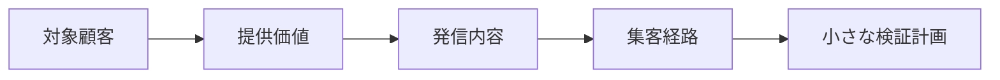

# 第 1 章　マーケティングとは何か

- 講座: 個人開発者のためのマーケティング（indie-marketing）
- 章 ID: `mkt-01`　動画 ID: `M01`
- 動画: 07:12（64 台詞）
- 要約: マーケティングを広告や SNS 投稿だけでなく「誰の・何の課題を・なぜ自分のサービスで解決するのか」から考える。価値の仮説を 1 文で書き、売上と利益の違い・少ないデータで断定しないことを、講座の約束として押さえる。

> このファイルは `bun scripts/build_materials.ts` が `content/` の台本から作ります。直すときは台本（`content/indie-marketing/` の TS）を直してください。

## 学習目標

- マーケティングを、広告や SNS 投稿より広い「価値を作り・伝え・届け・交換する活動」として説明できる
- 「誰の・何の課題を・なぜ自分のサービスで」の 3 つの問いに、自分のサービスで答えられる
- 価値の仮説を 1 文で書き、確かめる相手を決められる
- 売上と利益の違い、少ないデータで断定しないことを、数字の例で説明できる

## 前提知識

- 自分で作ったサービス（作りかけでもよい）か、作りたいサービスの案がある
- マーケティングの知識は要らない

根拠の種類の札: **研究・学術**（査読のある研究・メタ分析・学術書の定義）／**公式・法令・規格**（法律・官公庁・標準化団体・公式ガイドライン）／**実務の指針**（実務家や専門機関の一般的な指針。条件によって外れる）／**説明用の仮の例**（架空のサンプルで、実在のデータではない）

## 1. 教材本文

### [mkt-01-s01] 困りごと: 公開して告知したのに、使われない

根拠: 説明用の仮の例　動画の場面: 3

この講座では、架空の請求書アプリ「サンプル請求書」を例にします。個人で働く人（フリーランス）が、毎月の請求書を作るためのアプリです。

週末に作り込んで公開し、SNS で告知しました。投稿は 3,000 回表示され、登録は 12 人、2 週間後も使っていたのは 2 人でした（**仮の数字で、実在のデータではありません**）。

ここで「もっと告知する」「広告を出す」と考えたくなります。けれど、使い続ける人が少ない理由が「対象の人の課題と合っていない」ことなら、告知を増やしても、続く人はほとんど増えません。むしろ、合わない人を集めるほど、「使われない」数字が増えるだけです。

個人開発で起きやすいのは、「作れるもの」から始め、「誰の何の課題か」があとから来ることです。この章では、その順番を入れ替えます。

### [mkt-01-s02] マーケティングとは何か（定義）

根拠: 公式・法令・規格　動画の場面: 4, 5　出典: [American Marketing Association 2007 年採択・2017 年見直し](https://www.ama.org/the-definition-of-marketing-what-is-marketing/)、[American Marketing Association 2026（8 月 30 日）](https://www.ama.org/listings/2026/08/30/what-is-marketing/)、[公益社団法人 日本マーケティング協会 2024（1 月 25 日公表）](https://www.jma2-jp.org/home/news/916-marketing)、[宣伝会議 AdverTimes 2024](https://www.advertimes.com/20240131/article447566/)

米国マーケティング協会（AMA）の定義（訳）は「顧客・取引先・パートナー・社会全体にとって価値のある提供物を、創り・伝え・届け・交換するための活動、制度の集まり、プロセス」です。いまの文言は 2007 年に採択され、2017 年に研究者のパネルが見直して再承認しました。AMA は 2026 年 8 月に、定義を改めるかを検討する作業部会を作っており、2026 年 10 月 30 日の時点では新しい定義はまだ出ていません。

日本マーケティング協会も 2024 年 1 月 25 日に、1990 年の定義を 34 年ぶりに改めました。自分の言葉でまとめると、顧客や社会と一緒に価値をつくって広く届け、関わる人たちとの関係を育てながら、より豊かで続いていく社会をめざす、その構想と進め方です。注では、マーケティングの主体は企業に限らず、**個人や非営利組織もなりうる** と補っています。個人開発者も、マーケティングの主体です。

どちらの定義でも、**伝える（宣伝）は一部** で、中心にあるのは相手にとっての価値です。この講座では、マーケティングを次の流れの全体として扱います。

- **誰の・何の課題か** を決める（顧客理解・課題の検証・対象顧客の選び方）
- **価値と価格** を決め、伝わる言葉にする（ポジショニング・価値の伝え方・価格）
- **届け方・始め方・続け方** を作る（集客経路・利用開始・継続）
- **測って直す**（効果測定）

### [mkt-01-s03] 出発点の 3 つの問い: 誰の・何の課題を・なぜ自分のサービスで

根拠: 実務の指針・研究・学術　動画の場面: 6, 7　出典: [Clayton M. Christensen, Taddy Hall, Karen Dillon, David S. Duncan（Harvard Business Review） 2016（9 月号）](https://hbr.org/2016/09/know-your-customers-jobs-to-be-done)、[Steve Blank 2010](https://steveblank.com/2010/03/11/teaching-entrepreneurship-%E2%80%93-by-getting-out-of-the-building/)

**誰の**: 「みんな」や「忙しい人」ではなく、具体的な 1 人を思い浮かべます。職業・状況・使う場面まで書けると、言葉と届け方が決まります。最初は狭すぎるくらいでかまいません（対象顧客の選び方は第 3 章）。

**何の課題を**: クレイトン・クリステンセンらは Harvard Business Review の 2016 年 9 月号の記事で、製品を買うことを、ある状況で片付けたい「用事（ジョブ）」のために製品を雇うこと、と説明しました（ジョブ理論）。用事には機能の面だけでなく、社会的・感情的な面もあり、顧客の属性より、どんな状況にいるかが大事だとしています。サンプル請求書なら、用事は「月末に、請求書を間違えず早く送ること」です。

**なぜ自分のサービスで**: その用事は、今も何かの方法で片付いています。表計算のテンプレート、会計ソフトの請求書の機能、先月分のコピー、あるいは「何もしない」。これらが本当の競合です。乗り換えるには、代わりの手段より良い理由と、乗り換えやすさが要ります。

スティーブ・ブランクは、顧客と課題の仮説はオフィスの中では確かめられないので、外に出て顧客に会って確かめる（顧客開発）べきだ、と説いています。授業でも、学生をオフィスの外に出して、仮説を実際の顧客で確かめさせています。この章で書く答えは、すべて **確かめる前の仮説** です。

### [mkt-01-s04] 悪い例・良い例: トップの一文

根拠: 説明用の仮の例・公式・法令・規格　動画の場面: 8, 9　出典: [消費者庁 —](https://www.caa.go.jp/policies/policy/representation/fair_labeling/representation_regulation/misleading_representation/)、[消費者庁 —](https://www.caa.go.jp/policies/policy/representation/fair_labeling/representation_regulation/misleading_representation/not_demonstrated_ad)

サイトやストアの最初の一文は、3 つの問いへの答えがいちばん短く表れる場所です（図 mkt-01-f02）。

**悪い例**は「AI 搭載・テンプレート 50 種類・クラウド保存。多機能な、次世代の請求書アプリ」。機能の一覧で、誰のためのものか、どんな課題がどう変わるのかが分かりません。

**良い例**は、誰のため（個人で働くデザイナー・エンジニア）、課題と変化（毎月の請求書を、先月分から写して作る）、代わりの手段からの乗り換えやすさ（表計算の請求書も読み込める）を順に書きます。最初の行動も「登録なしで、見本を作ってみる」のように、試す手間を下げます。

効果を数字でうたう（「作業時間が 5 分の 1 に」など）なら、その根拠になる測った結果が要ります。品質などを実際より著しく良いと誤解させる表示は、景品表示法の優良誤認表示に当たるおそれがあり、わざとでなくても対象になります。消費者庁は表示の根拠になる資料を出すよう求めることができ、合理的な根拠を出せなければ不当な表示とみなされます（不実証広告規制）。根拠は、客観的に実証されていて、表示の中身と対応している必要があり、利用者のアンケートなら、偏りなく選んだ十分な人数が要るとされています（少ないデータで断定しない、とつながります）。根拠のない数字は書きません。個別の判断は、消費者庁の資料と専門家に確かめてください。

### [mkt-01-s05] 講座の約束 1: 売上と利益を分けて見る

根拠: 説明用の仮の例・公式・法令・規格　動画の場面: 10　出典: [国税庁 令和 8 年 4 月 1 日現在法令等](https://www.nta.go.jp/taxes/shiraberu/taxanswer/shotoku/1350.htm)、[国税庁 令和 8 年 4 月 1 日現在法令等](https://www.nta.go.jp/taxes/shiraberu/taxanswer/shotoku/1500.htm)

**売上**は、売った分の金額の合計です（年払い・未入金・返金があると、口座に入るお金の時期とはずれます）。**利益**は、売上から費用を引いた残りです。個人の事業の所得も、国税庁の説明では「総収入金額 − 必要経費」で計算します（副業の場合は、事業所得ではなく雑所得になることもありますが、計算の形は同じです）。

動画の例（仮の数字）: 月 500 円のプランを 30 人が使うと、売上は月 15,000 円。決済の手数料を例として 4.3% とすると 645 円、サーバーやドメインなどの費用を 3,000 円とすると、利益は 11,355 円です。手数料の率は決済サービスと支払い方法で違うので、自分が使うサービスの料金ページで確かめてください。

売上と利益を分けないと、次のような判断の誤りが起きます。

- **広告で売上を増やしたが、広告費のほうが大きく、利益は減った**
- **値下げで登録は増えたが、1 人あたりのサーバー費やサポートの手間で、利益が残らない**
- **アプリストア経由の課金で、手数料の分を見込んでいなかった**

さらに、税金（所得税・住民税など。条件によっては消費税も）と、自分の作業時間の値段（その時間で受託の仕事をしたらいくらになるか）も、判断の材料に入れます。税の個別の判断は、税理士や税務署に確かめてください。

### [mkt-01-s06] 講座の約束 2: 少ないデータで断定しない

根拠: 研究・学術・実務の指針　動画の場面: 11　出典: [NIST —](https://www.itl.nist.gov/div898/handbook/prc/section2/prc241.htm)、[CB Insights 2014（PDF は 2019）](https://www.cbinsights.com/reports/The-20-Reasons-Startups-Fail.pdf)、[CB Insights 2021](https://www.cbinsights.com/reports/CB-Insights_Top-Reasons-Startups-Fail.pdf)、[CB Insights 2026（3 月 5 日）](https://www.cbinsights.com/research/report/startup-failure-reasons-top/)

個人開発のサービスは、最初は人数が少なく、数字が偶然で大きく揺れます。10 人に有料プランを案内して 3 人が申し込んだとき、「申込率 30%」と言い切りたくなります。

割合の「本当の値がありそうな幅」は、信頼区間で表せます。NIST の統計の手引きが勧める Wilson のスコア区間で 95% 信頼区間を計算すると、10 人中 3 人ではおよそ **11%〜60%** です（図 mkt-01-f04。100 人中 30 人なら、およそ 22%〜40% まで狭まります）。この計算は連続修正なしの Wilson 法で、表計算や統計のツールによっては既定で連続修正が入り、10 人中 3 人で約 8%〜65% と少し広く出ます。また、案内した人が対象の層から偶然に選ばれていることが前提で、幅は偶然のぶれだけを表します。最初の利用者は自分から集まった人たちなので、実際の不確かさはもっと大きいと考えます。幅が広いうちは「効いた／効かない」を断定せず、次の小さな検証を決める材料として使います。

- **数字を見る前に**、期間・人数・判断のライン（例: 30 人に案内して 3 人以上なら続ける）を決めておく
- **1 つの数字だけで決めない**: 申込率と一緒に、使い続けている人数や、解約の理由も見る
- **成功談の数字をそのまま当てはめない**: 公開された成功談は、うまくいった例ばかりが目に入りやすい（生存者バイアス）

スタートアップの失敗の理由を集めた調査（CB Insights）でも、2014 年の版（101 件）では「市場のニーズがない」が 42% で最も多く、2021 年の版（111 件）でも 35% で 2 番目でした（1 位は資金が尽きた・調達できなかった 38%）。ただしこれは、創業者が自分で公開した事後の振り返りを集めて分類したもので、複数回答で、成功した会社との比較もありません。どの会社にも当てはまる割合や、失敗の原因を示すデータとしては使えません。版ごとに集め方も違うので、42% から 35% に「減った」とも言えません。最新の 2026 年版は、VC から出資を受けた会社 431 社を対象に、資金切れ（最後の引き金）に次いで「製品と市場が合わなかった」が多いとしていて、個人開発にそのまま当てはまる数字ではありません。

### [mkt-01-s07] 実践手順: 価値の仮説を 1 文で書く

根拠: 実務の指針・説明用の仮の例　動画の場面: 12, 13　出典: [Clayton M. Christensen, Taddy Hall, Karen Dillon, David S. Duncan（Harvard Business Review） 2016（9 月号）](https://hbr.org/2016/09/know-your-customers-jobs-to-be-done)

3 つの問いの答えを、次の型で 1 文にまとめます。

**［誰］は、［どんな場面］で、［何に］困っている。今は［代わりの手段］でしのいでいるが、［不満］がある。［自分のサービス］なら、［どう変わる］。**

1. **誰か（1 人）**: 職業・状況・使う場面まで（例: 個人で働くデザイナー。取引先は 3〜5 社）
2. **場面と課題**: いつ・どこで・何に困るか（例: 月末に請求書を作るたび、宛名や金額を直すのに手間取る）
3. **今の代わりの手段と不満**: 今どうしのいでいて、何が不満か（例: 表計算のテンプレートを毎回直していて、ときどき前の月の金額を消し忘れる）
4. **自分のサービスで変わること**: 機能の名前ではなく、変化で書く（例: 先月分から写して、日付と金額だけ直せばいい）

書いた 1 文は、確かめる前の仮説です。第 2 章で、この仮説を持って話を聞きに行きます。

### [mkt-01-s08] 振り返りの問い

根拠: 実務の指針　動画の場面: 14, 15

- 自分のサービスの「誰の」に、具体的な 1 人の顔が浮かびますか？
- その人は今、何でしのいでいますか？ その方法の不満は何ですか？
- 売上が 2 倍になったとき、費用はいくら増えますか？ 利益は増えますか？

最後の章（第 8 章）では、「対象顧客 → 提供価値 → 発信内容 → 集客経路 → 小さな検証計画」を 1 枚にまとめます。この章の価値の仮説は、その最初の 2 つの欄になります。

## 2. ナレーション台本

話者: 講師 = VOICEVOX:No.7、呼び込み = VOICEVOX:青山龍星。時刻は合成した音声の実測。

### 場面 1　オープニング

- `00:02` （呼び込み）第1章。マーケティングとは何か。
- `00:05` こんにちは。個人開発者のための、マーケティング講座へ、ようこそ。

### 場面 2　この章のゴール

- `00:11` この章のゴールは、三つです。
- `00:14` 一つ目。マーケティングを、広告や SNS の投稿より、広く説明できること。
- `00:20` 二つ目。誰の、何の課題を、なぜ自分のサービスで解決するのか、に答えられること。
- `00:27` 三つ目。それを、価値の仮説として、一文で書けることです。

### 場面 3　困りごと: 公開した。でも、使われない

- `00:33` この講座では、架空の請求書アプリ、サンプル請求書を例にします。個人で働く人が、請求書を作るためのアプリです。
- `00:42` 週末に作り込んで公開し、SNS で告知しました。投稿は、三千回表示されました。
- `00:49` 登録したのは、十二人。
- `00:51` 二週間後も使っていたのは、二人でした。
- `00:54` もっと告知すればいいのか、広告を出すべきか。その前に、考えることがあります。

### 場面 4　マーケティング = 宣伝、ではない

- `01:01` マーケティングというと、SNS の告知や、広告や、フォロワー集めを思い浮かべるかもしれません。
- `01:08` どれも、伝える手段です。
- `01:10` この講座では、もっと広く考えます。誰の、何の課題かを決める。
- `01:16` 価値と価格を決めて、伝わる言葉にする。届け方、使い始め方、続け方を作り、測って直す。
- `01:24` 宣伝は、その仕組みの一部です。課題が合っていなければ、告知を増やしても、続く人はほとんど増えません。

### 場面 5　マーケティングの定義

- `01:32` 定義も見ておきましょう。米国マーケティング協会の定義を、要約するとこうなります。
- `01:38` 顧客や取引先、社会にとって、価値のあるものを、作り、伝え、届け、交換する活動。
- `01:46` 日本マーケティング協会も、二〇二四年に定義を改め、顧客や社会と共に価値をつくり、広めることを掲げました。
- `01:54` どちらも、伝えることは一部で、中心にあるのは、相手にとっての価値です。

### 場面 6　出発点は、3 つの問い

- `02:01` では、何から考えるのか。出発点は、三つの問いです。
- `02:06` 誰の。みんな、ではなく、具体的な一人を思い浮かべます。
- `02:11` 何の課題を。その人が片付けたい用事と、そこでの困りごとです。
- `02:15` そして、なぜ自分のサービスで。その人は今も、何かの方法でしのいでいます。その代わりの手段より、良い理由は何か。

### 場面 7　競合は、同じジャンルのアプリだけではない

- `02:25` クリステンセンたちは、製品を買うことを、ある状況で片付けたい用事のために、製品を雇うこと、と説明しました。ジョブ理論と呼ばれます。
- `02:35` サンプル請求書なら、片付けたい用事は、月末に、請求書を間違えず、早く送ること。
- `02:42` その用事は、今も、表計算のテンプレートや、会計ソフトや、先月分のコピーで片付いています。これが本当の競合です。
- `02:52` だから、乗り換える理由が要ります。例えば、先月分から写せて、直すのは日付と金額だけ。これが、なぜ自分のサービスで、の答えの候補です。

### 場面 8　悪い例・良い例: トップの一文

- `03:04` では、サイトのトップの一文で、悪い例と良い例を比べます。
- `03:09` 悪い例は、機能の一覧です。AI 搭載、テンプレート五十種類。でも、誰のためのものかが分かりません。
- `03:17` どんな課題が、どう変わるのかも、書いていません。
- `03:21` 良い例は、まず、誰のためかを書きます。個人で働く、デザイナーやエンジニア向け。
- `03:27` 次に、課題と変化を一文で。毎月の請求書を、先月分から写して作る。
- `03:33` そして、今の代わりの手段から、乗り換えやすいこと。数字で効果をうたうなら、測った根拠が要ります。

### 場面 9　クイズ

- `03:42` ここでクイズです。フォロワーが増えていれば、マーケティングはうまくいっている。マルでしょうか、バツでしょうか。
- `03:52` 答えは、バツ。フォロワーは、届け方の一部です。
- `03:57` 見るべきは、対象の人の課題を解けているか。そして、使い続けてもらえているかです。

### 場面 10　講座の約束 1: 売上と利益を分ける

- `04:04` ここで、この講座の約束を二つ。一つ目は、売上と利益を分けることです。
- `04:10` 月五百円のプランを、三十人が使えば、売上は、一万五千円。
- `04:15` そこから、決済の手数料が引かれます。
- `04:18` サーバーやドメインの費用も、毎月かかります。
- `04:22` 残る利益は、一万一千三百五十五円。売上を増やす施策でも、費用がそれ以上に増えれば、利益は減ります。
- `04:30` しかも、ここには、税金と、自分の作業時間の値段が、入っていません。

### 場面 11　講座の約束 2: 少ないデータで断定しない

- `04:37` 二つ目の約束は、少ないデータで断定しないことです。十人に案内して、三人が申し込んだとします。申込率は三十パーセント、でしょうか。
- `04:48` 統計の方法で、本当の申込率がありそうな幅を計算すると、およそ十一パーセントから六十パーセント。とても広い幅です。
- `04:57` だから、三十パーセント効いた、と言い切らずに、幅で見て、次の小さな検証を決めます。測り方は、第八章で扱います。

### 場面 12　実践: 価値の仮説を 1 文で書く

- `05:07` 実践の手順です。三つの問いの答えを、価値の仮説として、一文にまとめます。
- `05:14` まず、誰か。例えば、個人で働くデザイナー。
- `05:18` 次に、場面と課題。月末に、請求書づくりで手間取っている。
- `05:23` 今の代わりの手段と、その不満。表計算を毎回直していて、ときどき間違える。
- `05:29` 最後に、自分のサービスで、どう変わるか。先月分から写して、日付と金額だけを直せばいい。
- `05:37` これはまだ、仮説です。本当にそうかは、次の章で、話を聞いて確かめます。

### 場面 13　演習

- `05:44` では、演習です。動画を止めて、五分だけ、取り組んでみてください。
- `05:50` 自分のサービスの、価値の仮説を、画面の型に沿って、一文で書きます。
- `05:55` 書けたら、話を聞いてみたい人を、三人思い浮かべましょう。手順と回答例は、講座サイトの実践課題にあります。
- （2.5 秒の間。考える時間）

### 場面 14　振り返り

- `06:07` 振り返りです。マーケティングは、価値を作り、伝え、届け、交換する仕組みの全体。宣伝は、その一部です。
- `06:16` 出発点は、誰の、何の課題を、なぜ自分のサービスで解決するのか、の三つの問い。
- `06:23` そして、売上と利益を分けて見ること。少ないデータで、断定しないこと。

### 場面 15　この講座の地図

- `06:30` この先の地図です。
- `06:31` 第二章と第三章で、顧客を理解し、課題を確かめ、対象の顧客と立ち位置を決めます。
- `06:38` 第四章と第五章は、価値の伝え方と、価格。ここで、売上と利益をもう一度、詳しく扱います。
- `06:47` 第六章と第七章で、集客の経路と、使い始めてから続けてもらうまでを作ります。
- `06:53` 最後の第八章で、対象顧客、提供価値、発信内容、集客経路、小さな検証計画を、一枚にまとめます。

### 場面 16　エンディング

- `07:03` 次の章では、価値の仮説を持って、話を聞きに行きましょう。

## 3. 絵コンテ

| # | 開始 | 秒数 | 図解の種類 | 根拠 | 表示内容（画面の文字） | 読み上げ（字幕と同じ） |
| --- | --- | --- | --- | --- | --- | --- |
| 1 | 00:00 | 11 秒 | タイトル |  | SECTION 1　はじめに／タイトル「マーケティングとは何か」／広告の前に、誰の・何の課題か | 第1章。マーケティングとは何か。 こんにちは。個人開発者のための、マーケティング講座へ、ようこそ。 |
| 2 | 00:11 | 22 秒 | ゴールの一覧 |  | 【この章のゴール】1. マーケティングを、広告や SNS より広く説明できる 2. 「誰の・何の課題を・なぜ自分で」に答えられる 3. 価値の仮説を、1 文で書ける | この章のゴールは、三つです。 一つ目。マーケティングを、広告や SNS の投稿より、広く説明できること。 二つ目。誰の、何の課題を、なぜ自分のサービスで解決するのか、に答えられること。 三つ目。それを、価値の仮説として、一文で書けることです。 |
| 3 | 00:32 | 29 秒 | 数字 | 説明用の仮の例 | 【困りごと: 公開した。でも、使われない】告知の投稿が表示された 3000 回 登録した 12 人 2 週間後も使っている 2 人／架空の請求書アプリ「サンプル請求書」の仮の数字。実在のデータではない | この講座では、架空の請求書アプリ、サンプル請求書を例にします。個人で働く人が、請求書を作るためのアプリです。 週末に作り込んで公開し、SNS で告知しました。投稿は、三千回表示されました。 登録したのは、十二人。 二週間後も使っていたのは、二人でした。 もっと告知すればいいのか、広告を出すべきか。その前に、考えることがあります。 |
| 4 | 01:01 | 31 秒 | 左右の比較 | 実務の指針 | 【マーケティング = 宣伝、ではない】左「よくある思い込み」SNS で告知する・広告を出す・フォロワーを増やす／右「この講座での範囲」誰の・何の課題かを決める・価値と価格を決め、伝わる言葉にする・届け方・始め方・続け方を作り、測って直す／結論: 宣伝は、仕組みの一部 | マーケティングというと、SNS の告知や、広告や、フォロワー集めを思い浮かべるかもしれません。 どれも、伝える手段です。 この講座では、もっと広く考えます。誰の、何の課題かを決める。 価値と価格を決めて、伝わる言葉にする。届け方、使い始め方、続け方を作り、測って直す。 宣伝は、その仕組みの一部です。課題が合っていなければ、告知を増やしても、続く人はほとんど増えません。 |
| 5 | 01:32 | 29 秒 | 大きな一文 | 公式・法令・規格 | 【マーケティングの定義】米国マーケティング協会（AMA）の定義を要約／相手にとって価値のあるものを、作り・伝え・届け・交換する活動／日本マーケティング協会も 2024 年に定義を改め、顧客や社会と共に価値をつくることを掲げた | 定義も見ておきましょう。米国マーケティング協会の定義を、要約するとこうなります。 顧客や取引先、社会にとって、価値のあるものを、作り、伝え、届け、交換する活動。 日本マーケティング協会も、二〇二四年に定義を改め、顧客や社会と共に価値をつくり、広めることを掲げました。 どちらも、伝えることは一部で、中心にあるのは、相手にとっての価値です。 |
| 6 | 02:00 | 24 秒 | 要点のカード | 実務の指針 | 【出発点は、3 つの問い】1. 誰の（具体的な 1 人を思い浮かべる）／2. 何の課題を（その人が片付けたい用事と、困りごと）／3. なぜ自分のサービスで（今の代わりの手段より、良い理由） | では、何から考えるのか。出発点は、三つの問いです。 誰の。みんな、ではなく、具体的な一人を思い浮かべます。 何の課題を。その人が片付けたい用事と、そこでの困りごとです。 そして、なぜ自分のサービスで。その人は今も、何かの方法でしのいでいます。その代わりの手段より、良い理由は何か。 |
| 7 | 02:25 | 39 秒 | 用語のカード | 実務の指針 | 【競合は、同じジャンルのアプリだけではない】片付けたい用事（Job）: 月末に、請求書を間違えず早く送りたい／今の代わりの手段（Alternatives）: 表計算のテンプレート・会計ソフト・先月分のコピー／乗り換える理由（Switch）: 先月分から写せて、直すのは日付と金額だけ | クリステンセンたちは、製品を買うことを、ある状況で片付けたい用事のために、製品を雇うこと、と説明しました。ジョブ理論と呼ばれます。 サンプル請求書なら、片付けたい用事は、月末に、請求書を間違えず、早く送ること。 その用事は、今も、表計算のテンプレートや、会計ソフトや、先月分のコピーで片付いています。これが本当の競合です。 だから、乗り換える理由が要ります。例えば、先月分から写せて、直すのは日付と金額だけ。これが、なぜ自分のサービスで、の答えの候補です。 |
| 8 | 03:03 | 38 秒 | 画面の比較（改善前・改善後） | 説明用の仮の例 | 【悪い例・良い例: トップの一文】悪い例「sample-invoice.example」: 1. 機能の一覧で、誰のためか分からない 2. どんな課題が、どう変わるかがない／良い例「sample-invoice.example」: 1. 誰のためかを最初に 2. 課題と変化を一文で 3. 代わりの手段からの乗り換えやすさ | では、サイトのトップの一文で、悪い例と良い例を比べます。 悪い例は、機能の一覧です。AI 搭載、テンプレート五十種類。でも、誰のためのものかが分かりません。 どんな課題が、どう変わるのかも、書いていません。 良い例は、まず、誰のためかを書きます。個人で働く、デザイナーやエンジニア向け。 次に、課題と変化を一文で。毎月の請求書を、先月分から写して作る。 そして、今の代わりの手段から、乗り換えやすいこと。数字で効果をうたうなら、測った根拠が要ります。 |
| 9 | 03:41 | 22 秒 | ○×クイズ |  | 【クイズ】Q1. フォロワーが増えていれば、マーケティングはうまくいっている？ → 答え ×: フォロワーは届け方の一部。対象の人の課題を解き、使い続けてもらえているかを見る | ここでクイズです。フォロワーが増えていれば、マーケティングはうまくいっている。マルでしょうか、バツでしょうか。 答えは、バツ。フォロワーは、届け方の一部です。 見るべきは、対象の人の課題を解けているか。そして、使い続けてもらえているかです。 |
| 10 | 04:03 | 34 秒 | 数字 | 説明用の仮の例 | 【講座の約束 1: 売上と利益を分ける】売上（月 500 円 × 30 人） 15000 円 −決済の手数料（例: 4.3%） 645 円 −サーバー・ドメインなど（例） 3000 円 ＝利益（もうけ） 11355 円／仮の数字。税金と、自分の作業時間の値段は入っていない | ここで、この講座の約束を二つ。一つ目は、売上と利益を分けることです。 月五百円のプランを、三十人が使えば、売上は、一万五千円。 そこから、決済の手数料が引かれます。 サーバーやドメインの費用も、毎月かかります。 残る利益は、一万一千三百五十五円。売上を増やす施策でも、費用がそれ以上に増えれば、利益は減ります。 しかも、ここには、税金と、自分の作業時間の値段が、入っていません。 |
| 11 | 04:37 | 30 秒 | 大きな一文 | 研究・学術 | 【講座の約束 2: 少ないデータで断定しない】10 人中 3 人が申し込んだ／本当の申込率は 約 11%〜60% のどこかにありそう／「30% 効いた」と言い切らず、幅で見る | 二つ目の約束は、少ないデータで断定しないことです。十人に案内して、三人が申し込んだとします。申込率は三十パーセント、でしょうか。 統計の方法で、本当の申込率がありそうな幅を計算すると、およそ十一パーセントから六十パーセント。とても広い幅です。 だから、三十パーセント効いた、と言い切らずに、幅で見て、次の小さな検証を決めます。測り方は、第八章で扱います。 |
| 12 | 05:07 | 36 秒 | 要点のカード | 実務の指針 | 【実践: 価値の仮説を 1 文で書く】1. 誰か（1 人）（例: 個人で働くデザイナー）／2. 場面と課題（月末に、請求書づくりで手間取る）／3. 今の代わりと不満（表計算を毎回直していて、間違える）／4. 自分のサービスで変わること（先月分から写し、日付と金額だけ直す） | 実践の手順です。三つの問いの答えを、価値の仮説として、一文にまとめます。 まず、誰か。例えば、個人で働くデザイナー。 次に、場面と課題。月末に、請求書づくりで手間取っている。 今の代わりの手段と、その不満。表計算を毎回直していて、ときどき間違える。 最後に、自分のサービスで、どう変わるか。先月分から写して、日付と金額だけを直せばいい。 これはまだ、仮説です。本当にそうかは、次の章で、話を聞いて確かめます。 |
| 13 | 05:43 | 23 秒 | 大きな一文 |  | 【演習】動画を止めて、5 分／自分のサービスの 価値の仮説 を 1 文で書く／［誰］は［場面］で［課題］。今は［代わり］で［不満］。［サービス］なら［変化］ | では、演習です。動画を止めて、五分だけ、取り組んでみてください。 自分のサービスの、価値の仮説を、画面の型に沿って、一文で書きます。 書けたら、話を聞いてみたい人を、三人思い浮かべましょう。手順と回答例は、講座サイトの実践課題にあります。（2.5 秒の間） |
| 14 | 06:07 | 23 秒 | まとめ |  | 【振り返り】1. マーケティングは、価値を作り・伝え・届け・交換する仕組み全体。宣伝はその一部 2. 出発点は、誰の・何の課題を・なぜ自分のサービスで 3. 売上と利益を分け、少ないデータで断定しない | 振り返りです。マーケティングは、価値を作り、伝え、届け、交換する仕組みの全体。宣伝は、その一部です。 出発点は、誰の、何の課題を、なぜ自分のサービスで解決するのか、の三つの問い。 そして、売上と利益を分けて見ること。少ないデータで、断定しないこと。 |
| 15 | 06:29 | 34 秒 | 時間の流れ |  | 【この講座の地図】第 2〜3 章　誰の・何の課題か（2 章） → 第 4〜5 章　伝えて選ばれる（2 章） → 第 6〜7 章　届けて続けてもらう（2 章） → 第 8 章　測って決める（1 章） | この先の地図です。 第二章と第三章で、顧客を理解し、課題を確かめ、対象の顧客と立ち位置を決めます。 第四章と第五章は、価値の伝え方と、価格。ここで、売上と利益をもう一度、詳しく扱います。 第六章と第七章で、集客の経路と、使い始めてから続けてもらうまでを作ります。 最後の第八章で、対象顧客、提供価値、発信内容、集客経路、小さな検証計画を、一枚にまとめます。 |
| 16 | 07:03 | 9 秒 | 次の章の予告 |  | 次: 第 2 章「顧客理解と課題の検証」 | 次の章では、価値の仮説を持って、話を聞きに行きましょう。 |

字幕: 全部の台詞を日本語字幕にする（講座サイトは動画の下の帯、`out/captioned/` の動画は焼き込み）。画面の文字は要点だけにし、説明はナレーションと教材本文で補う。

## 4. 図解・比較例

### [mkt-01-f01] 宣伝だけのマーケティングと、仕組み全体のマーケティング

この講座で扱う範囲。宣伝（伝える）は仕組みの一部（実務の指針）

| 段階 | 問い | この講座の章 |
| --- | --- | --- |
| 誰の・何の課題か | 誰が、どんな用事で困っていて、今どうしのいでいるか | 第 2〜3 章 |
| 価値と価格 | なぜ自分のサービスか。いくらなら払う価値があるか | 第 4〜5 章 |
| 届け方・始め方・続け方 | どこで出会い、どう使い始め、なぜ続けるか | 第 6〜7 章 |
| 測って直す | 何を・どれだけの人数で・いつ判断するか | 第 8 章 |

### [mkt-01-f02] トップの一文: 悪い例と良い例

動画の場面 8 の要点。中身は架空のサンプル請求書の仮の例（説明用の仮の例）

| 観点 | 悪い例 | 良い例 |
| --- | --- | --- |
| 誰のため | 書いていない | 個人で働くデザイナー・エンジニア向け |
| 課題と変化 | 機能の一覧（AI 搭載・テンプレート 50 種類） | 毎月の請求書を、先月分から写して作る |
| なぜ自分で | 「多機能」「次世代」 | 表計算の請求書も読み込める（乗り換えやすい） |
| 最初の行動 | 無料で始める（登録が要る） | 登録なしで、見本を作ってみる |

### [mkt-01-f03] 売上と利益（仮の数字）

月 500 円 × 30 人の例。手数料の率と費用は仮の値で、税金と作業時間の値段は入っていない（説明用の仮の例）

| 項目 | 金額（月） | メモ |
| --- | --- | --- |
| 売上 | 15,000 円 | 500 円 × 30 人 |
| 決済の手数料 | − 645 円 | 例として 4.3%。サービスと支払い方法で違う |
| サーバー・ドメインなど | − 3,000 円 | 例。人数が増えると増えることがある |
| 利益 | 11,355 円 | ここから税金。作業時間の値段も考える |

### [mkt-01-f04] 人数と、申込率の幅（95% 信頼区間・Wilson のスコア区間）

同じ 30% でも、人数が少ないほど幅が広い。計算は Wilson のスコア区間（研究・学術）

| 案内した人数 | 申し込んだ人数 | 見かけの申込率 | 95% 信頼区間（約） |
| --- | --- | --- | --- |
| 10 人 | 3 人 | 30% | 11%〜60% |
| 30 人 | 9 人 | 30% | 17%〜48% |
| 100 人 | 30 人 | 30% | 22%〜40% |
| 1,000 人 | 300 人 | 30% | 27%〜33% |

### [mkt-01-f05] 最後に 1 枚にまとめる流れ

第 8 章で完成させる 1 枚の計画。この章の価値の仮説が最初の 2 つになる（実務の指針）

流れ: 対象顧客 → 提供価値 → 発信内容 → 集客経路 → 小さな検証計画

## 5. 理解確認問題

### 問 1. この講座でのマーケティングの範囲として、いちばん近いものは？

1. SNS で告知し、フォロワーを増やすこと
2. 広告を出して、登録を増やすこと
3. 誰の何の課題かを決め、価値・価格・届け方・始め方・続け方を作り、測って直すこと
4. ロゴとサイトのデザインを整えること

答えと解説

**答え: 3. 誰の何の課題かを決め、価値・価格・届け方・始め方・続け方を作り、測って直すこと**

AMA の定義も、価値のあるものを「作り・伝え・届け・交換する」活動としている。宣伝（伝える）は、その一部。

### 問 2. サブスクの売上が月 15,000 円。決済の手数料と、サーバーなどの費用を引いた額は何と呼ぶ？

1. 売上
2. 利益（もうけ）
3. 客単価
4. 流入数

答えと解説

**答え: 2. 利益（もうけ）**

売上から費用（手数料・サーバー・ドメイン・広告など）を引いたものが利益。売上が伸びても、費用がそれ以上に増えれば利益は減る。税金や自分の時間の値段も忘れない。

### 問 3. 10 人に有料プランを案内し、3 人が申し込んだ。言えることは？

1. 申込率は 30% だと確定した
2. 100 人に案内すれば、必ず 30 人申し込む
3. 本当の申込率は、ざっくり 11%〜60% のどこかにありそうで、まだ幅が広い（95% 信頼区間）
4. 3 人しかいないので、何も分からない

答えと解説

**答え: 3. 本当の申込率は、ざっくり 11%〜60% のどこかにありそうで、まだ幅が広い（95% 信頼区間）**

Wilson の方法で 95% 信頼区間を計算すると、およそ 11%〜60%。少ない数で「30% 効いた」と言い切らず、判断に使える幅かどうかを見る。何も分からないわけではない。

## 6. 実践課題 [mkt-01-ex] 自分のサービスの価値の仮説を 1 文で書く

- ねらい: 自分のサービスについて、誰の・何の課題を・なぜ自分のサービスで解決するのかを、確かめられる形の 1 文の仮説にできる
- 目安の時間: 30〜40 分
- 出すもの: 価値の仮説の 1 文と、代わりの手段の一覧（不満つき）、確かめたい点 1 つ、話を聞きたい人 3 人の属性

### 手順

1. 自分のサービスを使ってほしい「具体的な 1 人」を書く（職業・状況・使う場面）。実在の知人を思い浮かべてもよいが、名前は書かない
2. その人が片付けたい用事と、そこでの困りごとを書く。「いつ・どこで・何に」まで
3. その人が今使っている代わりの手段を 2 つ以上書き、それぞれの不満を書く（「何もしない」も代わりの手段に入れる）
4. 自分のサービスで変わることを、機能の名前ではなく変化で書く
5. 1〜4 を、型（［誰］は［場面］で［課題］。今は［代わり］で［不満］。［サービス］なら［変化］）に沿って 1 文にする
6. この仮説が外れていたら困る点を 1 つ選び、確かめるために話を聞きたい人を 3 人（属性で）書く

### 回答例: サンプル請求書の価値の仮説（仮の例）

**誰**: 個人で働くデザイナー。取引先は 3〜5 社で、毎月ほぼ同じ内容の請求書を送る。

**用事と困りごと**: 月末に請求書を作るたび、宛名・日付・金額を直すのに手間取り、前の月の金額を消し忘れることがある。

**代わりの手段と不満**: 表計算のテンプレート（毎回直すのが面倒・間違える）／会計ソフトの請求書の機能（機能が多すぎて、請求書だけには大げさ・月額が高く感じる）／何もしない（取引先に催促される）。

**変化**: 先月分から写して、日付と金額だけを直せばいい。

**1 文**: 個人で働くデザイナーは、月末の請求書づくりで、宛名や金額を毎回直すのに手間取っている。今は表計算のテンプレートでしのいでいるが、ときどき前の月の金額を消し忘れる。サンプル請求書なら、先月分から写して、日付と金額だけ直せばいい。

**確かめたい点**: 「毎月ほぼ同じ内容の請求書を送る人」が、本当に多いのか（取引先ごとに内容が大きく変わるなら、価値が小さい）。

**話を聞きたい人**: 個人で働くデザイナー（取引先が少ない人）／個人で働くエンジニア（月額の契約が多い人）／個人で働く翻訳者（案件ごとに金額が変わる人。仮説が外れる側の確認）。

### 評価基準

| 観点 | できている | もう一歩 | やり直し |
| --- | --- | --- | --- |
| 誰の | 職業・状況・使う場面まで書かれ、具体的な 1 人が浮かぶ | 属性はあるが広い（「フリーランス」だけなど） | 「みんな」「忙しい人」など、誰でも当てはまる |
| 何の課題を | いつ・どこで・何に困るかが、相手の言葉で書けている | 課題はあるが、場面が曖昧 | 自分のサービスの機能の説明になっている |
| なぜ自分のサービスで | 代わりの手段を 2 つ以上挙げ、それより良い理由と乗り換えやすさが書けている | 代わりの手段が 1 つだけ、または「何もしない」を考えていない | 代わりの手段を書いていない（「競合はいない」） |
| 確かめ方 | 外れたら困る点と、話を聞く相手（外れる側も含む）が具体的 | 確かめたい点はあるが、相手が曖昧 | 仮説を確かめる予定がない |

## 7. 要点まとめと参考資料

### 要点

- マーケティングは、相手にとって価値のあるものを作り・伝え・届け・交換する活動（AMA の定義の要約）。広告や SNS 投稿は「伝える」の一部
- 出発点は、誰の・何の課題を・なぜ自分のサービスで、の 3 つの問い。競合は同じジャンルのアプリだけでなく、表計算や「何もしない」も含む
- 価値の仮説は、［誰］［場面］［課題］［代わりの手段と不満］［変化］の型で 1 文に書き、話を聞いて確かめる
- 売上と利益は違う。手数料・サーバー代・広告費・税金・自分の時間を引いて考える
- 少ないデータで断定しない。10 人中 3 人の申込率は、95% 信頼区間で約 11%〜60% の幅がある

### 参考資料

- American Marketing Association（2007 年採択・2017 年見直し）「Definitions of Marketing」 https://www.ama.org/the-definition-of-marketing-what-is-marketing/ （公式・法令・規格・2026-10-30 確認）
  - マーケティングの定義（顧客・取引先・パートナー・社会全体にとって価値のある提供物を、創り・伝え・届け・交換するための活動・制度の集まり・プロセス）。研究者のパネルが定期的に見直して再承認している
- American Marketing Association（2026（8 月 30 日））「What Is Marketing?（定義の見直しの作業部会の告知）」 https://www.ama.org/listings/2026/08/30/what-is-marketing/ （公式・法令・規格・2026-10-30 確認）
  - いまの文言は 2007 年採択、最後の正式な見直しは 2017 年。定義を改めるかを検討する作業部会（座長 Michael Haenlein）を作り、9 月 14 日まで意見を募集。2026-10-30 時点で新しい定義は未公表
- 公益社団法人 日本マーケティング協会（2024（1 月 25 日公表））「34 年振りにマーケティングの定義を刷新」 https://www.jma2-jp.org/home/news/916-marketing （公式・法令・規格・2026-10-30 確認）
  - 1990 年の旧定義から 34 年ぶりの改定。顧客や社会と共に価値を創造し、広く浸透させ、関係を育て、豊かで持続可能な社会をつくる構想とプロセスという趣旨。注で主体は企業に限らず個人や非営利組織もなりうるとする。公式ページはこちらの環境から開けず（403・Cloudflare のエラー）、中身は協会への取材記事で確認
- 宣伝会議 AdverTimes（2024）「日本マーケティング協会が 34 年ぶりにマーケティングの定義を刷新（協会トップへの取材）」 https://www.advertimes.com/20240131/article447566/ （実務の指針・2026-10-30 確認）
  - 業界紙の記事（二次資料）。新しい定義と 3 つの注、委員会で約半年かけて作った経緯。公式ページが開けなかったので中身の確認に使った
- Clayton M. Christensen, Taddy Hall, Karen Dillon, David S. Duncan（Harvard Business Review）（2016（9 月号））「Know Your Customers’ ‘Jobs to Be Done’」 https://hbr.org/2016/09/know-your-customers-jobs-to-be-done （実務の指針・2026-10-30 確認）
  - 製品を買うことは、ある状況で片付けたい用事（ジョブ）のために製品を雇うこと、という考え方。用事には社会的・感情的な面もあり、顧客の属性より状況が大事（研究にもとづく実務誌の記事。本文は有料で、要旨で確認）
- Steve Blank（2010）「Teaching Entrepreneurship – By Getting Out of the Building」 https://steveblank.com/2010/03/11/teaching-entrepreneurship-%E2%80%93-by-getting-out-of-the-building/ （実務の指針・2026-10-31 確認）
  - 顧客と課題の仮説は社内では確かめられないので、オフィスの外に出て実際の顧客で確かめる（顧客開発。著書『The Four Steps to the Epiphany』で示したモデル）。記事の言い方は「どんなビジネスモデルも（事業の計画ではない）、顧客との最初の出会いを生き延びない」
- 消費者庁（—）「優良誤認とは」 https://www.caa.go.jp/policies/policy/representation/fair_labeling/representation_regulation/misleading_representation/ （公式・法令・規格・2026-10-30 確認）
  - 品質・規格などを実際より（または競合より）著しく優良と示す表示は優良誤認表示（第 5 条第 1 号）。わざとでなくても対象。根拠資料を出せなければ不当表示とみなされる（不実証広告規制、第 7 条第 2 項）
- 消費者庁（—）「不実証広告規制」 https://www.caa.go.jp/policies/policy/representation/fair_labeling/representation_regulation/misleading_representation/not_demonstrated_ad （公式・法令・規格・2026-10-30 確認）
  - 消費者庁は期間を決めて合理的な根拠の資料を求められ、出せないと措置命令では不当表示とみなされる（課徴金では推定）。根拠は客観的に実証され、表示の中身と対応していること。アンケートなら無作為に選んだ十分な人数が要る
- 国税庁（令和 8 年 4 月 1 日現在法令等）「No.1350 事業所得の課税のしくみ（事業所得）」 https://www.nta.go.jp/taxes/shiraberu/taxanswer/shotoku/1350.htm （公式・法令・規格・2026-10-30 確認）
  - 事業所得の金額は「総収入金額 − 必要経費」で計算する
- 国税庁（令和 8 年 4 月 1 日現在法令等）「No.1500 雑所得」 https://www.nta.go.jp/taxes/shiraberu/taxanswer/shotoku/1500.htm （公式・法令・規格・2026-10-31 確認）
  - 副業などの「業務に係る雑所得」も、総収入金額 − 必要経費で計算する
- NIST（—）「NIST/SEMATECH e-Handbook of Statistical Methods 7.2.4.1 Confidence intervals（割合の信頼区間）」 https://www.itl.nist.gov/div898/handbook/prc/section2/prc241.htm （研究・学術・2026-10-30 確認）
  - 割合の信頼区間の求め方。正規近似は下限が負になりうるので劣るとし、Wilson のスコア区間を勧める（小見出しは Agresti and Coull で、今は Wilson 法と呼ぶと注記）
- CB Insights（2014（PDF は 2019））「The Top 20 Reasons Startups Fail」 https://www.cbinsights.com/reports/The-20-Reasons-Startups-Fail.pdf （研究・学術・2026-10-30 確認）
  - 創業者が公開した事後の振り返り 101 件を分類。市場のニーズがない 42%、資金が尽きた 29%、チームが合っていない 23%。複数回答で、合計は 100% を超える
- CB Insights（2021）「The Top 12 Reasons Startups Fail」 https://www.cbinsights.com/reports/CB-Insights_Top-Reasons-Startups-Fail.pdf （研究・学術・2026-10-30 確認）
  - 2018 年以降の事後の振り返り 111 件を分類。資金が尽きた・調達できなかった 38%、市場のニーズがない 35%。自己申告・複数回答・成功例との比較なし。商用の調査で査読なし
- CB Insights（2026（3 月 5 日））「The top 9 reasons startups fail」 https://www.cbinsights.com/research/report/startup-failure-reasons-top/ （研究・学術・2026-10-30 確認）
  - 2023 年以降に事業を終えた VC 出資の 431 社（理由が分かった 385 社）。資金切れ 70%（最後の引き金で根本の原因ではないと注記）、製品と市場が合わない 43% など。複数を数える

## 8. 学習画面の右側の AI チャットに聞ける質問例

（チャットはまだ作っていません。質問ごとに、答えの根拠にする節 ID を付けています）

1. 自分のアプリは「誰でも使える」のが売りです。それでも対象の人を 1 人に絞ったほうがいいのはなぜですか？　→ 参照: `mkt-01-s03`、`mkt-01-s07`
2. サイトのトップの一文で、効果を数字で書きたいです。どんな根拠があれば書いてよいですか？　→ 参照: `mkt-01-s04`
3. 有料プランの申込が 20 人中 4 人でした。この数字から、何が言えて、何が言えませんか？　→ 参照: `mkt-01-s06`
