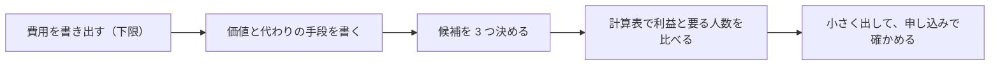

# 第 5 章　価格と、売上と利益

- 講座: 個人開発者のためのマーケティング（indie-marketing）
- 章 ID: `mkt-05`　動画 ID: `M05`
- 動画: 07:24（64 台詞）
- 要約: 価格を「安いほど使われる」で決めず、相手にとっての価値（上限の目安）・代わりの手段（比べる相手）・費用（下限）の 3 つから幅を考える。売上から決済やアプリストアの手数料・サーバー代を引いて利益を計算し、値下げの前に「同じ利益に要る人数」を確かめる。税は所得の計算の形だけ押さえ、個別の判断は専門家に。

> このファイルは `bun scripts/build_materials.ts` が `content/` の台本から作ります。直すときは台本（`content/indie-marketing/` の TS）を直してください。

## 学習目標

- 相手にとっての価値（上限の目安）・代わりの手段（比べる相手）・費用（下限）の 3 つから、価格の幅を考えられる
- 4 つの質問（van Westendorp の方法）で値段の感じ方を聞き、その限界を説明できる
- 決済・アプリストアの手数料とサーバー代を引いて、価格の候補ごとの利益と、同じ利益に要る人数を計算できる
- 無料と有料の境目を、価値を感じるところと、続けて使う理由で決められる

## 前提知識

- 第 1〜4 章（価値の仮説・話を聞いたメモ・ポジショニング・伝える言葉）
- 表計算ソフトで、足し算と掛け算ができる

根拠の種類の札: **研究・学術**（査読のある研究・メタ分析・学術書の定義）／**公式・法令・規格**（法律・官公庁・標準化団体・公式ガイドライン）／**実務の指針**（実務家や専門機関の一般的な指針。条件によって外れる）／**説明用の仮の例**（架空のサンプルで、実在のデータではない）

## 1. 教材本文

### [mkt-05-s01] 困りごと: 値下げしたら、利益が減った

根拠: 説明用の仮の例　動画の場面: 3

サンプル請求書は、月 980 円で 20 人が使っていました。「安くすれば、もっと使われる」と考えて月 500 円に下げると、使う人は 30 人（1.5 倍）に増えました。けれど、利益は月 15,757 円から 11,355 円に、約 3 割減りました（**仮の数字**。手数料 4.3%・サーバーなど月 3,000 円で計算した税の前の額）。

理由は、1 人あたりに残る額が減ったからです。手数料を引くと、980 円の 1 人からは約 938 円、500 円の 1 人からは約 478 円が残ります。決まった費用（月 3,000 円）を引いたうえで前と同じ利益を残すには、500 円では 40 人、つまり値下げの前の 2 倍の人数が要ります（図 mkt-05-f02）。

しかも、この計算には、人数に比例して増える費用（問い合わせに答える時間・メールの送信・保存の容量など）が入っていません。それがあれば、値下げで必要になる人数はもっと増えます。値下げで確実に減るのは 1 人あたりに残る額で、人数がどれだけ増えるかは分かりません。確かめる前に決めると、利益が減るだけの打ち手になりがちです。

### [mkt-05-s02] 価格の幅を 3 つで考える（費用からではなく）

根拠: 実務の指針・説明用の仮の例　動画の場面: 4, 5　出典: [Clayton M. Christensen, Taddy Hall, Karen Dillon, David S. Duncan（Harvard Business Review） 2016（9 月号）](https://hbr.org/2016/09/know-your-customers-jobs-to-be-done)

価格は、1 つの正解を計算で出すものではなく、3 つの物差しで幅を決め、その中で選ぶものとして扱います（図 mkt-05-f01）。これは実務でよく使われる考え方で、どの値段が当たるかを約束するものではありません。

- **相手にとっての価値（上限の目安）**: サービスで減る手間・ミス・心配を、相手の側の値段にしてみる。サンプル請求書なら、月末の 30 分の作業が 5 分になり、時給を 3,000 円とすると月 1,250 円分（仮の数字。第 2 章の聞き取りの「1 回 20〜40 分」と、第 4 章の記録が材料）。相手が得をする余地を残すため、価値いっぱいの値段は付けない
- **代わりの手段（比べる相手）**: 相手は値段を、今の代わりの手段と比べます。表計算は 0 円でも毎回の手間と消し忘れがあり、会計ソフトは機能が多いぶん月額が高いと感じてやめた人もいました（第 2 章）。「何もしない」も代わりの手段です
- **費用（下限）**: 1 人あたりの手数料、決まった費用（サーバー・ドメインなど）、問い合わせに答える時間。下回ると、売るほど損をします

**よくある失敗は、費用だけで決めること**です。サーバー代を人数で割って少し足すと、値段は安くなり、相手にとっての価値が値段に表れません。費用は「これより下げてはいけない線」として確かめ、値段は価値と代わりの手段で決めます。

**使い分け**: 代わりの手段との違いが小さく、相場がはっきりしている（例: 同じような機能のアプリが多い）なら、値段は相場に近づきます。違い（第 3 章のポジショニングの独自の特徴）がはっきりしているほど、価値の側に寄せられます。

### [mkt-05-s03] 価格の聞き方: 4 つの質問と、その限界

根拠: 実務の指針・研究・学術　動画の場面: 6　出典: [Peter van Westendorp（Proceedings of the 29th ESOMAR Congress） 1976](https://cran.r-project.org/web/packages/pricesensitivitymeter/refman/pricesensitivitymeter.html)、[Jerrod M. Penn, Wuyang Hu（American Journal of Agricultural Economics） 2018](https://repository.lsu.edu/ag_econ_pubs/150)

値段の感じ方は、話を聞くときに 4 つの質問で確かめられます。Peter van Westendorp が 1976 年に ESOMAR の大会で発表した、Price Sensitivity Meter（PSM）と呼ばれる方法です（原典は開けなかったため、書誌と手順は実装パッケージの説明で確かめました）。

1. 高すぎて、買うことを考えないのは、いくらから？
2. 高いけれど、考えてもよいと感じ始めるのは、いくらから？
3. お得だと感じるのは、いくらまで？
4. 安すぎて、品質が不安になるのは、いくらから下？

答えを人数分集めて、値段ごとの割合の線を重ねると、線が交わるところから「受け入れられやすい値段の幅」の目安が見えます。ただし、限界がはっきりしています。

- **何人が買うかは分からない**: 値段の感じ方の幅を見る方法で、その値段での申し込みの数（需要）は出ません（買う気持ちを足して聞く拡張もありますが、仮定が増えます）
- **仮の質問への答え**: 「いくらなら払うか」という仮の質問への答えと、実際の行動のずれ（仮想バイアス）は、環境・マーケティング・交通・医療などの分野で研究が続いていて、131 の研究を集めたメタ分析もあります（Penn & Hu 2018）。第 2 章の「月 500 円なら払うと思う」が、数に入れない未来の意見だったのと同じです
- **人数が少ない**: 5 人や 10 人の答えでは線がでこぼこで、幅も大きく揺れます（第 1 章）

なので、4 つの質問は「値段の候補の幅を絞る材料」に使い、決めるのは実際の申し込み（事前の申し込み・有料の試用・案内した人のうち何人が払ったか）で確かめます。聞くなら、サービスを実際に使ってもらったあとに、今の代わりの手段にいくら・何分かけているか（過去の事実）と一緒に聞きます。

### [mkt-05-s04] 利益の計算表: 決済とアプリストアの手数料

根拠: 説明用の仮の例・公式・法令・規格　動画の場面: 7, 8　出典: [Stripe 2026（10 月 30 日に確認）](https://stripe.com/jp/pricing)、[Apple 2025（12 月 17 日発表）](https://developer.apple.com/support/app-distribution-in-japan/)、[Apple Newsroom 2025（12 月 17 日）](https://www.apple.com/newsroom/2025/12/apple-announces-changes-to-ios-in-japan/)、[Apple —](https://developer.apple.com/app-store/small-business-program/)、[公正取引委員会 令和 6 年法律第 58 号（2025 年 12 月 18 日全面施行）](https://www.jftc.go.jp/msca/)

利益 ＝ 売上 − 手数料 − 費用 です（図 mkt-05-f02）。手数料の率は、使う決済サービスとストア、支払い方法、条件で変わります。2026 年 10 月 30 日に確かめた例を挙げますが、使う前に必ず最新のページを開いてください。

**Web で決済する場合（Stripe の日本の料金ページの例）**: カード決済は、決済が成功するごとに 3.6%（通貨の換算が要る場合はさらに 2%）。定期の請求の仕組み（Stripe Billing）を使うと、その取引額の 0.7% がかかります。標準の料金体系に初期費用と月額料金はなく、返金しても元の決済手数料は戻りません。月 500 円 × 30 人なら 540 円 ＋ 105 円、月 980 円 × 20 人なら 706 円 ＋ 137 円です（1 円未満を四捨五入した概算。実際の請求は決済ごとに計算されるので、少しずれます）。

**アプリで売る場合（日本の App Store・2025 年 12 月から）**: 日本では、スマホソフトウェア競争促進法が 2025 年 12 月 18 日に全面施行され、Apple は 2025 年 12 月 17 日に、iOS 26.2 から日本での条件を変えると発表しました。2026 年 10 月 30 日に Apple の日本向けのページで確かめた手数料は次のとおりです（図 mkt-05-f03）。

- **App Store の手数料**: 21%。小規模事業者プログラム（App Store Small Business Program）などの参加者と、2 年目以降の自動更新の定期購読は 10%
- **Apple の決済（アプリ内課金）の手数料**: 上とは別に 5%。小規模事業者がアプリ内課金で売ると、合わせて 15%
- **アプリから Web の購入ページへ案内する場合**: 案内をタップしてから 7 日以内の購入に 15%（小規模事業者などは 10%）。そこに、自分の決済サービスの手数料が加わる
- **App Store 以外のストアで配信する場合**: Apple に、売上の 5%（Core Technology Commission）。そのストア自体の条件は、ストアごとに確かめる

小規模事業者プログラムは、前の暦年と今の年の収益（関連するアカウントを合わせ、手数料などを引いた額）が 100 万ドル以下の開発者が対象で、自分で申し込んで承認を受ける必要があります。世界共通の説明のページでは率が 15% と書かれていて、日本の率は日本向けのページで確かめます。Google Play など、ほかのストアの条件も、それぞれのページで確かめてください。

動画の例（月 980 円 × 20 人・仮の数字）では、Web で決済すると手数料は約 843 円、小規模事業者がアプリ内課金で売ると 2,940 円、プログラムに入っていないと 5,096 円です。消費税などの税は、この概算に入れていません。

### [mkt-05-s05] 税と、自分の作業時間

根拠: 公式・法令・規格・実務の指針　動画の場面: 9　出典: [国税庁 令和 8 年 4 月 1 日現在法令等](https://www.nta.go.jp/taxes/shiraberu/taxanswer/shotoku/1350.htm)、[国税庁 令和 8 年 4 月 1 日現在法令等](https://www.nta.go.jp/taxes/shiraberu/taxanswer/shotoku/1500.htm)

計算表の利益は、税の前の額です。ここでは、国税庁の説明（令和 8 年 4 月 1 日現在の法令等）の範囲で、計算の形だけを押さえます。

- **事業所得**: 個人の事業の所得は「総収入金額 − 必要経費」で計算する。必要経費は、収入を得るために直接かかった費用で、生活費と混ざった支出は原則として経費にならないが、事業で使った部分をはっきり分けられれば、その部分は経費にできる
- **雑所得**: 副業の収入のうち、営利を目的とした継続的なものは「業務に係る雑所得」になり、これも「総収入金額 − 必要経費」で計算する

事業所得になるか雑所得になるか、何が経費になるかは、事情によって変わります。**個別の判断は、税理士や税務署に確かめてください**。どちらでも、手数料・サーバー代・ドメイン代の明細と、売上の記録を残しておくと、計算と相談がしやすくなります。消費税などほかの税も、条件によってかかります。

もう 1 つ、利益に入っていないのが、自分の作業時間の値段です。問い合わせに答える時間や、月末の作業の時間を、時給（その時間で受託の仕事をしたらいくらか）で見ておくと、「利益は出ているが、時給にすると割に合わない」状態に気づけます。

### [mkt-05-s06] 良い例と悪い例: 料金のページと、無料と有料の境目

根拠: 説明用の仮の例・公式・法令・規格　動画の場面: 10, 11　出典: [消費者庁 —](https://www.caa.go.jp/policies/policy/representation/fair_labeling/representation_regulation/advantageous_misidentification)

**悪い例**: 費用から決めた安い値段（ライト 300 円・スタンダード 500 円・プロ 800 円）が並ぶだけで、プランの違いが「詳細をご覧ください」になっている。違いが分からないと、選べません。さらに「今だけ全プラン半額！」と、何の半額かが分からない表示。基準の価格をはっきり示さずに半額をうたい、実際は半額に当たらなかった事例を、消費者庁は有利誤認の例に挙げています（一般的な説明。個別の判断は専門家に）。

**良い例**: 見出しで価値を言い（毎月の請求書を、先月分から写して作る）、プランは 2 つ。無料は「請求書は月 2 通まで」、有料の月 980 円は「通数の上限なし・宛名と品目を保存」。年払いは 9,800 円で、「月払い 12 か月分（11,760 円）より 1,960 円安い」と、実際に売っている月払いの値段と比べて書きます。最初の行動は「無料で 2 通作ってみる」。

**無料と有料の境目の決め方**:

- **無料は、価値を感じるところまで**: サンプル請求書なら「先月分から写して、1 通送る」ところ。価値を感じる前に払わせると、試す人が減ります
- **有料は、続けて使う理由に値段を付ける**: 取引先が 3〜5 社ある人は、毎月 2 通では足りません。全部を任せたくなったときに払う形にします
- **広すぎる無料に注意**: 対象の人が無料の範囲で全部済ませられるなら、払う理由がありません。逆に狭すぎると、価値を感じる前に帰られます。境目は、話を聞いた相手の使い方（月に何通か）で決め、申し込みの数で直します

値段は、あとから変えられます。ただ、使っている人への値上げには、前もって知らせて理由を説明する手間がかかります（アプリストアの定期購読なら、ストアのきまりも確かめます）。安くしすぎずに始め、候補の中で確かめるほうが、あとが楽です。

### [mkt-05-s07] 実践手順: 価格の候補を 3 つ比べる

根拠: 実務の指針・説明用の仮の例　動画の場面: 12, 13

表計算を 1 枚用意して進めます（図 mkt-05-f04）。

1. **費用を全部書き出す**: 決まった額（サーバー・ドメイン・ツール）、人数に比例する額（決済の手数料・メールの送信・保存の容量）、時間（問い合わせ・サポート）に分ける。手数料の率は、使うサービスとストアの最新のページで、確かめた日と一緒に書く
2. **価値と代わりの手段を書く**: 自分のサービスで減る時間（第 2 章の聞き取り・第 4 章の記録）と、代わりの手段の手間と値段
3. **候補を 3 つ決める**: 費用の下限より上、価値の上限より下で、代わりの手段と比べて選ばれそうな値段を 3 つ（例: 月 500 円・980 円・1,480 円）
4. **計算表で比べる**: 候補ごとに売上・手数料・費用・利益を並べ、今の利益（または目標の利益）と同じ利益に要る人数を出す。人数は仮の数字なので、「要る人数を集められそうか」で比べる
5. **小さく出して確かめる**: 最初に試す値段を 1 つ選び、期間・案内する人数・判断のライン（例: 2 か月で 14 人中 3 人以上が申し込んだら続ける）を先に決める。数が少ないうちは幅で見る（第 1 章・第 8 章）

### [mkt-05-s08] 振り返りの問い

根拠: 実務の指針　動画の場面: 14, 15

- 自分のサービスの値段は、費用・価値・代わりの手段のどれから決めましたか？
- 今の値段で、1 人あたりにいくら残りますか？ 半額にしたら、同じ利益に何人要りますか？
- 手数料の率を、いつ、どのページで確かめましたか？ アプリなら、どの売り方と条件ですか？
- 無料の範囲で、対象の人は価値を感じられますか？ 全部を済ませてしまいませんか？

第 8 章の 1 枚の計画では、この章の価格と利益の計算が「小さな検証計画」の判断のラインになります。

## 2. ナレーション台本

話者: 講師 = VOICEVOX:No.7、呼び込み = VOICEVOX:青山龍星。時刻は合成した音声の実測。

### 場面 1　オープニング

- `00:02` （呼び込み）第5章。価格と、売上と利益。
- `00:05` 伝えた価値に、いくらの値段を付けるか。利益まで計算して、決めます。

### 場面 2　この章のゴール

- `00:12` この章のゴールは、三つです。
- `00:14` 一つ目。価値と、代わりの手段と、費用の三つから、価格の幅を考えられること。
- `00:21` 二つ目。手数料と費用を引いて、利益を計算できること。
- `00:25` 三つ目。無料と有料の境目を決めて、価格の候補を比べられることです。

### 場面 3　困りごと: 値下げしたら、利益が減った

- `00:32` サンプル請求書は、月九百八十円で、二十人が使っていました。安くすれば、もっと使われる。そう考えて、値下げしました。
- `00:42` 値下げの前の利益は、手数料とサーバー代を引いて、一万五千七百五十七円。
- `00:48` 月五百円に下げると、使う人は三十人に増えました。でも、利益は、一万一千三百五十五円に減りました。
- `00:56` 五百円で、前と同じ利益を残すには、四十人。値下げの前の、二倍の人数が要ります。

### 場面 4　価格の幅は、3 つで考える

- `01:05` 価格は、三つの物差しで、幅を考えます。
- `01:08` 上限の目安は、相手にとっての価値。月末の三十分が五分になるなら、時給三千円として、月に千二百五十円分です。
- `01:18` 比べる相手は、代わりの手段です。表計算は無料でも手間がかかり、会計ソフトは、月額が高いと感じる人もいます。
- `01:26` 下限は、費用です。手数料、サーバー代、問い合わせに答える時間。これを下回ると、売るほど損をします。
- `01:35` 値段は、この下限と上限のあいだで、代わりの手段と比べて、選ばれるところに置きます。

### 場面 5　悪い決め方・良い決め方

- `01:42` 値段の決め方を、二つ比べます。
- `01:45` よくあるのは、費用から決める方法です。サーバー代を人数で割り、少し足して、安ければ選ばれる、と考えます。
- `01:54` でも、これでは、相手にとっての価値が、値段に表れません。
- `01:59` 良い決め方は、減る手間とミスを、相手の言葉で確かめ、代わりの手段と比べます。
- `02:05` そして、候補を三つ出して、それぞれの利益を計算します。
- `02:09` 費用は、下限として確かめるもの。値段は、相手にとっての価値で決めます。

### 場面 6　価格の聞き方: 4 つの質問

- `02:16` 値段の感じ方は、話を聞くときに、四つの質問で確かめられます。一九七六年に発表された、ヴァン・ウェステンドルプの方法です。
- `02:26` 高すぎて、買わないのは、いくらから。
- `02:29` 高いけれど、考えてもよいのは、いくらから。
- `02:33` お得だと感じるのは、いくらまで。
- `02:36` 安すぎて、品質が不安になるのは、いくらから下か。答えを重ねると、受け入れられやすい値段の幅が、ざっくり見えます。
- `02:44` ただし、これは仮の質問への答えで、何人が買うかは分かりません。最後は、実際の申し込みで確かめます。

### 場面 7　売上・費用・利益の計算表

- `02:53` 計算表で、二つの値段を比べます。人数と値段は、仮の数字です。
- `02:59` 売上は、値段かける人数。五百円の三十人で一万五千円、九百八十円の二十人で、一万九千六百円です。
- `03:09` 決済の手数料は、例えば Stripe の日本の料金ページで、カード払いが三・六パーセントでした。
- `03:15` 定期の請求の仕組みを使うと、さらに〇・七パーセントかかります。
- `03:20` サーバーやドメインの費用は、人数が少ないうちは、ほぼ同じです。
- `03:25` 残る利益は、一万一千三百五十五円と、一万五千七百五十七円。人数が少ないほうが、利益は多くなりました。

### 場面 8　アプリで売るときの手数料（日本）

- `03:35` アプリで売るなら、ストアの手数料も入れます。日本の App Store は、二〇二五年十二月に、条件が変わりました。
- `03:44` 比べる基準は、Web で決済したときの、四・三パーセントです。
- `03:48` アプリの中で Apple の決済を使うと、小規模事業者のプログラムに入っていれば、十パーセントに、決済の五パーセントが加わります。
- `03:57` 入っていなければ、二十一パーセントに、五パーセントです。
- `04:02` アプリから Web の購入ページへ案内すると、小規模なら十パーセントに、自分の決済の手数料が加わります。
- `04:09` 条件は、これからも変わりえます。売る前に、最新のページで確かめてください。

### 場面 9　利益の先に、税と自分の時間

- `04:16` 計算表の利益は、まだ、税の前です。
- `04:20` 国税庁の説明では、個人の事業の所得は、総収入金額から、必要経費を引いて計算します。
- `04:27` 副業の収入は、雑所得になることもありますが、計算の形は同じです。手数料やサーバー代の記録を、残しておきましょう。
- `04:36` 税の個別の判断は、税理士や税務署に確かめてください。それから、自分の作業時間の値段も、忘れずに。

### 場面 10　悪い例・良い例: 料金のページ

- `04:45` 料金のページで、悪い例と良い例を比べます。どちらも、架空のサンプル請求書です。
- `04:52` 悪い例は、費用から決めた安い値段が、三つ並ぶだけ。違いが分からないので、選べません。
- `04:59` 今だけ半額、と書くなら、本当に半額でなければいけません。基準の値段があいまいなら、有利誤認のおそれがあります。
- `05:07` 良い例は、無料で使える範囲を、価値を感じるところまでにします。まず二通、無料で作れます。
- `05:15` 有料は、続けて使う理由に、値段を付けます。通数の上限なしと、宛名と品目の保存です。
- `05:22` 年払いの安さは、実際の月払いの値段と比べて書きます。

### 場面 11　クイズ

- `05:27` ここでクイズです。サーバー代を人数で割って、少し足せば、値段は決まる。マルでしょうか、バツでしょうか。
- `05:39` 答えは、バツ。費用は、下回ってはいけない下限です。
- `05:43` 値段は、相手にとっての価値と、代わりの手段で決めて、利益が残るかを、計算で確かめます。

### 場面 12　実践: 価格の候補を 3 つ比べる

- `05:51` 実践の手順です。表計算を一枚、用意します。
- `05:55` まず、費用を全部書き出します。手数料、サーバー、ドメイン、問い合わせに答える時間。
- `06:02` 次に、自分のサービスで減る時間と、代わりの手段の、手間と値段を書きます。
- `06:08` 価格の候補を、三つ決めます。例えば、五百円、九百八十円、千四百八十円。
- `06:16` 計算表で、候補ごとに、利益と、同じ利益に要る人数を出します。そして、小さく出して、申し込みで確かめます。

### 場面 13　演習

- `06:26` では、演習です。動画を止めて、五分だけ、取り組んでみてください。
- `06:32` 自分のサービスの、利益の計算表を作ります。価格の候補を三つ、横に並べます。
- `06:38` 手数料の率は、自分が使う決済サービスやストアの、最新のページで確かめましょう。回答例は、講座サイトにあります。
- （2.5 秒の間。考える時間）

### 場面 14　振り返り

- `06:51` 振り返りです。価格の幅は、価値を上限、費用を下限にして、代わりの手段と比べて考えます。
- `06:58` 売上から、手数料と費用を引いて、利益で比べます。税の個別の判断は、専門家に。
- `07:05` 値下げの前に、同じ利益に要る人数を計算する。値段は変えられますが、値上げには説明が要るので、安くしすぎずに始めます。

### 場面 15　エンディング

- `07:15` 次の章では、この価値と値段を、届けたい人に届ける経路を選びます。

## 3. 絵コンテ

| # | 開始 | 秒数 | 図解の種類 | 根拠 | 表示内容（画面の文字） | 読み上げ（字幕と同じ） |
| --- | --- | --- | --- | --- | --- | --- |
| 1 | 00:00 | 12 秒 | タイトル |  | SECTION 3　伝えて選ばれる／タイトル「価格と、売上と利益」／安くする前に、利益が残るか | 第5章。価格と、売上と利益。 伝えた価値に、いくらの値段を付けるか。利益まで計算して、決めます。 |
| 2 | 00:11 | 20 秒 | ゴールの一覧 |  | 【この章のゴール】1. 価値・代わりの手段・費用から、価格の幅を考えられる 2. 手数料と費用を引いて、利益を計算できる 3. 無料と有料の境目を決め、価格の候補を比べられる | この章のゴールは、三つです。 一つ目。価値と、代わりの手段と、費用の三つから、価格の幅を考えられること。 二つ目。手数料と費用を引いて、利益を計算できること。 三つ目。無料と有料の境目を決めて、価格の候補を比べられることです。 |
| 3 | 00:31 | 33 秒 | 数字 | 説明用の仮の例 | 【困りごと: 値下げしたら、利益が減った】月 980 円 × 20 人の利益 15757 円 月 500 円に下げて 30 人の利益 11355 円 500 円で、前と同じ利益に要る人数 40 人／仮の数字。手数料 4.3%・サーバーなど月 3,000 円で計算。税の前 | サンプル請求書は、月九百八十円で、二十人が使っていました。安くすれば、もっと使われる。そう考えて、値下げしました。 値下げの前の利益は、手数料とサーバー代を引いて、一万五千七百五十七円。 月五百円に下げると、使う人は三十人に増えました。でも、利益は、一万一千三百五十五円に減りました。 五百円で、前と同じ利益を残すには、四十人。値下げの前の、二倍の人数が要ります。 |
| 4 | 01:04 | 38 秒 | 用語のカード | 実務の指針 | 【価格の幅は、3 つで考える】上限の目安（価値）: 減る手間とミス。例: 月末の 30 分が 5 分に（仮）／比べる相手（代わりの手段）: 表計算は 0 円でも手間。会計ソフトは月額が高めと感じる人も／下限（費用）: 手数料・サーバー代・問い合わせに答える時間 | 価格は、三つの物差しで、幅を考えます。 上限の目安は、相手にとっての価値。月末の三十分が五分になるなら、時給三千円として、月に千二百五十円分です。 比べる相手は、代わりの手段です。表計算は無料でも手間がかかり、会計ソフトは、月額が高いと感じる人もいます。 下限は、費用です。手数料、サーバー代、問い合わせに答える時間。これを下回ると、売るほど損をします。 値段は、この下限と上限のあいだで、代わりの手段と比べて、選ばれるところに置きます。 |
| 5 | 01:42 | 33 秒 | 左右の比較 | 実務の指針 | 【悪い決め方・良い決め方】左「費用から決める」サーバー代を人数で割って、少し足す・安ければ選ばれる、と考える・価値が、値段に表れない／右「価値と代わりから決める」減る手間とミスを、相手の言葉で確かめる・代わりの手段の、手間と値段と比べる・候補を 3 つ出し、利益を計算する／結論: 費用は下限。値段は、相手にとっての価値で決める | 値段の決め方を、二つ比べます。 よくあるのは、費用から決める方法です。サーバー代を人数で割り、少し足して、安ければ選ばれる、と考えます。 でも、これでは、相手にとっての価値が、値段に表れません。 良い決め方は、減る手間とミスを、相手の言葉で確かめ、代わりの手段と比べます。 そして、候補を三つ出して、それぞれの利益を計算します。 費用は、下限として確かめるもの。値段は、相手にとっての価値で決めます。 |
| 6 | 02:15 | 38 秒 | 要点のカード | 実務の指針 | 【価格の聞き方: 4 つの質問】1. 高すぎて、買わない（いくらから？）／2. 高いが、考えてもよい（いくらから？）／3. お得だと感じる（いくらまで？）／4. 安すぎて、品質が不安（いくらから下？） | 値段の感じ方は、話を聞くときに、四つの質問で確かめられます。一九七六年に発表された、ヴァン・ウェステンドルプの方法です。 高すぎて、買わないのは、いくらから。 高いけれど、考えてもよいのは、いくらから。 お得だと感じるのは、いくらまで。 安すぎて、品質が不安になるのは、いくらから下か。答えを重ねると、受け入れられやすい値段の幅が、ざっくり見えます。 ただし、これは仮の質問への答えで、何人が買うかは分かりません。最後は、実際の申し込みで確かめます。 |
| 7 | 02:53 | 42 秒 | 表 | 説明用の仮の例 | 【売上・費用・利益の計算表】項目｜月 500 円 × 30 人｜月 980 円 × 20 人: 売上・15,000 円・19,600 円／決済の手数料（カード 3.6%）・− 540 円・− 706 円／定期の請求の手数料（0.7%）・− 105 円・− 137 円／サーバー・ドメインなど・− 3,000 円・− 3,000 円／利益（税の前）・11,355 円・15,757 円 | 計算表で、二つの値段を比べます。人数と値段は、仮の数字です。 売上は、値段かける人数。五百円の三十人で一万五千円、九百八十円の二十人で、一万九千六百円です。 決済の手数料は、例えば Stripe の日本の料金ページで、カード払いが三・六パーセントでした。 定期の請求の仕組みを使うと、さらに〇・七パーセントかかります。 サーバーやドメインの費用は、人数が少ないうちは、ほぼ同じです。 残る利益は、一万一千三百五十五円と、一万五千七百五十七円。人数が少ないほうが、利益は多くなりました。 |
| 8 | 03:35 | 41 秒 | 表 | 公式・法令・規格 | 【アプリで売るときの手数料（日本）】売り方（iOS・日本）｜手数料｜月 980 円 × 20 人: 比べる基準: Web で決済（Stripe の例）・4.3%・843 円／アプリ内課金（小規模事業者プログラム）・10% ＋ 決済 5%・2,940 円／アプリ内課金（通常）・21% ＋ 決済 5%・5,096 円／アプリから Web の購入へ案内（小規模）・10% ＋ 自分の決済・2,803 円 | アプリで売るなら、ストアの手数料も入れます。日本の App Store は、二〇二五年十二月に、条件が変わりました。 比べる基準は、Web で決済したときの、四・三パーセントです。 アプリの中で Apple の決済を使うと、小規模事業者のプログラムに入っていれば、十パーセントに、決済の五パーセントが加わります。 入っていなければ、二十一パーセントに、五パーセントです。 アプリから Web の購入ページへ案内すると、小規模なら十パーセントに、自分の決済の手数料が加わります。 条件は、これからも変わりえます。売る前に、最新のページで確かめてください。 |
| 9 | 04:16 | 29 秒 | 大きな一文 | 公式・法令・規格 | 【利益の先に、税と自分の時間】個人の事業の所得の計算（国税庁の説明）／所得 ＝ 総収入金額 − 必要経費／副業なら雑所得のことも。計算の形は同じ。個別の判断は税理士・税務署に | 計算表の利益は、まだ、税の前です。 国税庁の説明では、個人の事業の所得は、総収入金額から、必要経費を引いて計算します。 副業の収入は、雑所得になることもありますが、計算の形は同じです。手数料やサーバー代の記録を、残しておきましょう。 税の個別の判断は、税理士や税務署に確かめてください。それから、自分の作業時間の値段も、忘れずに。 |
| 10 | 04:45 | 42 秒 | 画面の比較（改善前・改善後） | 説明用の仮の例 | 【悪い例・良い例: 料金のページ】悪い例「sample-invoice.example/pricing」: 1. 費用から決めた安い値段。違いが分からない 2. 基準のあいまいな「今だけ半額」は有利誤認のおそれ／良い例「sample-invoice.example/pricing」: 1. 無料は価値を感じるところまで 2. 有料は続けて使う理由に値段を付ける 3. 比べる値段は実際の値段で | 料金のページで、悪い例と良い例を比べます。どちらも、架空のサンプル請求書です。 悪い例は、費用から決めた安い値段が、三つ並ぶだけ。違いが分からないので、選べません。 今だけ半額、と書くなら、本当に半額でなければいけません。基準の値段があいまいなら、有利誤認のおそれがあります。 良い例は、無料で使える範囲を、価値を感じるところまでにします。まず二通、無料で作れます。 有料は、続けて使う理由に、値段を付けます。通数の上限なしと、宛名と品目の保存です。 年払いの安さは、実際の月払いの値段と比べて書きます。 |
| 11 | 05:27 | 24 秒 | ○×クイズ |  | 【クイズ】Q1. サーバー代を人数で割って、少し足せば、値段は決まる？ → 答え ×: 費用は下回ってはいけない下限。値段は、相手にとっての価値と代わりの手段で決め、利益が残るかを計算で確かめる | ここでクイズです。サーバー代を人数で割って、少し足せば、値段は決まる。マルでしょうか、バツでしょうか。 答えは、バツ。費用は、下回ってはいけない下限です。 値段は、相手にとっての価値と、代わりの手段で決めて、利益が残るかを、計算で確かめます。 |
| 12 | 05:51 | 35 秒 | 要点のカード | 実務の指針 | 【実践: 価格の候補を 3 つ比べる】1. 費用を書き出す（手数料・サーバー・ドメイン・問い合わせの時間）／2. 価値と代わりの手段を書く（減る時間と、代わりの手段の手間と値段）／3. 候補を 3 つ決める（例: 月 500 円・980 円・1,480 円）／4. 計算表で比べ、小さく出す（同じ利益に要る人数を出し、申し込みで確かめる） | 実践の手順です。表計算を一枚、用意します。 まず、費用を全部書き出します。手数料、サーバー、ドメイン、問い合わせに答える時間。 次に、自分のサービスで減る時間と、代わりの手段の、手間と値段を書きます。 価格の候補を、三つ決めます。例えば、五百円、九百八十円、千四百八十円。 計算表で、候補ごとに、利益と、同じ利益に要る人数を出します。そして、小さく出して、申し込みで確かめます。 |
| 13 | 06:26 | 25 秒 | 大きな一文 |  | 【演習】動画を止めて、5 分／自分のサービスの 利益の計算表 を作る／売上 − 手数料 − 費用 ＝ 利益。価格の候補を 3 つ並べる | では、演習です。動画を止めて、五分だけ、取り組んでみてください。 自分のサービスの、利益の計算表を作ります。価格の候補を三つ、横に並べます。 手数料の率は、自分が使う決済サービスやストアの、最新のページで確かめましょう。回答例は、講座サイトにあります。（2.5 秒の間） |
| 14 | 06:50 | 25 秒 | まとめ |  | 【振り返り】1. 価格の幅は、価値（上限）・代わりの手段・費用（下限）で考える 2. 売上から手数料と費用を引き、利益で比べる。税は専門家に 3. 値下げの前に、同じ利益に要る人数を計算する | 振り返りです。価格の幅は、価値を上限、費用を下限にして、代わりの手段と比べて考えます。 売上から、手数料と費用を引いて、利益で比べます。税の個別の判断は、専門家に。 値下げの前に、同じ利益に要る人数を計算する。値段は変えられますが、値上げには説明が要るので、安くしすぎずに始めます。 |
| 15 | 07:15 | 9 秒 | 次の章の予告 |  | 次: 第 6 章「集客経路の選び方」 | 次の章では、この価値と値段を、届けたい人に届ける経路を選びます。 |

字幕: 全部の台詞を日本語字幕にする（講座サイトは動画の下の帯、`out/captioned/` の動画は焼き込み）。画面の文字は要点だけにし、説明はナレーションと教材本文で補う。

## 4. 図解・比較例

### [mkt-05-f01] 価格の幅を決める 3 つの物差し

例は架空のサンプル請求書の仮の数字（実務の指針）

| 物差し | 役割 | サンプル請求書の例（仮） |
| --- | --- | --- |
| 相手にとっての価値 | 上限の目安（相手が得をする余地を残す） | 月末の 30 分が 5 分に。時給 3,000 円なら月 1,250 円分 |
| 代わりの手段 | 比べる相手 | 表計算（0 円・毎回直す）、会計ソフト（月額が高いと感じる人も）、何もしない |
| 費用 | 下限（下回ると売るほど損） | 手数料 4.3%・サーバーなど月 3,000 円・問い合わせに答える時間 |

### [mkt-05-f02] 利益の計算表（仮の数字）

手数料は Stripe の日本の料金ページの例（2026 年 10 月 30 日に確認）で、1 円未満を四捨五入した概算。税と作業時間は入っていない（説明用の仮の例）

| 項目 | 月 500 円 × 30 人 | 月 980 円 × 20 人 | 月 500 円 × 40 人 |
| --- | --- | --- | --- |
| 売上 | 15,000 円 | 19,600 円 | 20,000 円 |
| 決済の手数料（カード 3.6%） | − 540 円 | − 706 円 | − 720 円 |
| 定期の請求の手数料（0.7%） | − 105 円 | − 137 円 | − 140 円 |
| サーバー・ドメインなど | − 3,000 円 | − 3,000 円 | − 3,000 円 |
| 利益（税の前） | 11,355 円 | 15,757 円 | 16,140 円 |

### [mkt-05-f03] 売り方ごとの手数料（日本の iOS アプリ・2026 年 10 月 30 日に確認）

Apple の日本向けのページ・発表と Stripe の料金ページから。条件は変わるので、売る前に最新のページで確かめる（公式・法令・規格）

| 売り方 | 手数料 | メモ |
| --- | --- | --- |
| Web で決済（Stripe の例） | カード 3.6% ＋ 定期の請求 0.7% | 通貨の換算が要ると +2%。初期費用・月額料金なし |
| アプリ内課金（小規模事業者プログラム） | 10% ＋ Apple の決済 5% | 前年と今年の収益が 100 万ドル以下。申し込みと承認が要る |
| アプリ内課金（通常） | 21% ＋ Apple の決済 5% | 2 年目以降の自動更新の定期購読は 10% ＋ 5% |
| アプリから Web の購入へ案内 | 15%（小規模事業者などは 10%）＋ 自分の決済 | タップから 7 日以内の購入が対象 |
| App Store 以外のストアで配信 | Apple に 5%（Core Technology Commission） | そのストア自体の条件は別に確かめる |

### [mkt-05-f04] 価格を決める流れ

値段は決めて終わりではなく、申し込みで確かめて直す（実務の指針）

流れ: 費用を書き出す（下限） → 価値と代わりの手段を書く → 候補を 3 つ決める → 計算表で利益と要る人数を比べる → 小さく出して、申し込みで確かめる

## 5. 理解確認問題

### 問 1. 価格の幅を考えるとき、下限の目安になるのは？

1. 相手にとっての価値
2. 代わりの手段の値段
3. 自分の費用（手数料・サーバー代・問い合わせに答える時間など）
4. 競合のいちばん安い値段

答えと解説

**答え: 3. 自分の費用（手数料・サーバー代・問い合わせに答える時間など）**

費用を下回ると、売るほど損をする。上限の目安は相手にとっての価値で、代わりの手段は比べる相手。値段はそのあいだで、代わりの手段と比べて選ばれるところに置く。

### 問 2. 月 980 円 × 20 人から、月 500 円に値下げした。手数料 4.3%・サーバーなど月 3,000 円のとき、前と同じ利益を残すのに要る人数に近いのは？

1. 20 人
2. 30 人
3. 40 人
4. 60 人

答えと解説

**答え: 3. 40 人**

前の利益は 19,600 − 843 − 3,000 = 15,757 円。500 円の 1 人あたりは手数料を引いて約 478.5 円なので、(15,757 + 3,000) ÷ 478.5 ≒ 39.2 で 40 人。値下げ前の 2 倍で、人数に比例する費用があれば、もっと要る（仮の数字）。

### 問 3. 4 つの質問（van Westendorp の方法）で分かることとして、いちばん近いものは？

1. その値段で、何人が買うか
2. 受け入れられやすい値段の幅の目安
3. 利益がいちばん大きくなる値段
4. 解約する人の割合

答えと解説

**答え: 2. 受け入れられやすい値段の幅の目安**

「高すぎる」「高いが考える」「お得」「安すぎて不安」の答えを重ねて、受け入れられやすい値段の幅を見る方法。仮の質問への答えで、買う人数（需要）は分からない。最後は実際の申し込みで確かめる。

## 6. 実践課題 [mkt-05-ex] 利益の計算表と、価格の候補 3 つの比較

- ねらい: 自分のサービスの費用・手数料・価値・代わりの手段を書き出し、価格の候補 3 つの利益と、同じ利益に要る人数を比べて、最初に試す価格と確かめ方を決められる
- 目安の時間: 60〜90 分
- 出すもの: 利益の計算表（候補 3 つ）、同じ利益に要る人数、無料と有料の境目の 1 文、最初に試す価格と確かめ方

### 手順

1. 費用を、決まった額（サーバー・ドメイン・ツール）・人数に比例する額（手数料・メールの送信など）・時間（問い合わせ・サポート）に分けて書き出す
2. 使う決済サービスとストアの最新の料金ページを開き、手数料の率と条件を、確かめた日と一緒に書く
3. 代わりの手段の手間と値段、自分のサービスで減る時間を、第 2 章のメモや記録から書く
4. 価格の候補を 3 つ決め、計算表に売上・手数料・費用・利益を並べる
5. 候補ごとに、今の利益（または目標の利益）と同じ利益に要る人数を出す
6. 無料と有料の境目を 1 文で書き、最初に試す価格を 1 つ選んで、期間・案内する人数・判断のラインを決める

### 回答例: サンプル請求書の計算表（架空の例）

**費用（月）**: サーバー・ドメイン・メールの基本料 3,000 円（決まった額）。手数料は Stripe のカード 3.6% ＋ 定期の請求 0.7%（2026 年 10 月 30 日に料金ページで確認）。問い合わせは 1 人あたり月 5 分ほどで、お金の費用とは分けて時間で書く（30 人なら月 150 分）。

**価値**: 月末の 30 分の作業が 5 分に（第 2 章の聞き取りと第 4 章の記録から。仮の数字）。時給 3,000 円なら月 1,250 円分。

**代わりの手段**: 表計算（0 円・毎回直す・消し忘れる）、会計ソフト（月額が高くてやめた人がいる）、何もしない（取引先に書式を求められる）。

**候補と利益**: 月 500 円 × 30 人 → 11,355 円、月 980 円 × 20 人 → 15,757 円、月 1,480 円 × 12 人 → 13,997 円（売上 17,760 円 − 手数料 763 円 − 3,000 円）。人数はどれも仮で、値段ごとに何人になるかは分からない。

**同じ利益（15,757 円）に要る人数**: 500 円なら 40 人、980 円なら 20 人、1,480 円なら 14 人。

**無料と有料の境目**: 無料は月 2 通まで（先月分から写して 1 通送るところまで）。有料の月 980 円は、通数の上限なしと、宛名・品目の保存。

**最初に試す価格と確かめ方**: 980 円。話を聞いた 5 人と、見本を作った 9 人に案内し、2 か月で 14 人中 3 人以上が申し込んだら続ける。少ない数なので、幅で見て、次の検証を決める（第 8 章）。

### 評価基準

| 観点 | できている | もう一歩 | やり直し |
| --- | --- | --- | --- |
| 費用の洗い出し | 決まった額・人数に比例する額・時間を分けて書き、手数料の率を確かめた日つきで書いている | 費用はあるが、手数料か時間が抜けている | サーバー代だけ、または費用を書いていない |
| 価値と代わりの手段 | 減る時間や代わりの手段の値段を、聞いた話や記録から書いている | 価値は書いたが、根拠が自分の想像だけ | 価値と代わりの手段を書かず、費用だけで値段を決めている |
| 計算と比較 | 候補 3 つで利益と同じ利益に要る人数を出し、人数が仮であることを分けて書いている | 利益は出したが、要る人数を出していない | 売上だけで比べている |
| 境目と確かめ方 | 無料と有料の境目を価値を感じるところで決め、期間・人数・判断のラインを先に書いている | 境目はあるが、確かめ方が曖昧 | 確かめずに値段を決めて終わっている |

## 7. 要点まとめと参考資料

### 要点

- 「安くすれば使われる」で決めない。値下げで人数が増えても、利益が減ることがある（月 980 円 × 20 人 → 500 円 × 30 人で利益は約 3 割減。同じ利益には 40 人。仮の数字）
- 価格の幅は、相手にとっての価値（上限の目安）・代わりの手段（比べる相手）・費用（下限）で考える。費用だけで決めない
- 4 つの質問（van Westendorp の方法）で値段の感じ方の幅は見られるが、仮の質問への答えで、買う人数は分からない。最後は申し込みで確かめる
- 利益 ＝ 売上 − 手数料 − 費用。決済とアプリストアの手数料は売り方と条件で違い、変わる（日本の App Store は 2025 年 12 月から新しい条件）。最新のページで確かめる
- 税は「総収入金額 − 必要経費」の形を押さえ、記録を残す。個別の判断は税理士・税務署に。自分の作業時間の値段も見る

### 参考資料

- Clayton M. Christensen, Taddy Hall, Karen Dillon, David S. Duncan（Harvard Business Review）（2016（9 月号））「Know Your Customers’ ‘Jobs to Be Done’」 https://hbr.org/2016/09/know-your-customers-jobs-to-be-done （実務の指針・2026-10-30 確認）
  - 製品を買うことは、ある状況で片付けたい用事（ジョブ）のために製品を雇うこと、という考え方。用事には社会的・感情的な面もあり、顧客の属性より状況が大事（研究にもとづく実務誌の記事。本文は有料で、要旨で確認）
- Peter van Westendorp（Proceedings of the 29th ESOMAR Congress）（1976）「NSS-Price Sensitivity Meter (PSM) – A new approach to study consumer perception of price」 https://cran.r-project.org/web/packages/pricesensitivitymeter/refman/pricesensitivitymeter.html （実務の指針・2026-10-31 確認）
  - 「高すぎる・安すぎて不安・高いと感じ始める・お得」の 4 つの価格を聞き、受け入れられる価格帯を探る方法。原典は開けず、書誌は実装パッケージの説明で確認。需要量は推定できない
- Jerrod M. Penn, Wuyang Hu（American Journal of Agricultural Economics）（2018）「Understanding hypothetical bias: An enhanced meta-analysis」 https://repository.lsu.edu/ag_econ_pubs/150 （研究・学術・2026-10-31 確認）
  - 仮の質問で聞いた評価（表明選好）に生じる仮想バイアスについて、500 本以上の文献から 131 の研究を集めたメタ分析。仮想バイアスがよく見られる分野として、環境・マーケティング・交通・医療などを挙げる。選択実験・事前の注意喚起（cheap talk）・結果に影響すると伝えること・確信度の確認が、バイアスの大きさを説明し小さくする要因だった。要旨で確認（バイアスの大きさの数字と本文は未確認）。DOI 10.1093/ajae/aay021
- Stripe（2026（10 月 30 日に確認））「料金体系（日本）」 https://stripe.com/jp/pricing （公式・法令・規格・2026-10-30 確認）
  - カード決済は決済成功ごとに 3.6%（通貨換算が要る場合は +2%）。定期の請求（Stripe Billing）は Billing の取引額の 0.7%（単発の請求書は対象外）。標準の料金体系に初期費用・月額料金はない。返金しても元の決済手数料は戻らない。コンビニ決済は 3.6%（最低 120 円）など、支払い方法ごとに率が違う（料金ページと Billing の料金ページで確認。ページに更新日の記載はない）
- Apple（2025（12 月 17 日発表））「Changes to iOS in Japan（日本でのアプリ配信）」 https://developer.apple.com/support/app-distribution-in-japan/ （公式・法令・規格・2026-10-30 確認）
  - iOS 26.2 以降、日本で配信する iOS アプリは、App Store の手数料 21%（小規模事業者プログラムなどの参加者と、2 年目以降の自動更新の定期購読は 10%）。Apple のアプリ内課金を使うと別に決済の手数料 5%。アプリから Web の購入へ案内した場合は 7 日以内の購入に 15%（同じ条件で 10%）。App Store 以外で配信する場合は 5%。全部の開発者は 2026-03-17 までに新しい規約への同意が必要だった。日付は Apple の発表（2025-12-17）と公取委のページ（2025-12-18 全面施行）で確認。条件は変わりうる
- Apple Newsroom（2025（12 月 17 日））「Apple announces changes to iOS in Japan」 https://www.apple.com/newsroom/2025/12/apple-announces-changes-to-ios-in-japan/ （公式・法令・規格・2026-10-30 確認）
  - スマホソフトウェア競争促進法（MSCA）に合わせ、iOS 26.2 から日本での変更を始めると発表。App Store の手数料は、小規模事業者プログラムの参加者や 2 年目以降の定期購読など大半の開発者が 10%、それ以外は 21%。Apple の決済を使うと別に 5%。アプリから Web の購入へ案内した場合は 15%（同じ条件で 10%）。App Store の外で配信するアプリの売上には 5%（Core Technology Commission）
- Apple（—）「App Store Small Business Program」 https://developer.apple.com/app-store/small-business-program/ （公式・法令・規格・2026-10-30 確認）
  - 前の暦年と今の年の収益（手数料などを引いた額）が、関連するアカウントと合わせて 100 万ドル以下の開発者が対象。自分で申し込み、承認が要る。年の途中で超えると、以後の売上は通常の率になる。このページの率は世界共通の 15% で、日本の率は日本向けのページ（apple-japan-2025）で確かめる
- 公正取引委員会（令和 6 年法律第 58 号（2025 年 12 月 18 日全面施行））「スマホソフトウェア競争促進法」 https://www.jftc.go.jp/msca/ （公式・法令・規格・2026-10-30 確認）
  - 正式名称は「スマートフォンにおいて利用される特定ソフトウェアに係る競争の促進に関する法律」。2024 年 6 月 19 日公布、2025 年 12 月 18 日全面施行（指定の手続きの部分は 2024 年 12 月 19 日に先に施行）。指定事業者は Apple Inc.・iTunes 株式会社・Google LLC（2025 年 3 月 26 日指定）
- 国税庁（令和 8 年 4 月 1 日現在法令等）「No.1350 事業所得の課税のしくみ（事業所得）」 https://www.nta.go.jp/taxes/shiraberu/taxanswer/shotoku/1350.htm （公式・法令・規格・2026-10-30 確認）
  - 事業所得の金額は「総収入金額 − 必要経費」で計算する
- 国税庁（令和 8 年 4 月 1 日現在法令等）「No.1500 雑所得」 https://www.nta.go.jp/taxes/shiraberu/taxanswer/shotoku/1500.htm （公式・法令・規格・2026-10-31 確認）
  - 副業などの「業務に係る雑所得」も、総収入金額 − 必要経費で計算する
- 消費者庁（—）「有利誤認とは」 https://www.caa.go.jp/policies/policy/representation/fair_labeling/representation_regulation/advantageous_misidentification （公式・法令・規格・2026-10-30 確認）
  - 価格その他の取引条件を、実際より、または競争事業者より著しく有利だと誤認させる表示（景品表示法第 5 条第 2 号）。わざとでなくても対象で、措置命令などの対象になる。例として、基本の価格を示さずに「今なら半額」と表示したが、実際は半額に当たらない料金だった事例などを挙げる（ページで確認。二重価格の考え方は本文には無く、関連ページの名前だけ）

## 8. 学習画面の右側の AI チャットに聞ける質問例

（チャットはまだ作っていません。質問ごとに、答えの根拠にする節 ID を付けています）

1. 自分のアプリの値段を、サーバー代から決めてしまっています。価値と代わりの手段から考え直すには、何を書き出せばいいですか？　→ 参照: `mkt-05-s02`、`mkt-05-s07`
2. iOS アプリで月額課金を始めたいです。アプリ内課金と Web の決済で、手数料と利益はどれくらい違いますか？　→ 参照: `mkt-05-s04`
3. 話を聞いた人に「いくらなら払いますか？」と聞いてもいいですか？ どう聞けば、値段を決める材料になりますか？　→ 参照: `mkt-05-s03`
