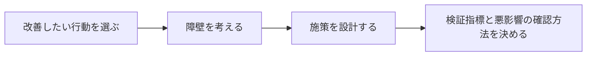

# 第 1 章　ナッジとは何か

- 講座: ナッジ理論をプロダクト改善に活かす（nudge-product）
- 章 ID: `nudge-01`　動画 ID: `N01`
- 動画: 07:16（65 台詞）
- 要約: どの画面にもある「選択アーキテクチャ」に気づき、ナッジを強制・お金・ダークパターンと見分け、良いナッジの 3 つの条件で自分の画面を点検する。

> このファイルは `bun scripts/build_materials.ts` が `content/` の台本から作ります。直すときは台本（`content/nudge-product/` の TS）を直してください。

## 学習目標

- 自分のサービスの画面にある選択アーキテクチャ（初期値・並び順と目立ち方・言葉・手間）を書き出せる
- ナッジを、強制・金銭的インセンティブ・ダークパターンと、選ぶ自由と本人の利益の 2 つの軸で見分けられる
- 良いナッジの 3 つの条件（透明・断りやすい・本人のため）で、自分の施策を点検できる
- ナッジの効果は場面で大きく変わり、保証されないことを、研究の数字を使って説明できる

## 前提知識

- Web サービスかアプリを作ったことがある（画面・ボタン・設定の仕組みが分かる）
- 行動経済学や心理学の知識は要らない

根拠の種類の札: **研究・学術**（査読のある研究・メタ分析・学術書の定義）／**公式・法令・規格**（法律・官公庁・標準化団体・公式ガイドライン）／**実務の指針**（実務家や専門機関の一般的な指針。条件によって外れる）／**説明用の仮の例**（架空のサンプルで、実在のデータではない）

## 1. 教材本文

### [nudge-01-s01] 困りごと: 「続けたいのに続かない」をどう扱うか

根拠: 説明用の仮の例　動画の場面: 3, 4

この講座では、架空の家計簿アプリ「サンプル家計簿」を例にします。ユーザーは「お金の使い方を見直したい」と思って登録します。ところが、週に 1 回の振り返りの通知をオンにする人は少なく、2 週目からは振り返りの画面を開く人も減っていきます（**ここに出てくる数字や傾向は、説明用の仮の例です**）。

こうした「本人もやりたいのに、続かない」問題は、Web サービスのオンボーディング（使い始め）と継続利用でよく起きます。ここで思いつく打ち手は、大きく 4 種類あります。

- **強制**: 通知をオンにしないと先へ進めない
- **金銭的インセンティブ**: オンにしたら 300 ポイントをあげる
- **ダークパターン**: 「今はしない」を小さく薄くして、気づかせない
- **ナッジ**: 何が届くかを具体的に書き、断る道も同じ大きさで並べる

どれを使っても、短期的にはオンにする人が増えるかもしれません。違いは「ユーザーに選ぶ自由が残っているか」と「それがユーザーのためになっているか」です。この章では、この 2 つの軸で打ち手を見分けられるようにします。

### [nudge-01-s02] ナッジとは何か（定義）

根拠: 研究・学術　動画の場面: 5　出典: [Richard H. Thaler, Cass R. Sunstein（Yale University Press） 2008（リンクは 2021 年の Final Edition）](https://yalebooks.yale.edu/book/9780300262285/nudge/)、[Cass R. Sunstein（Journal of Consumer Policy 37） 2014](https://doi.org/10.1007/s10603-014-9273-1)、[日本版ナッジ・ユニット BEST（環境省） 2020（12 月）](https://www.env.go.jp/earth/ondanka/nudge/checklist_deploy.pdf)

ナッジ（nudge）は、英語で「ひじで軽くつつく」という意味です。行動経済学者のリチャード・セイラー（Richard Thaler）と法学者のキャス・サンスティーン（Cass Sunstein）が、2008 年の本『Nudge』で広めました。

2 人の定義（『Nudge』の定義の訳）は、ナッジとは **「選択肢を禁じず、経済的なインセンティブ（お金の損得）も大きく変えずに、人の行動を予測できる向きに変える、選択アーキテクチャのあらゆる要素」** です。2 人は、ナッジと呼べるのは、避けたい人が簡単に・安く避けられるものだけだ、とも書いています。

定義から、次の 2 つが外れます。

- **選択肢を禁じるもの**（必須にする・先へ進めなくする）は、ナッジではなく強制です
- **お金の損得を大きく変えるもの**（ポイント・割引・罰金）は、ナッジではなく金銭的インセンティブです。少額のポイントのように境目にあるものもあり、日本版ナッジ・ユニット（BEST）の倫理チェックリストも、損得の大小だけでは一様に言えないとしています。この講座では、お金の損得を足す打ち手は別の道具として扱います

どちらも悪い道具というわけではありません。法律で必須の同意や、キャンペーンの割引は普通に使われます。ただし、効き方・費用・副作用が違うので、ナッジとは分けて設計します。たとえばポイントは費用がかかり、ポイントだけが目当ての人も集まります。

### [nudge-01-s03] 選択アーキテクチャ: 中立な画面はない

根拠: 研究・学術・説明用の仮の例　動画の場面: 6　出典: [Richard H. Thaler, Cass R. Sunstein（Yale University Press） 2008（リンクは 2021 年の Final Edition）](https://yalebooks.yale.edu/book/9780300262285/nudge/)、[Cass R. Sunstein（Journal of Consumer Policy 37） 2014](https://doi.org/10.1007/s10603-014-9273-1)、[Cass R. Sunstein（Yale Journal on Regulation 32） 2015](https://hls.harvard.edu/bibliography/the-ethics-of-nudging)

**選択アーキテクチャ**は、人が何かを選ぶ場面の「設計」のことです。Web サービスの画面では、少なくとも次の 4 つが必ず何かに決まります。

- **初期値（デフォルト）**: 何も選ばないと、どうなるか（通知は最初からオンか、オフか）
- **並び順と目立ち方**: どの選択肢が先に・大きく・目立つ色で見えるか
- **言葉（フレーミング）**: 同じ事実を、どんな言葉と単位で伝えるか
- **手間（フリクション）**: たどり着くまでに、何回押し、何を入力するか

セイラーとサンスティーンは、選択アーキテクチャは避けられない（中立な設計は無い）と指摘しています。ボタンを並べれば、どちらかが左に来ます。初期値を決めなければ、「オフ」という初期値になります（毎回、本人に選んでもらう「能動的な選択」という道もあります。第 2 章）。**影響をゼロにはできない**ので、どうせ影響するなら、ユーザーのためになる向きに設計しよう、というのがナッジの出発点です。ただしサンスティーンも書いているように、「中立が無い」からといって、どんな誘導でもよいわけではありません。1 つ 1 つの施策は、ねらいと方法で評価します（この章の後半と第 6 章）。

この講座では、ほかに **社会的規範**（ほかの人がどうしているかを見せる）と **フィードバック**（行動の結果をすぐ返す）も道具として扱います（第 4 章）。

### [nudge-01-s04] 4 つの打ち手の違い（強制・金銭的インセンティブ・ダークパターン・ナッジ）

根拠: 研究・学術・公式・法令・規格　動画の場面: 4, 9, 10　出典: [米国連邦取引委員会（FTC） 2022](https://www.ftc.gov/system/files/ftc_gov/pdf/P214800%20Dark%20Patterns%20Report%209.14.2022%20-%20FINAL.pdf)、[OECD 2022](https://doi.org/10.1787/44f5e846-en)、[Richard H. Thaler（Science 361） 2018](https://doi.org/10.1126/science.aau9241)、[Cass R. Sunstein（Behavioural Public Policy 6） 2022（オンライン 2020）](https://doi.org/10.1017/bpp.2019.32)、[欧州連合 2022](https://eur-lex.europa.eu/eli/reg/2022/2065/oj)、[消費者庁 2022](https://www.no-trouble.caa.go.jp/what/mailorder/)

4 つの打ち手を、**選ぶ自由**と**本人の利益**の 2 つの軸で並べると、違いがはっきりします（図 nudge-01-f01）。

**ダークパターン**は、利用者をだましたり、操ったりして、本人が本来なら選ばない選択をさせる画面の設計です。米国の連邦取引委員会（FTC）のスタッフ報告（2022 年 9 月）は、ダークパターンを、利用者をだましたり操ったりして、本来ならしなかった選択をさせ、害を与えうる設計の手法という趣旨で説明しています（説明のための言い方で、法律上の定義ではありません）。代表的な手口としては、広告であることを隠す・偽の期限で急がせる、解約を妨げる、大事な条件や手数料を隠す、個人データを出させる、が挙げられています。OECD も 2022 年の報告書（Digital Economy Papers No. 336）で、定義・広がり・害・対策を整理しています。

セイラーは 2018 年の論説で、選択アーキテクチャを悪用して、本人にとって良い選択を難しくする逆向きの工夫を **スラッジ（sludge、ヘドロ）** と呼び、ナッジと区別しました。たとえば解約の手続きをわざと面倒にする設計で、FTC の報告書にも、解約までに何画面もたどらせた事例が載っています。サンスティーンは、スラッジを「過剰な、または正当化できない手間」と整理し、組織が自分の手続きを定期的に点検することを勧めています。確認の手順のように、理由のある手間まで悪いわけではありません。

法律でも扱われています（2026 年 10 月時点）。

- **EU**: デジタルサービス法（DSA）第 25 条は、オンラインプラットフォームの提供者が、利用者をだましたり操ったりして、自由で情報に基づく判断をゆがめるようなインターフェースを作ることを禁じています。対象はオンラインプラットフォームで、不公正取引慣行指令や GDPR の対象になる行為は除かれます（EU で全部のダークパターンが一律に禁止されたわけではありません）。零細・小規模の事業者のプラットフォームは、超大規模のものを除いて、この条文の対象外です。適用は 2024 年 2 月 17 日から
- **日本**: 特定商取引法の改正（2022 年 6 月 1 日施行）で、通信販売の申込みの最終確認画面（紙の申込書も含む）に、分量・価格・支払いと引渡しの時期・申込みの期間・申込みの撤回や解除の条件などを表示することが義務になり、申込みであることなどを誤認させる表示も禁じられました（第 12 条の 6）。誤認して申し込んだ人は、申込みを取り消せます（第 15 条の 4）

ナッジとダークパターンの見た目は似ていることがあります。たとえば「おすすめ」の印は、本人のための推奨ならナッジですが、会社の都合だけで高いプランに付けるなら、ダークパターンに近づきます。違いは見た目ではなく、**選ぶ自由と本人の利益**で判断します。

個別のサービスが法律に触れるかどうかは、ここでは判断しません。気になる場合は、所管の官公庁の資料と専門家に確かめてください。

### [nudge-01-s05] 良いナッジの 3 つの条件と、倫理の点検

根拠: 実務の指針・公式・法令・規格　動画の場面: 7, 8　出典: [Richard H. Thaler（The New York Times） 2015](https://www.nytimes.com/2015/11/01/upshot/the-power-of-nudges-for-good-and-bad.html)、[日本版ナッジ・ユニット BEST（環境省） 2020（3 月。2021 年 3 月改訂）](https://www.env.go.jp/earth/ondanka/nudge/checklist_study.pdf)、[日本版ナッジ・ユニット BEST（環境省） 2020（12 月）](https://www.env.go.jp/earth/ondanka/nudge/checklist_deploy.pdf)

セイラーは 2015 年の新聞の寄稿で、良いナッジの条件として次の 3 つを挙げています（要約）。

- **透明で、誤解させない**: 何をしているかを隠さない
- **簡単に断れる**: できれば 1 回のクリックで、やめられる・戻せる
- **本人のためになると信じる理由がある**: 選んだ人の暮らしが良くなると言える

自分の施策を点検するときは、「この画面の意図を、ユーザーに面と向かって説明できるか」を考えると分かりやすくなります。説明すると怒られそうな設計は、透明さか本人の利益のどちらかが欠けています。

日本では、2017 年 4 月に環境省の主導で発足した日本版ナッジ・ユニット（BEST）が、ナッジなどの行動インサイトを使うときの倫理チェックリストを公開しています。①調査・研究編（2020 年 3 月）は効果を調べる段階、②社会実装編（2020 年 12 月）は施策や製品・サービスとして実際に使う段階のためのもので、②には効果を前もって確かめておくことなどの項目があります。行政向けに作られたものですが、サービスを出す前の点検の参考になります。チェックリスト自身も、満たせば十分というものではないと書いています。

動画の「良い例」の画面は、この 3 条件を満たすように作りました。何が・いつ・何回届くかを具体的に書き（透明）、「受け取らない」を同じ大きさで並べ、設定からいつでも変えられると書き（断りやすい）、通知の中身は今週の支出の振り返り（本人のため）です。

### [nudge-01-s06] 研究から分かること・分からないこと

根拠: 研究・学術　動画の場面: 11　出典: [Eric J. Johnson, Daniel Goldstein（Science 302） 2003](https://doi.org/10.1126/science.1091721)、[Subramanya Prasad Chandrashekar ほか（Meta-Psychology 7） 2023](https://doi.org/10.15626/MP.2022.3108)、[Adam Arshad, Benjamin Anderson, Adnan Sharif（Kidney International 95） 2019](https://doi.org/10.1016/j.kint.2019.01.036)、[Brigitte C. Madrian, Dennis F. Shea（Quarterly Journal of Economics 116） 2001](https://doi.org/10.1162/003355301753265543)、[Stephanie Mertens ほか（PNAS 119） 2022](https://doi.org/10.1073/pnas.2107346118)、[Maximilian Maier ほか（PNAS 119） 2022](https://doi.org/10.1073/pnas.2200300119)、[Stefano DellaVigna, Elizabeth Linos（Econometrica 90） 2022](https://doi.org/10.3982/ECTA18709)

**効きやすい例と、その限界**: デフォルトは、研究で効果が大きく出やすい道具です。臓器提供の意思表示を調べた研究のオンライン実験では、提供に同意するのが初期設定だと 82%、同意しないのが初期設定だと 42% が提供に同意しました（Johnson & Goldstein, 2003）。ただし、事前に分析計画を登録した米国の 1,920 人の再現実験では、差は約 11 ポイント（73.5% と 62.5%）で、効果は再現されたものの、もとの差よりかなり小さくなりました（Chandrashekar ほか, 2023）。また、OECD の 35 か国を比べた研究では、オプトアウトの国とオプトインの国で、亡くなった人からの臓器提供の数に有意な差は見られませんでした（Arshad ほか, 2019）。意思表示の率が変わっても、実際の結果が同じだけ変わるとは限りません。米国の大企業 1 社で、確定拠出型の退職貯蓄制度（401(k)）を自動加入にすると、加入率が大きく上がり、既定の拠出率や運用先のまま残る人も多かったという研究もあります（Madrian & Shea, 2001）。どれも国の制度や企業の福利厚生の話で、アプリの数字ではありません。

**実務では効果は小さめ（でもプラス）**: 米国の 2 つのナッジ・ユニット（行動インサイトを政策に使うチーム）が行った 126 のランダム化比較試験（対象は約 2,300 万人）をまとめた研究では、効果の平均は 1.4 ポイント（対照群に比べて約 8% の上乗せ）で、統計的に意味のある大きさでした。同じ著者たちが集めた学術誌の研究の平均は 8.7 ポイント（約 33% の上乗せ）で、この差の約 7 割は、目立つ結果ほど論文になりやすいこと（出版バイアス）で説明できるとしています（DellaVigna & Linos, 2022）。

**メタ分析の読み方にも注意**: 200 以上の研究をまとめたメタ分析は、選択アーキテクチャの介入に小〜中程度の効果（2022 年 5 月の訂正後の値で、212 本・447 の効果量の標準化効果量 d=0.43。訂正前は 0.45）があり、デフォルトなどの決定の構造を変える介入がいちばん大きい（d=0.54）としました（Mertens ほか, 2022）。著者たち自身も出版バイアスがあることを認めています。同じデータを出版バイアスで補正し直すと、ナッジ全体の平均効果の証拠は弱くなり、結論は出ていないという指摘もあります（Maier ほか, 2022。情報を出すだけの介入と金融の分野は、補正後に効果がないことを支持する結果で、決定の構造の介入ははっきりしなかった）。「ナッジは効く／効かない」と一言で言える状態ではなく、介入ごとの差が大きい、というのが今の読み方です。

ここから、実務で守ることは 3 つです。

- **効果を約束しない**: 他社や論文の数字を、自分のサービスの見込みにしない
- **小さく試して測る**: 1 つの施策を、比べられる形で試す（第 7 章）
- **悪影響も測る**: 通知を増やしたら、通知のオフやアプリの削除が増えていないかも見る

### [nudge-01-s07] 実践手順: 選択アーキテクチャを棚卸しする

根拠: 実務の指針・説明用の仮の例　動画の場面: 12, 13　出典: [Cass R. Sunstein（Behavioural Public Policy 6） 2022（オンライン 2020）](https://doi.org/10.1017/bpp.2019.32)

ナッジを足す前に、今の画面で何が働いているかを書き出します。新しい仕掛けを足す前に、今ある逆向きの手間（スラッジ）を減らせないかを先に見ます。サンスティーンも、組織が自分の手続きの手間を定期的に点検することを勧めています。

1. **行動を 1 つ決める**: 観察できる行動にする（例: 最初の支出を 1 件記録する、週に 1 回振り返りの画面を開く）。その行動がユーザー本人にとって何の役に立つかを一言で書く
2. **その行動までの画面を順に開く**: 新規登録から行動まで、スクリーンショットを撮る。スマホとパソコンの両方があるなら両方
3. **4 つの部品を書き出す**: 画面ごとに、初期値・並び順と目立ち方・言葉・手間を表にする（図 nudge-01-f02）
4. **3 つの条件で点検する**: 透明か・断りやすいか・本人のためか。引っかかったところに印を付ける

この棚卸しの表が、第 2 章以降でナッジの道具を当てはめる「地図」になります。

### [nudge-01-s08] 振り返りの問い

根拠: 実務の指針　動画の場面: 14, 15

- 自分のサービスで、初期値を「決めていない」つもりで、実は決まっている場所はどこですか？
- 最近足した施策のうち、ユーザーに面と向かって意図を説明しにくいものはありますか？
- 増やしたい行動は、ユーザー本人にとっても良いことだと、一言で言えますか？

最後の章（第 7 章）では、「改善したい行動を選ぶ → 障壁を考える → 施策を設計する → 検証指標と悪影響の確認方法を決める」までを 1 枚のシートにまとめます。この章の棚卸しは、その最初の材料です。

## 2. ナレーション台本

話者: 講師 = VOICEVOX:No.7、呼び込み = VOICEVOX:青山龍星。時刻は合成した音声の実測。

### 場面 1　オープニング

- `00:02` （呼び込み）第1章。ナッジとは何か。
- `00:05` こんにちは。ナッジ理論をプロダクト改善に活かす講座へ、ようこそ。

### 場面 2　この章のゴール

- `00:11` この章のゴールは、三つです。
- `00:13` 一つ目。自分の画面に、すでにある、選び方の設計に気づけること。
- `00:19` 二つ目。ナッジを、強制やお金、ダークパターンと見分けられること。
- `00:24` 三つ目。良いナッジの三つの条件で、自分の施策を点検できることです。

### 場面 3　困りごと: 続けたいのに、続かない

- `00:30` この講座では、架空の家計簿アプリ、サンプル家計簿を例にします。
- `00:35` 始めたばかりの人に、週に一度の、振り返りの通知をオンにしてほしい。
- `00:40` でも、オンにする人は少ない。
- `00:43` そして二週目からは、振り返りの画面を開く人も、減っていきます。
- `00:48` ユーザー自身が、お金の使い方を見直したくて始めたのに、続かない。よくある困りごとです。

### 場面 4　思いつく打ち手は 4 種類

- `00:55` 通知をオンにしてもらう打ち手は、大きく、四つに分けられます。
- `01:00` 一つ目は、強制。オンにしないと、先へ進めない。
- `01:04` 二つ目は、お金。オンにしたら、ポイントをあげる。
- `01:08` 三つ目は、ダークパターン。今はしない、のボタンを小さく薄くして、気づかせない。
- `01:14` 四つ目が、ナッジ。何が届くのかを書いて、断る道も同じ大きさで並べ、選びやすくします。
- `01:22` どれでも、オンにする人は増えるかもしれません。違うのは、選ぶ自由と、それがユーザーのためかどうかです。

### 場面 5　ナッジとは

- `01:30` ナッジは、行動経済学者のセイラーと、法学者のサンスティーンが、二〇〇八年の本で広めた考え方です。
- `01:38` 二人の定義を要約すると、選択肢を禁じず、お金の損得も大きく変えずに、人の行動を、予測できる向きに変える工夫です。
- `01:47` 大事なのは、避けたい人が、簡単に、安く避けられること。命令とは、そこが違います。

### 場面 6　選択アーキテクチャ: 中立な画面はない

- `01:55` ナッジの土台にあるのが、選択アーキテクチャです。人が選ぶ場面の、設計のことです。
- `02:02` 何も選ばなかったら、どうなるか。つまり、初期値。
- `02:06` どの選択肢が、先に、大きく見えるか。
- `02:09` 同じ事実を、どんな言葉で伝えるか。
- `02:12` そして、たどり着くまでに、何回押す必要があるか。
- `02:17` 画面を作れば、この四つは、必ず何かに決まります。だから、中立な画面は作れません。
- `02:24` どうせ影響するなら、ユーザーのためになる向きに設計しよう。これが、ナッジの出発点です。

### 場面 7　良いナッジの 3 つの条件

- `02:31` では、良いナッジは、どう見分けるのか。セイラーは、三つの条件を挙げています。
- `02:37` 一つ目は、透明であること。何をしているかを隠さず、説明できること。
- `02:43` 二つ目は、断りやすいこと。嫌なら、できるだけ簡単に、できれば一回の操作で、やめられること。
- `02:51` 三つ目は、本人のためになること。選んだ人の暮らしが良くなると、理由を持って言えること。
- `02:57` この講座では、どれかが欠けたら、ナッジではなく、ダークパターンに近づいている、と考えます。

### 場面 8　悪い例・良い例: 通知の画面

- `03:05` 同じ目的、通知をオンにしてもらう画面で、悪い例と、良い例を比べます。
- `03:11` 悪い例は、断るボタンに、損してもいい、と書いて、罪悪感で押させようとします。
- `03:17` しかも、そのボタンは小さく、薄い。何が届くのかも、書いていません。
- `03:23` 多くの人がもうオンにしている、という根拠のない一言も、だましの手口の一つです。
- `03:29` 良い例は、何が、いつ、何回届くのかを、具体的に書きます。
- `03:35` 設定から、いつでも変えられることも書きます。
- `03:38` そして、受け取らない、のボタンも、同じ大きさで並べます。選ぶのは、あくまでユーザーです。

### 場面 9　クイズ

- `03:46` ここでクイズです。解約の手順を、わざと長くして、解約を減らす。これは、ナッジでしょうか。
- `03:57` 答えは、バツ。ユーザーのためではなく、断りにくくしています。
- `04:02` セイラーは、こうした逆向きの手間を、ヘドロという意味の、スラッジと呼んでいます。

### 場面 10　クイズ

- `04:08` もう一問。通知をオンにした人に、三百ポイントをあげる。これは、ナッジでしょうか。
- `04:18` 答えは、バツ。お金の損得を変えるので、ナッジというより、金銭的インセンティブに近い打ち手です。
- `04:25` 三百ポイントのような少額だと、定義の上では境目にあるとも言えます。ただ、費用がかかり、ポイント目当ての人も集まるので、この講座では、ナッジとは別の道具として考えます。

### 場面 11　効果は、保証されない

- `04:39` ここで、大事な注意です。ナッジは、効果が保証された魔法ではありません。
- `04:45` 政府と組んで試験をする、米国のナッジ・ユニット二つが実施した、百二十六の試験をまとめた研究では、効果の平均は、一・四ポイントでした。
- `04:55` 一方、学術誌に載った研究の平均は、八・七ポイント。効果が大きく出た研究ほど、論文になりやすいことが、差の大きな理由とされています。
- `05:06` ナッジは、小さくても安く試せるのが強みです。でも、効かないことも、逆効果のこともある。だから、自分のサービスで測って確かめます。

### 場面 12　実践: 選択アーキテクチャを棚卸しする

- `05:17` では、実践の手順です。最初にやるのは、新しい仕掛けを足すことではなく、今の画面の棚卸しです。
- `05:24` まず、増やしたい行動を、一つだけ決めます。例えば、最初の支出を一件記録する。
- `05:31` 次に、その行動までの画面を、順に開いて、スクリーンショットを撮ります。
- `05:37` 画面ごとに、初期値、並び順、言葉、手間の四つを、書き出します。
- `05:43` 最後に、透明か、断りやすいか、本人のためか、の三つの条件で点検します。

### 場面 13　演習

- `05:51` では、演習です。動画を止めて、五分だけ、取り組んでみてください。
- `05:56` 自分のサービスから、画面を一つ選び、初期値、並び順、言葉、手間を、書き出します。
- `06:04` 書き出したら、三つの条件で点検します。詳しい手順と回答例は、講座サイトの、実践課題にあります。
- （2.5 秒の間。考える時間）

### 場面 14　振り返り

- `06:15` 振り返りです。どの画面にも、選択アーキテクチャがあります。中立な画面は、作れません。
- `06:22` ナッジは、選ぶ自由を残したまま、選びやすくする工夫。強制、お金、ダークパターンとは違います。
- `06:30` 良いナッジは、透明で、断りやすく、本人のためになるもの。そして効果は、測って確かめます。

### 場面 15　この講座の地図

- `06:39` この先の地図です。
- `06:40` 第二章から第五章では、デフォルト、言葉と見せ方、社会的規範とフィードバック、手間とタイミングを、一つずつ道具として学びます。
- `06:50` 第六章では、ダークパターンとの境界線を、法律と倫理のチェックで確かめます。
- `06:56` 最後の第七章で、改善したい行動を選び、障壁を考え、施策を設計し、検証の指標と悪影響の確かめ方まで決めます。

### 場面 16　エンディング

- `07:06` 次の章では、効果が大きく出やすいと言われる道具、デフォルトの設計から見ていきましょう。

## 3. 絵コンテ

| # | 開始 | 秒数 | 図解の種類 | 根拠 | 表示内容（画面の文字） | 読み上げ（字幕と同じ） |
| --- | --- | --- | --- | --- | --- | --- |
| 1 | 00:00 | 11 秒 | タイトル |  | SECTION 1　はじめに／タイトル「ナッジとは何か」／選択アーキテクチャと、似たものとの違い | 第1章。ナッジとは何か。 こんにちは。ナッジ理論をプロダクト改善に活かす講座へ、ようこそ。 |
| 2 | 00:10 | 20 秒 | ゴールの一覧 |  | 【この章のゴール】1. 自分の画面の「選択アーキテクチャ」に気づける 2. ナッジを、強制・お金・ダークパターンと見分けられる 3. 良いナッジの 3 つの条件で、施策を点検できる | この章のゴールは、三つです。 一つ目。自分の画面に、すでにある、選び方の設計に気づけること。 二つ目。ナッジを、強制やお金、ダークパターンと見分けられること。 三つ目。良いナッジの三つの条件で、自分の施策を点検できることです。 |
| 3 | 00:30 | 25 秒 | 画面の流れ | 説明用の仮の例 | 【困りごと: 続けたいのに、続かない】通知を受け取りますか？: はじめの設定で、通知をオンにする人が少ない → 今週の振り返り: 2 週目から、振り返りを開く人が減っていく | この講座では、架空の家計簿アプリ、サンプル家計簿を例にします。 始めたばかりの人に、週に一度の、振り返りの通知をオンにしてほしい。 でも、オンにする人は少ない。 そして二週目からは、振り返りの画面を開く人も、減っていきます。 ユーザー自身が、お金の使い方を見直したくて始めたのに、続かない。よくある困りごとです。 |
| 4 | 00:55 | 35 秒 | 表 | 説明用の仮の例 | 【思いつく打ち手は 4 種類】打ち手｜例: 通知をオンにしてもらう｜選ぶ自由: 強制・オンにしないと先へ進めない・ない／お金・オンにしたら 300 ポイント・ある（損得を変える）／ダークパターン・「今はしない」を小さく薄くする・形だけ（気づかせない）／ナッジ・何が届くかを書き、断る道も同じ大きさで・ある（選びやすくする） | 通知をオンにしてもらう打ち手は、大きく、四つに分けられます。 一つ目は、強制。オンにしないと、先へ進めない。 二つ目は、お金。オンにしたら、ポイントをあげる。 三つ目は、ダークパターン。今はしない、のボタンを小さく薄くして、気づかせない。 四つ目が、ナッジ。何が届くのかを書いて、断る道も同じ大きさで並べ、選びやすくします。 どれでも、オンにする人は増えるかもしれません。違うのは、選ぶ自由と、それがユーザーのためかどうかです。 |
| 5 | 01:30 | 25 秒 | 大きな一文 | 研究・学術 | 【ナッジとは】提唱: 行動経済学者 Thaler と法学者 Sunstein／選択肢を禁じず、お金の損得も大きく変えずに、行動を変える工夫／避けたい人は、簡単に・安く避けられる | ナッジは、行動経済学者のセイラーと、法学者のサンスティーンが、二〇〇八年の本で広めた考え方です。 二人の定義を要約すると、選択肢を禁じず、お金の損得も大きく変えずに、人の行動を、予測できる向きに変える工夫です。 大事なのは、避けたい人が、簡単に、安く避けられること。命令とは、そこが違います。 |
| 6 | 01:55 | 36 秒 | 用語のカード | 研究・学術 | 【選択アーキテクチャ: 中立な画面はない】初期値（Default）: 何も選ばないと、どうなるか／並び順と目立ち方（Order）: どれが先に、大きく見えるか／言葉（Framing）: 同じ事実を、どう言うか／手間（Friction）: 何回押せば、たどり着くか | ナッジの土台にあるのが、選択アーキテクチャです。人が選ぶ場面の、設計のことです。 何も選ばなかったら、どうなるか。つまり、初期値。 どの選択肢が、先に、大きく見えるか。 同じ事実を、どんな言葉で伝えるか。 そして、たどり着くまでに、何回押す必要があるか。 画面を作れば、この四つは、必ず何かに決まります。だから、中立な画面は作れません。 どうせ影響するなら、ユーザーのためになる向きに設計しよう。これが、ナッジの出発点です。 |
| 7 | 02:31 | 34 秒 | 要点のカード | 実務の指針 | 【良いナッジの 3 つの条件】透明（何をしているかを隠さず、説明できる）／断りやすい（できるだけ簡単にやめられる（できれば 1 回の操作で））／本人のため（選んだ人の暮らしが良くなると言える） | では、良いナッジは、どう見分けるのか。セイラーは、三つの条件を挙げています。 一つ目は、透明であること。何をしているかを隠さず、説明できること。 二つ目は、断りやすいこと。嫌なら、できるだけ簡単に、できれば一回の操作で、やめられること。 三つ目は、本人のためになること。選んだ人の暮らしが良くなると、理由を持って言えること。 この講座では、どれかが欠けたら、ナッジではなく、ダークパターンに近づいている、と考えます。 |
| 8 | 03:04 | 41 秒 | 画面の比較（改善前・改善後） | 説明用の仮の例 | 【悪い例・良い例: 通知の画面】悪い例「サンプル家計簿」: 1. 断るボタンで、罪悪感を押しつける 2. 断る道が小さく薄い 3. 何が届くのか、書いていない 4. 根拠のない「みんなやっている」／良い例「サンプル家計簿」: 1. 何が・いつ・何回届くかを具体的に 2. いつでも変えられると書く 3. 断る道も同じ大きさで並べる | 同じ目的、通知をオンにしてもらう画面で、悪い例と、良い例を比べます。 悪い例は、断るボタンに、損してもいい、と書いて、罪悪感で押させようとします。 しかも、そのボタンは小さく、薄い。何が届くのかも、書いていません。 多くの人がもうオンにしている、という根拠のない一言も、だましの手口の一つです。 良い例は、何が、いつ、何回届くのかを、具体的に書きます。 設定から、いつでも変えられることも書きます。 そして、受け取らない、のボタンも、同じ大きさで並べます。選ぶのは、あくまでユーザーです。 |
| 9 | 03:46 | 22 秒 | ○×クイズ |  | 【クイズ】Q1. 解約の手順をわざと長くして、解約を減らす。これはナッジ？ → 答え ×: 断りにくくする逆向きの手間。スラッジやダークパターンと呼ばれる | ここでクイズです。解約の手順を、わざと長くして、解約を減らす。これは、ナッジでしょうか。 答えは、バツ。ユーザーのためではなく、断りにくくしています。 セイラーは、こうした逆向きの手間を、ヘドロという意味の、スラッジと呼んでいます。 |
| 10 | 04:08 | 31 秒 | ○×クイズ |  | 【クイズ】Q2. 通知をオンにした人に、300 ポイントをあげる。これはナッジ？ → 答え ×: お金の損得を変えるので金銭的インセンティブ寄り。少額だと定義の境目だが、この講座では別の道具として扱う | もう一問。通知をオンにした人に、三百ポイントをあげる。これは、ナッジでしょうか。 答えは、バツ。お金の損得を変えるので、ナッジというより、金銭的インセンティブに近い打ち手です。 三百ポイントのような少額だと、定義の上では境目にあるとも言えます。ただ、費用がかかり、ポイント目当ての人も集まるので、この講座では、ナッジとは別の道具として考えます。 |
| 11 | 04:38 | 38 秒 | 数字 | 研究・学術 | 【効果は、保証されない】ナッジ・ユニットの 126 の試験の平均 1.4 ポイント 学術誌に載った研究の平均 8.7 ポイント／ポイント = 割合の差（例: 20% が 21.4% になる）。行動の種類や場面で大きく変わる | ここで、大事な注意です。ナッジは、効果が保証された魔法ではありません。 政府と組んで試験をする、米国のナッジ・ユニット二つが実施した、百二十六の試験をまとめた研究では、効果の平均は、一・四ポイントでした。 一方、学術誌に載った研究の平均は、八・七ポイント。効果が大きく出た研究ほど、論文になりやすいことが、差の大きな理由とされています。 ナッジは、小さくても安く試せるのが強みです。でも、効かないことも、逆効果のこともある。だから、自分のサービスで測って確かめます。 |
| 12 | 05:16 | 34 秒 | 要点のカード | 実務の指針 | 【実践: 選択アーキテクチャを棚卸しする】1. 行動を 1 つ決める（例: 最初の支出を 1 件記録する）／2. その行動までの画面を開く（順にスクリーンショットを撮る）／3. 4 つの部品を書き出す（初期値・並び順・言葉・手間）／4. 3 つの条件で点検する（透明・断りやすい・本人のため） | では、実践の手順です。最初にやるのは、新しい仕掛けを足すことではなく、今の画面の棚卸しです。 まず、増やしたい行動を、一つだけ決めます。例えば、最初の支出を一件記録する。 次に、その行動までの画面を、順に開いて、スクリーンショットを撮ります。 画面ごとに、初期値、並び順、言葉、手間の四つを、書き出します。 最後に、透明か、断りやすいか、本人のためか、の三つの条件で点検します。 |
| 13 | 05:50 | 25 秒 | 大きな一文 |  | 【演習】動画を止めて、5 分／自分のサービスの 1 画面 で、4 つの部品を書き出す／初期値・並び順と目立ち方・言葉・手間 → 3 つの条件で点検 | では、演習です。動画を止めて、五分だけ、取り組んでみてください。 自分のサービスから、画面を一つ選び、初期値、並び順、言葉、手間を、書き出します。 書き出したら、三つの条件で点検します。詳しい手順と回答例は、講座サイトの、実践課題にあります。（2.5 秒の間） |
| 14 | 06:15 | 23 秒 | まとめ |  | 【振り返り】1. どの画面にも選択アーキテクチャがある。中立な画面はない 2. ナッジは、選ぶ自由を残して選びやすくする工夫。強制・お金・ダークパターンとは違う 3. 良いナッジは、透明・断りやすい・本人のため。効果は測って確かめる | 振り返りです。どの画面にも、選択アーキテクチャがあります。中立な画面は、作れません。 ナッジは、選ぶ自由を残したまま、選びやすくする工夫。強制、お金、ダークパターンとは違います。 良いナッジは、透明で、断りやすく、本人のためになるもの。そして効果は、測って確かめます。 |
| 15 | 06:38 | 28 秒 | 時間の流れ |  | 【この講座の地図】第 2〜5 章　ナッジの道具（4 章） → 第 6 章　境界線と倫理（1 章） → 第 7 章　実践（1 章） | この先の地図です。 第二章から第五章では、デフォルト、言葉と見せ方、社会的規範とフィードバック、手間とタイミングを、一つずつ道具として学びます。 第六章では、ダークパターンとの境界線を、法律と倫理のチェックで確かめます。 最後の第七章で、改善したい行動を選び、障壁を考え、施策を設計し、検証の指標と悪影響の確かめ方まで決めます。 |
| 16 | 07:06 | 10 秒 | 次の章の予告 |  | 次: 第 2 章「デフォルト（初期値）を設計する」 | 次の章では、効果が大きく出やすいと言われる道具、デフォルトの設計から見ていきましょう。 |

字幕: 全部の台詞を日本語字幕にする（講座サイトは動画の下の帯、`out/captioned/` の動画は焼き込み）。画面の文字は要点だけにし、説明はナレーションと教材本文で補う。

## 4. 図解・比較例

### [nudge-01-f01] 4 つの打ち手の比較

同じ目的（週 1 回の振り返りの通知をオンにしてもらう）で、打ち手の違いを並べる。行の中身はサンプル家計簿の仮の例（説明用の仮の例）

| 打ち手 | 例 | 選ぶ自由 | お金の損得 | 本人のため？ | 注意 |
| --- | --- | --- | --- | --- | --- |
| 強制 | オンにしないと先へ進めない | ない | 変えない | 場合による | 嫌がる人の離脱・不信 |
| 金銭的インセンティブ | オンにしたら 300 ポイント | ある | 変える | 場合による | 費用・ポイント目当ての利用 |
| ダークパターン | 「今はしない」を小さく薄く・罪悪感の文言 | 形だけ | 変えない | いいえ | 信頼の低下・法律の問題 |
| ナッジ | 何が・いつ届くかを書き、断る道も同じ大きさ | ある | 変えない | はい（と言える理由がある） | 効果は小さいこともある・測る |

### [nudge-01-f02] 選択アーキテクチャの棚卸しの表（記入例）

サンプル家計簿の「通知の設定」画面を書き出した仮の例。自分のサービスでは、画面ごとに 1 表作る（説明用の仮の例）

| 部品 | 問い | 今の画面 | 点検（3 条件） |
| --- | --- | --- | --- |
| 初期値 | 何も選ばないとどうなる？ | 通知はオフ | 透明 ○／断りやすい ○／本人のため △ |
| 並び順と目立ち方 | どれが先に・大きく見える？ | 「今はしない」が上、「受け取る」が下で小さい | 本人の利益に逆向き |
| 言葉 | 同じ事実をどう言っている？ | 「通知を許可しますか？」だけ | 何が届くか分からない（透明 △） |
| 手間 | 何回押せばたどり着く？ | あとでオンにするには設定の 3 階層下 | 逆向きの手間（スラッジ）に近い |

### [nudge-01-f03] 通知の画面: 悪い例と良い例

動画の場面 8 の要点。良い例は、良いナッジの 3 条件に合わせて作った仮の例（説明用の仮の例）

| 観点 | 悪い例 | 良い例 |
| --- | --- | --- |
| 言葉 | 「オンにしないと損をします！」 | 「週に 1 回、振り返りの時間をお知らせします」 |
| 中身 | 何が届くか書いていない | 日曜の夜 8 時に 1 回、今週の支出 |
| 断る道 | 「損してもいい」と小さく薄いリンク | 「受け取らない」を同じ大きさのボタンで |
| ほかの人の話 | 根拠のない「多くの人がもうオンにしています」 | 書かない（根拠のある数字だけを、誤解のない形で） |
| 戻し方 | 書いていない | 設定からいつでも変えられると書く |

### [nudge-01-f04] この講座の実践の流れ

第 7 章で 1 枚のシートにまとめる流れ。この章の棚卸しは最初の材料になる（実務の指針）

流れ: 改善したい行動を選ぶ → 障壁を考える → 施策を設計する → 検証指標と悪影響の確認方法を決める

## 5. 理解確認問題

### 問 1. ナッジの定義に合うものは？

1. 通知をオンにしないと、次の画面へ進めないようにする
2. 通知をオンにした人に、300 ポイントをあげる
3. 何が・いつ・何回届くかを書き、「受け取らない」も同じ大きさで並べる
4. 「今はしない」を小さく薄い文字にして、気づかれにくくする

答えと解説

**答え: 3. 何が・いつ・何回届くかを書き、「受け取らない」も同じ大きさで並べる**

1 は選択肢を禁じるので強制、2 はお金の損得を変えるので金銭的インセンティブ寄り（少額だと定義の上では境目）、4 は断る道を見えにくくするのでダークパターン。3 は選ぶ自由を残したまま、選びやすくしている。

### 問 2. 「中立な画面はない」とは、どういう意味？

1. 画面には必ずデザイナーの好みが出る、という意味
2. 初期値・並び順・言葉・手間は必ず何かに決まり、それが選び方に影響する、という意味
3. どの画面も、ユーザーをだましている、という意味
4. A/B テストをしないと、画面は作れない、という意味

答えと解説

**答え: 2. 初期値・並び順・言葉・手間は必ず何かに決まり、それが選び方に影響する、という意味**

画面を作れば、何も選ばないときの結果（初期値）や、ボタンの順番・言葉・手順の数が必ず決まる。影響をゼロにはできないので、ユーザーのためになる向きに設計する、というのが出発点。

### 問 3. ナッジの効果について、研究から言えることは？

1. ナッジを入れれば、どのサービスでも数十パーセント伸びる
2. ナッジには効果がまったくないと証明されている
3. 学術誌の研究より、政府の実務の試験のほうが平均の効果は小さかった。自分のサービスで測って確かめる必要がある
4. デフォルトを変えるナッジは、必ず逆効果になる

答えと解説

**答え: 3. 学術誌の研究より、政府の実務の試験のほうが平均の効果は小さかった。自分のサービスで測って確かめる必要がある**

2 つのナッジ・ユニットの 126 の試験では平均 1.4 ポイント、学術誌の研究では平均 8.7 ポイント（DellaVigna & Linos, 2022）。効果は場面で変わり、逆効果のこともある。

## 6. 実践課題 [nudge-01-ex] 自分のサービスの選択アーキテクチャを棚卸しする

- ねらい: 自分のサービスの 1 画面について、すでに働いている選択アーキテクチャを言葉にし、ナッジとダークパターンの境界で点検できる
- 目安の時間: 30〜45 分
- 出すもの: 4 つの部品の表（今の画面・分類・点検）と、直し案 1 つ・悪影響の候補 1 つ・確かめる数字

### 手順

1. 増やしたい（または続けてほしい）ユーザーの行動を 1 つ決め、「その行動はユーザー本人の何の役に立つか」を一言で書く
2. その行動に関わる画面を 1 つ選び、スクリーンショットを撮る
3. 初期値・並び順と目立ち方・言葉・手間の 4 つについて、今どうなっているかを表に書き出す（図 nudge-01-f02 の形）
4. 4 つそれぞれが、強制・金銭的インセンティブ・ダークパターン・ナッジのどれに近いか（どれでもなければ「なし」）を書く
5. 良いナッジの 3 条件（透明・断りやすい・本人のため）で点検し、いちばん気になったところを 1 つ選んで、直し案を書く
6. 直し案で悪くなりそうなこと（例: 通知が増えてアプリを消す人が増える）を 1 つ書き、何の数字で確かめるかを添える

### 回答例: サンプル家計簿の「通知の設定」画面（仮の例）

**行動**: 週に 1 回、振り返りの画面を開く。ユーザーにとっては、使いすぎに早く気づけることが利益。

**4 つの部品**: 初期値は通知オフ。並び順は「今はしない」が上で、「受け取る」が下で小さい。言葉は「通知を許可しますか？」だけ。手間は、あとでオンにするには設定の 3 階層下まで行く必要がある。

**分類**: 強制・お金・ダークパターンには当たらないが、並び順と手間が、本人が望む行動と逆向きに働いている（手間はスラッジに近い）。

**点検**: 透明 ○（隠していない）、断りやすい ○、本人のため △（何が届くか分からないので、本人が判断できない）。

**直し案**: 「日曜の夜 8 時に 1 回だけ、今週の支出をお知らせします。設定からいつでも変えられます」と書き、「受け取らない」と「受け取る」を同じ大きさで並べる（断った人に何度も聞き直さない）。設定画面の 1 階層目に通知の項目を出す。

**悪影響の候補と確かめる数字**: 通知を煩わしく感じてアプリを消す人が増えるかもしれない。通知をオンにした率に加えて、通知のオフにした率とアプリの削除率（またはログインしなくなった率）を、直す前と後で比べる。

### 評価基準

| 観点 | できている | もう一歩 | やり直し |
| --- | --- | --- | --- |
| 行動の選び方 | 観察できる具体的な行動で、ユーザー本人の利益を一言で書けている | 行動はあるが曖昧（「もっと使ってもらう」など） | 会社の数字だけ（「売上を上げる」など）で、ユーザーの利益が書かれていない |
| 4 つの部品の書き出し | 4 つとも、文言・位置・手順の数など、今の画面が具体的に書けている | 2〜3 つは具体的だが、残りが空欄か感想だけ | 1 つ以下、または「分かりにくい」などの感想だけ |
| 分類と点検 | 4 種類の違いと 3 条件を使って、理由つきで分類・点検している | 分類はあるが、理由が書かれていない | 罪悪感の文言や断りにくい設計を、ナッジと分類している |
| 直し案と悪影響 | 直し案に、悪くなりそうなことと、それを確かめる数字が添えてある | 直し案はあるが、悪影響や確かめ方がない | 直し案がない、または断りにくくする方向の案になっている |

## 7. 要点まとめと参考資料

### 要点

- どの画面にも選択アーキテクチャ（初期値・並び順と目立ち方・言葉・手間）があり、中立な画面は作れない
- ナッジは、選択肢を禁じず、お金の損得も大きく変えずに選びやすくする工夫。強制・金銭的インセンティブ・ダークパターンとは、選ぶ自由と本人の利益で見分ける
- 良いナッジの 3 条件は、透明で誤解させない・簡単に断れる・本人のためになると言えること
- ダークパターンは法律でも扱われている（EU の DSA 第 25 条、日本の特定商取引法の最終確認画面の規制など）。個別の判断は専門家に
- 研究でも効果の大きさは場面で大きく変わる。実務の試験の平均は 1.4 ポイント（小さいがプラス）で、出版バイアスを補正すると全体の効果は結論が出ていない。効果を約束せず、自分のサービスで測り、悪影響も確かめる

### 参考資料

- Richard H. Thaler, Cass R. Sunstein（Yale University Press）（2008（リンクは 2021 年の Final Edition））「Nudge: Improving Decisions About Health, Wealth, and Happiness」 https://yalebooks.yale.edu/book/9780300262285/nudge/ （研究・学術・2026-10-30 確認）
  - ナッジの定義（選択肢を禁じず、経済的インセンティブを大きく変えずに行動を予測できる向きに変える選択アーキテクチャの要素。2009 年版 p.6 の定義を Mongin & Cozic 2018 の引用で確認）と、選択アーキテクチャの考え方。研究者の間でも定義の範囲は揺れている
- Cass R. Sunstein（Journal of Consumer Policy 37）（2014）「Nudging: A Very Short Guide」 https://doi.org/10.1007/s10603-014-9273-1 （研究・学術・2026-10-30 確認）
  - ナッジを、自由を残したまま特定の方向へ導く手法と短く定義し、義務・禁止や経済的インセンティブと比べている。選択アーキテクチャは常にある（中立な設計は無い）という整理
- Richard H. Thaler（The New York Times）（2015）「The Power of Nudges, for Good and Bad」 https://www.nytimes.com/2015/11/01/upshot/the-power-of-nudges-for-good-and-bad.html （実務の指針・2026-10-30 確認）
  - コラムで示した良いナッジの 3 原則（透明で誤解させない・できるだけ簡単にオプトアウトできる・本人の福祉を高めると考える十分な理由がある）。公式の基準ではなく提唱者の指針。記事はツールで開けず、所在と日付（2015-10-31 公開）は Thaler の会社のページの再掲で確認
- Richard H. Thaler（Science 361）（2018）「Nudge, not sludge」 https://doi.org/10.1126/science.aau9241 （研究・学術・2026-10-30 確認）
  - 選択アーキテクチャを悪用して、良い選択を難しくしたり、本人のためにならない行動を促したりする逆向きの工夫を「スラッジ」と呼んだ 1 ページの論説（実証研究ではない）
- Cass R. Sunstein（Behavioural Public Policy 6）（2022（オンライン 2020））「Sludge Audits」 https://doi.org/10.1017/bpp.2019.32 （研究・学術・2026-10-30 確認）
  - スラッジを過剰な、または正当化できない手間と定義。時間・お金・尊厳を奪い、立場の弱い人ほど影響が大きい。組織による定期的な点検を提案（抄録で確認）
- 米国連邦取引委員会（FTC）（2022）「Bringing Dark Patterns to Light（Staff Report）」 https://www.ftc.gov/system/files/ftc_gov/pdf/P214800%20Dark%20Patterns%20Report%209.14.2022%20-%20FINAL.pdf （公式・法令・規格・2026-10-30 確認）
  - スタッフ報告（2022 年 9 月、委員会が 5 対 0 で公表を承認）。ダークパターンを、利用者をだましたり操ったりして本来しなかった選択をさせ、害を与えうる設計の手法と説明（法律上の定義ではない）。広告の偽装・偽の期限、解約の妨害、条件や手数料の隠蔽、個人データの提供への誘導を代表的な手口に挙げる
- OECD（2022）「Dark Commercial Patterns（OECD Digital Economy Papers No. 336）」 https://doi.org/10.1787/44f5e846-en （公式・法令・規格・2026-10-30 確認）
  - Digital Economy Papers No. 336（2022-10-26）。ダークパターンの作業定義・7 つの分類・広がりと害の証拠・規制と執行の選択肢・自己監査。穏やかに見える手口でも同じくらい効くことがあり、決定版の分類は難しいとする。本体の PDF で確認
- 欧州連合（2022）「Regulation (EU) 2022/2065（Digital Services Act）Article 25」 https://eur-lex.europa.eu/eli/reg/2022/2065/oj （公式・法令・規格・2026-10-30 確認）
  - 第 25 条: オンラインプラットフォームの提供者は、利用者をだましたり操ったりして自由で情報に基づく判断をゆがめるインターフェースを作ってはならない。不公正取引慣行指令と GDPR の対象の行為は除く。欧州委員会が指針を出せる例は (a) 選択肢を目立たせる (b) 選んだことを繰り返し求める (c) 解約を申込みより難しくする。零細・小規模の事業者のプラットフォームは、超大規模のものを除いて対象外（第 19 条）。適用は 2024-02-17 から。EU 出版局の官報の正文で確認
- 消費者庁（2022）「特定商取引法ガイド 通信販売（特定申込みを受ける際の表示）」 https://www.no-trouble.caa.go.jp/what/mailorder/ （公式・法令・規格・2026-10-30 確認）
  - 2022 年 6 月 1 日施行の改正（令和 3 年法律第 72 号）で、通信販売の最終確認画面（紙の申込書も含む）の表示事項が義務化され、誤認させる表示が禁止された（第 12 条の 6）。誤認して申し込んだ人は取り消せる（第 15 条の 4）
- 日本版ナッジ・ユニット BEST（環境省）（2020（3 月。2021 年 3 月改訂））「ナッジ等の行動インサイトの活用に関わる倫理チェックリスト ①調査・研究編」 https://www.env.go.jp/earth/ondanka/nudge/checklist_study.pdf （公式・法令・規格・2026-10-30 確認）
  - BEST は 2017 年 4 月に環境省の主導で発足。ナッジ倫理委員会が作った、効果を調べる段階のためのチェックリスト。ナッジの定義の和訳と解説も載る
- 日本版ナッジ・ユニット BEST（環境省）（2020（12 月））「ナッジ等の行動インサイトの活用に関わる倫理チェックリスト ②社会実装編」 https://www.env.go.jp/earth/ondanka/nudge/checklist_deploy.pdf （公式・法令・規格・2026-10-30 確認）
  - 施策や製品・サービスとして実際に使う段階のためのチェックリスト（効果の事前確認などの項目）。少額のポイントのように経済的インセンティブを小さく変えるものも除外されておらず、大小だけでは一様に言えないとする。満たせば十分というものではないと明記
- Eric J. Johnson, Daniel Goldstein（Science 302）（2003）「Do Defaults Save Lives?」 https://doi.org/10.1126/science.1091721 （研究・学術・2026-10-30 確認）
  - 臓器提供の意思表示がデフォルトで大きく変わることを示した短い論文。オンライン実験で、同意が初期設定だと 82%、不同意が初期設定だと 42% が同意（再現研究の原典の説明で確認。本文は未開封）
- Subramanya Prasad Chandrashekar ほか（Meta-Psychology 7）（2023）「Defaults versus framing: Revisiting Default Effect and Framing Effect with replications and extensions of Johnson and Goldstein (2003) and Johnson, Bellman, and Lohse (2002)」 https://doi.org/10.15626/MP.2022.3108 （研究・学術・2026-10-30 確認）
  - 事前登録した米国の 1,920 人の再現実験。オプトアウト 73.5%・オプトイン 62.5%（初期設定なし 69.7%）で効果は再現されたが、差は約 11 ポイントで原典より小さい
- Adam Arshad, Benjamin Anderson, Adnan Sharif（Kidney International 95）（2019）「Comparison of organ donation and transplantation rates between opt-out and opt-in systems」 https://doi.org/10.1016/j.kint.2019.01.036 （研究・学術・2026-10-30 確認）
  - OECD 35 か国（2016 年）の比較で、オプトアウトとオプトインの国の間に、亡くなった人からの提供数の有意な差は無かった（観察研究。国ごとの医療体制などの違いが混ざる）
- Brigitte C. Madrian, Dennis F. Shea（Quarterly Journal of Economics 116）（2001）「The Power of Suggestion: Inertia in 401(k) Participation and Savings Behavior」 https://doi.org/10.1162/003355301753265543 （研究・学術・2026-10-30 確認）
  - 米国の大企業 1 社が 401(k)（確定拠出型の退職貯蓄制度）を自動加入に変えると、加入率が有意に大きく上がり、既定の拠出率と運用先のまま残る人が多かった（慣性と、既定を会社の助言と受け止めることが原因とされる）。NBER 版の要旨で確認
- Stephanie Mertens ほか（PNAS 119）（2022）「The effectiveness of nudging: A meta-analysis of choice architecture interventions across behavioral domains」 https://doi.org/10.1073/pnas.2107346118 （研究・学術・2026-10-30 確認）
  - 選択アーキテクチャの介入のメタ分析。2022 年 5 月の訂正（PNAS 119(19) e2204059119）後の値で、212 本・447 の効果量・約 215 万人、全体の効果量 d=0.43［0.38, 0.48］（訂正前は 0.45）。決定の構造（デフォルトなど）が最も大きい（0.54）。著者も出版バイアスを認めている
- Maximilian Maier ほか（PNAS 119）（2022）「No evidence for nudging after adjusting for publication bias」 https://doi.org/10.1073/pnas.2200300119 （研究・学術・2026-10-30 確認）
  - Mertens ほかのデータを出版バイアスで補正すると、平均効果は d≈0.04 で証拠は弱い（効果なしの証明ではなく、どちらとも決まらない水準）。情報を出すだけの介入と金融の分野は効果がないことを支持し、決定の構造の介入ははっきりしない
- Stefano DellaVigna, Elizabeth Linos（Econometrica 90）（2022）「RCTs to Scale: Comprehensive Evidence From Two Nudge Units」 https://doi.org/10.3982/ECTA18709 （研究・学術・2026-10-30 確認）
  - 米国の 2 つのナッジ・ユニットの 126 の RCT（約 2,300 万人）の平均効果は +1.4 ポイント（対照群比 +8.0%、統計的に有意）。学術誌の研究は +8.7 ポイント（+33.4%）。差の約 7 割は出版バイアスで説明できる

## 8. 学習画面の右側の AI チャットに聞ける質問例

（チャットはまだ作っていません。質問ごとに、答えの根拠にする節 ID を付けています）

1. 自分のアプリでは、OS の通知許可のダイアログを出す前に、説明の画面を挟もうと思っています。これはナッジとダークパターンのどちらに近いですか？　→ 参照: `nudge-01-s04`、`nudge-01-s05`
2. 無料トライアルが終わる 3 日前にリマインドのメールを送るのは、ナッジですか？ 金銭的インセンティブとの違いも教えてください。　→ 参照: `nudge-01-s02`、`nudge-01-s04`
3. ナッジの効果が論文の数字より小さくなりやすいのはなぜですか？ 利用者が少ないサービスで効果を確かめるときの注意は？　→ 参照: `nudge-01-s06`、`nudge-01-s07`
