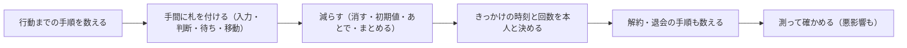

# 第 5 章　手間を減らし、タイミングを合わせる

- 講座: ナッジ理論をプロダクト改善に活かす（nudge-product）
- 章 ID: `nudge-05`　動画 ID: `N05`
- 動画: 06:59（65 台詞）
- 要約: やりたい人がつまずく手間（入力・判断・待ち・移動）を洗い出して減らし、EAST と B=MAP で施策を出す。逆向きの手間（スラッジ）と、本人を守る理由のある手間を見分け、きっかけ（通知）の時刻を本人の都合に合わせる。サンプル家計簿の最初の支出の記録と、振り返りの通知で設計する。

> このファイルは `bun scripts/build_materials.ts` が `content/` の台本から作ります。直すときは台本（`content/nudge-product/` の TS）を直してください。

## 学習目標

- 行動までの手間を、入力・判断・待ち・移動の 4 種類に分けて洗い出せる
- EAST（簡単・魅力的・社会的・タイミング）と B=MAP（動機・能力・きっかけ）を使って、施策の案を出せる
- スラッジ（逆向きの手間）を見つけ、本人を守るための理由のある手間と区別できる
- きっかけ（通知）の時刻と回数を、本人の都合と研究の限界を踏まえて決められる

## 前提知識

- 第 1 章（選択アーキテクチャの 4 つの部品・スラッジ）
- 第 2 章のデフォルト（初期値）を読んでいると分かりやすい（必須ではない）

根拠の種類の札: **研究・学術**（査読のある研究・メタ分析・学術書の定義）／**公式・法令・規格**（法律・官公庁・標準化団体・公式ガイドライン）／**実務の指針**（実務家や専門機関の一般的な指針。条件によって外れる）／**説明用の仮の例**（架空のサンプルで、実在のデータではない）

## 1. 教材本文

### [nudge-05-s01] 困りごと: 登録した日に、1 件も記録しない

根拠: 説明用の仮の例　動画の場面: 3

サンプル家計簿に登録した 100 人のうち、支出の記録の画面を開いたのは 72 人、その日のうちに 1 件でも記録したのは 31 人でした（**説明用の仮の数字です**）。ユーザーは記録したくて登録したのに、最初の 1 件の前で止まっています。

流れを見直すと、最初の記録の画面に必須の項目が 4 つあり、カテゴリや支払い方法を先に選ばせ、金額は最後、さらにあと 2 画面続く作りでした。登録の流れの中にも、メールの確認・プロフィールの入力・予算の設定がありました。

やる気が足りないのではなく、手間が多すぎるのかもしれません。この章では、手間の見つけ方と減らし方、減らしてはいけない手間との見分け方、きっかけ（通知）の時刻の決め方を扱います。

### [nudge-05-s02] 行動までの手間を 4 種類で洗い出す

根拠: 実務の指針　動画の場面: 5　出典: [The Behavioural Insights Team 2014（配布中の PDF は 2024 年 12 月の改訂版）](https://www.bi.team/publications/east-four-simple-ways-to-apply-behavioural-insights/)、[BJ Fogg —](https://behaviormodel.org/)

BIT の EAST（2024 年の改訂版）は、手間を「何をすればいいかを分かるまでの手間（頭の手間）」と「実際にする手間」に分け、小さな手間でも行動に大きく効くことがあるのに、施策や製品を作るときに見落とされやすいとしています。この講座では、画面の点検に使いやすいように、次の 4 種類に分けます（この講座の分け方です）。

- **入力**: 打つ・選ぶ項目の数。必須の項目、パスワードの条件、住所や口座番号など
- **判断**: 迷って決める場面の数。カテゴリを 12 個から選ぶ、プランを比べる、初期値の無い設定など
- **待ち**: 確認や読み込みを待つ時間。メールの確認のリンク、口座の連携、審査など
- **移動**: 画面をたどる・ほかのアプリや場所へ行く回数。メニューの奥の機能、メールを開いて戻る、窓口へ行くなど

Fogg の行動モデルも、やりやすさ（能力）は、その時にいちばん足りない資源（時間・お金など）で決まるとしています。4 種類のどれか 1 つが重いだけで、行動は止まりえます。

### [nudge-05-s03] 研究: 手間を減らすと、行動が変わる

根拠: 研究・学術　動画の場面: 6　出典: [Eric P. Bettinger, Bridget Terry Long, Philip Oreopoulos, Lisa Sanbonmatsu（Quarterly Journal of Economics 127） 2012](https://doi.org/10.1093/qje/qjs017)、[The Behavioural Insights Team 2014（配布中の PDF は 2024 年 12 月の改訂版）](https://www.bi.team/publications/east-four-simple-ways-to-apply-behavioural-insights/)

**申請書の記入を手伝う（Bettinger ほか, 2012）**: 米国で、税の申告の手伝いを受けに来た所得の低い家庭に、連邦の学生の学資援助の申請書（FAFSA）の記入をその場で手伝い、受けられる援助の見込みも伝えるランダム化試験をしました。親が手伝いを受けた高校 3 年生は、実験から 3 年以内に大学の 2 年分を終えた割合が 28% から 36% に上がりました。一方、援助の見込みの情報だけを渡した家庭では、成果は良くなりませんでした。

**移動の手間を減らす（EAST の改訂版が紹介する BIT の試験）**: モルドバでは、結核の患者は毎日、医療者の前で薬を飲む決まりでした。薬を飲む様子を動画で送ればよいように変えると、服薬を確かめられた日の割合が 44% から 84% に上がりました（BIT と国連開発計画の 2016 年のランダム化試験）。

**読み方の注意**: どちらも国の制度や医療の手続きの話で、アプリの数字ではありません。FAFSA の試験の手伝いには、援助の見込みの情報も一緒に入っていました。それでも、「説明を増やすより、手続きそのものを軽くするほうが効くことがある」という向きは、画面の設計にも使えます。自分のサービスでの効き方は、測って確かめます。

### [nudge-05-s04] 施策の出し方: EAST と B=MAP

根拠: 実務の指針　動画の場面: 4, 11　出典: [The Behavioural Insights Team 2014（配布中の PDF は 2024 年 12 月の改訂版）](https://www.bi.team/publications/east-four-simple-ways-to-apply-behavioural-insights/)、[BJ Fogg —](https://behaviormodel.org/)

**EAST**: 英国の BIT（The Behavioural Insights Team）が 2014 年に公開し、2024 年に改訂した実務の枠組みです。行動を促したいなら、**簡単に（Easy）・魅力的に（Attractive）・社会的に（Social）・タイミングよく（Timely）** する、という 4 つの原則です。改訂版は、簡単にする方法として「デフォルトを使う・手間を減らす・伝えることを簡単にする」、タイミングよくする方法として「よい時機を選ぶ・目の前の損得を考える・出来事への対応を前もって計画してもらう」を挙げています。BIT 自身も、EAST は人の行動の複雑さを全部とらえるものではなく、状況の理解と効果の検証が必要だとしています。

**B=MAP**: スタンフォード大学で行動デザインの研究室を作った BJ Fogg の行動モデルです。行動（Behavior）は、動機（Motivation）・能力（Ability）・きっかけ（Prompt）の 3 つが同時にそろったときに起き、起きないときはどれかが欠けている、と考えます。きっかけが無ければ行動は起きない、とも書いています。能力を上げる道として、技能を身につける（難しい道）、道具や手助けを渡す、行動そのものを小さくする、の 3 つを挙げ、行動を小さくすることを勧めています。

どちらも実務の枠組みで、効果を保証する理論ではありません。施策の案を漏れなく出すための問いとして使います（図 nudge-05-f02）。サンプル家計簿なら、動機はある（自分で登録した）ので、能力（最初の記録の手間）ときっかけ（いつ思い出すか）を直す、と考えます。

### [nudge-05-s05] 良い例と悪い例: 最初の支出の記録

根拠: 説明用の仮の例　動画の場面: 7

動画の場面 7 の画面です（架空の画面）。

- **改善前**: 必須の項目が 4 つ（カテゴリ・お店の名前・支払い方法・金額）。いちばん大事な金額が最後で、カテゴリや支払い方法を最初から選ばせる（判断）。このあとも 2 画面続く（移動）
- **改善後**: 入力は金額だけ。日付は今日を初期値にし、カテゴリはあとで選べる。1 画面で記録が終わる

減らした項目は、なくしたわけではありません。カテゴリはあとでまとめて選べるようにし、よく使うお店の名前は 2 件目から候補に出します。最初の 1 件は軽く、慣れてから詳しく、という順番にします。

分析のためにデータが欲しいときも、最初の記録の必須の項目には入れません。記録が続いてから、何に使うかを書いて、任意で聞きます。

### [nudge-05-s06] スラッジと、理由のある手間

根拠: 研究・学術・実務の指針　動画の場面: 8, 9, 10　出典: [Richard H. Thaler（Science 361） 2018](https://doi.org/10.1126/science.aau9241)、[Cass R. Sunstein（Behavioural Public Policy 6） 2022（オンライン 2020）](https://doi.org/10.1017/bpp.2019.32)、[The Behavioural Insights Team 2014（配布中の PDF は 2024 年 12 月の改訂版）](https://www.bi.team/publications/east-four-simple-ways-to-apply-behavioural-insights/)、[米国連邦取引委員会（FTC） 2022](https://www.ftc.gov/system/files/ftc_gov/pdf/P214800%20Dark%20Patterns%20Report%209.14.2022%20-%20FINAL.pdf)

セイラーは 2018 年の論説で、選択アーキテクチャを悪用して、良い選択を難しくする逆向きの工夫を **スラッジ** と呼びました。サンスティーンは、スラッジを「過剰な、または正当化できない手間」と定義しています（定義の訳）。時間やお金を奪い、人を苛立たせたり傷つけたりし、大事な機会やサービスから人を遠ざけ、立場の弱い人ほど影響が大きいとして、組織が自分の手続きを定期的に点検する「スラッジ監査」を勧めています。

EAST の改訂版も、申し込むより解約を難しくするような、わざと作った手間をスラッジの例に挙げています。データベースがつながっていないので同じ情報を何度も書かせる、といった、意図しない手間も多いとしています。米国の FTC の報告書（2022 年）にも、解約までに何画面もたどらせた事例が載っています。

一方で、手間がいつも悪いわけではありません。EAST の改訂版は、決める前に考え直せる期間や、「本当によろしいですか？」の確認のように、本人のためになる手間もあると書いています。見分けるには、次の問いを使います（図 nudge-05-f03）。

- **だれのための手間か**: 本人を守る（取り消せない操作・不正の防止・データの保護）ためか、会社の数字（解約を減らす）のためだけか
- **大きさは必要な分だけか**: 確認は 1 回で足りるのに、電話や何画面も求めていないか
- **入り口と出口は同じくらいの手間か**: 申し込みは 2 回の操作なのに、解約は電話だけ、になっていないか
- **理由を画面に書けるか**: 書くと怒られそうな手間は、スラッジを疑う

解約の手続きや最終確認の画面には、法律の決まりがあることもあります（第 6 章）。ここでの説明は一般的なもので、個別の判断は専門家に確かめてください。

### [nudge-05-s07] きっかけのタイミングと、その限界

根拠: 研究・学術・実務の指針　動画の場面: 12　出典: [Katherine L. Milkman, John Beshears, James J. Choi, David Laibson, Brigitte C. Madrian（PNAS 108） 2011](https://doi.org/10.1073/pnas.1103170108)、[Hengchen Dai, Katherine L. Milkman, Jason Riis（Management Science 60） 2014](https://doi.org/10.1287/mnsc.2014.1901)、[Predrag Klasnja ほか（Annals of Behavioral Medicine 53） 2019](https://doi.org/10.1093/abm/kay067)、[The Behavioural Insights Team 2014（配布中の PDF は 2024 年 12 月の改訂版）](https://www.bi.team/publications/east-four-simple-ways-to-apply-behavioural-insights/)

きっかけは、行動できる時に届かないと効きません。EAST の改訂版も、同じ頼みでも出す時機で効き方が変わり、決める・行動する瞬間の近くで出すきっかけが多く使われている、としています。研究から言えることを 3 つ挙げます。

- **日時を本人に決めてもらう**: 米国の大企業の社員に、社内の無料の予防接種の案内を送った実験では、対照群の接種率は 33.1% でした。案内に、受ける日付を書く欄を足すと +1.5 ポイント（意味のある差ではない）、日付と時刻を書く欄だと +4.2 ポイント（意味のある差）でした（Milkman ほか, 2011）。具体的な計画ほど効いた、という結果です
- **区切りに合わせる**: 「ダイエット」の検索、ジムへの来館、目標への約束は、新しい週・月・年・学期の始まり、誕生日、祝日のあとに増えていました（Dai ほか, 2014。記録データの観察研究）
- **効き目は薄れる**: 歩くことを促すアプリの 6 週間の試験（44 人）では、本人が選んだ 1 日 5 回までの時刻に、状況に合わせた提案を出すかどうかを毎回ランダムに決めました。提案のあとの 30 分の歩数は、始めのころは 66% 増えましたが、日がたつにつれて効果は小さくなりました（Klasnja ほか, 2019。全体の平均は 14% 増で、統計的に意味があるとまでは言えない水準）

**サンプル家計簿の通知の案（仮の例）**: 最初の設定で、振り返りの曜日と時刻を本人が選ぶ（初期値の例: 日曜の夜 8 時。「受け取らない」も同じ大きさで並べる）。記録のリマインドは、本人がオンにした場合だけ、本人が選んだ時刻に 1 日 1 回まで。夜 10 時から朝 7 時は送らない。月の始まりに、予算を見直す案内を 1 回だけ出す。2 週間続けて開かれなければ、回数を減らすかを本人に聞く。

**限界**: 予防接種もジムも、アプリの通知の話ではありません。歩くことの試験も 44 人の小さな試験です。時刻は「この時刻なら行動できるはず」という仮説として決め、通知を開いた率だけでなく、記録した率と、通知のオフ・アプリの削除も一緒に見ます。

### [nudge-05-s08] 実践手順と振り返りの問い

根拠: 実務の指針　動画の場面: 13, 14, 15

1. **手順を数える**: 登録から最初の大事な行動まで、画面と操作を全部書き出す
2. **手間に札を付ける**: 入力・判断・待ち・移動（1 つの手順に複数でもよい）
3. **減らす**: 消す・初期値にする・あとに回す・まとめる。理由のある手間（本人を守る確認など）は残し、理由を画面に書く
4. **きっかけと出口を決める**: きっかけの時刻と回数を本人と決め、送らない時間も決める。解約・退会・通知のオフまでの手順も数え、始めるより重ければ直す
5. **測る**: 最初の行動まで進んだ率に加え、通知のオフ・アプリの削除・問い合わせの数など、悪影響も見る

振り返りの問い:

- 自分のサービスで、最初の大事な行動までに、必須の入力はいくつありますか？ そのうち、今すぐ要らないものは？
- 始めるときと、やめるときの手間は、同じくらいですか？
- 通知の時刻は、だれの都合で決まっていますか？

## 2. ナレーション台本

話者: 講師 = VOICEVOX:No.7、呼び込み = VOICEVOX:青山龍星。時刻は合成した音声の実測。

### 場面 1　オープニング

- `00:02` （呼び込み）第5章。手間を減らし、タイミングを合わせる。
- `00:06` この章では、やりたい人がつまずく手間と、きっかけの時刻を直します。

### 場面 2　この章のゴール

- `00:12` この章のゴールは、三つです。
- `00:14` 一つ目。行動までの手間を、入力、判断、待ち、移動に分けて、洗い出せること。
- `00:22` 二つ目。EAST と B=MAP の、二つの枠組みで、施策の案を出せること。
- `00:29` 三つ目。逆向きの手間、スラッジを見つけ、理由のある手間と分けられることです。

### 場面 3　困りごと: 登録した日に、1 件も記録しない

- `00:36` サンプル家計簿の、登録した日の様子です。数字は、仮のものです。
- `00:41` 登録した人が、百人いたとします。
- `00:44` 支出の記録の画面を開いたのは、七十二人。
- `00:48` その日のうちに、一件でも記録したのは、三十一人でした。
- `00:53` 記録したくて登録したのに、最初の一件までの手間が多くて、止まってしまうのです。

### 場面 4　EAST: 行動してほしいなら、4 つの向きで

- `00:59` イギリスの行動科学のチーム、BIT は、行動を促す工夫を、EAST の四つにまとめています。
- `01:06` 簡単に。手間と迷いを減らす。
- `01:09` 魅力的に。目に留まり、やる理由が分かるようにする。
- `01:13` 社会的に。ほかの人の、本当の行動を示す。これは、第四章の話です。
- `01:20` そして、タイミングよく。行動できる時を選んで頼む。この章では、簡単に、と、タイミングよく、を中心に見ます。

### 場面 5　行動までの手間は 4 種類

- `01:30` 行動までの手間は、四つに分けると、見つけやすくなります。
- `01:35` 入力。打ったり、選んだりする項目の数です。
- `01:39` 判断。どれにするか、迷って決める場面の数。
- `01:43` 待ち。メールの確認や、読み込みを待つ時間。
- `01:46` 移動。画面をたどったり、ほかのアプリへ行ったりする回数です。小さな手間でも、行動を大きく減らすことがあります。

### 場面 6　説明より、手間を減らすほうが効いた

- `01:55` 米国で、所得の低い家庭の、大学の学費の援助の申請書を、その場で一緒に書いた研究があります。
- `02:03` 手伝いを受けなかった家庭の高校三年生では、三年以内に、大学の二年分を終えたのは、二十八パーセント。
- `02:11` 手伝いを受けた家庭では、三十六パーセントでした。
- `02:15` 一方、援助の見込みを伝えるだけでは、良くなりませんでした。説明より、手間を減らすほうが、効いたのです。

### 場面 7　悪い例・良い例: 最初の支出の記録

- `02:24` 最初の支出を記録する画面を、改善前と、改善後で比べます。どちらも、架空の画面です。
- `02:31` 改善前は、必須の項目が四つ。カテゴリや支払い方法を先に選ばせ、いちばん大事な金額は、最後です。
- `02:39` しかも、このあとにも、二つの画面が続きます。
- `02:43` 改善後は、使った金額を入れるだけです。
- `02:46` 日付は、今日を初期値にします。カテゴリは、あとで選べます。
- `02:51` 一つの画面で、記録が終わります。まずは、最初の一件を、楽にするのです。

### 場面 8　スラッジと、理由のある手間

- `02:58` 逆に、行動を難しくする手間もあります。サンスティーンは、過剰な、または正当化できない手間を、スラッジと呼びます。
- `03:07` 見分ける問いは、その手間が、だれのためか、です。
- `03:11` 申し込みはネットでできるのに、解約は、平日の電話だけ。これは、会社の数字のための手間です。
- `03:18` 同じ情報を、何度も入力させる。これは、だれのためにもなっていません。
- `03:24` 一方、全部のデータを消す前に、確認を一回挟むのは、取り消せない操作から、本人を守る手間です。こうした手間は、残します。

### 場面 9　クイズ

- `03:35` ここでクイズです。ネットで申し込めるのに、解約は、電話だけにする。これは、ナッジでしょうか。
- `03:45` 答えは、バツ。始めるより、やめるほうの手間を、わざと重くしています。
- `03:51` 会社のための、逆向きの手間、スラッジです。法律との関係は、第六章で扱います。

### 場面 10　クイズ

- `03:59` もう一問。全部のデータを消す前に、確認の画面を一回出す。これは、スラッジでしょうか。
- `04:09` 答えは、バツ。取り消せない操作から、本人を守る、理由のある手間です。
- `04:15` ただし、確認は一回だけにして、なぜ確認するのかを、画面に書きます。

### 場面 11　B=MAP: 3 つが同時にそろうと、行動が起きる

- `04:22` スタンフォード大学で、行動デザインの研究室を作ったフォッグは、B=MAP という枠組みを示しています。
- `04:30` 一つ目は、動機。やりたい気持ちです。
- `04:33` 二つ目は、能力。その時に、無理なくできるか。いちばん足りないもので、決まります。
- `04:40` 三つ目は、きっかけ。今やろう、と気づく合図です。
- `04:44` この三つが、同時にそろうと、行動が起きます。フォッグは、やりやすくするには、行動そのものを小さくすることを勧めています。

### 場面 12　きっかけのタイミング: 通知の時刻

- `04:54` 最後に、きっかけのタイミング。通知の時刻です。
- `04:58` 送る側の都合で、全員へ同じ時刻に送る。開くまで、何度も送る。これでは、行動できる時に届きません。
- `05:07` 本人に、日付と時刻を書いてもらうと、予防接種を受ける人が、四・二ポイント増えた研究があります。
- `05:14` 新しい週や月の始まりに、目標に向かう行動が増える、という研究もあります。
- `05:20` ただし、歩くことを促すアプリの試験では、提案の効果は始めが大きく、日がたつと小さくなりました。
- `05:28` サンプル家計簿では、振り返りの曜日と時刻を本人が選び、回数は増やしません。時刻は仮説です。測って確かめます。

### 場面 13　実践: 手順を数え、手間とタイミングを直す

- `05:38` 実践の手順です。
- `05:39` まず、行動までの手順を、画面と操作ごとに、全部数えます。
- `05:44` 次に、それぞれに、入力、判断、待ち、移動の札を付けます。
- `05:51` そして、減らします。消す、初期値にする、あとに回す、まとめる。理由のある手間は、残します。
- `05:59` 最後に、きっかけの時刻を本人と決め、解約や退会の手順も数えます。始めるより重ければ、スラッジです。

### 場面 14　演習

- `06:08` では、演習です。動画を止めて、五分だけ、取り組んでみてください。
- `06:14` 自分のサービスで、登録から、最初の大事な行動までの手順を数え、半分にする案を作ります。
- `06:21` 手間の札と、きっかけの時刻も書きます。回答例は、講座サイトの実践課題にあります。
- （2.5 秒の間。考える時間）

### 場面 15　振り返り

- `06:31` 振り返りです。手間は、入力、判断、待ち、移動で洗い出し、減らします。
- `06:38` スラッジは減らし、本人を守る、理由のある手間は残します。
- `06:42` きっかけは、本人が選んだ時刻に。回数は増やさず、測って確かめます。

### 場面 16　エンディング

- `06:49` 次の章では、ナッジとダークパターンの境界線を、法律と倫理のチェックで確かめます。

## 3. 絵コンテ

| # | 開始 | 秒数 | 図解の種類 | 根拠 | 表示内容（画面の文字） | 読み上げ（字幕と同じ） |
| --- | --- | --- | --- | --- | --- | --- |
| 1 | 00:00 | 12 秒 | タイトル |  | SECTION 2　ナッジの道具／タイトル「手間を減らし、タイミングを合わせる」／行動までの手間と、きっかけの時刻 | 第5章。手間を減らし、タイミングを合わせる。 この章では、やりたい人がつまずく手間と、きっかけの時刻を直します。 |
| 2 | 00:11 | 24 秒 | ゴールの一覧 |  | 【この章のゴール】1. 行動までの手間（入力・判断・待ち・移動）を洗い出せる 2. EAST と B=MAP で、施策の案を出せる 3. スラッジを見つけ、理由のある手間と分けられる | この章のゴールは、三つです。 一つ目。行動までの手間を、入力、判断、待ち、移動に分けて、洗い出せること。 二つ目。EAST と B=MAP の、二つの枠組みで、施策の案を出せること。 三つ目。逆向きの手間、スラッジを見つけ、理由のある手間と分けられることです。 |
| 3 | 00:36 | 23 秒 | 数字 | 説明用の仮の例 | 【困りごと: 登録した日に、1 件も記録しない】登録した 100 人 支出の記録の画面を開いた 72 人 その日に 1 件を記録した 31 人／サンプル家計簿の仮の数字。実在のデータではない | サンプル家計簿の、登録した日の様子です。数字は、仮のものです。 登録した人が、百人いたとします。 支出の記録の画面を開いたのは、七十二人。 その日のうちに、一件でも記録したのは、三十一人でした。 記録したくて登録したのに、最初の一件までの手間が多くて、止まってしまうのです。 |
| 4 | 00:59 | 31 秒 | 用語のカード | 実務の指針 | 【EAST: 行動してほしいなら、4 つの向きで】簡単に（Easy）: 手間と迷いを減らす／魅力的に（Attractive）: 目に留まり、やる理由が分かる／社会的に（Social）: ほかの人の本当の行動を示す／タイミングよく（Timely）: 行動できる時を選んで頼む | イギリスの行動科学のチーム、BIT は、行動を促す工夫を、EAST の四つにまとめています。 簡単に。手間と迷いを減らす。 魅力的に。目に留まり、やる理由が分かるようにする。 社会的に。ほかの人の、本当の行動を示す。これは、第四章の話です。 そして、タイミングよく。行動できる時を選んで頼む。この章では、簡単に、と、タイミングよく、を中心に見ます。 |
| 5 | 01:30 | 25 秒 | 用語のカード | 実務の指針 | 【行動までの手間は 4 種類】入力（Input）: 打つ・選ぶ項目の数／判断（Decision）: 迷って決める場面の数／待ち（Waiting）: 確認や読み込みを待つ時間／移動（Navigation）: 画面をたどる・ほかへ行く回数 | 行動までの手間は、四つに分けると、見つけやすくなります。 入力。打ったり、選んだりする項目の数です。 判断。どれにするか、迷って決める場面の数。 待ち。メールの確認や、読み込みを待つ時間。 移動。画面をたどったり、ほかのアプリへ行ったりする回数です。小さな手間でも、行動を大きく減らすことがあります。 |
| 6 | 01:55 | 28 秒 | 数字 | 研究・学術 | 【説明より、手間を減らすほうが効いた】手伝いを受けなかった家庭（対照） 28% 申請書の記入を、その場で手伝った家庭 36%／高校 3 年生が、3 年以内に大学の 2 年分を終えた割合（米国のランダム化試験） | 米国で、所得の低い家庭の、大学の学費の援助の申請書を、その場で一緒に書いた研究があります。 手伝いを受けなかった家庭の高校三年生では、三年以内に、大学の二年分を終えたのは、二十八パーセント。 手伝いを受けた家庭では、三十六パーセントでした。 一方、援助の見込みを伝えるだけでは、良くなりませんでした。説明より、手間を減らすほうが、効いたのです。 |
| 7 | 02:23 | 35 秒 | 画面の比較（改善前・改善後） | 説明用の仮の例 | 【悪い例・良い例: 最初の支出の記録】改善前「サンプル家計簿」: 1. 必須が 4 つ。金額が最後 2. このあとも 2 画面 続く／改善後「サンプル家計簿」: 1. 入力は金額だけ 2. 日付は今日が初期値。分類はあとで 3. 1 画面で終わる | 最初の支出を記録する画面を、改善前と、改善後で比べます。どちらも、架空の画面です。 改善前は、必須の項目が四つ。カテゴリや支払い方法を先に選ばせ、いちばん大事な金額は、最後です。 しかも、このあとにも、二つの画面が続きます。 改善後は、使った金額を入れるだけです。 日付は、今日を初期値にします。カテゴリは、あとで選べます。 一つの画面で、記録が終わります。まずは、最初の一件を、楽にするのです。 |
| 8 | 02:58 | 36 秒 | 表 | 研究・学術 | 【スラッジと、理由のある手間】手間｜だれのため？｜見分け: 解約は、平日の電話だけ・会社の数字・スラッジ／同じ情報を、何度も入力させる・だれのためでもない・スラッジ／全データの削除の前に、確認を 1 回・本人（取り消せない）・理由のある手間 | 逆に、行動を難しくする手間もあります。サンスティーンは、過剰な、または正当化できない手間を、スラッジと呼びます。 見分ける問いは、その手間が、だれのためか、です。 申し込みはネットでできるのに、解約は、平日の電話だけ。これは、会社の数字のための手間です。 同じ情報を、何度も入力させる。これは、だれのためにもなっていません。 一方、全部のデータを消す前に、確認を一回挟むのは、取り消せない操作から、本人を守る手間です。こうした手間は、残します。 |
| 9 | 03:34 | 24 秒 | ○×クイズ |  | 【クイズ】Q1. ネットで申し込めるのに、解約は電話だけにする。これはナッジ？ → 答え ×: 始めるより、やめるほうの手間をわざと重くしている。会社のための逆向きの手間（スラッジ） | ここでクイズです。ネットで申し込めるのに、解約は、電話だけにする。これは、ナッジでしょうか。 答えは、バツ。始めるより、やめるほうの手間を、わざと重くしています。 会社のための、逆向きの手間、スラッジです。法律との関係は、第六章で扱います。 |
| 10 | 03:58 | 23 秒 | ○×クイズ |  | 【クイズ】Q2. 全部のデータを消す前に、確認の画面を 1 回出す。これはスラッジ？ → 答え ×: 取り消せない操作から本人を守る、理由のある手間。ただし確認は 1 回にして、理由を画面に書く | もう一問。全部のデータを消す前に、確認の画面を一回出す。これは、スラッジでしょうか。 答えは、バツ。取り消せない操作から、本人を守る、理由のある手間です。 ただし、確認は一回だけにして、なぜ確認するのかを、画面に書きます。 |
| 11 | 04:21 | 33 秒 | 要点のカード | 実務の指針 | 【B=MAP: 3 つが同時にそろうと、行動が起きる】動機（やりたい気持ち）／能力（その時に、無理なくできるか）／きっかけ（今やろう、と気づく合図） | スタンフォード大学で、行動デザインの研究室を作ったフォッグは、B=MAP という枠組みを示しています。 一つ目は、動機。やりたい気持ちです。 二つ目は、能力。その時に、無理なくできるか。いちばん足りないもので、決まります。 三つ目は、きっかけ。今やろう、と気づく合図です。 この三つが、同時にそろうと、行動が起きます。フォッグは、やりやすくするには、行動そのものを小さくすることを勧めています。 |
| 12 | 04:54 | 43 秒 | 左右の比較 | 研究・学術 | 【きっかけのタイミング: 通知の時刻】左「送る側の都合」全員へ、同じ時刻に一斉に送る・開くまで、何度も送る／右「本人の都合」曜日と時刻を、本人が選ぶ・週や月の始まりに、目標を見直す・効き目を見て、回数を絞る／結論: 時刻は仮説。測って確かめる | 最後に、きっかけのタイミング。通知の時刻です。 送る側の都合で、全員へ同じ時刻に送る。開くまで、何度も送る。これでは、行動できる時に届きません。 本人に、日付と時刻を書いてもらうと、予防接種を受ける人が、四・二ポイント増えた研究があります。 新しい週や月の始まりに、目標に向かう行動が増える、という研究もあります。 ただし、歩くことを促すアプリの試験では、提案の効果は始めが大きく、日がたつと小さくなりました。 サンプル家計簿では、振り返りの曜日と時刻を本人が選び、回数は増やしません。時刻は仮説です。測って確かめます。 |
| 13 | 05:37 | 30 秒 | 要点のカード | 実務の指針 | 【実践: 手順を数え、手間とタイミングを直す】1. 手順を数える（行動までの画面と操作を、全部）／2. 手間に札を付ける（入力・判断・待ち・移動）／3. 減らす（消す・初期値・あとで・まとめる）／4. きっかけと出口を決める（本人が選ぶ時刻・解約の手順も数える） | 実践の手順です。 まず、行動までの手順を、画面と操作ごとに、全部数えます。 次に、それぞれに、入力、判断、待ち、移動の札を付けます。 そして、減らします。消す、初期値にする、あとに回す、まとめる。理由のある手間は、残します。 最後に、きっかけの時刻を本人と決め、解約や退会の手順も数えます。始めるより重ければ、スラッジです。 |
| 14 | 06:08 | 23 秒 | 大きな一文 |  | 【演習】動画を止めて、5 分／最初の大事な行動 までの手順を数え、半分にする案を作る／入力・判断・待ち・移動に札 → 減らす案と、きっかけの時刻 | では、演習です。動画を止めて、五分だけ、取り組んでみてください。 自分のサービスで、登録から、最初の大事な行動までの手順を数え、半分にする案を作ります。 手間の札と、きっかけの時刻も書きます。回答例は、講座サイトの実践課題にあります。（2.5 秒の間） |
| 15 | 06:30 | 18 秒 | まとめ |  | 【振り返り】1. 手間は、入力・判断・待ち・移動で洗い出し、減らす 2. スラッジは減らし、本人を守る理由のある手間は残す 3. きっかけは、本人が選んだ時刻に。回数は増やさず、測る | 振り返りです。手間は、入力、判断、待ち、移動で洗い出し、減らします。 スラッジは減らし、本人を守る、理由のある手間は残します。 きっかけは、本人が選んだ時刻に。回数は増やさず、測って確かめます。 |
| 16 | 06:49 | 10 秒 | 次の章の予告 |  | 次: 第 6 章「ダークパターンとの境界線」 | 次の章では、ナッジとダークパターンの境界線を、法律と倫理のチェックで確かめます。 |

字幕: 全部の台詞を日本語字幕にする（講座サイトは動画の下の帯、`out/captioned/` の動画は焼き込み）。画面の文字は要点だけにし、説明はナレーションと教材本文で補う。

## 4. 図解・比較例

### [nudge-05-f01] 手間の 4 種類（サンプル家計簿の最初の記録の例）

4 種類はこの講座の分け方。改善前の中身はサンプル家計簿の仮の例（説明用の仮の例）

| 手間 | 改善前（仮の例） | 減らし方 |
| --- | --- | --- |
| 入力 | カテゴリ・お店の名前・支払い方法・金額の 4 つが必須 | 金額だけを必須に。ほかは初期値か、あとで |
| 判断 | 最初の 1 件で、カテゴリを 12 個から選ぶ | あとで選べる。よく使うものを先に出す |
| 待ち | メールの確認が済むまで、記録の画面が開かない | 確認は、最初の記録のあとに回す |
| 移動 | 記録のボタンがメニューの 2 階層下。記録の画面がさらに 2 画面続く | ホームに記録のボタン。1 画面で終える |

### [nudge-05-f02] EAST と B=MAP を、サンプル家計簿に当てはめる

どちらも施策の案を出すための実務の枠組み。右の列は仮の例（実務の指針）

| 観点 | 問い | サンプル家計簿の案（仮の例） |
| --- | --- | --- |
| Easy（簡単に） | 手順と入力を減らせるか | 最初の 1 件は金額だけ |
| Attractive（魅力的に） | 目に留まり、やる理由が分かるか | 「1 件記録すると、今週の使い方が見えます」と書く |
| Social（社会的に） | ほかの人の本当の行動を、誤解なく示せるか | 使うなら、数え方を書ける数字だけ（第 4 章） |
| Timely（タイミングよく） | 行動できる時に頼んでいるか | 振り返りの曜日と時刻を本人が選ぶ |
| B=MAP | 動機・能力・きっかけのどれが欠けているか | 動機はある（自分で登録した）。能力（手間）ときっかけを直す |

### [nudge-05-f03] スラッジと理由のある手間の見分け方

スラッジの定義は Sunstein（2022）、理由のある手間の例は EAST の改訂版（2024）をもとにした実務の整理（実務の指針）

| 問い | スラッジに近い | 理由のある手間に近い |
| --- | --- | --- |
| だれのための手間？ | 会社の数字（解約を減らす）のためだけ | 本人を守る（取り消せない操作・不正の防止・データの保護） |
| 大きさは？ | 必要以上（電話だけ・何画面も・同じ入力を何度も） | 必要な分だけ（確認は 1 回） |
| 入り口と出口は？ | 申し込みは 2 回の操作、解約は平日の電話だけ | 始めるのもやめるのも、同じくらいの手間 |
| 理由を画面に書ける？ | 書くと怒られそう | 書ける（「消したデータは戻せません」） |

### [nudge-05-f04] 手間とタイミングの点検の流れ

実践課題（nudge-05-ex）の手順の要約（実務の指針）

流れ: 行動までの手順を数える → 手間に札を付ける（入力・判断・待ち・移動） → 減らす（消す・初期値・あとで・まとめる） → きっかけの時刻と回数を本人と決める → 解約・退会の手順も数える → 測って確かめる（悪影響も）

## 5. 理解確認問題

### 問 1. 行動までの手間を洗い出すときの、この章の 4 つの分け方は？

1. 入力・判断・待ち・移動
2. 動機・能力・きっかけ・結果
3. 初期値・並び順・言葉・手間
4. 簡単・魅力的・社会的・タイミング

答えと解説

**答え: 1. 入力・判断・待ち・移動**

2 は B=MAP（動機・能力・きっかけ）に結果を足したもの、3 は第 1 章の選択アーキテクチャの 4 つの部品、4 は EAST。手間そのものは、入力・判断・待ち・移動で数える。

### 問 2. スラッジに当たるものは？

1. 全部のデータを消す前に、確認の画面を 1 回出す
2. ネットで 2 回の操作で申し込めるのに、解約は平日の電話だけにする
3. 口座を連携する前に、本人確認をする
4. 最初の記録で、日付を今日にしておく

答えと解説

**答え: 2. ネットで 2 回の操作で申し込めるのに、解約は平日の電話だけにする**

スラッジは、過剰な、または正当化できない手間（Sunstein, 2022）。1 と 3 は本人を守る理由のある手間（必要な分だけにする）、4 は手間を減らす初期値。2 は、始めるよりやめるほうを重くしている。

### 問 3. 通知のタイミングについて、研究から言えることは？

1. 通知は、回数を増やすほど効く
2. 日付と時刻を本人に書いてもらうと、行動が増えた研究がある。ただし、通知の効果は日がたつと小さくなることがある
3. 朝 4 時に、全員へ一斉に送るのが、最も効く
4. タイミングを変えても、効果は変わらない

答えと解説

**答え: 2. 日付と時刻を本人に書いてもらうと、行動が増えた研究がある。ただし、通知の効果は日がたつと小さくなることがある**

予防接種の日付と時刻を書く欄で +4.2 ポイント（Milkman ほか, 2011）。歩くことを促す提案の効果は、始めが大きく、日がたつと小さくなった（Klasnja ほか, 2019）。時刻は仮説として決め、測って確かめる。

## 6. 実践課題 [nudge-05-ex] オンボーディングの手順を数え、半分にする案を作る

- ねらい: 自分のサービスのオンボーディング（登録から最初の大事な行動まで）の手順と手間を数え、手間を減らす案ときっかけのタイミングの案を、スラッジの点検と一緒に作れる
- 目安の時間: 30〜45 分
- 出すもの: 手順の一覧（札つき）と数、半分にした案（残した手間とその理由）、きっかけの案（時刻・回数・送らない時間）、解約・退会の手順の数と点検の結果

### 手順

1. ユーザーにとっての最初の大事な行動を 1 つ決め、それが本人の何の役に立つかを一言で書く（例: 最初の支出を 1 件記録する）
2. 登録から、その行動までの手順を、画面ごと・操作ごとに全部書き出し、数を数える
3. それぞれの手順に、入力・判断・待ち・移動の札を付ける（1 つの手順に複数でもよい）
4. 手順を半分にする案を作る。消す・初期値にする・あとに回す・まとめる、のどれかで減らし、理由のある手間（本人を守る確認など）は理由を書いて残す
5. きっかけの案を作る。いつ・何で（通知・画面の表示）・何回頼むか。本人が時刻を選べるようにし、送らない時間も決める
6. 逆に、解約・退会・通知のオフまでの手順も数え、始めるときより手間が多くないかを点検する

### 回答例: サンプル家計簿のオンボーディング（仮の例）

**最初の大事な行動**: 最初の支出を 1 件記録する。本人にとっては、記録が 1 件あると、その週の使い方を振り返る材料ができることが利益。

**今の手順（10 手順）**: ①メールアドレスとパスワードを入力【入力】②届いたメールの確認のリンクを開く【待ち・移動】③プロフィール（名前・家族の人数・月の収入）を入力【入力・判断】④予算のカテゴリを 12 個から選ぶ【判断】⑤カテゴリごとの予算を入力【入力・判断】⑥通知の許可【判断】⑦ホームへ進む【移動】⑧メニューから「支出の記録」を開く【移動】⑨カテゴリ・お店の名前・支払い方法・金額を入力し、さらに 2 画面進む【入力・判断・移動】⑩保存

**半分にした案（5 手順）**: ①メールアドレスとパスワードを入力【入力】②「使った金額を入れてみましょう」の画面で、金額だけ入力【入力】③記録する ④振り返りの曜日と時刻を選ぶ（初期値の例: 日曜の夜 8 時。「受け取らない」も同じ大きさで）【判断】⑤ホームへ。メールの確認・プロフィール・予算は、あとで（ホームに「あと 3 つで設定が終わります」と出す）

**残した手間と理由**: パスワードの入力は、家計のデータを守るために残す。メールの確認は、ほかの端末へデータを移すときに必要なので、最初の記録のあとに回す。

**きっかけの案**: 最初の設定で選んだ曜日と時刻に、週 1 回だけ振り返りを知らせる。記録のリマインドは、本人がオンにした場合だけ、本人が選んだ時刻（例: 夕食のあとの 21 時）に 1 日 1 回まで。夜 10 時から朝 7 時は送らない。2 週間続けて開かれなければ、回数を減らすかを本人に聞く。

**解約・退会の点検**: 有料プランの解約は、設定 → プラン → 解約の 3 手順で、申し込み（2 手順）と大きくは変わらない。解約の前の確認は 1 回だけにし、電話や問い合わせは求めない。データの書き出しの案内は、本人のための手間として残す。

### 評価基準

| 観点 | できている | もう一歩 | やり直し |
| --- | --- | --- | --- |
| 手順の数え上げ | 登録から最初の行動まで、画面と操作を漏れなく数え、手間の札が付いている | 手順はあるが、札がないか、一部が抜けている | 「登録が面倒」などの感想だけで、手順を数えていない |
| 手間を減らす案 | 消す・初期値・あとに回す・まとめるで半分近くに減らし、残した手間の理由が書けている | 減らしているが、残した手間の理由がない | 手順が減っていない、または必要な確認まで消して、本人のデータやお金を危険にしている |
| きっかけの案 | 時刻を本人が選べ、回数の上限と送らない時間があり、効き目が落ちたときの扱いも決めている | 時刻はあるが、回数の上限か本人の選択がない | 送る側の都合の時刻に、何度も送る案になっている |
| スラッジの点検 | 解約・退会・通知のオフまでの手順を数え、始めるときと比べたうえで直し案がある | 数えているが、始めるときと比べていない | 出口の手間を見ていない |

## 7. 要点まとめと参考資料

### 要点

- 行動までの手間は、入力・判断・待ち・移動の 4 種類で洗い出す。小さな手間でも、行動を大きく減らすことがある
- 申請書の記入を手伝うと、大学の 2 年分を終えた割合が 28% から 36% に上がり、情報だけでは変わらなかった（Bettinger ほか, 2012）。国・制度・対象の違いに注意して読む
- EAST（簡単・魅力的・社会的・タイミング）と B=MAP（動機・能力・きっかけが同時にそろうと行動が起きる）は、施策の案を出すための実務の枠組み。行動を小さくして、やりやすくする
- スラッジは、過剰な、または正当化できない手間。取り消せない操作の前の確認のように、本人を守る理由のある手間は、必要な分だけ残す
- きっかけは、本人が選んだ時刻に。日時を書いてもらう・区切りに合わせる工夫には研究があるが、通知の効果は日がたつと薄れる。時刻は仮説として、測って確かめる

### 参考資料

- The Behavioural Insights Team（2014（配布中の PDF は 2024 年 12 月の改訂版））「EAST: Four simple ways to apply behavioural insights」 https://www.bi.team/publications/east-four-simple-ways-to-apply-behavioural-insights/ （実務の指針・2026-10-30 確認）
  - Easy（デフォルト・手間を減らす・簡単に伝える）・Attractive（注意を引く・インセンティブの工夫）・Social（多くの人がしていると示す・つながり・互恵）・Timely（よい時機・目の前の損得・前もって計画）。改訂版は、規範の伝え方が逆効果になる条件や、本人のためになる手間にも触れる。PDF で確認
- BJ Fogg（—）「Fogg Behavior Model」 https://behaviormodel.org/ （実務の指針・2026-10-30 確認）
  - 動機・能力・きっかけが同じ瞬間にそろうと行動が起きるという枠組み（B=MAP）。能力はいちばん足りない資源で決まり、行動を小さくすることを勧める。きっかけは Facilitator・Signal・Spark の 3 種類。査読のある研究ではなく提唱者の実務の枠組み。公式サイトで確認
- Eric P. Bettinger, Bridget Terry Long, Philip Oreopoulos, Lisa Sanbonmatsu（Quarterly Journal of Economics 127）（2012）「The Role of Application Assistance and Information in College Decisions: Results from the H&R Block FAFSA Experiment」 https://doi.org/10.1093/qje/qjs017 （研究・学術・2026-10-30 確認）
  - 税の申告の手伝いを受けに来た所得の低い家庭に、連邦の学生の学資援助の申請書（FAFSA）の記入をその場で手伝い、援助の見込みも伝えたランダム化試験。親が手伝いを受けた高校 3 年生は、実験から 3 年以内に大学の 2 年分を終えた割合が 28% から 36% に上がった。援助の見込みの情報だけを渡した家庭は、成果が良くならなかった。有料のため、要旨（OpenAlex）と NBER Working Paper 15361 の要旨、Crossref の書誌で確認
- Richard H. Thaler（Science 361）（2018）「Nudge, not sludge」 https://doi.org/10.1126/science.aau9241 （研究・学術・2026-10-30 確認）
  - 選択アーキテクチャを悪用して、良い選択を難しくしたり、本人のためにならない行動を促したりする逆向きの工夫を「スラッジ」と呼んだ 1 ページの論説（実証研究ではない）
- Cass R. Sunstein（Behavioural Public Policy 6）（2022（オンライン 2020））「Sludge Audits」 https://doi.org/10.1017/bpp.2019.32 （研究・学術・2026-10-30 確認）
  - スラッジを過剰な、または正当化できない手間と定義。時間・お金・尊厳を奪い、立場の弱い人ほど影響が大きい。組織による定期的な点検を提案（抄録で確認）
- 米国連邦取引委員会（FTC）（2022）「Bringing Dark Patterns to Light（Staff Report）」 https://www.ftc.gov/system/files/ftc_gov/pdf/P214800%20Dark%20Patterns%20Report%209.14.2022%20-%20FINAL.pdf （公式・法令・規格・2026-10-30 確認）
  - スタッフ報告（2022 年 9 月、委員会が 5 対 0 で公表を承認）。ダークパターンを、利用者をだましたり操ったりして本来しなかった選択をさせ、害を与えうる設計の手法と説明（法律上の定義ではない）。広告の偽装・偽の期限、解約の妨害、条件や手数料の隠蔽、個人データの提供への誘導を代表的な手口に挙げる
- Katherine L. Milkman, John Beshears, James J. Choi, David Laibson, Brigitte C. Madrian（PNAS 108）（2011）「Using implementation intentions prompts to enhance influenza vaccination rates」 https://doi.org/10.1073/pnas.1103170108 （研究・学術・2026-10-30 確認）
  - 米国の大企業の社員に、社内の無料の予防接種の日時と場所を書いた案内を送ったフィールド実験。対照群の接種率は 33.1%。受ける日付を書く欄を足すと +1.5 ポイント（有意差なし）、日付と時刻を書く欄だと +4.2 ポイント（有意）。PubMed の要旨で確認
- Hengchen Dai, Katherine L. Milkman, Jason Riis（Management Science 60）（2014）「The Fresh Start Effect: Temporal Landmarks Motivate Aspirational Behavior」 https://doi.org/10.1287/mnsc.2014.1901 （研究・学術・2026-10-30 確認）
  - 3 つの記録データの研究（観察研究）で、「ダイエット」の検索・ジムへの来館・目標への約束が、新しい週・月・年・学期の始まり、誕生日、祝日のあとに増えた。要旨（OpenAlex）で確認
- Predrag Klasnja ほか（Annals of Behavioral Medicine 53）（2019）「Efficacy of Contextually Tailored Suggestions for Physical Activity: A Micro-randomized Optimization Trial of HeartSteps」 https://doi.org/10.1093/abm/kay067 （研究・学術・2026-10-30 確認）
  - 歩くことを促すアプリの 6 週間のマイクロランダム化試験（44 人）。本人が選んだ 1 日 5 回までの時刻に、状況に合わせた提案を出すかどうかを毎回ランダムに決めた。提案のあとの 30 分の歩数は、平均で 14% 増（p=0.06）。始めのころは 66% 増だったが、日がたつにつれて効果は小さくなった。座りすぎを防ぐ提案は効果が見られなかった。PubMed の要旨で確認

## 8. 学習画面の右側の AI チャットに聞ける質問例

（チャットはまだ作っていません。質問ごとに、答えの根拠にする節 ID を付けています）

1. 会員登録の最初に、電話番号の SMS 認証を入れています。これは理由のある手間ですか、それともスラッジですか？　→ 参照: `nudge-05-s06`、`nudge-05-s02`
2. 習慣化のアプリで、リマインドの通知は何時に、何回送ればいいですか？ 研究から言えることと、言えないことを教えてください。　→ 参照: `nudge-05-s07`、`nudge-05-s04`
3. 入力の項目を減らしたいのですが、分析に使うデータも欲しいです。手間を減らしながら、必要なデータを集めるには？　→ 参照: `nudge-05-s05`、`nudge-05-s02`、`nudge-05-s08`
