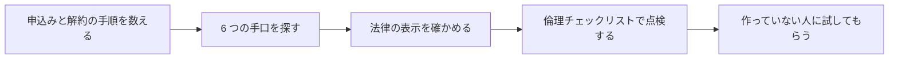

# 第 6 章　ダークパターンとの境界線

- 講座: ナッジ理論をプロダクト改善に活かす（nudge-product）
- 章 ID: `nudge-06`　動画 ID: `N06`
- 動画: 07:12（62 台詞）
- 要約: 「解約を減らしたい」という要望を例に、ダークパターンの 6 つの手口（隠す・急がせる・罪悪感・解約の妨げ・事前チェック・何度も聞き直す）を見分け、法律の要点（EU の DSA 第 25 条・日本の特定商取引法の最終確認画面）と倫理チェックリストで、公開前に施策を点検できるようにする。

> このファイルは `bun scripts/build_materials.ts` が `content/` の台本から作ります。直すときは台本（`content/nudge-product/` の TS）を直してください。

## 学習目標

- ダークパターンの主な 6 つの手口（隠す・急がせる・罪悪感・解約の妨げ・事前チェック・何度も聞き直す）を、画面の例で見分けられる
- FTC と OECD の報告書、EU の DSA 第 25 条、日本の特定商取引法（最終確認画面）の要点を、一般的な説明として言える
- 解約の前の引き止め（一時停止・プラン変更）を、選ぶ自由を守る形で設計できる
- 倫理チェックリストを使って、公開前に施策を点検する手順を回せる

## 前提知識

- 第 1〜5 章（特に第 1 章の「選ぶ自由と本人の利益」と、手間とスラッジの考え方）
- 法律の専門知識は要らない（個別の判断は専門家に確かめる前提で読む）

根拠の種類の札: **研究・学術**（査読のある研究・メタ分析・学術書の定義）／**公式・法令・規格**（法律・官公庁・標準化団体・公式ガイドライン）／**実務の指針**（実務家や専門機関の一般的な指針。条件によって外れる）／**説明用の仮の例**（架空のサンプルで、実在のデータではない）

## 1. 教材本文

### [nudge-06-s01] 困りごと: 「解約を減らしたい」に、どこまで応えるか

根拠: 説明用の仮の例・公式・法令・規格　動画の場面: 3　出典: [米国連邦取引委員会（FTC） 2022](https://www.ftc.gov/system/files/ftc_gov/pdf/P214800%20Dark%20Patterns%20Report%209.14.2022%20-%20FINAL.pdf)

サンプル家計簿には、月 480 円の有料プランがあります（**金額と数字は説明用の仮の例です**）。ある日チームから「解約を、もっと減らせないか」と頼まれました。

解約の画面を分かりにくくしたり、引き止めの画面を何枚も挟んだりすれば、短期の解約の数はすぐ下がるかもしれません。でもそれは、やめたい人をやめにくくしているだけで、本人の選択を尊重していません。米国の連邦取引委員会（FTC）の報告書は、望まない支払いにつながるダークパターンについて、利用者の時間とお金を無駄にさせ、市場への信頼も損ない、正直に商売をしている会社まで傷つけうる、と書いています。

一方で、解約しようとしている人の中には「しばらく使わないだけ」「料金だけが気になる」人もいます。その人に一時停止や無料プランを知らせるのは、選択肢を増やす工夫になりえます。違いは、**やめたい人が、申込みと同じくらい簡単にやめられるか**です。この章では、その境界線を、手口・法律・倫理の 3 つから引きます。

### [nudge-06-s02] ダークパターンとは（FTC と OECD の説明）

根拠: 公式・法令・規格　動画の場面: 4　出典: [米国連邦取引委員会（FTC） 2022](https://www.ftc.gov/system/files/ftc_gov/pdf/P214800%20Dark%20Patterns%20Report%209.14.2022%20-%20FINAL.pdf)、[OECD 2022](https://doi.org/10.1787/44f5e846-en)

FTC のスタッフ報告「Bringing Dark Patterns to Light」（2022 年 9 月）は、ダークパターンを、利用者をだましたり操ったりして、本来ならしなかった選択をさせ、害を与えうる設計の手法、という趣旨で説明しています（説明のための言い方で、法律上の定義ではありません）。この言葉は、2010 年に UX デザインの専門家ハリー・ブリヌル（Harry Brignull）が作ったと紹介しています。

OECD（経済協力開発機構）の消費者政策委員会は、報告書「Dark commercial patterns」（Digital Economy Papers No. 336、2022 年 10 月）で、各国で議論するための**作業定義**を示しました。要約すると、デジタルの選択アーキテクチャ（特に画面）を使い、消費者の自律・判断・選択をゆがめたり損なったりする商売のやり方で、しばしばだまし・強制・操作を伴い、直接または間接の損害を生みやすいもの、です。損害は測りにくいことが多い、とも添えています。

OECD の報告書は、ダークパターンが、利用者に思った以上のお金・個人データ・時間を出させようとするもので、商売の仕組みと切り離せず、画面を作る人に悪意がなくても生まれうる、とも指摘しています。

第 1 章の言葉で言えば、ナッジとダークパターンは同じ「選択アーキテクチャ」を使います。違いは道具ではなく、**選ぶ自由が残っているか**と、**本人の利益になっているか**です。

### [nudge-06-s03] 主な 6 つの手口

根拠: 公式・法令・規格　動画の場面: 5　出典: [米国連邦取引委員会（FTC） 2022](https://www.ftc.gov/system/files/ftc_gov/pdf/P214800%20Dark%20Patterns%20Report%209.14.2022%20-%20FINAL.pdf)、[OECD 2022](https://doi.org/10.1787/44f5e846-en)

FTC の報告書の付録 A は、ワークショップと研究で挙がったダークパターンを、種類と例で一覧にしています。OECD の報告書は、強制（forced action）・画面の誘導（interface interference）・しつこい要求（nagging）・妨害（obstruction）・こっそり（sneaking）・社会的証明（social proof）・急がせる（urgency）の 7 つに分けています。この講座では、Web サービスとアプリでよく出会う 6 つを選びました（図 nudge-06-f01）。

- **隠す（Sneaking・Hidden Information）**: 大事な条件や費用を、小さな字・長い規約・最後の画面に回す。最後の画面で手数料を足す「ドリップ・プライシング」や、無料体験のあとに知らせずに有料へ移す「隠れた定期購入」も含む
- **急がせる（Urgency・Scarcity）**: 時間が来るとリセットされるカウントダウン、期限がないのに「今だけ」、在庫があるのに「残りわずか」
- **罪悪感（Confirmshaming）**: 断る選択肢を、恥ずかしい言葉にする（FTC の例: 定期便より 1 回だけの購入を選ぶと出る「いいえ、節約したくありません」）
- **解約の妨げ（Obstruction・Roadblocks to Cancellation）**: 申込みは簡単なのに、解約だけ別の手段（電話だけなど）にしたり、長い手順をたどらせたり、途中で売り込みを聞かせたりする
- **事前チェック（Preselection）**: 会社には良いが本人には良くない選択肢を、最初から選んだ状態にしておく（FTC の例: 旅行の保険や延長保証が、外さない限り自動で付く）
- **何度も聞き直す（Nagging）**: 「はい」と「今はしない」だけを出し、断っても繰り返し聞く

手口は組み合わせると効きやすくなります。OECD の報告書は、ダークパターンはスマホで、また組み合わせると効きやすく、事前チェックや断りにくくするような**穏やかに見える手口でも**、しつこい手口や感情をあおる手口と同じかそれ以上に効くことがある、とまとめています。FTC の報告書も、ワークショップで紹介された研究で、ダークパターンを見せると、なりすまし被害を防ぐという怪しいサービスに申し込む人の割合が、中立な画面の 2 倍になったと紹介しています。**効くことと、本人のためになることは別**です。

### [nudge-06-s04] 法律と公式資料の要点（2026 年 10 月時点）

根拠: 公式・法令・規格　動画の場面: 6　出典: [欧州連合 2022](https://eur-lex.europa.eu/eli/reg/2022/2065/oj)、[消費者庁 2022](https://www.no-trouble.caa.go.jp/what/mailorder/)、[消費者庁 2023（4 月の版）](https://www.no-trouble.caa.go.jp/pdf/20230421la02_09.pdf)、[米国連邦取引委員会（FTC） 2022](https://www.ftc.gov/system/files/ftc_gov/pdf/P214800%20Dark%20Patterns%20Report%209.14.2022%20-%20FINAL.pdf)

ここに書くのは**一般的な説明**です。自分のサービスに法律が当てはまるか、どう直せばよいかは、所管の官公庁の資料と専門家（弁護士など）に確かめてください（図 nudge-06-f02）。

**EU: デジタルサービス法（DSA）第 25 条**。オンラインプラットフォームの提供者は、利用者をだましたり操ったりするように、または利用者が自由に情報に基づいて決める力をゆがめたり損なったりするように、画面を設計・運用してはならない、と定めています（適用は 2024 年 2 月 17 日から）。不公正取引慣行指令や GDPR の対象になる行為は除かれます。第 25 条 3 項は、欧州委員会が指針を出せる例として、(a) 決めてもらうときに特定の選択肢を目立たせる、(b) すでに選んだのに、ポップアップなどで繰り返し選ばせようとする、(c) 解約の手続きを申込みより難しくする、を挙げています。

対象の「オンラインプラットフォーム」は、利用者の求めで情報を保存し、広く公開するホスティングのサービス（SNS やマーケットプレイスなど）です（第 3 条）。また第 19 条により、零細・小規模の事業者のプラットフォームは、超大規模のものを除いて、第 25 条を含む節の対象外です。サンプル家計簿のように利用者の情報を公開しないサービスは、この条文の対象になるとは限りません。ただし EU には、ほかの消費者保護の法律もあります。

**日本: 特定商取引法 第 12 条の 6（2022 年 6 月 1 日施行の改正）**。インターネットの通信販売で申込みを受ける最終確認画面（紙の申込書も同じ）には、分量、価格（送料を含む）、支払いの時期と方法、引渡し（サービスの提供）の時期、申込みの期間があるときはその内容、申込みの撤回や解除に関すること、を表示します。申込みになることや、これらの事項を誤認させる表示は禁止です。誤認して申し込んだ人は、申込みを取り消せます（第 15 条の 4）。

消費者庁のガイドラインは、「解除に関すること」には解約の条件・方法・効果が含まれ、たとえば定期購入なら、解約の申出の期限や違約金も入るとしています。解約の方法を特定の手段に限る（申込みと同じような手軽な手段では受け付けない、受付の時間帯を限る、など）制約は、リンク先に任せず最終確認画面にもはっきり示す必要があり、「いつでも解約可能」と強調しながら実際は条件がある表示は、誤認させる表示に当たるおそれがある、としています。

**米国: FTC の報告書**。オンラインの定期購入について、米国の法律（ROSCA）は簡単な解約の手段を求めています。報告書はこれを、解約の手段を申込みと少なくとも同じくらい簡単にし、申し込んだのと同じ手段（Web やアプリ）で解約できるようにし、新しい提案などの引き止めで解約を不当に遅らせないこと、と解説しています。FTC が訴えた事例では、解約までに 6〜9 画面をたどらせ、途中のリンクを押すと解約の流れから外れる作りでした。

国によって法律の中身も対象も違いますが、向いている方向は同じです。**大事なことを隠さず、断る道を目立たなくせず、やめるのを始めるより難しくしない**。

### [nudge-06-s05] 良い例と悪い例: 解約の流れ（引き止めは、どこまでよいか）

根拠: 説明用の仮の例・公式・法令・規格・実務の指針　動画の場面: 7, 8, 9　出典: [米国連邦取引委員会（FTC） 2022](https://www.ftc.gov/system/files/ftc_gov/pdf/P214800%20Dark%20Patterns%20Report%209.14.2022%20-%20FINAL.pdf)、[欧州連合 2022](https://eur-lex.europa.eu/eli/reg/2022/2065/oj)、[Richard H. Thaler（The New York Times） 2015](https://www.nytimes.com/2015/11/01/upshot/the-power-of-nudges-for-good-and-bad.html)

動画の悪い例は、解約の 1 画面目で「本当に、家計の管理をあきらめますか？」と聞き（罪悪感）、解約まで 6 画面続き（解約の妨げ）、「今日だけ 50% オフ 残り 09:59」と根拠のない期限で急がせ（急がせる）、解約の道は一番下の小さく薄いリンクだけです（選択肢の目立たせ方）。どれも、第 1 章の良いナッジの 3 条件のうち「簡単に断れる」を壊しています。

良い例は、1 画面で、解約したらどうなるか（11 月 30 日まで使える・記録は無料プランで残る）を先に書き、「1 か月だけ休む」「無料プランに変える」「解約する」を同じ大きさで並べ、申込みと同じ 2 タップで終わります（図 nudge-06-f03）。

引き止め（一時停止・プラン変更・割引の提案）は、それ自体がダメなわけではありません。次の条件を満たすなら、本人に役立つ選択肢を増やす工夫になりえます（この講座の目安）。

- 解約と**同じ画面**に並べ、解約より目立たせない（同じ大きさ・同じ色の重み）
- 提案は **1 回**だけ。断った人に、別の提案の画面を何枚も挟まない
- 断る言葉で責めない（「あきらめる」「損してもいい」などと書かない）
- 書くことは本当のこと（解約しても記録が残るならそう書く。消えるなら、いつ消えるかを書く）
- 申込みと同じ手段（アプリで申し込んだならアプリ）で、同じくらいの手間で解約できる

反対に、提案の画面を何枚も挟む、解約を電話だけにする、断るたびに同じ提案を出す、は解約の妨げや何度も聞き直す手口になります。○×クイズの 2 問目のように、通知を断った人に毎日聞き直すのも同じです。聞き直すなら、間を十分にあけ、「今後は聞かない」も選べるようにします。

### [nudge-06-s06] 限界と例外

根拠: 実務の指針・公式・法令・規格・研究・学術　動画の場面: 10　出典: [Cass R. Sunstein（Behavioural Public Policy 6） 2022（オンライン 2020）](https://doi.org/10.1017/bpp.2019.32)、[OECD 2022](https://doi.org/10.1787/44f5e846-en)、[日本版ナッジ・ユニット BEST（環境省） 2020（12 月）](https://www.env.go.jp/earth/ondanka/nudge/checklist_deploy.pdf)

**理由のある手間まで悪いわけではありません**。誤って解約しないための 1 回の確認、本人確認、データを消す前の注意（消すと戻せない）は、本人を守る手間です。サンスティーンも、スラッジを「過剰な、または正当化できない手間」としています。手間を足すなら、その手間がだれのためかを説明できるようにします。

**手口の一覧は完全ではありません**。OECD の報告書は、新しい技術や画面とともに新しい手口が出てくるので、決定版の分類はできそうにない、としています。一覧にないから大丈夫、ではなく、選ぶ自由と本人の利益で判断します。

**チェックリストを満たせば十分、ではありません**。BEST の倫理チェックリストも、満たせば倫理面で十分というわけではない、と書いています。満たさない項目があるのに進めるなら、その合理的な理由を説明できるようにしておく必要がある、ともしています。

**法律の対象外でも、信頼は失います**。DSA 第 25 条の対象にならない小さなサービスでも、だます設計は利用者に気づかれ、評判や、ほかの法律の問題につながりえます。短期の数字より、長く使ってもらえる信頼を優先します。

**境目は見た目では決まりません**。同じ「おすすめ」の印でも、本人のための推奨ならナッジ、会社の都合だけならダークパターンに近づきます（第 1 章）。迷ったら、「この画面の意図を、ユーザーに面と向かって説明できるか」を考えます。

### [nudge-06-s07] 実践手順: 公開前に点検する

根拠: 公式・法令・規格・実務の指針　動画の場面: 10, 11, 12　出典: [日本版ナッジ・ユニット BEST（環境省） 2020（12 月）](https://www.env.go.jp/earth/ondanka/nudge/checklist_deploy.pdf)、[OECD 2022](https://doi.org/10.1787/44f5e846-en)

日本版ナッジ・ユニット（BEST）の「倫理チェックリスト ②社会実装編」（2020 年 12 月）は、施策や製品・サービスを実際に使う段階のためのもので、A（ナッジの定義の理解）・B（体制）・C（計画と実施）・D（終了後）の 23 項目があります。原則として始めるまでに満たすこととし、満たさない項目があるなら、その理由を説明できるようにしておく、としています。主に公共部門での活用を念頭に作られていますが、「社会実装」には製品・サービスとして実社会で使うことも含まれていて、サービスの点検にも使えます。動画ではこのうち 4 つを選びました。

- **目的は妥当か**（項目 8）: 本人と社会のためになり、多くの人に受け入れられる目的か
- **手法は妥当か**（項目 9）: 過度な負担や不快感を与えないか。合理的に判断できる情報を出しているか。もっと負担の少ない方法を考えたか
- **効果を事前に確かめたか**（項目 10）: 調査や他の事例で確かめたか、または事実から合理的に見込めるか
- **不利益に備えたか**（項目 14・5）: 不利益が出たら、続けるかどうかも含めてすぐ対処する。結果が都合に合わなくても隠さない

解約・退会の流れは、次の順に点検します（図 nudge-06-f04）。

1. **申込みと解約の手順を数える**: 画面の数・タップの数・入力の数・使う手段（アプリ／Web／電話）を、両方で並べる。解約のほうが多ければ、理由を書く
2. **6 つの手口を探す**: 画面ごとに、隠す・急がせる・罪悪感・解約の妨げ・事前チェック・何度も聞き直す、が無いかを見る
3. **法律の表示を確かめる**: 最終確認画面に、価格・支払いの時期・解約に関することなどが出ているか。気になる点は専門家に確かめる
4. **倫理チェックリストで点検する**: 目的・手法・効果の見込み・不利益への備え
5. **作っていない人に試してもらう**: 作った人は手順に慣れていて、手間に気づきにくい。開発に関わっていない人に、説明なしで解約してもらい、迷ったところを記録する

OECD の報告書も、事業者が自分の選択アーキテクチャを点検すること（自己監査）や、A/B テストを申込みの率だけでなく、消費者の利益と法令を守る観点からも使うことを勧める声を紹介しています。

### [nudge-06-s08] 振り返りの問い

根拠: 実務の指針　動画の場面: 13, 14

- 自分のサービスで、申込みより解約のほうが手間のかかる場所はありますか？ その手間は、だれのためですか？
- 断る選択肢の言葉を、声に出して読んでみてください。ユーザーを責める言葉になっていませんか？
- 最終確認画面に、価格と解約に関することが、はっきり出ていますか？
- 公開前に、作っていない人に試してもらう手順は、チームの中にありますか？

次の第 7 章では、施策を 1 枚の設計シートにまとめ、悪影響まで含めて安全に確かめる方法を学びます。

## 2. ナレーション台本

話者: 講師 = VOICEVOX:No.7、呼び込み = VOICEVOX:青山龍星。時刻は合成した音声の実測。

### 場面 1　オープニング

- `00:02` （呼び込み）第6章。ダークパターンとの境界線。
- `00:05` この章では、ナッジとダークパターンの境目を、手口と法律と倫理の三つから確かめます。

### 場面 2　この章のゴール

- `00:12` この章のゴールは、三つです。
- `00:15` 一つ目。ダークパターンの、主な六つの手口を見分けられること。
- `00:20` 二つ目。法律と公式資料の要点を、説明できること。
- `00:24` 三つ目。倫理のチェックリストで、公開の前に施策を点検できることです。

### 場面 3　困りごと: 解約を減らしたい

- `00:31` サンプル家計簿には、月四百八十円の、有料プランがあります。金額は、仮の数字です。
- `00:38` ある日、チームから、こう頼まれました。解約を、もっと減らせないか。
- `00:44` 解約の画面を、分かりにくくすれば、数字はすぐに下がるかもしれません。
- `00:49` でも、それは、だましではないか。この章では、その境界線を引きます。

### 場面 4　ダークパターンとは

- `00:56` ダークパターンとは何か。米国の連邦取引委員会、FTC は、二〇二二年の報告書で、こう説明しています。
- `01:05` 利用者をだましたり、操ったりして、本来なら選ばない選択をさせる設計です。
- `01:11` OECD も同じ年に、消費者の自律や判断を、ゆがめたり損なったりするもの、と整理しました。
- `01:18` ナッジとの違いは、第一章と同じです。選ぶ自由と、本人の利益を、守っているかどうかです。

### 場面 5　主な手口: 6 つ

- `01:26` よく見られる手口を、FTC と OECD の報告書から、六つにまとめます。
- `01:32` 一つ目は、隠す。費用や条件を、小さな字や、最後の画面に回します。
- `01:38` 二つ目は、急がせる。偽の期限や、残りわずかの表示で、考える時間を奪います。
- `01:45` 三つ目は、罪悪感。断るボタンの言葉で、恥ずかしさを押しつけます。
- `01:50` 四つ目は、解約の妨げ。申し込みは簡単なのに、やめる手順だけを長くします。
- `01:56` 五つ目は、事前チェック。会社に都合のよい選択肢に、最初から、しるしを付けておきます。
- `02:03` 六つ目は、何度も聞き直す。一度断っても、同じお願いを繰り返します。
- `02:09` OECD によれば、事前チェックのような穏やかに見える手口も、しつこい手口と同じくらい、効くことがあります。

### 場面 6　法律の要点（2026 年 10 月時点）

- `02:18` 法律でも、扱われています。二〇二六年十月時点の、要点だけを見ます。
- `02:24` EU のデジタルサービス法、第二十五条は、利用者をだましたり操ったりする画面を、禁じています。
- `02:31` 欧州委員会が指針を出せる例には、解約の手続きを、申し込みより難しくすること、も挙がっています。
- `02:39` ただし対象は、オンラインプラットフォームの提供者で、零細・小規模の事業者は、対象外です。
- `02:46` 日本では、特定商取引法が、ネット通販の最終確認画面に、価格や、解約に関することなどの表示を、求めています。
- `02:56` 誤解させる表示は禁止で、誤解して申し込んだ人は、申し込みを取り消せます。
- `03:01` 米国の FTC の報告書は、解約の手段を、申し込みと少なくとも同じくらい簡単に、と書いています。
- `03:09` どれも一般的な説明です。自分のサービスに当てはまるかは、専門家に確かめてください。

### 場面 7　悪い例・良い例: 解約の画面

- `03:16` 同じ解約の画面で、悪い例と良い例を比べます。
- `03:20` 悪い例は、本当に、家計の管理をあきらめますか、と聞いて、罪悪感を押しつけます。
- `03:27` しかも、解約までは六画面。毎回、引き止めの画面が挟まります。
- `03:32` 今日だけ半額、という、根拠のない期限で、急がせてもいます。
- `03:37` 解約する道は、一番下の、小さく薄い文字だけです。
- `03:42` 良い例は、まず、解約したらどうなるかを書きます。いつまで使えて、記録は残るのか。
- `03:48` 一か月だけ休む、無料プランに変える、という道も示します。続けたい人には、役に立つ選択肢です。
- `03:56` そして、解約するボタンも、同じ大きさで並べます。申し込みと同じ、二回のタップで終わります。

### 場面 8　クイズ

- `04:05` ここでクイズです。解約の前に、一時停止や、プランの変更を提案する。これは、ダークパターンでしょうか。
- `04:16` 答えは、バツ。解約も同じ手間ででき、選ぶのが本人なら、選択肢を増やす工夫です。
- `04:23` FTC の報告書も、引き止めの提案で、解約を不当に遅らせないように、と書いています。何画面も挟めば、妨げです。

### 場面 9　クイズ

- `04:34` もう一問。受け取らない、を選んだ人に、毎日、通知をオンにしますか、と聞く。これは、ダークパターンでしょうか。
- `04:46` 答えは、マル。一度した選択を、何度も聞き直す手口です。
- `04:51` EU の法律でも、指針の例に、すでに選んだことを、繰り返し選ばせようとすることが、挙がっています。

### 場面 10　公開前の点検: 倫理チェックリスト

- `05:00` 公開の前には、日本版ナッジ・ユニット、BEST の倫理チェックリストで点検します。
- `05:05` 目的は妥当か。本人と、社会のためになる目的かを確かめます。
- `05:10` 手法は妥当か。過度な負担をかけず、判断に必要な情報を出しているか。
- `05:16` 効果を、前もって確かめたか。調査や、ほかの事例から、見込みを確かめます。
- `05:22` 不利益に備えたか。悪い影響が出たら止め、悪い結果も、隠さないようにします。
- `05:28` 二十三の項目から、四つを選びました。満たせば十分、というものではない、とチェックリスト自身も書いています。

### 場面 11　実践: 公開前に、解約の流れを点検する

- `05:37` では、実践の手順です。公開の前に、解約の流れを点検します。
- `05:43` まず、申し込みと解約の、画面の数、タップの数、入力の数を、両方で数えます。
- `05:50` 次に、六つの手口が紛れていないかを、画面ごとに探します。
- `05:55` 最終確認画面に、価格や、解約の条件が出ているかも確かめます。迷ったら、専門家に聞きます。
- `06:03` 最後に、倫理のチェックリストで点検し、作っていない人にも、実際に解約してもらいます。

### 場面 12　演習

- `06:10` では、演習です。動画を止めて、五分だけ、取り組んでみてください。
- `06:16` 自分のサービスの、解約か退会の流れを、申し込みと比べて、画面とタップの数を数えます。
- `06:23` そして、六つの手口が無いかを探し、直す案を一つ書きます。回答例は、講座サイトの、実践課題にあります。
- （2.5 秒の間。考える時間）

### 場面 13　振り返り

- `06:35` 振り返りです。ダークパターンは、だましたり操ったりして、本来なら選ばない選択をさせる設計です。
- `06:42` 法律でも扱われています。解約は、申し込みと同じくらい簡単に。迷ったら、専門家に確かめます。
- `06:50` 公開の前に、チェックリストと、別の人の目で点検します。短期の数字より、信頼を守りましょう。

### 場面 14　エンディング

- `06:59` 次は、最後の章です。改善したい行動を選び、施策を設計して、安全に確かめる方法を、一枚にまとめます。

## 3. 絵コンテ

| # | 開始 | 秒数 | 図解の種類 | 根拠 | 表示内容（画面の文字） | 読み上げ（字幕と同じ） |
| --- | --- | --- | --- | --- | --- | --- |
| 1 | 00:00 | 12 秒 | タイトル |  | SECTION 3　境界線と倫理／タイトル「ダークパターンとの境界線」／だましの手口・法律・倫理チェックリスト | 第6章。ダークパターンとの境界線。 この章では、ナッジとダークパターンの境目を、手口と法律と倫理の三つから確かめます。 |
| 2 | 00:12 | 18 秒 | ゴールの一覧 |  | 【この章のゴール】1. ダークパターンの主な 6 つの手口を見分けられる 2. 法律と公式資料の要点（EU の DSA・日本の特定商取引法）を説明できる 3. 倫理チェックリストで、公開前に施策を点検できる | この章のゴールは、三つです。 一つ目。ダークパターンの、主な六つの手口を見分けられること。 二つ目。法律と公式資料の要点を、説明できること。 三つ目。倫理のチェックリストで、公開の前に施策を点検できることです。 |
| 3 | 00:30 | 25 秒 | 大きな一文 | 説明用の仮の例 | 【困りごと: 解約を減らしたい】サンプル家計簿の有料プラン（月 480 円・仮の数字）／「解約を、もっと減らせない？」／どこまでが工夫で、どこからが「だまし」か | サンプル家計簿には、月四百八十円の、有料プランがあります。金額は、仮の数字です。 ある日、チームから、こう頼まれました。解約を、もっと減らせないか。 解約の画面を、分かりにくくすれば、数字はすぐに下がるかもしれません。 でも、それは、だましではないか。この章では、その境界線を引きます。 |
| 4 | 00:55 | 30 秒 | 大きな一文 | 公式・法令・規格 | 【ダークパターンとは】米国 FTC の報告書（2022）の説明を要約／だましたり操ったりして、本来なら選ばない選択をさせる設計／OECD: 消費者の自律や判断を、ゆがめたり損なったりする | ダークパターンとは何か。米国の連邦取引委員会、FTC は、二〇二二年の報告書で、こう説明しています。 利用者をだましたり、操ったりして、本来なら選ばない選択をさせる設計です。 OECD も同じ年に、消費者の自律や判断を、ゆがめたり損なったりするもの、と整理しました。 ナッジとの違いは、第一章と同じです。選ぶ自由と、本人の利益を、守っているかどうかです。 |
| 5 | 01:26 | 52 秒 | 用語のカード | 公式・法令・規格 | 【主な手口: 6 つ】隠す（Sneaking）: 費用や条件を、小さな字や最後の画面に回す／急がせる（Urgency）: 偽の期限や「残りわずか」で、考える時間を奪う／罪悪感（Confirmshaming）: 断るボタンの言葉で、恥ずかしさを押しつける／解約の妨げ（Obstruction）: 申込みは簡単なのに、やめる手順だけ長くする／事前チェック（Preselection）: 会社に都合のよい選択肢に、最初から印を付ける／何度も聞き直す（Nagging）: 一度断っても、同じお願いを繰り返す | よく見られる手口を、FTC と OECD の報告書から、六つにまとめます。 一つ目は、隠す。費用や条件を、小さな字や、最後の画面に回します。 二つ目は、急がせる。偽の期限や、残りわずかの表示で、考える時間を奪います。 三つ目は、罪悪感。断るボタンの言葉で、恥ずかしさを押しつけます。 四つ目は、解約の妨げ。申し込みは簡単なのに、やめる手順だけを長くします。 五つ目は、事前チェック。会社に都合のよい選択肢に、最初から、しるしを付けておきます。 六つ目は、何度も聞き直す。一度断っても、同じお願いを繰り返します。 OECD によれば、事前チェックのような穏やかに見える手口も、しつこい手口と同じくらい、効くことがあります。 |
| 6 | 02:17 | 58 秒 | 表 | 公式・法令・規格 | 【法律の要点（2026 年 10 月時点）】法律・資料｜要点｜注意: EU デジタルサービス法 第 25 条・利用者をだます・操る画面を禁止。指針の例に「解約を申込みより難しくする」・オンラインプラットフォームが対象。零細・小規模は対象外（第 19 条）／日本 特定商取引法 第 12 条の 6・最終確認画面に、価格・支払いの時期・解約に関することなどを表示・誤認させる表示は禁止。誤認して申し込んだ人は取り消せる／米国 FTC の報告書（2022）・解約の手段は、申込みと少なくとも同じくらい簡単に・米国の法律（ROSCA）の解説。報告書は法律そのものではない | 法律でも、扱われています。二〇二六年十月時点の、要点だけを見ます。 EU のデジタルサービス法、第二十五条は、利用者をだましたり操ったりする画面を、禁じています。 欧州委員会が指針を出せる例には、解約の手続きを、申し込みより難しくすること、も挙がっています。 ただし対象は、オンラインプラットフォームの提供者で、零細・小規模の事業者は、対象外です。 日本では、特定商取引法が、ネット通販の最終確認画面に、価格や、解約に関することなどの表示を、求めています。 誤解させる表示は禁止で、誤解して申し込んだ人は、申し込みを取り消せます。 米国の FTC の報告書は、解約の手段を、申し込みと少なくとも同じくらい簡単に、と書いています。 どれも一般的な説明です。自分のサービスに当てはまるかは、専門家に確かめてください。 |
| 7 | 03:16 | 48 秒 | 画面の比較（改善前・改善後） | 説明用の仮の例 | 【悪い例・良い例: 解約の画面】悪い例「サンプル家計簿」: 1. 断る言葉で罪悪感を押しつける 2. 解約まで6 画面。毎回引き止める 3. 根拠のない期限で急がせる 4. 解約の道が小さく薄い／良い例「サンプル家計簿」: 1. 解約後にどうなるかを先に書く 2. 休む・変えるも選べる 3. 解約も同じ大きさ・同じ手間 | 同じ解約の画面で、悪い例と良い例を比べます。 悪い例は、本当に、家計の管理をあきらめますか、と聞いて、罪悪感を押しつけます。 しかも、解約までは六画面。毎回、引き止めの画面が挟まります。 今日だけ半額、という、根拠のない期限で、急がせてもいます。 解約する道は、一番下の、小さく薄い文字だけです。 良い例は、まず、解約したらどうなるかを書きます。いつまで使えて、記録は残るのか。 一か月だけ休む、無料プランに変える、という道も示します。続けたい人には、役に立つ選択肢です。 そして、解約するボタンも、同じ大きさで並べます。申し込みと同じ、二回のタップで終わります。 |
| 8 | 04:04 | 29 秒 | ○×クイズ |  | 【クイズ】Q1. 解約の前に、一時停止やプラン変更を提案する。これはダークパターン？ → 答え ×: 解約も同じ画面・同じ手間ででき、提案で待たせないなら、選択肢を増やす工夫 | ここでクイズです。解約の前に、一時停止や、プランの変更を提案する。これは、ダークパターンでしょうか。 答えは、バツ。解約も同じ手間ででき、選ぶのが本人なら、選択肢を増やす工夫です。 FTC の報告書も、引き止めの提案で、解約を不当に遅らせないように、と書いています。何画面も挟めば、妨げです。 |
| 9 | 04:33 | 26 秒 | ○×クイズ |  | 【クイズ】Q2. 「受け取らない」を選んだ人に、毎日「通知をオンにしますか？」と聞く。これはダークパターン？ → 答え ○: 一度した選択を、何度も聞き直す手口。「今後は聞かない」も選べるようにする | もう一問。受け取らない、を選んだ人に、毎日、通知をオンにしますか、と聞く。これは、ダークパターンでしょうか。 答えは、マル。一度した選択を、何度も聞き直す手口です。 EU の法律でも、指針の例に、すでに選んだことを、繰り返し選ばせようとすることが、挙がっています。 |
| 10 | 04:59 | 38 秒 | 要点のカード | 公式・法令・規格 | 【公開前の点検: 倫理チェックリスト】目的は妥当か（本人と社会のためになる目的か）／手法は妥当か（過度な負担がなく、判断に必要な情報を出しているか）／効果を事前に確かめたか（調査やほかの事例から、見込みを確かめる）／不利益に備えたか（悪影響が出たら止める。悪い結果も隠さない） | 公開の前には、日本版ナッジ・ユニット、BEST の倫理チェックリストで点検します。 目的は妥当か。本人と、社会のためになる目的かを確かめます。 手法は妥当か。過度な負担をかけず、判断に必要な情報を出しているか。 効果を、前もって確かめたか。調査や、ほかの事例から、見込みを確かめます。 不利益に備えたか。悪い影響が出たら止め、悪い結果も、隠さないようにします。 二十三の項目から、四つを選びました。満たせば十分、というものではない、とチェックリスト自身も書いています。 |
| 11 | 05:37 | 33 秒 | 要点のカード | 実務の指針 | 【実践: 公開前に、解約の流れを点検する】1. 申込みと解約を数える（画面・タップ・入力の数を、両方で）／2. 6 つの手口を探す（隠す・急がせる・罪悪感・妨げ・事前チェック・聞き直し）／3. 法律の表示を確かめる（最終確認画面に、価格と解約の条件。迷ったら専門家に）／4. 倫理と、別の人の目（チェックリストで点検し、作っていない人にも試してもらう） | では、実践の手順です。公開の前に、解約の流れを点検します。 まず、申し込みと解約の、画面の数、タップの数、入力の数を、両方で数えます。 次に、六つの手口が紛れていないかを、画面ごとに探します。 最終確認画面に、価格や、解約の条件が出ているかも確かめます。迷ったら、専門家に聞きます。 最後に、倫理のチェックリストで点検し、作っていない人にも、実際に解約してもらいます。 |
| 12 | 06:10 | 25 秒 | 大きな一文 |  | 【演習】動画を止めて、5 分／自分のサービスの解約・退会を、申込みと比べて数える／画面・タップ・入力の数 → 6 つの手口 → 直し案を 1 つ | では、演習です。動画を止めて、五分だけ、取り組んでみてください。 自分のサービスの、解約か退会の流れを、申し込みと比べて、画面とタップの数を数えます。 そして、六つの手口が無いかを探し、直す案を一つ書きます。回答例は、講座サイトの、実践課題にあります。（2.5 秒の間） |
| 13 | 06:35 | 24 秒 | まとめ |  | 【振り返り】1. 本来なら選ばない選択をさせる設計。6 つの手口で見分ける 2. 解約は、申込みと同じくらい簡単に。法律の判断は専門家に 3. 公開前に、チェックリストと別の人の目で点検する | 振り返りです。ダークパターンは、だましたり操ったりして、本来なら選ばない選択をさせる設計です。 法律でも扱われています。解約は、申し込みと同じくらい簡単に。迷ったら、専門家に確かめます。 公開の前に、チェックリストと、別の人の目で点検します。短期の数字より、信頼を守りましょう。 |
| 14 | 06:58 | 13 秒 | 次の章の予告 |  | 次: 第 7 章「実践: 行動を選び、施策を設計し、検証する」 | 次は、最後の章です。改善したい行動を選び、施策を設計して、安全に確かめる方法を、一枚にまとめます。 |

字幕: 全部の台詞を日本語字幕にする（講座サイトは動画の下の帯、`out/captioned/` の動画は焼き込み）。画面の文字は要点だけにし、説明はナレーションと教材本文で補う。

## 4. 図解・比較例

### [nudge-06-f01] 6 つの手口と、直し方

FTC（2022）の付録 A と OECD（2022）の分類から、Web サービスとアプリでよく出会うものを選んで要約。例はサンプル家計簿の仮の例（公式・法令・規格）

| 手口 | 例（仮の例） | 直し方 |
| --- | --- | --- |
| 隠す | 月額は大きく、年額の自動更新は規約の奥 | 料金・更新・解約の条件を、申込みの画面に同じ大きさで |
| 急がせる | 「今日だけ 50% オフ 残り 09:59」が毎日リセットされる | 本当の期限だけを書く。期限がないなら書かない |
| 罪悪感 | 「いいえ、家計の管理をあきらめます」 | 「解約する」「今はしない」など、事実だけの言葉に |
| 解約の妨げ | 解約まで 6 画面、または電話だけ | 申込みと同じ手段・同じくらいの手間で |
| 事前チェック | 「バックアップ容量の追加（月 100 円）」に最初からチェック | 有料の追加は、本人が選んだときだけ |
| 何度も聞き直す | 通知を断った人に、毎日「オンにしますか？」 | 間をあけ、「今後は聞かない」も選べるように |

### [nudge-06-f02] 法律と公式資料の要点（2026 年 10 月時点）

一般的な説明。自分のサービスに当てはまるか、どう直すかは、専門家に確かめる（公式・法令・規格）

| 法律・資料 | 対象 | 要点 | 注意 |
| --- | --- | --- | --- |
| EU デジタルサービス法 第 25 条 | オンラインプラットフォームの提供者（零細・小規模は対象外。第 19 条） | だます・操る画面の禁止。指針の例: 選択肢の目立たせ方・繰り返しの要求・解約を申込みより難しくする | 不公正取引慣行指令・GDPR の対象の行為は除く。2024 年 2 月 17 日から適用 |
| 日本 特定商取引法 第 12 条の 6 | インターネットなどの通信販売の申込み | 最終確認画面に、分量・価格・支払い・引渡し・申込みの期間・撤回や解除に関することを表示。誤認させる表示の禁止 | 誤認して申し込んだ人は取り消せる（第 15 条の 4）。解約の方法の制約は最終確認画面にも明示（消費者庁のガイドライン） |
| 米国 FTC の報告書（2022） | オンラインの定期購入（ROSCA の解説） | 解約は申込みと少なくとも同じくらい簡単に、同じ手段で。引き止めで不当に遅らせない | 報告書は法律そのものではなく、FTC の職員の報告 |

### [nudge-06-f03] 解約の画面: 悪い例と良い例

動画の場面 7 の要点。良い例は、良いナッジの 3 条件と、FTC の報告書の解約の解説に合わせて作った仮の例（説明用の仮の例）

| 観点 | 悪い例 | 良い例 |
| --- | --- | --- |
| 手順の数 | 解約まで 6 画面 | 1 画面・申込みと同じ 2 タップ |
| 言葉 | 「本当に、家計の管理をあきらめますか？」 | 「有料プランの解約」と、解約後にどうなるか |
| 期限 | 「今日だけ 50% オフ 残り 09:59」 | 書かない（本当の期限があるときだけ書く） |
| 選択肢の見せ方 | 「続ける」が大きく、解約は小さく薄いリンク | 休む・無料プランに変える・解約するを同じ大きさで |
| 書いてあること | 解約後にどうなるか、書いていない | 11 月 30 日まで使える。記録は無料プランで残る |

### [nudge-06-f04] 公開前の点検の流れ

この講座の実践の手順。倫理チェックリストは BEST の②社会実装編から 4 項目を選んで使う（実務の指針）

流れ: 申込みと解約の手順を数える → 6 つの手口を探す → 法律の表示を確かめる → 倫理チェックリストで点検する → 作っていない人に試してもらう

## 5. 理解確認問題

### 問 1. ダークパターンの「事前チェック」に当たるものは？

1. 有料の追加オプションに、最初からチェックを入れておく
2. 申込みの最終確認画面に、合計の金額と次の請求日を出す
3. 通知の回数を、設定画面でいつでも選べるようにする
4. おすすめのプランに、本人に合う理由を書いて印を付ける

答えと解説

**答え: 1. 有料の追加オプションに、最初からチェックを入れておく**

会社には都合がよく、本人には良くない選択肢を、最初から選んだ状態にしておく手口（Preselection）。2 は特定商取引法でも求められる表示、3 は断りやすくする工夫、4 は本人のための推奨ならナッジになりうる。

### 問 2. EU のデジタルサービス法（DSA）第 25 条について、正しいものは？

1. EU で、すべての事業者のすべてのダークパターンを、一律に禁止した
2. オンラインプラットフォームの提供者に、利用者をだましたり操ったりする画面を禁じている。零細・小規模の事業者は対象外
3. アプリの通知を送ることを、原則として禁止した
4. 解約ボタンの色と大きさを、細かく決めている

答えと解説

**答え: 2. オンラインプラットフォームの提供者に、利用者をだましたり操ったりする画面を禁じている。零細・小規模の事業者は対象外**

対象はオンラインプラットフォームの提供者で、不公正取引慣行指令や GDPR の対象の行為は除く。第 19 条で、零細・小規模の事業者（超大規模を除く）は対象外。指針の例に、選択肢の目立たせ方・繰り返しの要求・解約を申込みより難しくすること、がある。個別の判断は専門家に。

### 問 3. 有料プランの解約の流れとして、良い設計に近いものは？

1. 解約の前に、引き止めの画面を 5 枚続けて見せる
2. 「続ける」を大きなボタンにし、解約は小さな薄い文字のリンクにする
3. 一時停止やプラン変更も同じ画面に並べつつ、解約も申込みと同じくらいの手間で終えられる
4. 解約は電話だけで受け付け、番号はよくある質問の奥に書く

答えと解説

**答え: 3. 一時停止やプラン変更も同じ画面に並べつつ、解約も申込みと同じくらいの手間で終えられる**

FTC の報告書は、解約の手段を申込みと少なくとも同じくらい簡単にし、引き止めの提案で不当に遅らせないように、と解説している。1 と 4 は解約の妨げ（Obstruction）、2 は選択肢の目立たせ方で選ばせる手口。

## 6. 実践課題 [nudge-06-ex] 自分のサービスの解約・退会の流れを点検する

- ねらい: 解約（または退会）の流れを申込みと比べて数え、6 つの手口・法律の表示・倫理チェックリストで点検し、選ぶ自由を守る直し案を作れる
- 目安の時間: 30〜45 分
- 出すもの: 申込みと解約の手順の比較表、6 つの手口の点検表、最終確認画面の確認メモ、直し案 1 つと試してもらう段取り

### 手順

1. 自分のサービスで、申込み（登録・有料プランの開始）と、解約（退会・有料プランの停止）の流れを、最後まで操作して画面ごとにスクリーンショットを撮る（本番で試せないときは、テスト用の環境やアカウントで）
2. 申込みと解約の、画面の数・タップの数・入力の数・使う手段（アプリ／Web／電話）を表にして比べる
3. 解約の各画面で、6 つの手口（隠す・急がせる・罪悪感・解約の妨げ・事前チェック・何度も聞き直す）が無いかを点検し、あれば画面と理由を書く
4. 最終確認画面（申込みの直前の画面）に、価格・支払いの時期・解約に関することが出ているかを確かめ、気になる点を「専門家に確かめること」として書き出す
5. 引き止めの施策（一時停止・プラン変更・割引など）を、倫理チェックリストの 4 項目（目的・手法・効果の見込み・不利益への備え）で点検する
6. いちばん気になったところの直し案を 1 つ書き、作っていない人に解約を試してもらう段取り（だれに・いつ・何を記録するか）を決める

### 回答例: サンプル家計簿の有料プランの解約（仮の例）

**手順の比較**: 申込みはアプリの設定から 2 タップ。解約は、設定 → アカウント → プラン → よくある質問 → 問い合わせフォームで、5 画面と入力 2 つ。解約のほうが手間が多く、手段も違う。

**6 つの手口の点検**: 解約の前に引き止めの画面が 3 枚（解約の妨げ）。断るボタンが「家計の管理をやめる」（罪悪感）。「今月だけ半額」の表示が毎月出る（急がせる。本当の期限がない）。隠す・事前チェック・何度も聞き直すは見つからなかった。

**最終確認画面**: 月額 480 円と次の請求日は出ているが、解約の方法（設定から・更新日の前日まで）が出ていない。表示のしかたは専門家に確かめる。

**倫理チェックリスト**: 目的（使わない月に料金を払わずに済む選択肢を知らせる）は妥当。手法は、引き止めが 3 枚で過度な負担。効果は他社の事例しかなく、見込みは弱い。不利益が出たとき（解約できなかったという問い合わせ）の対応が決まっていない。

**直し案**: 解約は設定 → プラン → 「解約する」の 2 タップにする。1 画面に「1 か月だけ休む」「無料プランに変える」「解約する」を同じ大きさで並べ、解約後にどうなるか（更新日まで使える・記録は残る）を書く。「今月だけ半額」の表示はやめる。最終確認画面に解約の方法を足す。

**試してもらう段取り**: 開発に関わっていない 2 人に、説明なしで「有料プランを解約してください」と頼み、かかった時間と迷った画面を記録する。

### 評価基準

| 観点 | できている | もう一歩 | やり直し |
| --- | --- | --- | --- |
| 手順の比較 | 申込みと解約の画面・タップ・入力・手段を、実際に操作して数えている | 数えているが、手段の違い（アプリと電話など）や入力の数が抜けている | 数えておらず、「たぶん簡単」などの印象だけ |
| 手口の点検 | 6 つの手口ごとに、どの画面のどこかと理由を挙げて、有無を判断している | 手口は挙げているが、どの画面のどこかが書かれていない | 罪悪感の言葉や長い引き止めを、問題なしとしている |
| 法律と倫理の確認 | 最終確認画面の表示を確かめ、迷う点を専門家に確かめる項目として分け、倫理チェックリストの 4 項目でも点検している | 法律の表示か倫理チェックリストの、どちらか一方だけ | 法律について自分で断定している（「うちは対象外だから大丈夫」など）、または点検していない |
| 直し案 | 解約を申込みと同じくらいの手間にし、引き止めを同じ画面・同じ大きさにする案と、別の人に試してもらう段取りがある | 直し案はあるが、引き止めの扱いか、試してもらう段取りがない | 解約をさらに難しくする案になっている、または直し案がない |

## 7. 要点まとめと参考資料

### 要点

- ダークパターンは、だましたり操ったりして、本来なら選ばない選択をさせる設計（FTC の説明の要約）。OECD は、消費者の自律や判断をゆがめる商売のやり方と整理している
- 主な手口は、隠す・急がせる・罪悪感・解約の妨げ・事前チェック・何度も聞き直す。穏やかに見える手口でも効きやすく、組み合わせるとさらに効く。効くことと本人のためは別
- 法律の要点（2026 年 10 月時点）: EU の DSA 第 25 条（オンラインプラットフォームが対象。零細・小規模は対象外）、日本の特定商取引法 第 12 条の 6（最終確認画面の表示と、誤認させる表示の禁止）。一般的な説明で、個別の判断は専門家に
- 引き止めは、同じ画面・同じ大きさ・1 回だけ・本当のことを書く・申込みと同じ手間で解約できる、なら選択肢を増やす工夫になりうる
- 公開前に、手順を数え、6 つの手口と法律の表示を確かめ、倫理チェックリスト（BEST）で点検し、作っていない人に試してもらう

### 参考資料

- 米国連邦取引委員会（FTC）（2022）「Bringing Dark Patterns to Light（Staff Report）」 https://www.ftc.gov/system/files/ftc_gov/pdf/P214800%20Dark%20Patterns%20Report%209.14.2022%20-%20FINAL.pdf （公式・法令・規格・2026-10-30 確認）
  - スタッフ報告（2022 年 9 月、委員会が 5 対 0 で公表を承認）。ダークパターンを、利用者をだましたり操ったりして本来しなかった選択をさせ、害を与えうる設計の手法と説明（法律上の定義ではない）。広告の偽装・偽の期限、解約の妨害、条件や手数料の隠蔽、個人データの提供への誘導を代表的な手口に挙げる
- OECD（2022）「Dark Commercial Patterns（OECD Digital Economy Papers No. 336）」 https://doi.org/10.1787/44f5e846-en （公式・法令・規格・2026-10-30 確認）
  - Digital Economy Papers No. 336（2022-10-26）。ダークパターンの作業定義・7 つの分類・広がりと害の証拠・規制と執行の選択肢・自己監査。穏やかに見える手口でも同じくらい効くことがあり、決定版の分類は難しいとする。本体の PDF で確認
- 欧州連合（2022）「Regulation (EU) 2022/2065（Digital Services Act）Article 25」 https://eur-lex.europa.eu/eli/reg/2022/2065/oj （公式・法令・規格・2026-10-30 確認）
  - 第 25 条: オンラインプラットフォームの提供者は、利用者をだましたり操ったりして自由で情報に基づく判断をゆがめるインターフェースを作ってはならない。不公正取引慣行指令と GDPR の対象の行為は除く。欧州委員会が指針を出せる例は (a) 選択肢を目立たせる (b) 選んだことを繰り返し求める (c) 解約を申込みより難しくする。零細・小規模の事業者のプラットフォームは、超大規模のものを除いて対象外（第 19 条）。適用は 2024-02-17 から。EU 出版局の官報の正文で確認
- 消費者庁（2022）「特定商取引法ガイド 通信販売（特定申込みを受ける際の表示）」 https://www.no-trouble.caa.go.jp/what/mailorder/ （公式・法令・規格・2026-10-30 確認）
  - 2022 年 6 月 1 日施行の改正（令和 3 年法律第 72 号）で、通信販売の最終確認画面（紙の申込書も含む）の表示事項が義務化され、誤認させる表示が禁止された（第 12 条の 6）。誤認して申し込んだ人は取り消せる（第 15 条の 4）
- 消費者庁（2023（4 月の版））「通信販売の申込み段階における表示についてのガイドライン（別添 9）」 https://www.no-trouble.caa.go.jp/pdf/20230421la02_09.pdf （公式・法令・規格・2026-10-30 確認）
  - 特定商取引法 第 12 条の 6 の解説。最終確認画面に出す「申込みの撤回又は解除に関する事項」には、解約の条件・方法・効果（例: 定期購入の解約の申出の期限、違約金）が含まれる。解約の方法を特定の手段や時間帯に限るなどの制約は、リンク先に任せず最終確認画面にも明確に表示する必要がある。「いつでも解約可能」と強調しながら実際は条件がある表示は「人を誤認させるような表示」に当たるおそれがある、とする。特定商取引法ガイドの通信販売のページからリンクされた PDF を開いて確認
- 日本版ナッジ・ユニット BEST（環境省）（2020（12 月））「ナッジ等の行動インサイトの活用に関わる倫理チェックリスト ②社会実装編」 https://www.env.go.jp/earth/ondanka/nudge/checklist_deploy.pdf （公式・法令・規格・2026-10-30 確認）
  - 施策や製品・サービスとして実際に使う段階のためのチェックリスト（効果の事前確認などの項目）。少額のポイントのように経済的インセンティブを小さく変えるものも除外されておらず、大小だけでは一様に言えないとする。満たせば十分というものではないと明記
- Richard H. Thaler（The New York Times）（2015）「The Power of Nudges, for Good and Bad」 https://www.nytimes.com/2015/11/01/upshot/the-power-of-nudges-for-good-and-bad.html （実務の指針・2026-10-30 確認）
  - コラムで示した良いナッジの 3 原則（透明で誤解させない・できるだけ簡単にオプトアウトできる・本人の福祉を高めると考える十分な理由がある）。公式の基準ではなく提唱者の指針。記事はツールで開けず、所在と日付（2015-10-31 公開）は Thaler の会社のページの再掲で確認
- Richard H. Thaler（Science 361）（2018）「Nudge, not sludge」 https://doi.org/10.1126/science.aau9241 （研究・学術・2026-10-30 確認）
  - 選択アーキテクチャを悪用して、良い選択を難しくしたり、本人のためにならない行動を促したりする逆向きの工夫を「スラッジ」と呼んだ 1 ページの論説（実証研究ではない）
- Cass R. Sunstein（Behavioural Public Policy 6）（2022（オンライン 2020））「Sludge Audits」 https://doi.org/10.1017/bpp.2019.32 （研究・学術・2026-10-30 確認）
  - スラッジを過剰な、または正当化できない手間と定義。時間・お金・尊厳を奪い、立場の弱い人ほど影響が大きい。組織による定期的な点検を提案（抄録で確認）

## 8. 学習画面の右側の AI チャットに聞ける質問例

（チャットはまだ作っていません。質問ごとに、答えの根拠にする節 ID を付けています）

1. 解約の画面で「今なら 3 か月半額」の引き止めを 1 回だけ出すのは、ダークパターンですか？ どう出せば大丈夫ですか？　→ 参照: `nudge-06-s05`、`nudge-06-s04`
2. 日本で個人開発しているアプリにも、EU の DSA 第 25 条は関係しますか？ 何を確かめればいいですか？　→ 参照: `nudge-06-s04`、`nudge-06-s06`
3. データを消す前の「本当に削除しますか？」の確認は、何度も聞き直す手口になりますか？ 理由のある手間との違いを教えてください。　→ 参照: `nudge-06-s03`、`nudge-06-s06`
