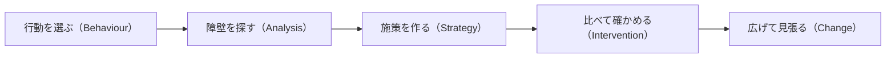

# 第 7 章　実践: 行動を選び、施策を設計し、検証する

- 講座: ナッジ理論をプロダクト改善に活かす（nudge-product）
- 章 ID: `nudge-07`　動画 ID: `N07`
- 動画: 07:59（75 台詞）
- 要約: 改善したい行動を 1 つ選び、障壁 → 施策 → 主な指標とガードレール → 判断のきまり（期間・人数・止める条件）までを 1 枚の設計シートにまとめる。同じ期間に分けて比べ（A/B テスト）、少ないデータで断定しない。最後に講座全体を振り返り、次の一歩を決める。

> このファイルは `bun scripts/build_materials.ts` が `content/` の台本から作ります。直すときは台本（`content/nudge-product/` の TS）を直してください。

## 学習目標

- 改善したい行動を 1 つ選び、障壁 → 施策 → 検証指標と悪影響の確認方法までを、1 枚の設計シートにまとめられる
- 同じ期間に分けて比べる仕組み（A/B テスト）の考え方と、前後の比較の弱点を説明できる
- 主な指標と、悪影響を見張る指標（ガードレール）を決められる
- 必要な人数を見積もり、期間・人数・止める条件を先に決めて、少ないデータで断定しない

## 前提知識

- 第 1〜6 章（第 1 章の棚卸しの表があると、行動を選びやすい）
- アクセス解析の数字（率・人数）を見たことがある。統計の知識は要らない（人数の計算はコードの例を使う）

根拠の種類の札: **研究・学術**（査読のある研究・メタ分析・学術書の定義）／**公式・法令・規格**（法律・官公庁・標準化団体・公式ガイドライン）／**実務の指針**（実務家や専門機関の一般的な指針。条件によって外れる）／**説明用の仮の例**（架空のサンプルで、実在のデータではない）

## 1. 教材本文

### [nudge-07-s01] 困りごと: 効いたのか、偶然なのか

根拠: 説明用の仮の例　動画の場面: 3

サンプル家計簿で、週に 1 回の振り返りの通知の文言を、「今週の振り返りの時間です」から「今週の支出 3 件、予算まであと 8,200 円」に変えました。変える前の週に振り返りを開いた人は 20%、変えた次の週は 25% でした（**数字は説明用の仮の例です**）。

5 ポイント上がったように見えます。でも、次の週は給料日のあとで、もともと開く人が多かったのかもしれません。通知の文言のほかにも、アプリの更新や季節（年末など）の違いが混ざっています。人数が少なければ、偶然でもこのくらいの差は出ます。

この章では、「効いたのか、偶然なのか分からない」を避けるために、施策を始める前に **1 枚の設計シート**を書き、同じ期間に分けて比べ、悪影響も見張り、判断のきまりを先に決める方法を学びます。第 1 章から使ってきた流れ（行動を選ぶ → 障壁を考える → 施策を設計する → 検証指標と悪影響の確認方法を決める）の仕上げです。

### [nudge-07-s02] 設計シートの流れ（OECD の BASIC）と、行動・障壁の書き方

根拠: 公式・法令・規格・実務の指針・説明用の仮の例　動画の場面: 4, 5　出典: [OECD 2019](https://doi.org/10.1787/9ea76a8f-en)

OECD の「Tools and Ethics for Applied Behavioural Insights: The BASIC Toolkit」（2019 年）は、行動インサイトを政策に使う手順を 5 つの段階にまとめています。**Behaviour（行動）**: 問題のなかで大事な行動を見つけて、的を絞る。**Analysis（分析）**: その行動を、行動科学の見方で調べる。**Strategy（戦略）**: 行動の知見を使った解決策を考える。**Intervention（介入）**: 解決策の効果を確かめる実験を設計する。**Change（変化）**: 実施・広げ方・見張り・評価・結果の共有を計画する。段階ごとに倫理の注意も付いています。

分析では、**ABCD** の 4 つの見方を使います。**Attention（注意）**: 人の注意には限りがあり、それやすい。**Belief formation（信念）**: 思い込みや直感に頼り、結果や確率を大きく、または小さく見積もる。**Choice（選択）**: 選択肢の見せ方や、まわりの人・状況に影響される。**Determination（意志）**: 意志の力には限りがあり、心理的なバイアスの影響を受ける。

この講座の設計シート（図 nudge-07-f01）は、この流れに合わせて、行動（B）・障壁（A）・施策（S）・比べ方と指標と判断のきまり（I）を 1 枚に書き、うまくいったあとに広げて見張ること（C）を「次にすること」として書き足します（図 nudge-07-f03）。

**行動の書き方**: 観察できる 1 つの行動を、だれが・いつ・何をするかまで書きます（例: 始めて 2 週目にも、振り返りの画面を開く）。その行動が本人の何の役に立つかも一言書きます（例: 使いすぎに早く気づける）。会社の数字（売上など）だけの目標は、行動ではありません。

**障壁の書き方**: ABCD で探します。サンプル家計簿の例では、注意（日曜の通知に気づかない・忘れる）、信念（振り返っても役に立たないと思う）、選択（開いても何を見ればいいか分からない）、意志（続ける気持ちが続かない）。障壁によって合う道具が変わります（気づかない → タイミングと通知の言葉、何を見ればいいか分からない → 手間を減らす、など。第 2〜5 章）。いちばん大きそうな 1〜2 個に絞ります。

### [nudge-07-s03] 比べる仕組み: A/B テストと、その限界

根拠: 公式・法令・規格・実務の指針　動画の場面: 6　出典: [OECD 2019](https://doi.org/10.1787/9ea76a8f-en)、[Ron Kohavi, Diane Tang, Ya Xu（Cambridge University Press） 2020](https://doi.org/10.1017/9781108653985)

効いたかどうかを確かめるには、比べる相手が要ります。前と後で比べると（変える前の週と、変えた次の週）、給料日・曜日・季節・アプリの更新など、施策のほかの違いが混ざり、差が施策のせいか分かりません。

BASIC は、RCT（ランダム化比較試験）を、効果を知るための理想的な方法として説明しています。ランダムに分けると、2 つの群はもともとの違いがほぼそろい、施策のほかに残る違いは偶然のばらつきだけになります。だから、終わったときの差が偶然の範囲を超えていれば、施策の効果として読めます（どれくらいの人数なら偶然と見分けられるかは、この章の「判断のきまり」の節で扱います）。新しい案をいくつか試すときも、今のままの群（対照群）を入れて比べます。Web サービスやアプリで、ユーザーをランダムに 2 つに分けて比べるのが **A/B テスト**です。

実務での注意（この講座のきまり）:

- **分ける単位は人**: 同じ人が日によって A と B の両方を見ないように、ユーザーごとに分ける
- **同じ期間に動かす**: A と B を同時に出す。片方だけ先に始めない
- **人数の比を確かめる**: 半分ずつに分けたつもりが、実際の人数が大きくずれていたら、仕組みの不具合を疑う。オンライン実験の実務書は、この比のずれ（SRM）を、すべての実験で見るべき信頼性のガードレールとしている（Kohavi ほか, 2020）

**A/B テストができないとき**: 人数が少ない、ランダムに分けられない、分けること自体が不公平になる、ということもあります。BASIC も、ランダムに分けることが実務・倫理・政治の面で難しいときは、専門家に相談して、ランダムに分けない比べ方（準実験）を考えるとしています。小さなサービスなら、(1) 大きな差が見込める施策から試す、(2) 期間を延ばして人数を集める、(3) 数人に実際に使ってもらい、どこで迷うかを見る（数字の代わりに理由を知る）、という手もあります。いずれも「効いた」と言い切らず、「傾向が見えた」くらいの言い方にとどめます。

### [nudge-07-s04] 主な指標と、ガードレール

根拠: 実務の指針・公式・法令・規格・説明用の仮の例　動画の場面: 7　出典: [Ron Kohavi, Diane Tang, Ya Xu（Cambridge University Press） 2020](https://doi.org/10.1017/9781108653985)、[米国連邦取引委員会（FTC） 2022](https://www.ftc.gov/system/files/ftc_gov/pdf/P214800%20Dark%20Patterns%20Report%209.14.2022%20-%20FINAL.pdf)、[OECD 2022](https://doi.org/10.1787/44f5e846-en)

測る数字は 2 種類を決めます。**主な指標**は、増やしたい行動を測る 1 つの数字です（例: 始めて 2 週目に振り返りを開いた人の割合）。判断に使う数字が多いと、どれかが偶然よく見えることが増えるので、1 つに絞ります。

**ガードレール**は、主な指標が伸びても、悪くなってはいけない数字です。オンライン実験の実務書（Kohavi ほか, 2020）は、ガードレール指標を、実験の前提が崩れたことを知らせる重要な指標とし、事業を守るもの（組織のガードレール）と、結果が信頼できるかを確かめるもの（信頼性のガードレール）の 2 種類に分けています。この講座では、ここに**ユーザーへの悪影響**を見張る数字も入れます。

サンプル家計簿の通知の施策なら、通知をオフにした人の割合、ログインしなくなった人の割合、有料プランの解約率、問い合わせや低い評価の数、などです。施策で悪くなりそうなことから考えます（通知に支出を具体的に書くと、見たくない人には負担になるかもしれない、など）。2〜3 個に絞り、どこまで悪くなったら止めるか（線）も決めます。

A/B テストは、だましの案を「勝ち」と選んでしまうこともあります。FTC の報告書には、ある会社が A/B テストで、事実と違う「事前承認済み」という言葉のほうがクリックされると分かり、その言葉を採用した、と FTC が訴えた事例が載っています。FTC は、画面の設計を売上やクリック率だけで見ず、利用者が取引の大事な条件を正しく理解できるかへの影響でも見るべきだ、としています。OECD の報告書も、A/B テストを申込みの率だけでなく、消費者の利益と法令を守る観点からも使うよう勧める声を紹介しています。

だから、勝った案を出す前に、第 6 章の 6 つの手口の点検も通します。数字が良くても、だましの手口が入っていたら出しません。

### [nudge-07-s05] 判断のきまり: 少ないデータで断定しない

根拠: 研究・学術・公式・法令・規格・実務の指針・説明用の仮の例　動画の場面: 8, 9　出典: [Stefano DellaVigna, Elizabeth Linos（Econometrica 90） 2022](https://doi.org/10.3982/ECTA18709)、[Maximilian Maier ほか（PNAS 119） 2022](https://doi.org/10.1073/pnas.2200300119)、[Ramesh Johari, Pete Koomen, Leonid Pekelis, David Walsh（Operations Research 70） 2022](https://doi.org/10.1287/opre.2021.2135)、[OECD 2019](https://doi.org/10.1787/9ea76a8f-en)、[日本版ナッジ・ユニット BEST（環境省） 2020（3 月。2021 年 3 月改訂）](https://www.env.go.jp/earth/ondanka/nudge/checklist_study.pdf)、[日本版ナッジ・ユニット BEST（環境省） 2020（12 月）](https://www.env.go.jp/earth/ondanka/nudge/checklist_deploy.pdf)

**差が小さいほど、人数が要ります**。今の割合が 20% のとき、両側の有意水準 5%・検出力 80%（よく使われる基準）で 1 つの群に必要な人数を計算すると、+5 ポイント（25%）なら約 1,100 人、+1.4 ポイント（21.4%）なら約 1 万 3 千人です（図 nudge-07-f02、計算のコードは図 nudge-07-f04）。1.4 ポイントは、米国の 2 つのナッジ・ユニットの 126 の試験の平均の効果です（DellaVigna & Linos, 2022）。利用者が少ないサービスでは、平均くらいの小さな差は、まず見分けられません。

BASIC も、介入の前に「成功の定義」と「必要な人数（標本の大きさ）」を決め、意味のある差がどれくらいかを関係者と話し合い、専門家に人数を計算してもらうよう勧めています。効果がない・悪いという結果になる可能性も、前もって考えておくとしています。

**論文の数字が大きく見える理由**: DellaVigna & Linos（2022）は、学術誌の研究の平均（8.7 ポイント）とナッジ・ユニットの試験の平均（1.4 ポイント）の差の約 7 割を、目立つ結果ほど論文になりやすいこと（出版バイアス）と、それを強める検出力の低さで説明しています。人数の少ない試験で大きな差が出ても、そのまま信じないほうがよい、ということです。出版バイアスを補正すると、ナッジ全体の平均効果の証拠は弱くなる、という指摘もあります（Maier ほか, 2022）。

**途中で何度も見て止めない**: A/B テストの p 値や信頼区間は、結果を見ながら続けるか止めるかを決めると、当てにならなくなります（Johari ほか, 2022）。良く見えたところで止めると、偶然の差を効果と見誤りやすくなります。この講座では、主な指標は、決めた人数と期間がそろってから 1 回だけ判定します（途中で見ながら判定できる方法も研究されていますが、ここでは扱いません）。

判断のきまりの書き方（この講座のきまり）:

- **人数**: 見分けたい差（「これくらい上がれば続ける価値がある」）から、1 群の人数を見積もる
- **期間**: その人数が集まる長さ。曜日の偏りをならすため 1 週間の倍数にし、家計簿のように月の中で使い方が変わるなら 4 週間以上にする。例: +5 ポイントを見分けるのに 2 群で約 2,200 人、1 週間に始める人が 300 人なら 8 週間（仮の数字）。主な指標が「始めて 2 週目」のように時間をおいて測るものなら、最後に入った人がその時点を過ぎるまで待ってから判定する（この例なら 10 週目の終わり）
- **止める条件**: ガードレールが決めた線を超えたら、期間の途中でもすぐ止める（例: 通知のオフが A より 2 ポイント以上多い）。悪影響で止めるのは、主な指標の判定とは別
- **決め方**: 決めた時点で、主な指標の差が、先に決めた基準（両側の有意水準 5% など）で統計的に意味があり、ガードレールが悪化していなければ採用。そうでなければ「効果は確認できなかった」と記録して、次の案へ
- **記録**: 結果は良くても悪くても残す。BEST の倫理チェックリストも、結果が都合に合わなくても隠さない体制を求め、不利益が出たら続けるかどうかも含めてすぐ対処するよう求めている

### [nudge-07-s06] 良い例と悪い例: 実験のメモ

根拠: 説明用の仮の例　動画の場面: 10, 11

悪い例のメモは、3 日目に差（20% → 29%）が出たところで止め、「効きました」と全員に出しています。比べた相手は先週の数字で、人数は 1 群 90 人。通知のオフや解約は見ていません。少ない人数で途中で止めると、偶然の大きな差をつかみやすく、悪影響にも気づけません。

良い例のメモは、始める前に、主な指標とガードレール、期間と人数（8 週間・1 群 約 1,100 人）、止める条件、結果の記録の約束を書いています。こう書いておけば、途中で数字が良く見えても悪く見えても、決めたとおりに進められます。

○×クイズのとおり、3 日目の大きな差で「効いた」と決めるのはバツです。ただし、ガードレールの悪化（例: 通知のオフが急に増えた）で止めるのは、期間の途中でもすぐに行います。

### [nudge-07-s07] 実践手順: 設計シートを埋めて、小さく試す

根拠: 実務の指針・公式・法令・規格　動画の場面: 12, 13　出典: [OECD 2019](https://doi.org/10.1787/9ea76a8f-en)、[日本版ナッジ・ユニット BEST（環境省） 2020（3 月。2021 年 3 月改訂）](https://www.env.go.jp/earth/ondanka/nudge/checklist_study.pdf)、[Richard H. Thaler（The New York Times） 2015](https://www.nytimes.com/2015/11/01/upshot/the-power-of-nudges-for-good-and-bad.html)

1. **行動を 1 つ選ぶ**: 観察できて、本人のためになる行動。第 1 章の棚卸しの表から選ぶとよい
2. **障壁を書く**: ABCD（注意・信念・選択・意志）で探し、いちばん大きそうな 1〜2 個に絞る
3. **施策を書く**: 障壁に合う道具を第 2〜5 章から選ぶ。第 6 章の 6 つの手口と、良いナッジの 3 条件（透明・断りやすい・本人のため）で点検する
4. **比べ方・指標・判断のきまりを書く**: 分ける単位と割合、主な指標 1 つ、ガードレール 2〜3 個、人数と期間、止める条件、決め方
5. **倫理の点検をしてから試す**: A/B テストは、BEST の倫理チェックリストの言う「調査・研究」（RCT などで効果を調べること）に当たります。①調査・研究編は、原則として事前に説明して同意を得ること（インフォームド・コンセント）を求め、得られない・得るのが難しいときは、その十分な理由を明らかにして補う手順を整えることを求めています。対照群になった人の不利益にも気を配るよう求めています。サービスで試すときは、少なくとも、何を試すことがあるかをお知らせや規約で説明し、どちらの群も本人に不利にならない案だけを試します（この講座の目安。どこまで必要かは、社内の規程や専門家にも確かめる）
6. **記録して、次へ**: 結果を設計シートに書き足し、採用するなら広げ方と、長い目での見張り（C: 変化）を決める。効かなかった結果も残す

このシートが、講座の最終課題です（実践課題 nudge-07-ex）。

### [nudge-07-s08] 振り返りの問いと、講座のまとめ

根拠: 実務の指針　動画の場面: 14, 15, 16

- 最近の施策で「効いた」と判断した根拠は何でしたか？ 比べる相手と人数は十分でしたか？
- 自分のサービスでは、1 週間に何人が、その行動の手前まで来ますか？ その人数で、どれくらいの差なら見分けられますか？
- 主な指標が伸びたときに、悪くなっていそうな数字は何ですか？ それを今、見られますか？

**講座のまとめ**: どの画面にも選択アーキテクチャがあり、中立な画面はありません（第 1 章）。デフォルト、言葉と見せ方、社会的規範とフィードバック、手間とタイミングは、選ぶ自由を残したまま選びやすくする道具です（第 2〜5 章）。同じ道具でも、隠したり断りにくくしたりすれば、ダークパターンになります（第 6 章）。そして、効果は保証されないので、1 枚の設計シートで小さく試し、悪影響も見張って確かめます（第 7 章）。

**次の一歩**: 自分のサービスで行動を 1 つだけ選び、設計シートを書いて、小さく試してください。効かないこともあります。それも、自分のサービスについての確かな学びです。

## 2. ナレーション台本

話者: 講師 = VOICEVOX:No.7、呼び込み = VOICEVOX:青山龍星。時刻は合成した音声の実測。

### 場面 1　オープニング

- `00:02` （呼び込み）第7章。実践。行動を選び、施策を設計し、検証する。
- `00:08` いよいよ最後の章です。これまでの道具を、一枚の設計シートにまとめ、安全に試す方法を学びます。

### 場面 2　この章のゴール

- `00:17` この章のゴールは、三つです。
- `00:19` 一つ目。行動、障壁、施策、検証を、一枚のシートにまとめられること。
- `00:26` 二つ目。主な指標と、悪い影響を見張る指標を、決められること。
- `00:31` 三つ目。少ないデータで断定しない、判断のきまりを作れることです。

### 場面 3　困りごと: 効いたのか、偶然なのか

- `00:37` サンプル家計簿で、振り返りの通知の文言を、変えてみました。
- `00:42` 変える前の週に、振り返りを開いた人は、二十パーセント。
- `00:47` 変えた次の週は、二十五パーセント。五ポイント上がりました。どちらも、仮の数字です。
- `00:53` でも、次の週は給料日のあとで、もともと開く人が多かったのかもしれません。
- `00:59` 効いたのか、偶然なのか。これでは、分かりません。

### 場面 4　流れ: OECD の BASIC

- `01:04` OECD は、行動の知見を政策に使う手順を、BASIC という、五つの段階にまとめています。
- `01:11` 行動。変えたい行動を、一つに絞ります。
- `01:15` 分析。その行動を妨げている障壁を、注意、信念、選択、意志の、四つの見方で探します。
- `01:24` 戦略。この講座の第二章から第五章の道具を使って、施策の案を作ります。
- `01:30` 介入。比べられる形で試して、効果を確かめます。
- `01:34` 変化。うまくいったら広げ、長い目で、悪い影響が出ていないかを見張ります。
- `01:40` この講座の設計シートも、この流れに沿っています。

### 場面 5　1 枚の設計シート（仮の例）

- `01:45` では、一枚の設計シートを見ます。サンプル家計簿で埋めた、仮の例です。
- `01:50` 行動は、始めて二週目にも、振り返りを開くこと。だれが、いつ、何をするかまで書きます。
- `01:58` 障壁は、通知に気づかない、開いても何を見ればいいか分からない、などです。
- `02:04` 施策は、通知に今週の支出を具体的に書き、振り返りを、三つの質問、一分で終わる形にします。
- `02:11` 主な指標は、二週目に、振り返りを開いた人の割合です。
- `02:16` ガードレールは、悪くなってはいけない数字。通知のオフや、解約、問い合わせです。
- `02:22` 判断のきまりは、期間、人数、止める条件。ここまでを、始める前に書きます。

### 場面 6　比べる仕組み: A/B テスト

- `02:30` 効いたかどうかを確かめるには、比べる相手が要ります。
- `02:34` 前と後で比べると、給料日や曜日、季節の違いが、混ざってしまいます。
- `02:40` だから、差が出ても、施策のせいかどうか、分かりません。
- `02:45` そこで、同じ期間に、ユーザーをランダムに二つに分けて、片方だけに新しい施策を見せます。これが、A/B テストです。
- `02:54` ランダムに分ければ、二つの群の違いは、施策と偶然だけになります。だから、偶然を超える差なら、施策の効果として読めます。
- `03:03` 比べる相手を、同じ時期に用意する。これが、検証の土台です。

### 場面 7　主な指標と、ガードレール

- `03:09` 測る数字は、二種類を決めます。
- `03:12` 一つは、主な指標。増やしたい行動を測る、一つの数字です。
- `03:17` もう一つが、ガードレール。主な指標が伸びても、悪くなってはいけない数字です。
- `03:22` オンライン実験の実務で、使われている考え方です。ナッジなら、ユーザーへの悪い影響を、ここで見張ります。
- `03:30` FTC の報告書には、A/B テストで、よくクリックされた言葉を採用した、会社の事例が載っています。
- `03:38` ところが、その言葉は事実と違っていた、と FTC は訴えています。
- `03:43` 勝った案が、だましの案のこともある。だから、ガードレールと一緒に、第六章の点検もします。

### 場面 8　少ないデータでは、小さな差は見えない

- `03:51` もう一つ大事なのが、人数です。差が小さいほど、見分けるのに、多くの人が要ります。
- `03:58` 例えば、二十パーセントが、二十五パーセントになる差なら、一つの群に、約千百人。
- `04:04` 第一章で見た、実務の平均の、一・四ポイントの差なら、一つの群に、約一万三千人が必要です。
- `04:13` よく使われる基準で計算した例です。利用者が少ないなら、小さな差は、まず見分けられません。

### 場面 9　判断のきまりを、先に書く

- `04:20` だから、判断のきまりを、始める前に書いておきます。
- `04:24` 人数は、見分けたい差から見積もります。五ポイントの差なら、二つの群で、約二千二百人です。
- `04:32` 期間は、その人数が集まる長さ。週に三百人が始めるなら、八週間です。これも、仮の数字です。
- `04:40` 止める条件は、ガードレールの数字が、決めた線を超えたら、すぐ止める、と決めます。
- `04:46` 主な指標を、途中で何度も見て、良さそうなところで止めると、偶然の差を、効果と見誤りやすくなります。

### 場面 10　悪い例・良い例: 実験のメモ

- `04:55` 実験のメモで、悪い例と良い例を比べます。
- `04:58` 悪い例は、三日目に差が出たところで止めて、効いた、と言い切っています。
- `05:04` しかも、比べた相手は先週の数字で、人数も、一つの群に九十人だけです。
- `05:10` 通知をオフにした人が増えていないかも、見ていません。
- `05:14` 良い例は、始める前に、主な指標と、ガードレールを書いています。
- `05:19` 期間は八週間。一つの群に、約千百人を集めてから、判断します。
- `05:25` 止める条件と、結果は良くても悪くても記録する、という約束も、先に書いています。

### 場面 11　クイズ

- `05:32` ここでクイズです。三日目に大きな差が出たので、予定より早く止めて、効いた、と決める。これで、いいでしょうか。
- `05:44` 答えは、バツ。人数が少ないうちは、偶然でも、大きな差が出ます。
- `05:50` 決めた期間まで待ちます。ただし、悪い影響が出たときは別です。そのときは、すぐに止めます。

### 場面 12　実践: 設計シートを埋めて、小さく試す

- `05:58` では、実践の手順です。
- `06:00` まず、行動を一つ選びます。観察できて、本人のためになる行動です。
- `06:06` 次に、障壁を探し、それに合う道具を選んで、施策を書きます。
- `06:11` 始める前に、主な指標、ガードレール、人数、期間、止める条件を、書いておきます。
- `06:19` 第六章の点検をしてから試し、結果は、良くても悪くても、記録に残します。

### 場面 13　演習

- `06:26` では、演習です。動画を止めて、五分だけ、取り組んでみてください。
- `06:31` 自分のサービスで、改善したい行動を一つ選び、設計シートを書き始めます。
- `06:37` まずは、行動と、ガードレールの二つだけでも構いません。仕上げる手順と回答例は、講座サイトの、実践課題にあります。
- （2.5 秒の間。考える時間）

### 場面 14　振り返り

- `06:49` 振り返りです。行動、障壁、施策、検証を、一枚の設計シートにまとめます。
- `06:57` 同じ期間に分けて比べ、主な指標と、ガードレールの、両方を見ます。
- `07:02` 人数、期間、止める条件を先に決め、少ないデータで、断定しません。

### 場面 15　この講座の振り返り

- `07:09` 最後に、講座の全体を振り返ります。
- `07:12` 第一章では、中立な画面はないこと、そして、良いナッジの三つの条件を学びました。
- `07:19` 第二章から第五章では、デフォルト、言葉と見せ方、社会的規範とフィードバック、手間とタイミングを、道具として学びました。
- `07:28` 第六章では、ダークパターンとの境界線を、手口と法律と倫理で、確かめました。
- `07:34` そしてこの章で、行動を選び、施策を設計し、安全に確かめる流れを、一枚にまとめました。

### 場面 16　エンディング

- `07:43` 次の一歩は、自分のサービスで、行動を一つだけ選び、小さく試して、測ることです。効かなくても、それは確かな学びです。
- `07:53` ここまで、ありがとうございました。

## 3. 絵コンテ

| # | 開始 | 秒数 | 図解の種類 | 根拠 | 表示内容（画面の文字） | 読み上げ（字幕と同じ） |
| --- | --- | --- | --- | --- | --- | --- |
| 1 | 00:00 | 17 秒 | タイトル |  | SECTION 4　実践／タイトル「実践: 行動を選び、施策を設計し、検証する」／1 枚の設計シートで、小さく試して確かめる | 第7章。実践。行動を選び、施策を設計し、検証する。 いよいよ最後の章です。これまでの道具を、一枚の設計シートにまとめ、安全に試す方法を学びます。 |
| 2 | 00:16 | 21 秒 | ゴールの一覧 |  | 【この章のゴール】1. 行動 → 障壁 → 施策 → 検証を、1 枚のシートにまとめられる 2. 主な指標と、悪影響を見張る指標（ガードレール）を決められる 3. 少ないデータで断定しない、判断のきまりを作れる | この章のゴールは、三つです。 一つ目。行動、障壁、施策、検証を、一枚のシートにまとめられること。 二つ目。主な指標と、悪い影響を見張る指標を、決められること。 三つ目。少ないデータで断定しない、判断のきまりを作れることです。 |
| 3 | 00:37 | 27 秒 | 数字 | 説明用の仮の例 | 【困りごと: 効いたのか、偶然なのか】通知の文言を変える前の週 20 % 変えた次の週 25 %／振り返りを開いた人の割合（仮の数字） | サンプル家計簿で、振り返りの通知の文言を、変えてみました。 変える前の週に、振り返りを開いた人は、二十パーセント。 変えた次の週は、二十五パーセント。五ポイント上がりました。どちらも、仮の数字です。 でも、次の週は給料日のあとで、もともと開く人が多かったのかもしれません。 効いたのか、偶然なのか。これでは、分かりません。 |
| 4 | 01:04 | 40 秒 | 時間の流れ | 公式・法令・規格 | 【流れ: OECD の BASIC】Behaviour　行動（B） → Analysis　分析（A） → Strategy　戦略（S） → Intervention　介入（I） → Change　変化（C） | OECD は、行動の知見を政策に使う手順を、BASIC という、五つの段階にまとめています。 行動。変えたい行動を、一つに絞ります。 分析。その行動を妨げている障壁を、注意、信念、選択、意志の、四つの見方で探します。 戦略。この講座の第二章から第五章の道具を使って、施策の案を作ります。 介入。比べられる形で試して、効果を確かめます。 変化。うまくいったら広げ、長い目で、悪い影響が出ていないかを見張ります。 この講座の設計シートも、この流れに沿っています。 |
| 5 | 01:44 | 46 秒 | 表 | 説明用の仮の例 | 【1 枚の設計シート（仮の例）】項目｜問い｜サンプル家計簿: 行動・だれが・いつ・何を？・始めて 2 週目にも、振り返りを開く／障壁・何が邪魔している？・通知に気づかない・開いても何を見るか分からない／施策・何を変える？・通知に今週の支出を具体的に。振り返りは 3 問で 1 分／主な指標・何で効果を測る？・2 週目に振り返りを開いた人の割合／ガードレール・何が悪くなってはいけない？・通知のオフ・解約・問い合わせ／判断のきまり・いつ・何で決める？・8 週間・1 群 約 1,100 人・止める条件 | では、一枚の設計シートを見ます。サンプル家計簿で埋めた、仮の例です。 行動は、始めて二週目にも、振り返りを開くこと。だれが、いつ、何をするかまで書きます。 障壁は、通知に気づかない、開いても何を見ればいいか分からない、などです。 施策は、通知に今週の支出を具体的に書き、振り返りを、三つの質問、一分で終わる形にします。 主な指標は、二週目に、振り返りを開いた人の割合です。 ガードレールは、悪くなってはいけない数字。通知のオフや、解約、問い合わせです。 判断のきまりは、期間、人数、止める条件。ここまでを、始める前に書きます。 |
| 6 | 02:30 | 39 秒 | 左右の比較 | 公式・法令・規格 | 【比べる仕組み: A/B テスト】左「前と後で比べる」給料日・曜日・季節の違いが混ざる・差が、施策のせいか分からない／右「同じ期間に、分けて比べる」ユーザーを、ランダムに 2 つの群に分ける・違いは施策と偶然だけ。偶然を超える差が効果／結論: 比べる相手を、同じ時期に用意する | 効いたかどうかを確かめるには、比べる相手が要ります。 前と後で比べると、給料日や曜日、季節の違いが、混ざってしまいます。 だから、差が出ても、施策のせいかどうか、分かりません。 そこで、同じ期間に、ユーザーをランダムに二つに分けて、片方だけに新しい施策を見せます。これが、A/B テストです。 ランダムに分ければ、二つの群の違いは、施策と偶然だけになります。だから、偶然を超える差なら、施策の効果として読めます。 比べる相手を、同じ時期に用意する。これが、検証の土台です。 |
| 7 | 03:08 | 42 秒 | 要点のカード | 実務の指針 | 【主な指標と、ガードレール】主な指標（増やしたい行動を測る、1 つの数字。例: 2 週目に振り返りを開いた人の割合）／ガードレール（悪くなってはいけない数字。例: 通知のオフ・解約・問い合わせ） | 測る数字は、二種類を決めます。 一つは、主な指標。増やしたい行動を測る、一つの数字です。 もう一つが、ガードレール。主な指標が伸びても、悪くなってはいけない数字です。 オンライン実験の実務で、使われている考え方です。ナッジなら、ユーザーへの悪い影響を、ここで見張ります。 FTC の報告書には、A/B テストで、よくクリックされた言葉を採用した、会社の事例が載っています。 ところが、その言葉は事実と違っていた、と FTC は訴えています。 勝った案が、だましの案のこともある。だから、ガードレールと一緒に、第六章の点検もします。 |
| 8 | 03:50 | 29 秒 | 数字 | 説明用の仮の例 | 【少ないデータでは、小さな差は見えない】+5 ポイント（20% → 25%） 1094 人 +1.4 ポイント（実務の平均） 13146 人／今の割合が 20% のとき、差を見分けるのに要る 1 群の人数（両側の有意水準 5%・検出力 80% で計算した例） | もう一つ大事なのが、人数です。差が小さいほど、見分けるのに、多くの人が要ります。 例えば、二十パーセントが、二十五パーセントになる差なら、一つの群に、約千百人。 第一章で見た、実務の平均の、一・四ポイントの差なら、一つの群に、約一万三千人が必要です。 よく使われる基準で計算した例です。利用者が少ないなら、小さな差は、まず見分けられません。 |
| 9 | 04:20 | 35 秒 | 要点のカード | 実務の指針 | 【判断のきまりを、先に書く】人数（見分けたい差から、1 群の人数を見積もる）／期間（人数が集まる長さ。曜日をならすため 1 週間の倍数で）／止める条件（ガードレールが決めた線を超えたら、すぐ止める） | だから、判断のきまりを、始める前に書いておきます。 人数は、見分けたい差から見積もります。五ポイントの差なら、二つの群で、約二千二百人です。 期間は、その人数が集まる長さ。週に三百人が始めるなら、八週間です。これも、仮の数字です。 止める条件は、ガードレールの数字が、決めた線を超えたら、すぐ止める、と決めます。 主な指標を、途中で何度も見て、良さそうなところで止めると、偶然の差を、効果と見誤りやすくなります。 |
| 10 | 04:55 | 37 秒 | 画面の比較（改善前・改善後） | 説明用の仮の例 | 【悪い例・良い例: 実験のメモ】悪い例「サンプル家計簿　実験メモ」: 1. 3 日で止めて「効いた」と言い切る 2. 先週と比べただけ。人数も少ない 3. 悪影響を見ていない／良い例「サンプル家計簿　実験の計画」: 1. 指標とガードレールを先に書く 2. 期間と人数を先に決める 3. 止める条件と、記録の約束 | 実験のメモで、悪い例と良い例を比べます。 悪い例は、三日目に差が出たところで止めて、効いた、と言い切っています。 しかも、比べた相手は先週の数字で、人数も、一つの群に九十人だけです。 通知をオフにした人が増えていないかも、見ていません。 良い例は、始める前に、主な指標と、ガードレールを書いています。 期間は八週間。一つの群に、約千百人を集めてから、判断します。 止める条件と、結果は良くても悪くても記録する、という約束も、先に書いています。 |
| 11 | 05:32 | 26 秒 | ○×クイズ |  | 【クイズ】Q1. 3 日目に大きな差が出たので、予定より早く止めて「効いた」と決める。これでいい？ → 答え ×: 少ない人数では、偶然でも大きな差が出る。悪影響でなければ、期間まで待つ | ここでクイズです。三日目に大きな差が出たので、予定より早く止めて、効いた、と決める。これで、いいでしょうか。 答えは、バツ。人数が少ないうちは、偶然でも、大きな差が出ます。 決めた期間まで待ちます。ただし、悪い影響が出たときは別です。そのときは、すぐに止めます。 |
| 12 | 05:57 | 28 秒 | 要点のカード | 実務の指針 | 【実践: 設計シートを埋めて、小さく試す】1. 行動を 1 つ選ぶ（観察できて、本人のためになる行動）／2. 障壁と施策を書く（注意・信念・選択・意志で障壁を探し、道具を選ぶ）／3. 指標ときまりを先に書く（主な指標・ガードレール・人数・期間・止める条件）／4. 試して、記録する（第 6 章の点検をしてから。結果は良くても悪くても残す） | では、実践の手順です。 まず、行動を一つ選びます。観察できて、本人のためになる行動です。 次に、障壁を探し、それに合う道具を選んで、施策を書きます。 始める前に、主な指標、ガードレール、人数、期間、止める条件を、書いておきます。 第六章の点検をしてから試し、結果は、良くても悪くても、記録に残します。 |
| 13 | 06:25 | 24 秒 | 大きな一文 |  | 【演習】動画を止めて、5 分／自分のサービスの設計シートを、書き始める／行動 → 障壁 → 施策 → 主な指標・ガードレール・判断のきまり | では、演習です。動画を止めて、五分だけ、取り組んでみてください。 自分のサービスで、改善したい行動を一つ選び、設計シートを書き始めます。 まずは、行動と、ガードレールの二つだけでも構いません。仕上げる手順と回答例は、講座サイトの、実践課題にあります。（2.5 秒の間） |
| 14 | 06:49 | 20 秒 | まとめ |  | 【振り返り】1. 行動 → 障壁 → 施策 → 検証を、1 枚の設計シートにまとめる 2. 同じ期間に分けて比べ、主な指標とガードレールの両方を見る 3. 人数・期間・止める条件を先に決め、少ないデータで断定しない | 振り返りです。行動、障壁、施策、検証を、一枚の設計シートにまとめます。 同じ期間に分けて比べ、主な指標と、ガードレールの、両方を見ます。 人数、期間、止める条件を先に決め、少ないデータで、断定しません。 |
| 15 | 07:09 | 34 秒 | 時間の流れ |  | 【この講座の振り返り】第 1 章　ナッジとは何か（1 章） → 第 2〜5 章　ナッジの道具（4 章） → 第 6 章　境界線と倫理（1 章） → 第 7 章　実践（1 章） | 最後に、講座の全体を振り返ります。 第一章では、中立な画面はないこと、そして、良いナッジの三つの条件を学びました。 第二章から第五章では、デフォルト、言葉と見せ方、社会的規範とフィードバック、手間とタイミングを、道具として学びました。 第六章では、ダークパターンとの境界線を、手口と法律と倫理で、確かめました。 そしてこの章で、行動を選び、施策を設計し、安全に確かめる流れを、一枚にまとめました。 |
| 16 | 07:42 | 17 秒 | 次の章の予告 |  | 選ぶ自由を守りながら、小さく試して確かめよう | 次の一歩は、自分のサービスで、行動を一つだけ選び、小さく試して、測ることです。効かなくても、それは確かな学びです。 ここまで、ありがとうございました。 |

字幕: 全部の台詞を日本語字幕にする（講座サイトは動画の下の帯、`out/captioned/` の動画は焼き込み）。画面の文字は要点だけにし、説明はナレーションと教材本文で補う。

## 4. 図解・比較例

### [nudge-07-f01] 設計シート（記入例）

この講座の最終課題の形。行は OECD の BASIC の段階（B・A・S・I・C）に対応させた。中身はサンプル家計簿の仮の例（説明用の仮の例）

| 項目 | 書くこと | サンプル家計簿（仮の例） |
| --- | --- | --- |
| 行動（B） | だれが・いつ・何をするか。本人の利益 | 始めて 2 週目にも振り返りを開く。使いすぎに早く気づける |
| 障壁（A） | ABCD（注意・信念・選択・意志）で探す | 注意: 通知に気づかない／選択: 開いても何を見るか分からない |
| 施策（S） | 障壁に合う道具。6 つの手口と 3 条件の点検 | 通知に今週の支出を具体的に。振り返りは 3 問・1 分。通知の停止も 1 タップ |
| 比べ方（I） | 分ける単位・割合・期間 | ユーザーごとにランダムに半分ずつ。同じ 8 週間 |
| 主な指標（I） | 判断に使う 1 つの数字 | 2 週目に振り返りを開いた人の割合（今は約 20%） |
| ガードレール（I） | 悪くなってはいけない数字と、止める線 | 通知のオフ・ログインしなくなった人・有料プランの解約・問い合わせ |
| 判断のきまり（I） | 人数・期間・止める条件・決め方・記録 | 1 群 約 1,100 人（+5 ポイント）、週 300 人で 8 週間集め、最後に入った人の 2 週目のあとに判定、通知のオフが 2 ポイント以上多ければ止める、結果は必ず記録 |
| 次にすること（C） | 広げ方と、長い目での見張り | 採用なら全員に出し、3 か月は通知のオフと解約率を見続ける |

### [nudge-07-f02] 1 群に必要な人数の目安（今の割合が 20% のとき）

2 つの割合の差の検定（両側の有意水準 5%・検出力 80%）で計算した例。条件が変われば人数も変わる。+1.4 ポイントは DellaVigna & Linos（2022）の平均の効果（説明用の仮の例）

| 見分けたい差 | 変えた群の割合 | 1 群に必要な人数 |
| --- | --- | --- |
| +1.4 ポイント（実務の平均） | 21.4% | 約 13,100 人 |
| +2 ポイント | 22% | 約 6,500 人 |
| +3 ポイント | 23% | 約 2,900 人 |
| +5 ポイント | 25% | 約 1,100 人 |
| +10 ポイント | 30% | 約 300 人 |

### [nudge-07-f03] BASIC の 5 つの段階と、設計シート

OECD（2019）の BASIC の段階を、この講座の言葉で書いたもの（公式・法令・規格）



流れ: 行動を選ぶ（Behaviour） → 障壁を探す（Analysis） → 施策を作る（Strategy） → 比べて確かめる（Intervention） → 広げて見張る（Change）

### [nudge-07-f04] 必要な人数を計算する（Python）

標準ライブラリだけで動く例。結果は図 nudge-07-f02 の人数になる。本番の判断では、使っている分析の道具や専門家の計算とも照らし合わせる（実務の指針）

```python
from math import ceil, sqrt
from statistics import NormalDist


def n_per_group(p1: float, p2: float, alpha: float = 0.05, power: float = 0.8) -> int:
    """2 つの割合の差を見分けるのに必要な、1 群あたりの人数（両側検定）"""
    z_a = NormalDist().inv_cdf(1 - alpha / 2)
    z_b = NormalDist().inv_cdf(power)
    p = (p1 + p2) / 2
    top = z_a * sqrt(2 * p * (1 - p)) + z_b * sqrt(p1 * (1 - p1) + p2 * (1 - p2))
    return ceil(top**2 / (p2 - p1) ** 2)


print(n_per_group(0.20, 0.25))   # 1094
print(n_per_group(0.20, 0.214))  # 13146
```

## 5. 理解確認問題

### 問 1. サンプル家計簿で「2 週目に振り返りを開いた人の割合」を主な指標にした。ガードレール指標として最も合うものは？

1. 振り返りを開いた人の割合
2. 通知をオフにした人の割合
3. 通知の文言の文字数
4. テストを担当した人の数

<details><summary>答えと解説</summary>

**答え: 2. 通知をオフにした人の割合**

ガードレールは、主な指標が伸びても悪くなってはいけない数字。通知を具体的にしたら、煩わしく感じてオフにする人が増えるかもしれない。通知のオフ・解約・問い合わせなど、ユーザーへの悪影響を見張る。

</details>

### 問 2. 「変える前の週」と「変えた次の週」を比べる方法の、いちばんの弱点は？

1. 人数が多すぎて、計算できない
2. 給料日・曜日・季節などの違いが混ざり、差が施策のせいか分からない
3. どんな施策でも、必ず効果がないと出る
4. 法律で禁止されている

<details><summary>答えと解説</summary>

**答え: 2. 給料日・曜日・季節などの違いが混ざり、差が施策のせいか分からない**

前後の比較では、施策のほかの違いが混ざる。同じ期間にユーザーをランダムに 2 つに分けて比べれば（A/B テスト）、施策のほかの違いは偶然のばらつきだけになり、偶然を超える差なら施策の効果として読める（OECD の BASIC の RCT の説明）。

</details>

### 問 3. 利用者が少ないサービスで、判断のきまりとして適切なものは？

1. 3 日見て差が出たら、その日に「効いた」と決める
2. 期間・人数・止める条件を始める前に書き、ガードレールは途中でも見張る
3. 良い結果が出たときだけ、記録に残す
4. 差が出るまで、何度も結果を見ながら期間を延ばす

<details><summary>答えと解説</summary>

**答え: 2. 期間・人数・止める条件を始める前に書き、ガードレールは途中でも見張る**

途中で何度も見て止めたり延ばしたりすると、偶然の差を効果と見誤りやすい（Johari ほか, 2022）。主な指標は決めた期間で判定し、ガードレールは途中でも見て、決めた線を超えたら止める。結果は良くても悪くても記録する。

</details>

## 6. 実践課題 [nudge-07-ex] ナッジの設計シートを完成させる（最終課題）

- ねらい: 自分のサービスで改善したい行動を 1 つ選び、障壁 → 施策 → 比べ方 → 主な指標とガードレール → 判断のきまりを 1 枚にまとめ、小さく試せる状態にする
- 目安の時間: 60〜90 分
- 出すもの: 設計シート 1 枚（行動・障壁・施策・比べ方・主な指標・ガードレール・判断のきまり・次にすること）

### 手順

1. 改善したい行動を 1 つ選び、だれが・いつ・何をするかと、本人にとっての利益を書く（第 1 章の棚卸しの表を使ってよい）
2. 障壁を ABCD（注意・信念・選択・意志）の見方で書き出し、大きそうな 1〜2 個に絞る
3. 障壁に合う道具（デフォルト・言葉と見せ方・社会的規範とフィードバック・手間とタイミング）から施策を 1 つ書き、第 6 章の 6 つの手口と良いナッジの 3 条件で点検する
4. 比べ方（分ける単位・割合・同じ期間）と、主な指標 1 つ・ガードレール 2〜3 個（止める線つき）を書く
5. 今の割合と見分けたい差から 1 群の人数を計算し（図 nudge-07-f04）、1 週間に対象になる人数から期間を出す。足りなければ、狙う差・期間・比べ方を見直す
6. 止める条件・決め方・記録の約束を書き、倫理の点検（何をどう説明するか・対照群の不利益）をメモする

### 回答例: サンプル家計簿: 2 週目の振り返りを続けてもらう（仮の例）

**行動**: 始めて 2 週目にも、振り返りの画面を開く。本人の利益は、使いすぎに早く気づけること。

**障壁**: 注意（日曜の通知に気づかない）と、選択（開いても何を見ればいいか分からない）の 2 つに絞った。信念（振り返っても役に立たないと思う）は、アンケートで確かめてから扱う。

**施策**: 通知を「今週の支出 3 件、予算まであと 8,200 円」と具体的にし（言葉と見せ方）、振り返りを 3 つの質問・1 分で終わる形にする（手間を減らす）。通知の回数の変更と停止は、通知から 1 タップでできるようにした（断りやすい）。6 つの手口は無し。

**比べ方**: 新しく始めた人を、ユーザーごとにランダムに半分ずつ、今の通知（A）と新しい通知（B）に分ける。同じ 8 週間に動かす。

**主な指標**: 始めて 2 週目に振り返りを開いた人の割合（今は約 20%）。

**ガードレール**: 通知をオフにした人の割合（A より 2 ポイント以上多ければ止める）、2 週目にログインしなくなった人の割合、有料プランの解約率、問い合わせの数。

**判断のきまり**: +5 ポイント（25%）を見分けたいので 1 群 約 1,100 人。1 週間に始める人は約 300 人なので 8 週間（2 群で約 2,400 人）。主な指標は、最後に入った人の 2 週目が終わる 10 週目の終わりに、1 回だけ判定する。ガードレールは毎週見る。結果は良くても悪くても記録し、チームに共有する。

**倫理の点検**: アプリのお知らせで「通知の文言を改善するため、表示を出し分けることがあります」と説明する。どちらの文言も、本人に不利にならない。

**次にすること**: 採用なら全員に出し、3 か月は通知のオフと解約率を見続ける。効果が確かめられなければ、障壁の「信念」を確かめるアンケートに進む。

### 評価基準

| 観点 | できている | もう一歩 | やり直し |
| --- | --- | --- | --- |
| 行動と障壁 | 観察できる行動と本人の利益が書け、障壁を ABCD の見方で具体的に挙げて絞っている | 行動はあるが曖昧、または障壁が「使われない」などの一般論 | 会社の数字（売上など）だけで、本人の利益も障壁も書かれていない |
| 施策と点検 | 障壁に合う道具を選び、6 つの手口と 3 条件で点検した結果を書いている | 施策はあるが、障壁とのつながりか、点検が抜けている | 断りにくくする・隠すなどの手口を含む施策になっている |
| 比べ方と指標 | 同じ期間にランダムに分ける比べ方、主な指標 1 つ、止める線つきのガードレール 2〜3 個がある | 前後の比較だけ、またはガードレールがない | 何で効果を判断するかが書かれていない |
| 判断のきまり | 人数の見積もりと期間、止める条件、決め方、記録の約束が、始める前に書いてある | 期間はあるが、人数の根拠か止める条件がない | 「様子を見て決める」など、判断のきまりがない |

## 7. 要点まとめと参考資料

### 要点

- 施策は始める前に 1 枚の設計シート（行動 → 障壁 → 施策 → 比べ方 → 主な指標・ガードレール → 判断のきまり）に書く。OECD の BASIC の流れに沿う
- 効果は、同じ期間にユーザーをランダムに分けて比べる（A/B テスト）。前後の比較には、曜日・給料日・季節などの違いが混ざる
- 主な指標が伸びても、ガードレール（通知のオフ・解約・問い合わせなど）が悪化したら止める。A/B テストはだましの案を勝たせることもあるので、第 6 章の点検も通す
- 差が小さいほど人数が要る（今が 20% なら、+5 ポイントで 1 群 約 1,100 人、+1.4 ポイントで約 1 万 3 千人）。人数・期間・止める条件を先に決め、途中で何度も見て止めない
- 効果は保証されない。効かなかった結果も記録して、次の一歩にする

### 参考資料

- OECD（2019）「Tools and Ethics for Applied Behavioural Insights: The BASIC Toolkit」 https://doi.org/10.1787/9ea76a8f-en （公式・法令・規格・2026-10-31 確認）
  - 行動インサイトを政策に使う 5 段階（Behaviour: 大事な行動に絞る／Analysis: 行動科学の見方で調べる（ABCD）／Strategy: 解決策を考える／Intervention: 成功の定義・標本の大きさ・リスクを決めて実験で確かめる（RCT が理想）／Change: 実施・広げ方・見張り・評価・共有）と、段階ごとの倫理の注意。2026-10-31 に oecd.org の公式 PDF（publications/reports/2019/06 の版）で確かめ直した（HTML のページは 403）
- Stefano DellaVigna, Elizabeth Linos（Econometrica 90）（2022）「RCTs to Scale: Comprehensive Evidence From Two Nudge Units」 https://doi.org/10.3982/ECTA18709 （研究・学術・2026-10-31 確認）
  - 米国の 2 つのナッジ・ユニットの 126 の RCT（約 2,300 万人）の平均効果は +1.4 ポイント（対照群比 +8.0%、統計的に有意）。学術誌の研究は +8.7 ポイント（+33.4%）。差の約 7 割は、検出力の低さで強まった選択的な出版で説明できる（2026-10-31 に要旨で確かめ直し）
- Maximilian Maier ほか（PNAS 119）（2022）「No evidence for nudging after adjusting for publication bias」 https://doi.org/10.1073/pnas.2200300119 （研究・学術・2026-10-30 確認）
  - Mertens ほかのデータを出版バイアスで補正すると、平均効果は d≈0.04 で証拠は弱い（効果なしの証明ではなく、どちらとも決まらない水準）。情報を出すだけの介入と金融の分野は効果がないことを支持し、決定の構造の介入ははっきりしない
- Ramesh Johari, Pete Koomen, Leonid Pekelis, David Walsh（Operations Research 70）（2022）「Always Valid Inference: Continuous Monitoring of A/B Tests」 https://doi.org/10.1287/opre.2021.2135 （研究・学術・2026-10-30 確認）
  - A/B テストの p 値と信頼区間は、結果を見ながら続けるか止めるか（人数）を決める、つまり途中で何度も見ると、まったく当てにならなくなると指摘し、いつ判断しても使える p 値と信頼区間を提案した。大規模な商用の A/B テストの基盤で使われている。抄録（Crossref の書誌）と arXiv 版（1512.04922）の抄録で確認。本文は未開封
- Ron Kohavi, Diane Tang, Ya Xu（Cambridge University Press）（2020）「Trustworthy Online Controlled Experiments: A Practical Guide to A/B Testing」 https://doi.org/10.1017/9781108653985 （実務の指針・2026-10-30 確認）
  - オンライン実験（A/B テスト）の実務書。第 21 章の要約で、ガードレール指標を、実験の前提が崩れたことを知らせる重要な指標とし、組織のガードレール（事業を守る。第 7 章で扱う）と信頼性のガードレールの 2 種類があり、群の人数の比のずれ（SRM）はすべての実験で見るべきだとしている。本文は未開封で、Cambridge Core の章の要約と Crossref の書誌で確認
- 米国連邦取引委員会（FTC）（2022）「Bringing Dark Patterns to Light（Staff Report）」 https://www.ftc.gov/system/files/ftc_gov/pdf/P214800%20Dark%20Patterns%20Report%209.14.2022%20-%20FINAL.pdf （公式・法令・規格・2026-10-30 確認）
  - スタッフ報告（2022 年 9 月、委員会が 5 対 0 で公表を承認）。ダークパターンを、利用者をだましたり操ったりして本来しなかった選択をさせ、害を与えうる設計の手法と説明（法律上の定義ではない）。広告の偽装・偽の期限、解約の妨害、条件や手数料の隠蔽、個人データの提供への誘導を代表的な手口に挙げる
- OECD（2022）「Dark Commercial Patterns（OECD Digital Economy Papers No. 336）」 https://doi.org/10.1787/44f5e846-en （公式・法令・規格・2026-10-31 確認）
  - Digital Economy Papers No. 336（2022-10-26）。ダークパターンの作業定義・7 つの分類・広がりと害の証拠・規制と執行の選択肢・自己監査。穏やかに見える手口でも同じくらい効くことがあり、決定版の分類は難しいとする。本体の PDF で確認（DOI の先は 403。公式 PDF は https://www.oecd.org/content/dam/oecd/en/publications/reports/2022/10/dark-commercial-patterns_9f6169cd/44f5e846-en.pdf ）
- 日本版ナッジ・ユニット BEST（環境省）（2020（3 月。2021 年 3 月改訂））「ナッジ等の行動インサイトの活用に関わる倫理チェックリスト ①調査・研究編」 https://www.env.go.jp/earth/ondanka/nudge/checklist_study.pdf （公式・法令・規格・2026-10-30 確認）
  - BEST は 2017 年 4 月に環境省の主導で発足。ナッジ倫理委員会が作った、効果を調べる段階のためのチェックリスト。ナッジの定義の和訳と解説も載る
- 日本版ナッジ・ユニット BEST（環境省）（2020（12 月））「ナッジ等の行動インサイトの活用に関わる倫理チェックリスト ②社会実装編」 https://www.env.go.jp/earth/ondanka/nudge/checklist_deploy.pdf （公式・法令・規格・2026-10-30 確認）
  - 施策や製品・サービスとして実際に使う段階のためのチェックリスト（効果の事前確認などの項目）。少額のポイントのように経済的インセンティブを小さく変えるものも除外されておらず、大小だけでは一様に言えないとする。満たせば十分というものではないと明記
- Richard H. Thaler（The New York Times）（2015）「The Power of Nudges, for Good and Bad」 https://www.nytimes.com/2015/11/01/upshot/the-power-of-nudges-for-good-and-bad.html （実務の指針・2026-10-30 確認）
  - コラムで示した良いナッジの 3 原則（透明で誤解させない・できるだけ簡単にオプトアウトできる・本人の福祉を高めると考える十分な理由がある）。公式の基準ではなく提唱者の指針。記事はツールで開けず、所在と日付（2015-10-31 公開）は Thaler の会社のページの再掲で確認

## 8. 学習画面の右側の AI チャットに聞ける質問例

（チャットはまだ作っていません。質問ごとに、答えの根拠にする節 ID を付けています）

1. 利用者が月に 200 人ほどの小さなサービスです。A/B テストをする意味はありますか？ 代わりにできることは？　→ 参照: `nudge-07-s03`、`nudge-07-s05`
2. ガードレール指標は、いくつくらい決めればいいですか？ 止める線は、どう決めればいいですか？　→ 参照: `nudge-07-s04`、`nudge-07-s05`
3. 設計シートの「障壁」を、注意・信念・選択・意志の 4 つの見方で書くと、どうなりますか？ 自分のアプリの例で考える手順を教えてください。　→ 参照: `nudge-07-s02`、`nudge-07-s07`
