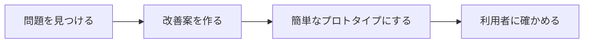

# 第 1 章　UI・UX とは何か

- 講座: エンジニアのための UI・UX デザイン（uiux-engineers）
- 章 ID: `uiux-01`　動画 ID: `D01`
- 動画: 06:35（57 台詞）
- 要約: 見た目の前に「ユーザーの目的」と「操作の流れ」から画面を見る。同じ予約フォームの改善前・改善後を比べ、なぜ分かりやすくなるかを、目的・流れ・見た目の 3 層とユーザビリティの数字で説明できるようにする。

> このファイルは `bun scripts/build_materials.ts` が `content/` の台本から作ります。直すときは台本（`content/uiux-engineers/` の TS）を直してください。

## 学習目標

- UX・ユーザビリティ・UI の違いを、規格の定義を手がかりに自分の言葉で説明できる
- 画面を「目的 → 流れ → 見た目」の 3 層で見て、どの層の問題かを書き分けられる
- 同じ画面の改善前・改善後を比べ、「なぜ分かりやすくなるか」をヒューリスティクスの言葉で説明できる
- 改善の良し悪しを、効果・効率・満足の数字で比べる計画を立てられる

## 前提知識

- Web の画面（HTML のフォームやボタン）を作ったことがある
- デザインの専門知識は要らない

根拠の種類の札: **研究・学術**（査読のある研究・メタ分析・学術書の定義）／**公式・法令・規格**（法律・官公庁・標準化団体・公式ガイドライン）／**実務の指針**（実務家や専門機関の一般的な指針。条件によって外れる）／**説明用の仮の例**（架空のサンプルで、実在のデータではない）

## 1. 教材本文

### [uiux-01-s01] 困りごと: 機能はあるのに、使い切ってもらえない

根拠: 説明用の仮の例　動画の場面: 3

この講座では、架空の予約サービス「サンプル予約」を例にします。小さなお店が来店の予約を受けるサービスです。今の予約の画面は、お名前・電話番号・メールアドレス・希望日時を 1 画面で入力して送る形です。

予約の画面を開いた人を 100 人とすると、最後の日時の欄まで入力した人が 58 人、予約を送った人が 29 人だったとします（**仮の数字で、実在のデータではありません**）。機能はそろっているのに、途中でやめる人が多い、という状況です。

ここでよくある打ち手は「ボタンを目立つ色にする」「デザインを今風にする」です。ただし、途中でやめる理由が「来た目的（希望の日時で予約したい）がすぐ果たせない」ことなら、見た目を直しても解決しません。この章では、問題がどの層にあるかを見分ける方法を学びます。

### [uiux-01-s02] UX・ユーザビリティ・UI の違い

根拠: 公式・法令・規格・実務の指針　動画の場面: 4　出典: [ISO 2019](https://www.iso.org/standard/77520.html)、[ISO 2018](https://www.iso.org/standard/63500.html)、[Don Norman, Jakob Nielsen（Nielsen Norman Group） 1998](https://www.nngroup.com/articles/definition-user-experience/)

言葉の意味は人によってぶれるので、国際規格の定義を手がかりにそろえます（以下は自分の言葉での言い換えです。規格の原文は ISO の有料の本文を見てください）。

- **UX（ユーザーエクスペリエンス）**: 製品やサービスを使うこと、使うと予想することから生まれる、利用者の受け止め方と反応（ISO 9241-210:2019 の 3.15。もとは ISO 9241-11:2018 の 3.2.3）。注記によれば、使う前・使っている間・使った後の感情や好み、行動まで含みます
- **ユーザビリティ**: ある製品やサービスを、決まった利用者が、決まった状況で使って、決まった目標を、効果・効率・満足をともなって果たせる度合い（ISO 9241-11:2018 の 3.1.1。訳語は JIS Z 8521:2020）。規格は、ユーザビリティを製品が持つ性質ではなく、使った結果だとしています
- **UI（ユーザーインターフェース）**: 利用者と製品がやりとりする部分。画面の配置・文言・ボタン・入力・通知など（ここは規格の定義ではなく一般的な説明）

Nielsen Norman Group の Don Norman と Jakob Nielsen は 1998 年の記事で、UX を利用者と会社・サービス・製品とのやりとりのすべてとして説明し、UX の全体と UI を区別すべきだと書いています。UI はデザインのとても大事な一部ですが、UI が完璧でも UX が悪いことはある、という例も挙げています。ISO 9241-11:2018 も注記で、UX は見せ方・機能・性能・やりとりのふるまいなどから生まれる、という趣旨を書いています。つまり **UI は UX を生む部品の 1 つ** で、UX には予約の前後のメールや、お店に着いたときの体験も含まれます。

エンジニアにとって大事なのは、ユーザビリティの 3 つの観点が、そのまま「改善を測る物差し」になることです（uiux-01-s05）。

### [uiux-01-s03] 画面は「目的 → 流れ → 見た目」の 3 層で見る

根拠: 実務の指針　動画の場面: 5　出典: [ISO 2019](https://www.iso.org/standard/77520.html)

この講座では、画面を次の 3 つの層に分けて見ます（UX の設計を層で考える実務の考え方を、この講座向けに 3 つにまとめたものです）。

- **目的**: その人は何をしに来たか。どんな状況で、何ができれば満足か（例: 初めての人が、希望の日時で予約したい）
- **流れ**: 何を、どの順で見せ、どう進んでもらうか。情報の並び・ステップの分け方・ナビゲーション
- **見た目**: 何を大きく・どれだけ空けて・どの文字と色で見せるか。視覚的な優先順位・余白・文字・色

下の層の問題は、上の層だけでは直しきれません。日時が最後にあるという「流れ」の問題は、ボタンの色では直りません。逆に、目的と流れが決まると「最初に見せるべきは日時」「一番大きいボタンは次へ」のように、見た目で何を優先するかが決めやすくなります（文字の薄さのように、見た目の層で別に直す問題もあります）。

国際規格の人間中心設計（ISO 9241-210）も、利用者・タスク・環境を明確に理解することから始め、利用者を交えて評価しながら繰り返すことを原則にしています。

### [uiux-01-s04] 改善前・改善後: なぜ分かりやすくなるのか

根拠: 説明用の仮の例・実務の指針　動画の場面: 6, 7, 8　出典: [Jakob Nielsen（Nielsen Norman Group） 1994（2020 年改訂・2024 年見直し）](https://www.nngroup.com/articles/ten-usability-heuristics/)、[Katie Sherwin（Nielsen Norman Group） 2014](https://www.nngroup.com/articles/form-design-placeholders/)

動画では、サンプル予約の予約の画面を、改善前と改善後で比べました（図 uiux-01-f01）。変えたのは 4 点です。

- **日時を最初にし、空いている時間だけを選べるようにした**: 来た目的に最初に答える。改善前は名前から入力が始まり、空いているかどうかは送るまで分からなかった
- **3 つのステップ（日時・連絡先・確認）のどこにいるかを見せた**: 今どこで、あと何があるかが分かる
- **ラベルを入力欄の外に出した**: 改善前は欄の中の薄い文字（プレースホルダー）だけで、入力を始めると消えた。見直すときに「何の欄だったか」を覚えておく必要があった
- **ボタンに次に起きることを書いた**: 「送信」では、押したら予約が確定するのか、確認の画面が出るのかが分からない

ここで大事なのは「何を変えたか」より「なぜ分かりやすくなるか」を説明できることです。Jakob Nielsen の 10 のユーザビリティ・ヒューリスティクス（経験則。1990 年に Rolf Molich と原型を作り、1994 年に今の 10 項目にまとめ、2020 年に説明を更新）には、「システムの状態を見せる」「システムと現実の世界を合わせる（利用者の言葉と順番）」「記憶より、見て分かるようにする」などがあり、改善の理由を説明する共通の言葉として使えます（図 uiux-01-f02）。

ただしヒューリスティクスは、NN/g 自身が「具体的なガイドラインではなく、大まかな経験則」と書いているもので、守れば必ず使いやすくなるという保証ではありません。最後は利用者に使ってもらって確かめます（第 8 章）。

### [uiux-01-s05] 改善を数字で比べる（効果・効率・満足）

根拠: 公式・法令・規格・実務の指針　動画の場面: 9　出典: [ISO 2018](https://www.iso.org/standard/63500.html)、[Kasper Hornbæk, Effie Lai-Chong Law（CHI 2007） 2007](https://www.kasperhornbaek.dk/papers/CHI2007_MetaAnalysis.pdf)

ユーザビリティの 3 つの観点は、そのまま測るものになります。

- **効果**: タスクを正しく最後までできた人の割合（予約を送れた人の割合）、間違えずにできたか（JIS Z 8521:2020 の訳語。古い訳では「有効さ」）
- **効率**: かかった時間、手順の数、やり直しの回数（日時を選ぶまでの時間）
- **満足**: 使った後の一言や点数（「迷わなかった」と答えた人の割合など）

3 つは食い違うことがあります。73 の研究をまとめた分析でも、効果・効率・満足の数字どうしの相関は全体に低いと報告されています（Hornbæk & Law, 2007）。たとえば入力欄を 1 画面に詰め込むと手順の数は減りますが、間違いが増えて効果が下がることがあります。1 つの数字だけで「良くなった」と判断せず、3 つをそろえて見ます。

本番の数字（アクセス解析）は、人数が少ないうちは偶然で大きく揺れます。小さなサービスでは、数人に実際に使ってもらい、どこで迷ったかを観察するほうが、早く具体的な手がかりになることがよくあります。

### [uiux-01-s06] 実践手順: 主要なタスクから画面を見直す

根拠: 実務の指針　動画の場面: 10, 11　出典: [Jakob Nielsen（Nielsen Norman Group） 2012](https://www.nngroup.com/articles/thinking-aloud-the-1-usability-tool/)、[Jakob Nielsen（Nielsen Norman Group） 2000](https://www.nngroup.com/articles/why-you-only-need-to-test-with-5-users/)

1. **主要なタスクを 1 文で書く**: 「誰が・どんな状況で・何をしたいか」。例: 初めての人が、仕事帰りにスマホで、希望の日時で予約したい
2. **今の手順を数える**: 画面の数・入力の数・判断の数（迷って選ぶ場面）。数えると、減らせる所が見える
3. **3 層の順に問題を書く**: 目的（来た目的にすぐ答えているか）→ 流れ（順番・ステップ・戻り方）→ 見た目（何が一番目立つか）
4. **2〜3 人に使ってもらう**: タスクだけを伝え、口を出さずに見る。考えていることを声に出してもらう「思考発話」が使える（NN/g の Jakob Nielsen は 2012 年の記事で、思考発話をユーザビリティの一番の道具と呼びつつ、万能ではないとも書いている）。1 人だけだと、その人のたまたまの行動に引きずられやすいので、結果は仮説として扱う（第 8 章で 3〜5 人のテストを扱う）

最初から完璧な分析はいりません。主要なタスクを 1 つに絞ると、見るべき画面と数字が決まります。

### [uiux-01-s07] 振り返りの問い

根拠: 実務の指針　動画の場面: 12, 13

- 自分のサービスの主要なタスクを、1 文で言えますか？ その 1 文は、作り手ではなく利用者の言葉ですか？
- 最近の画面の改善のうち、「見た目」の層で直したけれど、本当は「流れ」の問題だったものはありますか？
- 改善できたかどうかを、どの数字（効果・効率・満足）で確かめますか？

最後の章（第 8 章）では、自分のサービスの 1 画面で「問題を見つける → 改善案を作る → 簡単なプロトタイプにする → 利用者に確かめる」を一巡します。この章で書いた主要なタスクが、その出発点です。

## 2. ナレーション台本

話者: 講師 = VOICEVOX:No.7、呼び込み = VOICEVOX:青山龍星。時刻は合成した音声の実測。

### 場面 1　オープニング

- `00:02` （呼び込み）第1章。UI・UX とは何か。
- `00:06` こんにちは。エンジニアのための、UI・UX デザイン講座へ、ようこそ。

### 場面 2　この章のゴール

- `00:14` この章のゴールは、三つです。
- `00:16` 一つ目。UI と UX の違いを、自分の言葉で説明できること。
- `00:22` 二つ目。画面を、目的、流れ、見た目の、三つの層で見られること。
- `00:28` 三つ目。改善の前と後を、タスクの数字で比べられることです。

### 場面 3　困りごと: 予約が、途中で止まる

- `00:34` この講座では、架空の予約サービス、サンプル予約を例にします。小さなお店の、来店予約のサービスです。
- `00:43` 予約の画面を開いた人が、百人いたとします。
- `00:46` そのうち、最後の日時の欄まで入力したのは、五十八人。
- `00:51` 予約を送ったのは、二十九人だったとします。
- `00:54` 機能は、そろっています。でも、使い切ってもらえない。デザインの出番は、ここからです。

### 場面 4　UX・ユーザビリティ・UI

- `01:02` まず、言葉をそろえます。国際規格の ISO の定義を、要約して紹介します。
- `01:09` UX は、製品やサービスを使うこと、使うと予想することから生まれる、利用者の知覚と反応のこと。予約する前の期待や、予約した後の安心も含みます。
- `01:20` ユーザビリティは、特定の人が、特定の状況で、製品を使って、目標を、効果的に、効率よく、満足して達成できる度合いです。
- `01:31` この三つの観点は、あとで、改善を数字で比べるときの物差しになります。
- `01:36` そして UI は、利用者と製品がやりとりする部分。画面や、文言や、操作です。UI は、UX を作る部品の一つです。

### 場面 5　画面は 3 つの層で見る

- `01:47` エンジニアが画面を直すとき、つい見た目から手を付けがちです。でも、順番があります。
- `01:54` 一番下にあるのが、目的。その人は、何をしに来たのか。
- `01:59` 次に、流れ。何を、どの順番で見せ、どう進んでもらうか。
- `02:04` そして最後に、見た目。何を大きく、どれだけ空けて、どの色で見せるか。
- `02:10` 目的と流れが決まると、見た目で何を優先するかも、決めやすくなります。下の層の問題は、上の層だけでは直しきれません。

### 場面 6　同じ画面の、改善前と改善後

- `02:20` では、同じ予約の画面を、改善前と改善後で比べます。
- `02:25` 改善前は、お名前から入力が始まり、来た目的の日時は、最後です。しかも、空いているかどうかは、送るまで分かりません。
- `02:34` 入力欄の説明は、欄の中の薄い文字だけ。入力を始めると、消えてしまいます。
- `02:41` ボタンは、送信。押したら予約が確定するのか、確認の画面が出るのか、分かりません。
- `02:48` 改善後は、日時を最初に選びます。しかも、空いている時間だけが出ます。
- `02:54` 上には、日時、連絡先、確認の、三つのステップのどこにいるかを出します。
- `03:00` ボタンには、この日時で次へ、と、押したら何が起きるかを書きます。

### 場面 7　なぜ分かりやすくなるのか

- `03:06` 大事なのは、何を変えたかより、なぜ分かりやすくなるかを、説明できることです。
- `03:12` 日時を最初にすると、来た目的に、すぐ答えられます。利用者の頭の中の順番に、画面を合わせています。
- `03:20` ステップを見せると、今どこにいて、あと何があるかが分かります。
- `03:25` ラベルを欄の外に出すと、入力中も、何の欄かを、見て確かめられます。覚えておく必要がありません。
- `03:32` ボタンに次の動作を書くと、押した後を予想できます。右の列は、それぞれが、ニールセンの十のヒューリスティクス、つまり経験則のどれに当たるかを、短く書いたものです。

### 場面 8　クイズ

- `03:45` ここでクイズです。ボタンを、流行りの色とデザインに変えれば、UX は良くなる。マルでしょうか、バツでしょうか。
- `03:57` 答えは、バツ。見た目が整うと、印象は良くなるかもしれません。
- `04:02` でも、日時が最後にある、空きが分からない、という流れの問題は、残ったままです。

### 場面 9　改善は、タスクの数字で比べる

- `04:10` 改善できたかどうかは、好みではなく、タスクの数字で比べます。物差しは、さっきの三つの観点です。
- `04:17` 効果は、タスクを正しく最後までできた人の割合。サンプル予約なら、予約を送れた人の割合です。
- `04:25` 効率は、かかった時間や、手順の数、やり直しの回数。
- `04:29` 満足は、使った後の一言や点数です。三つをそろえて見ると、見落としが減ります。

### 場面 10　実践: 主要なタスクから画面を見直す

- `04:37` 実践の手順です。
- `04:38` まず、いちばん大事なタスクを、誰が、何をしたいか、の一文で書きます。例えば、初めての人が、希望の日時で予約したい。
- `04:48` 次に、今の手順を数えます。画面の数、入力の数、迷って判断する場面の数です。
- `04:56` そして、目的、流れ、見た目の順に、問題を書き出します。
- `05:01` 最後に、二、三人に使ってもらい、迷った所を、口を出さずに見ます。一人だけだと、たまたまの行動に引きずられます。詳しい確かめ方は、第八章で扱います。

### 場面 11　演習

- `05:15` では、演習です。動画を止めて、五分だけ、取り組んでみてください。
- `05:20` 自分のサービスの、いちばん大事なタスクを一文で書き、今の手順を数えます。
- `05:26` 詳しい手順と回答例、評価の基準は、講座サイトの実践課題にあります。
- （2.5 秒の間。考える時間）

### 場面 12　振り返り

- `05:35` 振り返りです。UX は、使う前から使った後までの経験の全体。UI は、その部品です。
- `05:43` 画面は、目的、流れ、見た目の順に見ます。
- `05:47` 改善は、効果、効率、満足の数字で比べ、なぜ分かりやすくなるかを、言葉で説明します。

### 場面 13　この講座の地図

- `05:56` この先の地図です。
- `05:57` 第二章と第三章で、ユーザーの目的と情報設計、操作の流れを学びます。
- `06:03` 第四章と第五章は、見た目の基本。優先順位、余白、文字、そして色です。
- `06:10` 第六章と第七章で、フォームとエラー表示、アクセシビリティを扱います。
- `06:16` 最後の第八章で、自分のサービスの一画面を選び、問題を見つけ、改善案を作り、プロトタイプにして、利用者に確かめます。

### 場面 14　エンディング

- `06:27` 次の章では、いちばん下の層、ユーザーの目的から見ていきましょう。

## 3. 絵コンテ

| # | 開始 | 秒数 | 図解の種類 | 根拠 | 表示内容（画面の文字） | 読み上げ（字幕と同じ） |
| --- | --- | --- | --- | --- | --- | --- |
| 1 | 00:00 | 14 秒 | タイトル |  | SECTION 1　はじめに／タイトル「UI・UX とは何か」／見た目より先に、目的と流れ | 第1章。UI・UX とは何か。 こんにちは。エンジニアのための、UI・UX デザイン講座へ、ようこそ。 |
| 2 | 00:13 | 21 秒 | ゴールの一覧 |  | 【この章のゴール】1. UI と UX の違いを、自分の言葉で説明できる 2. 画面を「目的・流れ・見た目」の 3 層で見られる 3. 改善前と改善後を、タスクの数字で比べられる | この章のゴールは、三つです。 一つ目。UI と UX の違いを、自分の言葉で説明できること。 二つ目。画面を、目的、流れ、見た目の、三つの層で見られること。 三つ目。改善の前と後を、タスクの数字で比べられることです。 |
| 3 | 00:34 | 28 秒 | 数字 | 説明用の仮の例 | 【困りごと: 予約が、途中で止まる】予約の画面を開いた 100 人 最後の日時の欄まで入力した 58 人 予約を送った 29 人／架空の予約サービス「サンプル予約」の仮の数字。実在のデータではない | この講座では、架空の予約サービス、サンプル予約を例にします。小さなお店の、来店予約のサービスです。 予約の画面を開いた人が、百人いたとします。 そのうち、最後の日時の欄まで入力したのは、五十八人。 予約を送ったのは、二十九人だったとします。 機能は、そろっています。でも、使い切ってもらえない。デザインの出番は、ここからです。 |
| 4 | 01:01 | 45 秒 | 用語のカード | 公式・法令・規格 | 【UX・ユーザビリティ・UI】UX（User Experience）: 使うこと・使う予想から生じる知覚と反応（使う前・間・後）／ユーザビリティ（Usability）: 製品を使って、目標を効果的に・効率よく・満足して達成できる度合い／UI（User Interface）: 利用者と製品がやりとりする部分（画面・文言・操作） | まず、言葉をそろえます。国際規格の ISO の定義を、要約して紹介します。 UX は、製品やサービスを使うこと、使うと予想することから生まれる、利用者の知覚と反応のこと。予約する前の期待や、予約した後の安心も含みます。 ユーザビリティは、特定の人が、特定の状況で、製品を使って、目標を、効果的に、効率よく、満足して達成できる度合いです。 この三つの観点は、あとで、改善を数字で比べるときの物差しになります。 そして UI は、利用者と製品がやりとりする部分。画面や、文言や、操作です。UI は、UX を作る部品の一つです。 |
| 5 | 01:47 | 33 秒 | 要点のカード | 実務の指針 | 【画面は 3 つの層で見る】1. 目的（その人は、何をしに来たか）／2. 流れ（何を、どの順で見せ、どう進むか）／3. 見た目（優先順位・余白・文字・色） | エンジニアが画面を直すとき、つい見た目から手を付けがちです。でも、順番があります。 一番下にあるのが、目的。その人は、何をしに来たのか。 次に、流れ。何を、どの順番で見せ、どう進んでもらうか。 そして最後に、見た目。何を大きく、どれだけ空けて、どの色で見せるか。 目的と流れが決まると、見た目で何を優先するかも、決めやすくなります。下の層の問題は、上の層だけでは直しきれません。 |
| 6 | 02:20 | 46 秒 | 画面の比較（改善前・改善後） | 説明用の仮の例 | 【同じ画面の、改善前と改善後】改善前「サンプル予約　ご予約フォーム」: 1. 来た目的の日時が最後。空きも分からない 2. ラベルが欄の中の薄い文字だけ 3. 「送信」で、次に何が起きるか分からない／改善後「サンプル予約　日時を選ぶ」: 1. 目的の日時を最初に。空きだけ選べる 2. 3 ステップのどこかが見える 3. ボタンに次に起きることを書く | では、同じ予約の画面を、改善前と改善後で比べます。 改善前は、お名前から入力が始まり、来た目的の日時は、最後です。しかも、空いているかどうかは、送るまで分かりません。 入力欄の説明は、欄の中の薄い文字だけ。入力を始めると、消えてしまいます。 ボタンは、送信。押したら予約が確定するのか、確認の画面が出るのか、分かりません。 改善後は、日時を最初に選びます。しかも、空いている時間だけが出ます。 上には、日時、連絡先、確認の、三つのステップのどこにいるかを出します。 ボタンには、この日時で次へ、と、押したら何が起きるかを書きます。 |
| 7 | 03:06 | 39 秒 | 表 | 実務の指針 | 【なぜ分かりやすくなるのか】変えたこと｜なぜ分かりやすくなるか｜ヒューリスティクス: 日時を最初に・来た目的に、すぐ答える・現実の世界に合わせる／3 ステップを見せる・今どこで、あと何があるか分かる・システムの状態を見せる／ラベルを欄の外に・入力中も、何の欄か見て分かる・記憶より、見て分かる／ボタンに次の動作・押した後を予想できる・システムの状態を見せる | 大事なのは、何を変えたかより、なぜ分かりやすくなるかを、説明できることです。 日時を最初にすると、来た目的に、すぐ答えられます。利用者の頭の中の順番に、画面を合わせています。 ステップを見せると、今どこにいて、あと何があるかが分かります。 ラベルを欄の外に出すと、入力中も、何の欄かを、見て確かめられます。覚えておく必要がありません。 ボタンに次の動作を書くと、押した後を予想できます。右の列は、それぞれが、ニールセンの十のヒューリスティクス、つまり経験則のどれに当たるかを、短く書いたものです。 |
| 8 | 03:45 | 24 秒 | ○×クイズ |  | 【クイズ】Q1. ボタンを流行りの色とデザインに変えれば、UX は良くなる？ → 答え ×: UX は使う前・間・後の経験の全体。目的と流れの問題は、見た目だけでは直らない | ここでクイズです。ボタンを、流行りの色とデザインに変えれば、UX は良くなる。マルでしょうか、バツでしょうか。 答えは、バツ。見た目が整うと、印象は良くなるかもしれません。 でも、日時が最後にある、空きが分からない、という流れの問題は、残ったままです。 |
| 9 | 04:09 | 27 秒 | 表 | 実務の指針 | 【改善は、タスクの数字で比べる】観点｜測るもの（例）｜サンプル予約では: 効果・タスクを正しく最後までできた人の割合・予約を送れた人の割合／効率・かかった時間・手順の数・やり直しの回数・日時を選ぶまでの時間／満足・使った後の一言・点数・「迷わなかった」と答えた人 | 改善できたかどうかは、好みではなく、タスクの数字で比べます。物差しは、さっきの三つの観点です。 効果は、タスクを正しく最後までできた人の割合。サンプル予約なら、予約を送れた人の割合です。 効率は、かかった時間や、手順の数、やり直しの回数。 満足は、使った後の一言や点数です。三つをそろえて見ると、見落としが減ります。 |
| 10 | 04:36 | 38 秒 | 要点のカード | 実務の指針 | 【実践: 主要なタスクから画面を見直す】1. タスクを 1 文で書く（誰が・何をしたいか）／2. 今の手順を数える（画面・入力・判断の数）／3. 3 層の順に問題を書く（目的 → 流れ → 見た目）／4. 2〜3 人に使ってもらう（迷った所を、黙って見る） | 実践の手順です。 まず、いちばん大事なタスクを、誰が、何をしたいか、の一文で書きます。例えば、初めての人が、希望の日時で予約したい。 次に、今の手順を数えます。画面の数、入力の数、迷って判断する場面の数です。 そして、目的、流れ、見た目の順に、問題を書き出します。 最後に、二、三人に使ってもらい、迷った所を、口を出さずに見ます。一人だけだと、たまたまの行動に引きずられます。詳しい確かめ方は、第八章で扱います。 |
| 11 | 05:14 | 20 秒 | 大きな一文 |  | 【演習】動画を止めて、5 分／自分のサービスの 主要なタスク を 1 文で書き、手順を数える／画面の数・入力の数・迷う場面の数 | では、演習です。動画を止めて、五分だけ、取り組んでみてください。 自分のサービスの、いちばん大事なタスクを一文で書き、今の手順を数えます。 詳しい手順と回答例、評価の基準は、講座サイトの実践課題にあります。（2.5 秒の間） |
| 12 | 05:35 | 21 秒 | まとめ |  | 【振り返り】1. UX は使う前・間・後の経験全体。UI はその部品 2. 画面は、目的 → 流れ → 見た目の順に見る 3. 改善は、効果・効率・満足の数字で比べ、なぜ分かりやすいかを説明する | 振り返りです。UX は、使う前から使った後までの経験の全体。UI は、その部品です。 画面は、目的、流れ、見た目の順に見ます。 改善は、効果、効率、満足の数字で比べ、なぜ分かりやすくなるかを、言葉で説明します。 |
| 13 | 05:55 | 31 秒 | 時間の流れ |  | 【この講座の地図】第 2〜3 章　目的と流れ（2 章） → 第 4〜5 章　見た目の基本（2 章） → 第 6〜7 章　フォームと誰でも使える画面（2 章） → 第 8 章　実践（1 章） | この先の地図です。 第二章と第三章で、ユーザーの目的と情報設計、操作の流れを学びます。 第四章と第五章は、見た目の基本。優先順位、余白、文字、そして色です。 第六章と第七章で、フォームとエラー表示、アクセシビリティを扱います。 最後の第八章で、自分のサービスの一画面を選び、問題を見つけ、改善案を作り、プロトタイプにして、利用者に確かめます。 |
| 14 | 06:26 | 9 秒 | 次の章の予告 |  | 次: 第 2 章「ユーザーの目的と情報設計」 | 次の章では、いちばん下の層、ユーザーの目的から見ていきましょう。 |

字幕: 全部の台詞を日本語字幕にする（講座サイトは動画の下の帯、`out/captioned/` の動画は焼き込み）。画面の文字は要点だけにし、説明はナレーションと教材本文で補う。

## 4. 図解・比較例

### [uiux-01-f01] サンプル予約の予約の画面: 改善前と改善後

動画の場面 6 の画面を表にしたもの。中身は仮の例（説明用の仮の例）

| 観点 | 改善前 | 改善後 |
| --- | --- | --- |
| 最初に見せるもの | お名前の入力 | 日付と時間（空いている時間だけ） |
| 流れ | 1 画面に全部。送るまで空きが分からない | 日時 → 連絡先 → 確認の 3 ステップ |
| 入力欄の説明 | 欄の中の薄い文字だけ（入力すると消える） | 欄の外のラベルと、必要なときだけ補足 |
| ボタン | 「送信」 | 「この日時で次へ（連絡先の入力）」 |
| 文字の濃さ | 説明文と欄の文字が薄い | 本文は十分に濃い |

### [uiux-01-f02] 変えたことと、その理由（ヒューリスティクス）

「何を変えたか」と「なぜ分かりやすくなるか」を対にして書く（実務の指針）

| 変えたこと | なぜ分かりやすくなるか | 関係するヒューリスティクス（Nielsen） |
| --- | --- | --- |
| 日時を最初に | 来た目的に、すぐ答える | システムと現実の世界を合わせる |
| 3 ステップを見せる | 今どこで、あと何があるか分かる | システムの状態を見せる |
| ラベルを欄の外に | 入力中も何の欄か見て分かる | 記憶より、見て分かるようにする |
| ボタンに次の動作 | 押した後を予想できる | システムの状態を見せる |
| 空いている時間だけ出す | 選べない日時を選ぶ間違いを防ぐ | エラーを防ぐ |

### [uiux-01-f03] 3 つの層と、よくある問題

問題がどの層にあるかで、直し方が変わる（実務の指針）

| 層 | 問い | よくある問題 | 直し方の例 |
| --- | --- | --- | --- |
| 目的 | 何をしに来たか | 作り手の都合の順番（会員登録が先） | 主要なタスクを 1 文で書き、最初に答える |
| 流れ | 何をどの順で見せるか | 1 画面に全部・戻れない・今どこか分からない | ステップに分ける・状態を見せる |
| 見た目 | 何を目立たせるか | すべて同じ強さ・文字が薄い | 優先順位を 1 つ決め、濃さと大きさで差を付ける |

### [uiux-01-f04] この講座の実践の流れ

第 8 章で、自分のサービスの 1 画面で一巡する（実務の指針）

流れ: 問題を見つける → 改善案を作る → 簡単なプロトタイプにする → 利用者に確かめる

## 5. 理解確認問題

### 問 1. ISO 9241-11 のユーザビリティの 3 つの観点は？

1. 速さ・安さ・美しさ
2. 効果・効率・満足
3. 色・文字・余白
4. 機能の数・画面の数・ボタンの数

答えと解説

**答え: 2. 効果・効率・満足**

特定の利用者が、特定の利用状況で、目標を「効果（正しく最後までできたか）」「効率（どれだけの手間で）」「満足」を伴って達成できる度合い（JIS Z 8521:2020 の訳語。古い訳では「有効さ」）。だから改善は、完了率・時間や手順の数・使った人の満足で比べられる。

### 問 2. 予約フォームの改善で、最初に見直すべきなのは？

1. ボタンの色
2. 書体の種類
3. ユーザーが何をしに来たか（目的）と、その順番
4. アニメーションの速さ

答えと解説

**答え: 3. ユーザーが何をしに来たか（目的）と、その順番**

目的（希望の日時で予約したい）と流れ（日時 → 連絡先 → 確認）が決まると、何を大きく見せるかなど、見た目の優先順位も決めやすくなる。見た目だけを直しても、順番の問題は残る。

### 問 3. 入力欄のラベルを、欄の中の薄い文字（プレースホルダー）だけにすると何が起きやすい？

1. 画面がすっきりして、間違いが減る
2. 入力を始めると説明が消え、何の欄か思い出す必要が出る。薄い文字は読みにくい
3. 検索エンジンの順位が上がる
4. 入力が速くなる

答えと解説

**答え: 2. 入力を始めると説明が消え、何の欄か思い出す必要が出る。薄い文字は読みにくい**

入力すると消えるので、見直すときに記憶に頼ることになる（「記憶より、見て分かる」に反する）。薄い文字はコントラストも低くなりやすい。ラベルは欄の外に置く。

## 6. 実践課題 [uiux-01-ex] 主要なタスクを 1 文で書き、3 層で問題を書き出す

- ねらい: 自分のサービスの 1 画面について、主要なタスクと今の手順を言葉と数で表し、問題を目的・流れ・見た目の層に分けて書ける
- 目安の時間: 30〜40 分
- 出すもの: タスクの 1 文、手順の数、層ごとの問題の表、直し案 1 つとその理由、確かめる数字 3 つ

### 手順

1. 自分のサービスで、いちばん大事なタスクを「誰が・どんな状況で・何をしたいか」の 1 文で書く
2. そのタスクに使う画面を 1 つ選び、スクリーンショットを撮る
3. 今の手順を数える: 画面の数・入力の数・判断の数（迷って選ぶ場面）
4. 問題を、目的 → 流れ → 見た目の順に、層ごとに 1〜3 個書く
5. いちばん効きそうな直し案を 1 つ選び、「なぜ分かりやすくなるか」をヒューリスティクスの言葉で 1 文書く
6. 直し案を確かめる数字を、効果・効率・満足から 1 つずつ選ぶ

### 回答例: サンプル予約の予約の画面（仮の例）

**タスク**: 初めての人が、仕事帰りにスマホで、希望の日時で予約したい。

**手順の数**: 画面 2（入力・完了）、入力 4（名前・電話・メール・日時）、判断 2（日時の書き方・送ってよいか）。

**目的の層**: 来た目的の日時が最後にある。空いているかは送るまで分からない。

**流れの層**: 1 画面に全部あり、送ると即確定するのか分からない。間違えたときに戻れるかも分からない。

**見た目の層**: 説明と入力欄の文字が薄い。ラベルが欄の中だけ。

**直し案**: 日時を最初に選ぶステップを作り、空いている時間だけを出す。理由: 来た目的に最初に答え、選べない日時を選ぶ間違いを防ぐ（システムと現実の世界を合わせる・エラーを防ぐ）。

**確かめる数字**: 効果 = 予約を送れた人の割合。効率 = 日時を選ぶまでの時間。満足 = 予約の後の「迷わなかった」の割合。

### 評価基準

| 観点 | できている | もう一歩 | やり直し |
| --- | --- | --- | --- |
| タスクの 1 文 | 誰が・どんな状況で・何をしたいかが、利用者の言葉で具体的に書けている | 何をしたいかはあるが、誰か・状況が曖昧 | 作り手の目的（「登録を増やす」など）になっている |
| 手順の数え上げ | 画面・入力・判断の 3 つを数え、減らせそうな所に印がある | 画面の数だけなど、一部だけ数えている | 数えていない |
| 層の書き分け | 問題が目的・流れ・見た目に正しく分けられ、下の層から書いている | 問題はあるが、層の分け方が混ざっている | 見た目の好み（「ダサい」など）だけ |
| 直し案の理由と確かめ方 | 「なぜ分かりやすくなるか」をヒューリスティクスの言葉で説明し、3 つの観点の数字を選んでいる | 直し案はあるが、理由か確かめ方のどちらかがない | 直し案がない、または理由が「かっこいいから」 |

## 7. 要点まとめと参考資料

### 要点

- UX は製品やサービスを使うこと・使う予想から生まれる、利用者の知覚と反応（使う前・間・後を含む）で、UI はそれを生む部品の 1 つ（ISO 9241-210:2019 などの要約）
- ユーザビリティは、目標を効果的に・効率よく・満足して達成できる度合い（ISO 9241-11:2018）。効果・効率・満足が改善を測る物差しになる
- 画面は「目的 → 流れ → 見た目」の順に見る。下の層の問題は上の層だけでは直しきれない
- 改善前後の比較では、何を変えたかより「なぜ分かりやすくなるか」を、ヒューリスティクスの言葉で説明する
- ヒューリスティクスは経験則で、保証ではない。最後は利用者に使ってもらって確かめる

### 参考資料

- ISO（2019）「ISO 9241-210:2019 Ergonomics of human-system interaction — Part 210: Human-centred design for interactive systems」 https://www.iso.org/standard/77520.html （公式・法令・規格・2026-10-30 確認）
  - 3.15 user experience の定義（システム・製品・サービスの利用や利用の予想から生じる利用者の知覚と反応。使う前・間・後に生じる）と、5 章の人間中心設計の 6 つの原則（利用者・タスク・環境の理解、利用者を交えた評価、繰り返し など）
- ISO（2018）「ISO 9241-11:2018 Ergonomics of human-system interaction — Part 11: Usability: Definitions and concepts」 https://www.iso.org/standard/63500.html （公式・法令・規格・2026-10-30 確認）
  - 3.1.1 usability の定義（特定の利用者が特定の利用状況で、効果・効率・満足を伴って特定の目標を達成できる度合い）。3.1.10 目標（意図した結果）・3.1.11 タスク（目標は手段によらない）・3.1.15 利用状況も、各国の規格機関の公式プレビューで確認。日本の JIS Z 8521:2020 はこれを基にした規格（修正あり）で、訳語は「効果・効率・満足」
- Don Norman, Jakob Nielsen（Nielsen Norman Group）（1998）「The Definition of User Experience (UX)」 https://www.nngroup.com/articles/definition-user-experience/ （実務の指針・2026-10-30 確認）
  - UX は会社・サービス・製品と利用者のやりとりのすべてで、UI は大事な一部だが UI が良くても良い UX になるとは限らない、という説明
- Jakob Nielsen（Nielsen Norman Group）（1994（2020 年改訂・2024 年見直し））「10 Usability Heuristics for User Interface Design」 https://www.nngroup.com/articles/ten-usability-heuristics/ （実務の指針・2026-10-30 確認）
  - 10 のユーザビリティ・ヒューリスティクス（システムの状態を見せる・現実の世界に合わせる・記憶より見て分かる・エラーを防ぐ など）。具体的なガイドラインではなく大まかな経験則と明記
- Katie Sherwin（Nielsen Norman Group）（2014）「Placeholders in Form Fields Are Harmful」 https://www.nngroup.com/articles/form-design-placeholders/ （実務の指針・2026-10-30 確認）
  - 入力欄の中の薄い文字（プレースホルダー）をラベル代わりにすると、入力で消えて記憶の負担になる・見直せない・コントラストが低い・読み上げない支援技術がある。ラベルは欄の外に常に見えるように置く
- Jakob Nielsen（Nielsen Norman Group）（2012）「Thinking Aloud: The #1 Usability Tool」 https://www.nngroup.com/articles/thinking-aloud-the-1-usability-tool/ （実務の指針・2026-10-30 確認）
  - 利用者に考えを声に出してもらいながら使ってもらう思考発話法の説明。Nielsen はユーザビリティの一番の道具と位置づけ、万能ではない・統計的な比較には向かないとも書く
- Jakob Nielsen（Nielsen Norman Group）（2000）「Why You Only Need to Test with 5 Users」 https://www.nngroup.com/articles/why-you-only-need-to-test-with-5-users/ （実務の指針・2026-10-30 確認）
  - 1 人が見つける問題の割合を約 31% と置くモデルでは 5 人で約 85%。利用者層が同じ・問題を見つける定性テスト・繰り返すことが前提
- Kasper Hornbæk, Effie Lai-Chong Law（CHI 2007）（2007）「Meta-Analysis of Correlations Among Usability Measures」 https://www.kasperhornbaek.dk/papers/CHI2007_MetaAnalysis.pdf （研究・学術・2026-10-30 確認）
  - 73 の研究の分析で、有効さ・効率・満足の数字どうしの相関は全体に低い。3 つは別々に測るべきという主張を支える（著者の公開原稿）

## 8. 学習画面の右側の AI チャットに聞ける質問例

（チャットはまだ作っていません。質問ごとに、答えの根拠にする節 ID を付けています）

1. 自分のサービスの設定画面は項目が多く、どれも大事に見えます。「目的 → 流れ → 見た目」のどこから手を付ければよいですか？　→ 参照: `uiux-01-s03`、`uiux-01-s06`
2. 入力欄のプレースホルダーをラベル代わりに使うのは、なぜよくないのですか？ 例外はありますか？　→ 参照: `uiux-01-s04`
3. 利用者が少ないサービスで、改善前と改善後をどう比べればいいですか？ 効果・効率・満足のどれを優先すべき？　→ 参照: `uiux-01-s05`、`uiux-01-s06`
