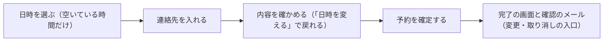

# 第 3 章　操作の流れとナビゲーション

- 講座: エンジニアのための UI・UX デザイン（uiux-engineers）
- 章 ID: `uiux-03`　動画 ID: `D03`
- 動画: 06:22（59 台詞）
- 要約: 主要なタスクを流れ図にして、戻れない・直せない行き止まりを見つける。サンプル予約で、送ったあとに間違いに気づく流れと、ステップと確認の画面があり、戻っても入力が消えない流れを比べ、システムの状態を見せる・利用者の制御と自由・エラーを防ぐ、の 3 つの経験則で直す。

> このファイルは `bun scripts/build_materials.ts` が `content/` の台本から作ります。直すときは台本（`content/uiux-engineers/` の TS）を直してください。

## 学習目標

- 主要なタスクを、画面と操作の箱と矢印で流れ図にし、行き止まりと迷う所を見つけられる
- ステップの表示・ボタンの文言・確定のあとの知らせで、今どこか・次に何が起きるかを見せられる
- 戻る・やめる・取り消すの出口と、戻っても入力を消さない仕組みを設計できる
- 確認の画面とステップの使いどころを、操作の重さ・使う頻度・慣れで判断できる

## 前提知識

- 第 1 章（主要なタスクの 1 文）と第 2 章（目的と情報設計）
- フォームを送る画面を作ったことがある

根拠の種類の札: **研究・学術**（査読のある研究・メタ分析・学術書の定義）／**公式・法令・規格**（法律・官公庁・標準化団体・公式ガイドライン）／**実務の指針**（実務家や専門機関の一般的な指針。条件によって外れる）／**説明用の仮の例**（架空のサンプルで、実在のデータではない）

## 1. 教材本文

### [uiux-03-s01] 困りごと: 送ったあとで、間違いに気づく

根拠: 説明用の仮の例　動画の場面: 3

サンプル予約のもとの流れは、1 つの画面に名前・電話・メール・日時を入れて「送信」を押すと、その場で予約が確定する形でした（第 1 章の改善前）。確定の前に内容を確かめる画面はなく、完了の画面で初めて、選んだ日時を目にします。

1 か月の予約が 200 件、そのうち送ったあとにお店へ変更の電話があったのが 30 件、その理由でいちばん多いのが日時の選び間違いで 18 件だった、とします（**仮の数字で、実在のデータではありません**）。11 月 7 日（土）のつもりが、11 月 17 日（火）を選んでいた、という間違いです。

送る前に気づければ、お客さまもお店も、電話の手間はいりません。問題は入力欄の見た目ではなく、確かめる機会と直す道がない「流れ」にあります。

### [uiux-03-s02] タスクの流れ図を書く

根拠: 実務の指針・説明用の仮の例　動画の場面: 4, 6　出典: [Kate Kaplan（Nielsen Norman Group） 2023（2026-08-27 見直し）](https://www.nngroup.com/articles/user-journeys-vs-user-flows/)、[ISO 2018](https://www.iso.org/standard/63500.html)

流れを直す前に、今の流れを図にします。画面と操作を箱に、つながりを矢印にした「タスクの流れ図（ユーザーフロー）」です。NN/g の Kate Kaplan（2023）は、ユーザーフローを、1 つの製品の中で決まったタスクを終えるまでの、利用者の操作とシステムの応答の流れとして説明しています（数分から数時間で終わる短いもの）。複数の接点にまたがり、気持ちの動きまで描く「ジャーニー」とは区別します。

書き方の目安（この講座のすすめ）:

- 箱は「画面」か「操作」。矢印に、押すボタンや条件（空きがない・ログインが切れた）を書く
- 主な道だけでなく、分かれ道（エラー・やめる・戻る）も書く
- 各箱に「ここで今どこか分かるか」「次に何が起きるか分かるか」を書き込む

サンプル予約のもとの流れを書くと、「完了の画面で間違いに気づく → 直す道は電話だけ」という行き止まりが一目で分かります（図 uiux-03-f01）。直した流れでは、日時 → 連絡先 → 確認 → 確定の 4 つの箱に、確認から日時へ戻る矢印と、確定のあとの「変更・取り消し」への矢印が加わります（図 uiux-03-f02）。

ISO 9241-11:2018 の定義でいえば、タスクは目標を果たすための活動のまとまりです（第 2 章）。流れ図は、そのタスクの手順を、画面の単位で見えるようにしたものです。

### [uiux-03-s03] 流れを直す 3 つの経験則

根拠: 実務の指針　動画の場面: 5　出典: [Jakob Nielsen（Nielsen Norman Group） 1994（2020 年改訂・2024 年見直し）](https://www.nngroup.com/articles/ten-usability-heuristics/)、[Aurora Harley（Nielsen Norman Group） 2018](https://www.nngroup.com/articles/visibility-system-status/)、[Maria Rosala（Nielsen Norman Group） 2020](https://www.nngroup.com/articles/user-control-and-freedom/)、[Raluca Budiu（Nielsen Norman Group） 2017](https://www.nngroup.com/articles/wizards/)、[Page Laubheimer（Nielsen Norman Group） 2024](https://www.nngroup.com/articles/menu-design/)

Jakob Nielsen の 10 の経験則のうち、流れに効くのは次の 3 つです（NN/g の記事の要約。自分の言葉での言い換え）。

- **1 番 システムの状態を見せる**: 今何が起きているかを、ほどよい時間のうちに、適切な知らせで伝え続ける。Aurora Harley（2018）は、状態が分からないと利用者は次の手を決められないとし、操作にはすぐ見える応答を返し、結果やエラーをはっきり伝えるよう勧めています
- **3 番 利用者の制御と自由**: 人は間違えて操作を選ぶことがあるので、長い手続きを踏まずに抜けられる、はっきりした「非常口」を用意する。取り消しとやり直しを支える
- **5 番 エラーを防ぐ**: 間違いが起きやすい条件をなくすか、確定の前に確かめる機会を出す

流れの画面では、「今どこか」と「次に何が起きるか」を、次のように見せます。

- **ステップの表示**: 全部のステップを並べ、今のステップを目立たせ、それぞれに分かる名前を付ける（NN/g の Raluca Budiu, 2017 のウィザードの指針）
- **ボタンの文言**: 「次へ」「送信」ではなく、押すと何が起きるかを書く（「この日時で次へ（連絡先の入力）」「予約を確定する」）。ウィザードの指針も、戻る・進むのボタンを行き先の名前にするよう勧めています
- **確定のあとの知らせ**: 完了の画面で、何が確定し、次に何が届くか（確認のメール）を伝える
- **メニューの今いる場所**: サイトのメニューでは、今いる場所を示す（NN/g のメニューの指針, 2024）

### [uiux-03-s04] 改善前・改善後: 確認の画面と 3 つの出口

根拠: 説明用の仮の例・実務の指針・公式・法令・規格　動画の場面: 7, 9, 10　出典: [Maria Rosala（Nielsen Norman Group） 2020](https://www.nngroup.com/articles/user-control-and-freedom/)、[W3C WAI WCAG 2.2](https://www.w3.org/WAI/WCAG22/Understanding/error-prevention-legal-financial-data.html)、[W3C Web Accessibility Initiative（WAI） WCAG 2.2 の解説](https://www.w3.org/WAI/WCAG22/Understanding/redundant-entry.html)、[W3C 2023（2024-12-12 更新）](https://www.w3.org/TR/WCAG22/)

動画では、サンプル予約の改善前の完了の画面と、改善後の確認の画面を比べました（図 uiux-03-f01）。

- **改善前**: 送ったあとで初めて日時を見る。直す方法は、小さな文字の「お店にお電話ください」だけ。「もう一度予約する」は、名前から全部入れ直し
- **改善後**: 上に 3 つのステップの最後（確認）にいることを出す。確定の前に、選んだ日時を曜日まで見せる。「日時を変える」で戻れ、戻っても入れた連絡先は残る。ボタンは「予約を確定する」で、その下に「このあと、確認のメールが届きます」と書く

流れには、3 つの出口を用意します（図 uiux-03-f03）。NN/g の Maria Rosala（2020）は、利用者の制御と自由を支える部品として、戻る・キャンセル・閉じる・取り消しを挙げています。

- **戻る**: 確認の画面から日時や連絡先へ戻れる。入れた内容は残す。ブラウザの戻るボタンを壊さず、フォームの中の「戻る」や押せるステップの表示からも、入力を失わずに戻れるようにする
- **やめる**: どのステップでも、予約をやめられる。やめると何が消えるかを書く。「×」が「閉じる」なのか「やめる」なのか紛らわしいなら、「予約をやめる」と言葉で書く
- **取り消す**: 確定したあとも、完了の画面と確認のメールから、変更と取り消しができる。期限があるなら、その期限も書く（サンプル予約の仮のきまり: 前日の 18 時まで）

W3C の WCAG 2.2 にも、関係する達成基準があります（要約）。3.3.4（レベル AA）は、法的な約束やお金の取引、利用者が管理するデータの変更や削除を伴う送信について、取り消せる・入力を点検して直せる・確定の前に確かめて直せる、のどれかを求めます。3.3.7（レベル A。2.2 で追加）は、同じ手続きの中で前に入れた情報をもう一度求めるなら、自動で入れるか選べるようにすることを求めます（欠かせない場合・安全のため・情報が古くなった場合は例外）。戻ると入力が消える作りは、利用者に二度入れをさせることになりがちです。

入力を残す仕組みの例は、図 uiux-03-f04 にあります。入力をステップの外（そのタブの中だけの保存場所）に持ち、予約が確定したとき・やめたときに消します。

### [uiux-03-s05] 判断: ステップに分けるか、確認の画面をどこに挟むか

根拠: 実務の指針・公式・法令・規格　動画の場面: 8, 11　出典: [Raluca Budiu（Nielsen Norman Group） 2017](https://www.nngroup.com/articles/wizards/)、[Jakob Nielsen（Nielsen Norman Group） 2018（2026-08-07 見直し）](https://www.nngroup.com/articles/confirmation-dialog/)、[消費者庁 —](https://www.no-trouble.caa.go.jp/what/mailorder/)、[国民生活センター 2022](https://www.kokusen.go.jp/news/data/n-20220609_1.html)

**ステップに分けるか、1 画面にまとめるか**（NN/g の Budiu, 2017 の要約）。

- **ステップ（ウィザード）が向く**: 初めての人、まれにしか行わない手続き、前の答えで次に聞くことが変わる手続き、複雑で小さく分けたい手続き
- **1 画面が向く**: 毎日くり返す作業（全部のステップを押して進むのが手間になる）、項目を見比べたり、ほかの画面の情報を見ながら入れたりする作業、慣れた人

サンプル予約では、お客さまの来店の予約はステップに分け、お店の人が電話で受けた予約を入れる管理画面は 1 画面のフォームにします。同じサービスでも、利用者と頻度で、流れの形が変わります。

**確認の画面をどこに挟むか**（NN/g の Nielsen, 2018 の要約）。確認は、作業を失う・大きなお金が動く・取り消せない、といった重い操作に絞ります。ふだんの操作にまで確認を出すと、人は読まずに「はい」を押すようになり、本当に大事な確認も効かなくなります。確認を出すなら、何が起きるかを具体的に書き、ボタンは「はい／いいえ」ではなく行うことの名前（「予約を確定する」「入力に戻る」）にします。取り消しを用意できるなら、そのほうが良いことも多くあります。

**法律で決まっている場合**: インターネット通販で申込みを受ける場合、特定商取引法で、申込みの最終確認画面に、分量・販売価格（サービスの対価）・代金の支払いの時期と方法・引渡しや提供の時期・申込期間（あれば）・申込みの撤回や解除に関すること、を表示することが求められています（消費者庁「特定商取引法ガイド」の要約。2022 年 6 月 1 日施行の改正による、と国民生活センターが案内）。申込みになることを分かりにくくする表示や、表示する事項を誤解させる表示は禁止で、誤解して申し込んだ人は取り消せる場合があります。**一般的な説明です。自分のサービスが当たるか、何をどう表示するかの個別の判断は、専門家や所管の窓口に確かめてください。**

### [uiux-03-s06] 限界と例外

根拠: 実務の指針　動画の場面: 8, 11　出典: [Jakob Nielsen（Nielsen Norman Group） 2018（2026-08-07 見直し）](https://www.nngroup.com/articles/confirmation-dialog/)、[Raluca Budiu（Nielsen Norman Group） 2017](https://www.nngroup.com/articles/wizards/)、[Maria Rosala（Nielsen Norman Group） 2020](https://www.nngroup.com/articles/user-control-and-freedom/)

- **画面を増やすほど、手間も増える**: 確認の画面は、1 つ増えた画面です。主要なタスクの手順の数（第 1 章）を数え直し、増やした価値があるかを、完了率や間違いの数で確かめます
- **ウィザードは途中でやめにくい**: NN/g の Budiu（2017）は、ウィザードは途中で抜けると作業が失われやすい形だとし、途中でやめて保存し、あとで続けられるようにするよう勧めています。長い手続きなら、下書きの保存を考えます
- **取り消しにも限りがある**: 確定したあとの取り消しは、お店の都合（前日の何時まで）やお金（キャンセル料）で制限がつくことがあります。できないことは、確定の前の確認の画面に書いておきます。また、取り消しの知らせを数秒で消すと、押す前に消えてしまいます（Rosala, 2020 が挙げる例）
- **確認は万能ではない**: 毎回同じ確認を出すと、読まずに押されます。確認だけに頼らず、空いている時間だけを選べるようにする（第 1 章）など、間違いが起きにくい形を先に作ります
- **経験則は保証ではない**: ここでの直し方も経験則で、必ず良くなるとは限りません。直したら、利用者に流れをたどってもらって確かめます（第 8 章）

### [uiux-03-s07] 実践手順: 流れ図で、行き止まりを見つける

根拠: 実務の指針　動画の場面: 12, 13　出典: [Kate Kaplan（Nielsen Norman Group） 2023（2026-08-27 見直し）](https://www.nngroup.com/articles/user-journeys-vs-user-flows/)、[Jakob Nielsen（Nielsen Norman Group） 1994（2020 年改訂・2024 年見直し）](https://www.nngroup.com/articles/ten-usability-heuristics/)

1. **主要なタスクの流れ図を書く**: 画面と操作を箱に、矢印でつなぐ。分かれ道（エラー・空きがない・やめる）も書く
2. **迷う所に印を付ける**: 今どこか・次に何が起きるかが、画面で分からない所
3. **行き止まりに印を付ける**: 戻れない・やめられない・直せない所と、戻ると入力が消える所
4. **出口と確認を足す**: 戻る・やめる・取り消すを、どの段にも。確定の前の確認は、取り返しのつかない操作やお金が動く操作の前だけ
5. **たどってもらう**: 直した流れ図や紙の画面を 1〜2 人にたどってもらい、「間違えたらどうしますか？」と聞いて、戻れるかを確かめる

### [uiux-03-s08] 振り返りの問い

根拠: 実務の指針　動画の場面: 14, 15

- 自分のサービスの主要なタスクに、送ったあとで初めて内容を見る所はありませんか？
- どの画面でも、戻る・やめる・取り消すを選べますか？ 戻ったときに、入れた内容は残りますか？
- 確認の画面やダイアログを、ふだんの操作にまで出していませんか？
- ステップに分けた流れが、毎日くり返す人にとって手間になっていませんか？

次の章からは、見た目の基本（視覚的な優先順位・余白・文字）に入ります。この章で決めた流れの中で、各画面の一番大事なものを、一目で分かるようにします。

## 2. ナレーション台本

話者: 講師 = VOICEVOX:No.7、呼び込み = VOICEVOX:青山龍星。時刻は合成した音声の実測。

### 場面 1　オープニング

- `00:02` （呼び込み）第3章。操作の流れとナビゲーション。
- `00:05` この章では、予約の流れを図にして、迷う所と、行き止まりを直します。

### 場面 2　この章のゴール

- `00:12` この章のゴールは、三つです。
- `00:14` 一つ目。タスクの流れを、図にできること。
- `00:18` 二つ目。今どこにいて、次に何が起きるかを、画面で見せられること。
- `00:23` 三つ目。戻る、やめる、取り消すを用意し、入れた内容を消さないことです。

### 場面 3　困りごと: 送ったあとで、間違いに気づく

- `00:30` 第一章で見た、サンプル予約の予約です。もとの流れでは、一つの画面に全部入れて送ると、その場で予約が確定しました。
- `00:39` ひと月の予約が、二百件あったとします。
- `00:42` そのうち三十件は、送ったあとで、お店に変更の電話がありました。
- `00:48` 理由で一番多いのは、日時の選び間違いで、十八件だったとします。
- `00:53` 送る前に気づければ、お客さまもお店も、電話の手間はいりませんでした。

### 場面 4　今の流れを、図にする

- `00:59` まず、今の流れを図にします。画面と操作を箱にして、矢印でつなぐ、タスクの流れ図です。
- `01:06` 予約の画面を開き、一つの画面に、名前、電話、メール、日時を入れます。
- `01:13` 送信を押すと、その場で予約が確定します。確かめる画面は、ありません。
- `01:19` 日時を間違えたことに、完了の画面で、初めて気づきます。
- `01:23` 直す道は、お店への電話だけ。図にすると、ここが行き止まりだと、一目で分かります。

### 場面 5　流れを直す、3 つの経験則

- `01:31` 流れを直す手がかりは、ニールセンの十の経験則のうち、三つです。
- `01:36` 一つ目は、システムの状態を見せる。今どこにいて、次に何が起きるかを、いつも分かるようにします。
- `01:43` 二つ目は、利用者の制御と自由。間違えて進んでも、戻る、やめる、取り消す、という出口があることです。
- `01:52` 三つ目は、エラーを防ぐ。間違えにくい形にし、確定の前に、確かめる機会を作ります。

### 場面 6　直した流れ: ステップと出口

- `02:00` 直した流れを、図にします。最初に、日時を選びます。
- `02:05` 次に、連絡先を入れます。
- `02:07` 確定の前に、内容を確かめる画面を、一つ挟みます。
- `02:12` 間違いに気づいたら、ここから戻って直せます。戻っても、入れた内容は消えません。
- `02:18` 確かめてから、予約を確定します。
- `02:21` 確定のあとも、変更と取り消しの出口を残します。これで、行き止まりがなくなります。

### 場面 7　同じ予約の、改善前と改善後

- `02:28` 次に、画面で比べます。左は改善前の、完了の画面。右は改善後の、確認の画面です。
- `02:36` 改善前は、送ったあとで、初めて日時を目にします。七日の土曜日のつもりが、十七日の火曜日でした。
- `02:44` 直す方法は、小さな文字の、お店にお電話ください、だけです。
- `02:49` もう一度予約すると、名前から全部、入れ直しになります。
- `02:54` 改善後は、上に、三つのステップの最後、確認にいることを出します。
- `02:59` 確定の前に、選んだ日時を、曜日まで見せます。ここで、間違いに気づけます。
- `03:06` 日時を変える、で戻れます。戻っても、入れた連絡先は残ります。

### 場面 8　クイズ

- `03:12` ここでクイズです。確認の画面は、どの操作の前にも出すほど、安全になる。マルでしょうか、バツでしょうか。
- `03:24` 答えは、バツ。毎回出ると、人は読まずに、はいを押すようになります。
- `03:29` 確認は、取り返しのつかない操作や、お金が動く操作の前に絞ります。ふだんの操作は、取り消しで救います。

### 場面 9　出口は 3 つ: 戻る・やめる・取り消す

- `03:38` 流れには、出口を三つ用意します。
- `03:41` 戻る。確認の画面から、日時や連絡先へ戻れるようにし、入れた内容は残します。ブラウザの戻るボタンでも、消えないようにします。
- `03:51` やめる。どのステップでも、予約をやめられるようにします。やめると何が消えるかも、書いておきます。
- `03:58` 取り消す。確定したあとも、完了の画面と、確認のメールから、変更と取り消しができるようにします。

### 場面 10　WCAG 2.2 の達成基準にもある

- `04:07` アクセシビリティの国際的な指針、WCAG 2.2 にも、関係する達成基準があります。
- `04:14` 契約や支払い、データの変更のような送信は、取り消せるか、点検して直せるか、送る前に確かめて直せるか。どれかを満たします。
- `04:24` そして、同じ手続きの中で、一度入れた情報を、もう一度入れさせない。これは 2.2 で加わった、レベル A の基準です。

### 場面 11　ステップに分けるか、1 画面にまとめるか

- `04:35` では、どんな流れでも、ステップに分ければよいのでしょうか。
- `04:39` ステップに分ける形は、たまにしか使わない手続きや、初めての人が多いときに向きます。お客さまの来店の予約が、これです。
- `04:48` 一方、お店の人が、電話で受けた予約を、毎日何件も入れるなら、一つの画面のほうが速く済みます。
- `04:56` 流れの形は、使う頻度と、慣れで選びます。

### 場面 12　実践: 流れ図で、行き止まりを見つける

- `05:00` 実践の手順です。
- `05:02` まず、主要なタスクの流れ図を書きます。画面と操作を箱にして、矢印でつなぎます。
- `05:08` 次に、今どこか、次に何が起きるかが、分からない所に印を付けます。
- `05:14` そして、戻れない、やめられない、直せない、行き止まりに印を付けます。
- `05:20` 最後に、戻る、やめる、取り消すの出口と、確定の前の確認を足します。確認は、取り返しのつかない所だけにします。

### 場面 13　演習

- `05:31` では、演習です。動画を止めて、五分だけ、取り組んでみてください。
- `05:36` 自分のサービスの、主要なタスクを流れ図にして、行き止まりと、迷う所に印を付けます。
- `05:43` 詳しい手順と回答例、評価の基準は、講座サイトの実践課題にあります。
- （2.5 秒の間。考える時間）

### 場面 14　振り返り

- `05:52` 振り返りです。流れは、図にすると、行き止まりが見えます。
- `05:57` 今どこにいて、次に何が起きるかを、いつも見せます。
- `06:01` 戻る、やめる、取り消すを、どの画面でも選べるようにし、入れた内容は消しません。確認の画面は、大事な所だけにします。

### 場面 15　エンディング

- `06:12` 次の章からは、見た目の基本です。一番大事なものが、一目で分かる画面を作ります。

## 3. 絵コンテ

| # | 開始 | 秒数 | 図解の種類 | 根拠 | 表示内容（画面の文字） | 読み上げ（字幕と同じ） |
| --- | --- | --- | --- | --- | --- | --- |
| 1 | 00:00 | 12 秒 | タイトル |  | SECTION 2　目的と流れ／タイトル「操作の流れとナビゲーション」／迷わず進み、間違えても戻れる | 第3章。操作の流れとナビゲーション。 この章では、予約の流れを図にして、迷う所と、行き止まりを直します。 |
| 2 | 00:11 | 18 秒 | ゴールの一覧 |  | 【この章のゴール】1. タスクの流れを、図にできる 2. 今どこか・次に何が起きるかを見せられる 3. 戻る・やめる・取り消すを用意し、入力を消さない | この章のゴールは、三つです。 一つ目。タスクの流れを、図にできること。 二つ目。今どこにいて、次に何が起きるかを、画面で見せられること。 三つ目。戻る、やめる、取り消すを用意し、入れた内容を消さないことです。 |
| 3 | 00:30 | 29 秒 | 数字 | 説明用の仮の例 | 【困りごと: 送ったあとで、間違いに気づく】1 か月の予約 200 件 送ったあとの、変更の電話 30 件 そのうち、日時の選び間違い 18 件／架空の「サンプル予約」の仮の数字。実在のデータではない | 第一章で見た、サンプル予約の予約です。もとの流れでは、一つの画面に全部入れて送ると、その場で予約が確定しました。 ひと月の予約が、二百件あったとします。 そのうち三十件は、送ったあとで、お店に変更の電話がありました。 理由で一番多いのは、日時の選び間違いで、十八件だったとします。 送る前に気づければ、お客さまもお店も、電話の手間はいりませんでした。 |
| 4 | 00:58 | 32 秒 | 流れの図 | 説明用の仮の例 | 【今の流れを、図にする】予約の画面を開く・1 画面で全部入れる・送信で、すぐ確定・日時の間違いに気づく・直すには、電話だけ。 | まず、今の流れを図にします。画面と操作を箱にして、矢印でつなぐ、タスクの流れ図です。 予約の画面を開き、一つの画面に、名前、電話、メール、日時を入れます。 送信を押すと、その場で予約が確定します。確かめる画面は、ありません。 日時を間違えたことに、完了の画面で、初めて気づきます。 直す道は、お店への電話だけ。図にすると、ここが行き止まりだと、一目で分かります。 |
| 5 | 01:30 | 29 秒 | 用語のカード | 実務の指針 | 【流れを直す、3 つの経験則】システムの状態を見せる（Visibility of system status）: 今どこにいて、次に何が起きるかを、いつも分かるようにする／利用者の制御と自由（User control and freedom）: 間違えて進んでも、戻る・やめる・取り消すの出口がある／エラーを防ぐ（Error prevention）: 間違えにくい形にし、確定の前に確かめる機会を作る | 流れを直す手がかりは、ニールセンの十の経験則のうち、三つです。 一つ目は、システムの状態を見せる。今どこにいて、次に何が起きるかを、いつも分かるようにします。 二つ目は、利用者の制御と自由。間違えて進んでも、戻る、やめる、取り消す、という出口があることです。 三つ目は、エラーを防ぐ。間違えにくい形にし、確定の前に、確かめる機会を作ります。 |
| 6 | 01:59 | 28 秒 | 流れの図 | 説明用の仮の例 | 【直した流れ: ステップと出口】日時を選ぶ・連絡先を入れる・内容を確かめる・予約が確定・変更・取り消し。戻って直す（入力は残る） | 直した流れを、図にします。最初に、日時を選びます。 次に、連絡先を入れます。 確定の前に、内容を確かめる画面を、一つ挟みます。 間違いに気づいたら、ここから戻って直せます。戻っても、入れた内容は消えません。 確かめてから、予約を確定します。 確定のあとも、変更と取り消しの出口を残します。これで、行き止まりがなくなります。 |
| 7 | 02:27 | 44 秒 | 画面の比較（改善前・改善後） | 説明用の仮の例 | 【同じ予約の、改善前と改善後】改善前「サンプル予約」: 1. 送ったあとで、初めて日時を見る 2. 直すには、電話しかない 3. やり直すと、最初から入れ直し／改善後「サンプル予約」: 1. 3 ステップの最後だと分かる 2. 確定の前に、日時を確かめる 3. 戻って直せる。入力は消えない | 次に、画面で比べます。左は改善前の、完了の画面。右は改善後の、確認の画面です。 改善前は、送ったあとで、初めて日時を目にします。七日の土曜日のつもりが、十七日の火曜日でした。 直す方法は、小さな文字の、お店にお電話ください、だけです。 もう一度予約すると、名前から全部、入れ直しになります。 改善後は、上に、三つのステップの最後、確認にいることを出します。 確定の前に、選んだ日時を、曜日まで見せます。ここで、間違いに気づけます。 日時を変える、で戻れます。戻っても、入れた連絡先は残ります。 |
| 8 | 03:12 | 26 秒 | ○×クイズ |  | 【クイズ】Q1. 確認の画面は、どの操作の前にも出すほど安全になる？ → 答え ×: 毎回出ると、読まずに押すくせが付く。確認は取り返しのつかない操作・お金が動く操作の前に絞り、ふだんの操作は取り消しで救う | ここでクイズです。確認の画面は、どの操作の前にも出すほど、安全になる。マルでしょうか、バツでしょうか。 答えは、バツ。毎回出ると、人は読まずに、はいを押すようになります。 確認は、取り返しのつかない操作や、お金が動く操作の前に絞ります。ふだんの操作は、取り消しで救います。 |
| 9 | 03:38 | 28 秒 | 表 | 実務の指針 | 【出口は 3 つ: 戻る・やめる・取り消す】出口｜サンプル予約では｜気をつけること: 戻る・確認から、日時や連絡先へ戻る・入力を残す。ブラウザの戻るでも／やめる・どのステップでも、予約をやめる・やめると何が消えるかを書く／取り消す・確定のあとも、変更と取り消し・完了の画面とメールに入口を置く | 流れには、出口を三つ用意します。 戻る。確認の画面から、日時や連絡先へ戻れるようにし、入れた内容は残します。ブラウザの戻るボタンでも、消えないようにします。 やめる。どのステップでも、予約をやめられるようにします。やめると何が消えるかも、書いておきます。 取り消す。確定したあとも、完了の画面と、確認のメールから、変更と取り消しができるようにします。 |
| 10 | 04:06 | 28 秒 | 表 | 公式・法令・規格 | 【WCAG 2.2 の達成基準にもある】達成基準｜求めること（要約）: 3.3.4（レベル AA）・契約・お金・データの変更は、取り消せる・点検して直せる・確かめて直せる、のどれか／3.3.7（レベル A。2.2 で追加）・同じ手続きで一度入れた情報は、自動で入れるか、選べるようにする | アクセシビリティの国際的な指針、WCAG 2.2 にも、関係する達成基準があります。 契約や支払い、データの変更のような送信は、取り消せるか、点検して直せるか、送る前に確かめて直せるか。どれかを満たします。 そして、同じ手続きの中で、一度入れた情報を、もう一度入れさせない。これは 2.2 で加わった、レベル A の基準です。 |
| 11 | 04:34 | 26 秒 | 左右の比較 | 実務の指針 | 【ステップに分けるか、1 画面にまとめるか】左「ステップに分ける」たまにしか使わない（来店の予約）・初めての人が多い・前の答えで、次に聞くことが変わる／右「1 画面にまとめる」毎日くり返す（お店の人の予約の入力）・項目を見比べながら入れる・慣れた人が、速く入れたい／結論: 流れの形は、使う頻度と慣れで選ぶ | では、どんな流れでも、ステップに分ければよいのでしょうか。 ステップに分ける形は、たまにしか使わない手続きや、初めての人が多いときに向きます。お客さまの来店の予約が、これです。 一方、お店の人が、電話で受けた予約を、毎日何件も入れるなら、一つの画面のほうが速く済みます。 流れの形は、使う頻度と、慣れで選びます。 |
| 12 | 05:00 | 30 秒 | 要点のカード | 実務の指針 | 【実践: 流れ図で、行き止まりを見つける】1. 流れ図を書く（画面と操作を箱に、矢印でつなぐ）／2. 迷う所に印（今どこか・次に何が起きるか分からない所）／3. 行き止まりに印（戻れない・やめられない・直せない所）／4. 出口と確認を足す（確認は、取り返しのつかない所だけ） | 実践の手順です。 まず、主要なタスクの流れ図を書きます。画面と操作を箱にして、矢印でつなぎます。 次に、今どこか、次に何が起きるかが、分からない所に印を付けます。 そして、戻れない、やめられない、直せない、行き止まりに印を付けます。 最後に、戻る、やめる、取り消すの出口と、確定の前の確認を足します。確認は、取り返しのつかない所だけにします。 |
| 13 | 05:30 | 22 秒 | 大きな一文 |  | 【演習】動画を止めて、5 分／自分のサービスの 主要なタスク を、流れ図にする／行き止まりと、迷う所に印を付ける | では、演習です。動画を止めて、五分だけ、取り組んでみてください。 自分のサービスの、主要なタスクを流れ図にして、行き止まりと、迷う所に印を付けます。 詳しい手順と回答例、評価の基準は、講座サイトの実践課題にあります。（2.5 秒の間） |
| 14 | 05:52 | 20 秒 | まとめ |  | 【振り返り】1. 流れは、図にすると行き止まりが見える 2. 今どこか・次に何が起きるかを、いつも見せる 3. 戻る・やめる・取り消すを用意し、入力を消さない。確認は大事な所だけ | 振り返りです。流れは、図にすると、行き止まりが見えます。 今どこにいて、次に何が起きるかを、いつも見せます。 戻る、やめる、取り消すを、どの画面でも選べるようにし、入れた内容は消しません。確認の画面は、大事な所だけにします。 |
| 15 | 06:11 | 11 秒 | 次の章の予告 |  | 次: 第 4 章「視覚的な優先順位・余白・文字」 | 次の章からは、見た目の基本です。一番大事なものが、一目で分かる画面を作ります。 |

字幕: 全部の台詞を日本語字幕にする（講座サイトは動画の下の帯、`out/captioned/` の動画は焼き込み）。画面の文字は要点だけにし、説明はナレーションと教材本文で補う。

## 4. 図解・比較例

### [uiux-03-f01] サンプル予約の予約の流れ: 改善前と改善後

動画の場面 4・6・7 を表にしたもの。中身は仮の例（説明用の仮の例）

| 観点 | 改善前 | 改善後 |
| --- | --- | --- |
| 流れ | 1 画面で全部入れて送信 → すぐ確定 | 日時 → 連絡先 → 確認 → 確定 |
| 今どこか | 分からない（ステップの表示なし） | 上に 3 つのステップと、今のステップ |
| 確定の前 | 確かめる画面がない | 日時を曜日まで見せ、直せる |
| 間違えたら | お店に電話するしかない | 「日時を変える」で戻る。入力は残る |
| 確定のあと | 「もう一度予約する」は最初から入れ直し | 完了の画面とメールから、変更・取り消し |

### [uiux-03-f02] 直した予約の流れ

左から右へ進む。確認の画面から日時へ戻る道と、確定のあとの変更・取り消しの道がある（仮の例）（説明用の仮の例）



流れ: 日時を選ぶ（空いている時間だけ） → 連絡先を入れる → 内容を確かめる（「日時を変える」で戻れる） → 予約を確定する → 完了の画面と確認のメール（変更・取り消しの入口）

### [uiux-03-f03] 3 つの出口と、気をつけること

NN/g（Rosala, 2020・Nielsen, 2018）と WCAG 2.2 の 3.3.7 をもとに、サンプル予約に当てはめた例（実務の指針）

| 出口 | サンプル予約では | 気をつけること |
| --- | --- | --- |
| 戻る | 確認の画面から、日時や連絡先へ戻る | 入れた内容を残す。ブラウザの戻るボタンでも消さない |
| やめる | どのステップでも「予約をやめる」 | 何が消えるかを書く。「×」だけにしない |
| 取り消す | 完了の画面と確認のメールから、変更・取り消し | 期限（前日の 18 時まで など）を、確定の前にも書く |
| 確定の前の確認 | 確定の前に 1 回だけ | ふだんの操作には出さない。ボタンは行うことの名前に |

### [uiux-03-f04] 戻っても入力を消さない: 入力をステップの外に持つ

ステップの画面が入れ替わっても、読み込み直しても、同じタブの中なら入力が残る例（サンプル予約・仮の例）。連絡先は個人の情報なので、確定したとき・やめたときに消す（説明用の仮の例）

```ts
// 予約の入力を、ステップの外（このタブの中だけの保存場所）に持つ
type Draft = { date?: string; time?: string; name?: string; tel?: string; email?: string };

const KEY = 'sample-yoyaku:draft';

export const loadDraft = (): Draft => {
  try {
    return JSON.parse(sessionStorage.getItem(KEY) ?? '{}') as Draft;
  } catch {
    return {}; // 壊れていたら、空から始める
  }
};

// 入力が変わるたびに残す。確認の画面から戻ったら、ここから欄に入れ直す
export const saveDraft = (patch: Draft): void => {
  sessionStorage.setItem(KEY, JSON.stringify({ ...loadDraft(), ...patch }));
};

// 予約が確定したとき・やめたときに消す（共用の端末に連絡先を残さない）
export const clearDraft = (): void => {
  sessionStorage.removeItem(KEY);
};
```

## 5. 理解確認問題

### 問 1. 予約を送ったあとで、日時の選び間違いに気づく人が多い。まず足すべきものは？

1. 完了の画面のお祝いのアニメーション
2. 確定の前に内容（日時と曜日）を見せ、そこから戻って直せる確認の画面
3. すべてのボタンに「本当によろしいですか？」の確認
4. 入力欄の枠の色を変えること

<details><summary>答えと解説</summary>

**答え: 2. 確定の前に内容（日時と曜日）を見せ、そこから戻って直せる確認の画面**

確定の前に確かめる機会を作るのは、経験則の「エラーを防ぐ」。そこから戻って直せるのが「利用者の制御と自由」。ただし、すべての操作に確認を出すと、読まずに押されるようになる。

</details>

### 問 2. 確認の画面から「日時を変える」で戻ったときの、良い作りは？

1. 入力を全部消して、最初から入れ直してもらう
2. 入れた連絡先を残したまま、日時だけを直せる
3. ブラウザの戻るボタンを使えなくする
4. 戻る前に、必ずログインし直してもらう

<details><summary>答えと解説</summary>

**答え: 2. 入れた連絡先を残したまま、日時だけを直せる**

戻っても入力を残す。ブラウザの戻るボタンも壊さない（NN/g の Rosala, 2020）。WCAG 2.2 の 3.3.7（レベル A）は、同じ手続きの中で前に入れた情報をもう一度求めるなら、自動で入れるか選べるようにすることを求めている。

</details>

### 問 3. ステップに分ける形（ウィザード）が向かないのは、どれ？

1. 初めての人が、たまにしか使わない手続き
2. 前の答えで、次に聞くことが変わる手続き
3. お店の人が、毎日何件もくり返す予約の入力
4. 手順の多い、最初の設定

<details><summary>答えと解説</summary>

**答え: 3. お店の人が、毎日何件もくり返す予約の入力**

ウィザードは、初めての人やまれな手続きに向く。毎日くり返す作業では、全部のステップを押して進むのが手間になり、慣れた人には 1 画面のほうが速い（NN/g の Budiu, 2017）。

</details>

## 6. 実践課題 [uiux-03-ex] 主要なタスクの流れ図を書き、行き止まりを直す

- ねらい: 自分のサービスの主要なタスクを流れ図にし、迷う所と行き止まりを見つけて、戻る・やめる・取り消す・確定の前の確認を足した流れに直せる
- 目安の時間: 40〜60 分
- 出すもの: 今の流れ図（印つき）、直した流れ図、直し案の一覧（どの経験則に当たるか）、たどってもらった結果

### 手順

1. 主要なタスクを「誰が・どんな状況で・何をしたいか」の 1 文で書く（第 1 章の 1 文を使ってよい）
2. 今の流れを、画面と操作の箱と矢印で書く。分かれ道（エラー・空きがない・ログインが切れた・やめる）も書く
3. 各画面に「今どこか」「次に何が起きるか」が分かるかを書き、分からない所に印を付ける
4. 戻れない・やめられない・直せない所（行き止まり）と、戻ると入力が消える所に印を付ける
5. 直し案を書く: 確定の前の確認、戻る・やめる・取り消すの出口、入力を残す仕組み。確認は、取り返しのつかない操作やお金が動く操作の前だけにする
6. 直した流れ図（または紙の画面）を 1〜2 人にたどってもらい、「間違えたらどうしますか？」と聞いて、戻れるかを確かめる

### 回答例: サンプル予約の予約の流れ（仮の例）

**タスク**: 初めての人が、仕事帰りにスマホで、希望の日時で予約したい。

**今の流れ**: 予約の画面を開く → 1 画面で名前・電話・メール・日時を入れる → 送信で、その場で確定 → 完了の画面。

**印**: 送る前に内容を確かめられない（エラーを防ぐ）。完了の画面で間違いに気づいても、直す道が電話だけ（行き止まり）。「もう一度予約する」は最初から入れ直し（入力が消える）。空いていない時間を選ぶと、送ったあとでエラーになる（迷う所）。

**直した流れ**: 日時を選ぶ（空いている時間だけ）→ 連絡先を入れる → 内容を確かめる（日時と曜日・連絡先。「日時を変える」で戻れる）→ 予約を確定 → 完了の画面と確認のメールに「変更・取り消し」の入口。

**出口**: どのステップにも「予約をやめる」。戻っても入力は残す（ブラウザの戻るボタンでも）。取り消しは前日の 18 時まで、と確認の画面と完了の画面に書く（仮のきまり）。

**確認を出さない所**: 日時の選び直しや、連絡先の書き直しには確認を出さない（何度でもやり直せるため）。

**たどってもらった結果（仮）**: 2 人に紙の画面でたどってもらうと、2 人とも確認の画面で日時を直せた。1 人が「やめる」を「閉じる」と思ったので、「予約をやめる（入力は消えます）」と書く案にした。

### 評価基準

| 観点 | できている | もう一歩 | やり直し |
| --- | --- | --- | --- |
| 流れ図 | 画面と操作が箱と矢印で書け、分かれ道（エラー・空きがない・やめる）まである | 主な道だけで、分かれ道がない | 画面の一覧だけで、つながりがない |
| 状態の見せ方 | 各画面で今どこか・次に何が起きるかを点検し、足りない所の直し案がある | 一部の画面だけ点検している | 点検していない |
| 出口と入力の保存 | 戻る・やめる・取り消すがどの段にもあり、戻っても入力が残る | 出口はあるが、入力が消える所が残っている | 出口がない、または考えていない |
| 確認の使い方 | 確認を取り返しのつかない操作の前に絞り、それ以外は取り消しで救う理由が書けている | 確認はあるが、どこに出すかの理由がない | すべての操作に確認を出す、または確認が全くない |

## 7. 要点まとめと参考資料

### 要点

- 主要なタスクを、画面と操作の箱と矢印で流れ図にすると、戻れない・直せない行き止まりが見える（ユーザーフロー）
- 今どこか（ステップの表示）と、次に何が起きるか（ボタンの文言・確定のあとの知らせ）を、いつも見せる（経験則「システムの状態を見せる」）
- 戻る・やめる・取り消すの出口を用意し、戻っても入力を消さない（「利用者の制御と自由」。WCAG 2.2 の 3.3.7 は同じ手続きでの二度入れを避けることを求め、3.3.4 は重い送信に取り消し・点検・確認のどれかを求める）
- 確定の前の確認は、取り返しのつかない操作やお金が動く操作に絞る。毎回出すと、読まずに押されるようになる
- ステップに分けるか 1 画面にまとめるかは、使う頻度と慣れで選ぶ。初めての人・まれな手続きはステップ、毎日くり返す入力は 1 画面

### 参考資料

- Jakob Nielsen（Nielsen Norman Group）（1994（2020 年改訂・2024 年見直し））「10 Usability Heuristics for User Interface Design」 https://www.nngroup.com/articles/ten-usability-heuristics/ （実務の指針・2026-10-30 確認）
  - 10 のユーザビリティ・ヒューリスティクス（システムの状態を見せる・現実の世界に合わせる・記憶より見て分かる・エラーを防ぐ など）。具体的なガイドラインではなく大まかな経験則と明記
- Kate Kaplan（Nielsen Norman Group）（2023（2026-08-27 見直し））「User Journeys vs. User Flows」 https://www.nngroup.com/articles/user-journeys-vs-user-flows/ （実務の指針・2026-10-30 確認）
  - ユーザーフローは、1 つの製品の中で決まったタスクを終えるまでの、利用者の操作とシステムの応答の流れ（数分〜数時間）。ジャーニーは複数の接点にまたがる長い経験で、気持ちも描く。フローは流れ図・タスク図・ワイヤーフローで描く
- Aurora Harley（Nielsen Norman Group）（2018）「Visibility of System Status (Usability Heuristic #1)」 https://www.nngroup.com/articles/visibility-system-status/ （実務の指針・2026-10-30 確認）
  - 状態が分からないと、利用者は次の手を決められない。操作にはすぐ見える応答を返し、時間のかかる処理は進み具合を見せ、結果とエラーをはっきり伝える。やりとりが予想どおりに進むことが信頼につながる
- Maria Rosala（Nielsen Norman Group）（2020）「User Control and Freedom (Usability Heuristic #3)」 https://www.nngroup.com/articles/user-control-and-freedom/ （実務の指針・2026-10-30 確認）
  - 間違えて進んだときの出口として、戻る・キャンセル・閉じる・取り消しを挙げる。ブラウザの戻るを壊さない、フォームの中の戻るや押せる進み具合の表示で入力を失わずに戻れるように、どの段でもキャンセルできるように、取り消しは見つけやすく押す時間を十分に（数秒で消える例）、やめるときに下書きを残すか捨てるかを選べるように
- Raluca Budiu（Nielsen Norman Group）（2017）「Wizards: Definition and Design Recommendations」 https://www.nngroup.com/articles/wizards/ （実務の指針・2026-10-30 確認）
  - ウィザード（決まった順に進む複数ページの入力）は、初めての人・まれな手続き・答えで分かれる手続きに向き、毎日くり返す作業・見比べが要る作業・慣れた人・途中で抜ける作業には向かない。全部のステップと今のステップを見せ、戻る・進むのボタンは行き先の名前に、途中でやめて保存し再開できるように
- Jakob Nielsen（Nielsen Norman Group）（2018（2026-08-07 見直し））「Confirmation Dialogs Can Prevent User Errors — If Not Overused」 https://www.nngroup.com/articles/confirmation-dialog/ （実務の指針・2026-10-30 確認）
  - 確認のダイアログは、作業を失う・大きなお金が動く・取り消せない操作に絞る。警告が多すぎると人は注意を払わなくなり、読まずに「はい」を押す。結果を具体的に書き、ボタンは「はい／いいえ」でなく行うことの名前に。取り消し（undo）を用意できればなおよい
- Page Laubheimer（Nielsen Norman Group）（2024）「Menu-Design Checklist: 17 UX Guidelines」 https://www.nngroup.com/articles/menu-design/ （実務の指針・2026-10-30 確認）
  - メニューの指針。今いる場所をメニューで示す、ラベルは明確で具体的でなじみのある言葉に（作った言葉・社内の言葉・曖昧な総称を避ける）、大事な言葉をラベルの先頭に、アイコンは文字を補うもので置き換えない、よく使う項目を近くに置く
- W3C WAI（WCAG 2.2）「Understanding Success Criterion 3.3.4: Error Prevention (Legal, Financial, Data)」 https://www.w3.org/WAI/WCAG22/Understanding/error-prevention-legal-financial-data.html （公式・法令・規格・2026-10-30 確認）
  - 3.3.4（レベル AA）。法的な約束・お金の取引・利用者が管理するデータの変更や削除・テストの回答を送るページは、取り消せる・入力を点検して直せる・確定の前に確かめて直せる、のどれかを満たす。例として、注文の前に品物・数・届け先・支払いを見せて直せるようにする。本文（WCAG 2.2、2024-12-12 版）でも確かめた
- W3C Web Accessibility Initiative（WAI）（WCAG 2.2 の解説）「Understanding Success Criterion 3.3.7: Redundant Entry」 https://www.w3.org/WAI/WCAG22/Understanding/redundant-entry.html （公式・法令・規格・2026-10-30 確認）
  - 3.3.7（レベル A。WCAG 2.2 で追加。W3C の「What’s New in WCAG 2.2」でも確認）。同じ手続きの中で前に入れた情報をもう一度求めるなら、自動で入れるか選べるようにする。ブラウザの自動入力だけでは足りない。例外は、再入力が欠かせない場合・安全のため（パスワードの確認など）・前の情報が使えなくなった場合。手続きを閉じてから戻ってきた場合には当たらない（第 3 章・第 6 章）
- W3C（2023（2024-12-12 更新））「Web Content Accessibility Guidelines (WCAG) 2.2」 https://www.w3.org/TR/WCAG22/ （公式・法令・規格・2026-10-30 確認）
  - コントラスト比（本文 4.5:1）・色だけに頼らない・ターゲットのサイズ・エラーの特定・ラベルなどの達成基準
- ISO（2018）「ISO 9241-11:2018 Ergonomics of human-system interaction — Part 11: Usability: Definitions and concepts」 https://www.iso.org/standard/63500.html （公式・法令・規格・2026-10-30 確認）
  - 3.1.1 usability の定義（特定の利用者が特定の利用状況で、効果・効率・満足を伴って特定の目標を達成できる度合い）。3.1.10 目標（意図した結果）・3.1.11 タスク（目標は手段によらない）・3.1.15 利用状況も、各国の規格機関の公式プレビューで確認。日本の JIS Z 8521:2020 はこれを基にした規格（修正あり）で、訳語は「効果・効率・満足」
- 消費者庁（—）「通信販売｜特定商取引法ガイド」 https://www.no-trouble.caa.go.jp/what/mailorder/ （公式・法令・規格・2026-10-30 確認）
  - インターネット通販の申込み（特定申込み、法第 12 条の 6）では、最終確認画面に、分量・販売価格（役務の対価）・代金の支払いの時期と方法・引渡しや提供の時期・申込期間（あれば）・申込みの撤回や解除に関すること を表示する。申込みになることを誤認させる表示や、表示事項を誤認させる表示は禁止で、誤認して申し込んだ人は取り消せる（法第 15 条の 4）。ページ自身が「概要」と書いている
- 国民生活センター（2022）「「おトクにお試しだけ」のつもりが「定期購入」に！？－「詐欺的な定期購入商法」の規制が強化された改正特定商取引法が施行されました！－」 https://www.kokusen.go.jp/news/data/n-20220609_1.html （公式・法令・規格・2026-10-30 確認）
  - 改正特定商取引法が 2022 年 6 月 1 日に施行され、通販サイトの最終確認画面（注文確定の直前の画面）に、申込内容を簡単に確かめられるよう、分量・価格・支払い・引渡しの時期・申込期間・撤回や解除のことを表示する義務ができた（2022-06-09 公表）

## 8. 学習画面の右側の AI チャットに聞ける質問例

（チャットはまだ作っていません。質問ごとに、答えの根拠にする節 ID を付けています）

1. すべての送信の前に確認の画面を挟むのは、やりすぎですか？ どう決めればいいですか？　→ 参照: `uiux-03-s05`、`uiux-03-s06`
2. ステップに分けたフォームで、ブラウザの戻るボタンを押すと入力が消えます。どう直せばいいですか？　→ 参照: `uiux-03-s04`
3. 自分のサービスの流れ図を書きたいのですが、どこまで細かく書けばいいですか？　→ 参照: `uiux-03-s02`、`uiux-03-s07`
