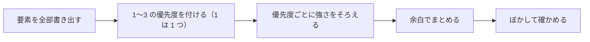

# 第 4 章　視覚的な優先順位・余白・文字

- 講座: エンジニアのための UI・UX デザイン（uiux-engineers）
- 章 ID: `uiux-04`　動画 ID: `D04`
- 動画: 06:37（56 台詞）
- 要約: すべてが同じ強さの画面では、どこを見ればいいか分からない。画面の「一番」を 1 つ決め、大きさ・濃さ・位置・余白で見る順番を作る。近接・類似・共通領域（ゲシュタルトの原則）でまとまりを見せ、整列とグリッドで置き場所をそろえる。文字は大きさを 3 段階に絞り、本文の行間を広めに取る。サンプル予約の確認の画面の改善前・改善後で確かめる。

> このファイルは `bun scripts/build_materials.ts` が `content/` の台本から作ります。直すときは台本（`content/uiux-engineers/` の TS）を直してください。

## 学習目標

- 大きさ・濃さ・位置・余白で見る順番を作り、画面の「一番」を 1 つに決められる
- 近接・類似・共通領域（ゲシュタルトの原則）でまとまりを見せ、整列とグリッドで置き場所をそろえられる
- 本文・見出し・補足の文字の大きさを 3 段階に絞り、行間と単位（rem）を決めて CSS に書ける
- 改善前と改善後の画面を、ぼかして見て確かめ、どの道具で直したかを言葉で説明できる

## 前提知識

- 第 1〜3 章（目的と流れが決まっている画面を使う）
- CSS で font-size・line-height・margin を書いたことがある

根拠の種類の札: **研究・学術**（査読のある研究・メタ分析・学術書の定義）／**公式・法令・規格**（法律・官公庁・標準化団体・公式ガイドライン）／**実務の指針**（実務家や専門機関の一般的な指針。条件によって外れる）／**説明用の仮の例**（架空のサンプルで、実在のデータではない）

## 1. 教材本文

### [uiux-04-s01] 困りごと: すべてが同じ強さの画面

根拠: 説明用の仮の例　動画の場面: 3

サンプル予約の「予約内容の確認」の画面には、「予約を確定する」「日時を変える」「連絡先を変える」「トップに戻る」の 4 つのボタンが、同じ色・同じ大きさで縦に並んでいます。見出しも予約の内容も同じ大きさの文字で、部品の間もすべて同じ幅です。

初めての人は、どのボタンを押せば予約が終わるのかを、上から順に読んで探すことになります（**画面と迷い方は説明用の仮の例です**）。どれも大事だからと全部を同じ強さにすると、かえってどれも目立たなくなります。NN/g の Kelley Gordon も、全部に差を付けようとすると何も目立たない、という趣旨を書いています。

この章では、第 1 章の 3 つの層のうち「見た目」の層を扱います。目的（予約を確定したい）と流れ（日時 → 連絡先 → 確認）が決まっているので、「この画面の一番は、予約を確定すること」と決められます。一番が決まると、残りの強さも決まります。

### [uiux-04-s02] 見る順番を作る 4 つの道具

根拠: 実務の指針　動画の場面: 4　出典: [Kelley Gordon（Nielsen Norman Group） 2021](https://www.nngroup.com/articles/visual-hierarchy-ux-definition/)、[Kara Pernice（Nielsen Norman Group） 2017（2026 年見直し）](https://www.nngroup.com/articles/f-shaped-pattern-reading-web-content/)

見てほしい順に要素を見せる配置を、**視覚的な優先順位**（visual hierarchy）と呼びます。NN/g の解説は、道具として色とコントラスト・大きさ・まとまりを挙げています。この講座では、画面を直すときに点検しやすいように、次の 4 つに分けます。

- **大きさ**: 大きいものから目に入る。ただし大きな要素は絞る（NN/g は、多くても 2 つまでを勧めています）
- **濃さ**: 背景との差が大きいほど目立つ。NN/g は、色の種類（色相）より、明るさや鮮やかさの差が効くと説明しています。太字も濃さの一つです
- **位置**: 見出しや太字などの強い手がかりがない文章では、上の行と、各行の左側の数語が一番見られる、という視線の調査があります（NN/g の F 字型のパターン）。手がかりを作ると、この見方は変わります。大事なものは、読み始めの位置か、読み終えて決める位置に置きます
- **余白**: 周りを広く空けた要素は、ひとまとまりに見え、目も向きやすくなります

4 つの道具は、足し算ではなく「差」で効きます。主ボタンを目立たせたいなら、主ボタンを強くするだけでなく、ほかのボタンを控えめにします。

### [uiux-04-s03] まとまりを見せる: 近接・類似・共通領域

根拠: 実務の指針　動画の場面: 5　出典: [Aurora Harley（Nielsen Norman Group） 2020](https://www.nngroup.com/articles/gestalt-proximity/)、[Aurora Harley（Nielsen Norman Group） 2020](https://www.nngroup.com/articles/gestalt-similarity/)、[Aurora Harley（Nielsen Norman Group） 2020](https://www.nngroup.com/articles/common-region/)

人は画面の部品を、自分でまとまりに分けて見ます。その見え方の法則を、ゲシュタルトの原則と呼びます。NN/g の Aurora Harley の解説（2020 年）をもとに、画面でよく使う 3 つを挙げます。

- **近接**: 近くにあるものは、同じまとまりに見える。ラベルと入力欄は近づけ、次の項目との間は広く空ける。関係のないものを近くに置くと仲間に見え、遠くに離したものは見落とされやすい
- **類似**: 色・形・大きさ・文字の太さなどが似ているものは、関係があるように見える。同じ働きの部品は同じ見た目に、違う働きは違う見た目にする。NN/g の解説には、すべてのボタンが同じ色だったために、利用者が主ボタンを探すのに時間を使った銀行のフォームの例があります
- **共通領域**: 同じ枠や同じ背景色の中にあるものは、ひとまとまりに見える。はっきりした枠は、近接より強く効くことがある

使う順番の目安は、まず余白（近接）でまとめ、足りないときだけ枠や背景色（共通領域）で囲む、です。NN/g は、念のために足した枠や、飾りだけの色の箱が画面をうるさくすると注意しています。

### [uiux-04-s04] 整列とグリッド: ゲシュタルトの原則とは別の道具

根拠: 実務の指針　動画の場面: 6　出典: [Kelley Gordon（Nielsen Norman Group） 2022](https://www.nngroup.com/articles/using-grids-in-interface-designs/)

まとまりの話とよく一緒に語られるのが、整列とグリッドです。この講座では、ゲシュタルトの原則（まとまりがどう見えるか）とは分けて、**置き場所をそろえる決まり**として扱います。

- **整列**: 部品の端を同じ線にそろえる。端がそろうと目で追う線が決まり、見渡しやすくなる
- **グリッド**: 画面を、列（column）・列の間の溝（gutter）・外側の余白（margin）で割る決まり。部品は列の上に置き、溝と外側の余白には置かない。NN/g の Kelley Gordon（2022 年）は、グリッドが読みやすさと見渡しやすさを上げ、画面の大きさや向きが変わっても置き場所を保ちやすいと説明しています

グリッドは、崩すと目立ちます。NN/g も、正当な理由があれば時々崩してよい、としています。理由のない崩れは、一部だけが目立つ、ちぐはぐな画面になります。

実装では、CSS Grid の grid-template-columns と gap で列と溝を先に決めておくと、部品ごとに余白を書き足す場面が減ります（一般的な実装の工夫）。

### [uiux-04-s05] 文字: 大きさの段階と行間

根拠: 実務の指針・公式・法令・規格　動画の場面: 7　出典: [Kelley Gordon（Nielsen Norman Group） 2021](https://www.nngroup.com/articles/visual-hierarchy-ux-definition/)、[W3C（Working Group Note） 2020](https://www.w3.org/TR/jlreq/)、[W3C 2023（2024-12-12 更新）](https://www.w3.org/TR/WCAG22/)、[MDN Web Docs（Mozilla） —](https://developer.mozilla.org/en-US/docs/Web/CSS/font-size)

文字の大きさは、種類を絞ります。NN/g の解説は、大・中・小の 3 つまでを勧め、Web の例として本文 14〜16px、小見出し 18〜22px、見出しは 32px までを挙げています。この講座では、日本語の本文が詰まって見えないように、本文を 16px にした例を使います（図 uiux-04-f02）。

- **見出し**: 24px・太字（画面に 1 つの、いちばん大事な見出し）
- **本文**: 16px。多くのブラウザの既定の大きさです（MDN）
- **補足・注**: 14px
- **小見出し**: 16px・太字。大きさを増やさず太さで差を付けると、大きさは 3 つのまま

**行間**（CSS の line-height）は、本文で 1.7 倍ほどにします。W3C の「日本語組版処理の要件」は、本の組版で、行と行の間を文字の大きさの半分から 1 文字分にすることが多い、と書いています。line-height に直すと 1.5〜2 倍です。1 行が長い（35 字を超える）なら 1 文字分か少し詰めた行間に、1 行が短いなら文字の半分（1.5 倍）でもよい、としています（本の本文の目安です。見出しの 1.4 倍は、この講座の例です）。1 文字分より広げても読みやすくはならない、とも書かれています。

利用者の設定も尊重します。MDN は、px で文字の大きさを決めると、一部のブラウザで利用者が文字を大きくできないとして、利用者の既定の大きさに対する値を勧めています。CSS では rem（既定の設定では 1rem = 16px）で書き、line-height は単位なしの数（1.7 など）で書くと、文字の大きさに合わせて変わります。

WCAG 2.2 は、文字を 200% まで大きくしても内容と機能が失われないこと（1.4.4 テキストのサイズ変更、AA）と、利用者が行の高さを文字の 1.5 倍に、段落の後の間を 2 倍に、文字や単語の間を広げても内容や機能が失われないこと（1.4.12 テキストの間隔、AA）を求めています。高さを固定した箱に文字を入れると、ここで崩れます。より厳しい AAA の 1.4.8（視覚的提示）は、利用者が段落の中の行送りを 1.5 倍以上に、1 行の幅を 80 字（日本語などは 40 字）以内に、などと変えられる仕組みがあることを求めています（ページそのものがこの値である必要はなく、ブラウザの機能で満たしてもよい）。

### [uiux-04-s06] 改善前・改善後: 予約内容の確認の画面

根拠: 説明用の仮の例・実務の指針・公式・法令・規格　動画の場面: 8, 9　出典: [GOV.UK（英国政府） —](https://design-system.service.gov.uk/components/button/)、[Aurora Harley（Nielsen Norman Group） 2020](https://www.nngroup.com/articles/gestalt-similarity/)、[Aurora Harley（Nielsen Norman Group） 2020](https://www.nngroup.com/articles/gestalt-proximity/)

動画では、サンプル予約の確認の画面を、改善前と改善後で比べました（図 uiux-04-f01）。ボタンの数と働きは同じで、見た目の強さだけを変えています。

- **主ボタンを 1 つにした**: 「予約を確定する」だけを塗りのボタンにし、予約の内容を読み終えた位置に置いた。英国政府の GOV.UK Design System も、既定のボタン（主ボタン）を 1 ページに複数置かないよう勧めています。複数あると効き目が下がり、次に何をすればよいか分かりにくくなるからです
- **ほかの行動を控えめにした**: 「日時を変える」「連絡先を変える」は枠だけのボタン、「トップに戻る」は文字のリンクにした。同じ働き（内容を変える）の 2 つは、同じ見た目にそろえた（類似）
- **見出しと内容に差を付けた**: 見出しを大きく太くし、予約の内容は箇条書きでひとまとまりにした
- **余白でまとまりを分けた**: 内容のまとまりとボタンのまとまりの間を広く空けた（近接）

動画のクイズの通り、「全部を赤く大きく」は逆効果です。強さは、周りとの差から生まれます。

### [uiux-04-s07] 判断と限界: 強さの付け方を使い分ける

根拠: 実務の指針・公式・法令・規格　動画の場面: 10　出典: [GOV.UK（英国政府） —](https://design-system.service.gov.uk/components/button/)、[Kelley Gordon（Nielsen Norman Group） 2021](https://www.nngroup.com/articles/visual-hierarchy-ux-definition/)、[Aurora Harley（Nielsen Norman Group） 2020](https://www.nngroup.com/articles/gestalt-proximity/)、[Aurora Harley（Nielsen Norman Group） 2020](https://www.nngroup.com/articles/common-region/)

「一番を 1 つ」は目安です。条件によって使い分けます。

- **どちらを選ぶかを利用者に任せる選択**（通知を受け取る・受け取らない、同意する・しない など）: 片方だけを強くすると、誘導になります。あえて同じ強さで並べます
- **行動が多すぎて、強さを付けきれない**: 見た目より先に流れを見直します。GOV.UK も、行動を増やしたくなったら、ページを簡単にするか、いくつかのページに分けることを勧めています（第 3 章）
- **取り消せない操作**（予約の取り消しなど）: うっかり押されないように、主ボタンと離して置き、確認の手順を挟むことが多い（一般的な実務の工夫）
- **大きさの 3 段階では差が足りない**: 大きさを増やす前に、太さ・濃さ・余白で差を付けます

優先順位は、作った後でも崩れます。

- **中身で崩れる**: 色の強い写真や長い見出しが入ると、そこに目を奪われる。NN/g の解説も、型だけでなく、入る中身まで入れて確かめるよう勧めています
- **画面の幅で崩れる**: 広い画面で近くにあった部品が、スマホでは離れて見落とされることがある（NN/g の近接の解説）。幅ごとに確かめます

確かめ方として、NN/g は、目を細めるか、画面を少しぼかして見る方法を挙げています。ぼかしても一番の要素が最初に目に入り、まとまりが崩れなければ、見た目の強さは意図どおりです。ただし、これは作り手の点検です。最後は第 1 章の効果・効率・満足の物差しで、利用者に使ってもらって確かめます（第 8 章）。

### [uiux-04-s08] 実践手順と振り返りの問い

根拠: 実務の指針　動画の場面: 11, 12, 13

1. **要素を全部書き出す**: 見出し・文・入力欄・ボタン・リンク・画像
2. **1〜3 の優先度を付ける**: 1 は画面に 1 つだけ。第 1 章で書いた主要なタスクに一番効くものを 1 にする
3. **優先度ごとに見た目の強さをそろえる**: 1 は大きく濃く、2 は中くらいか枠だけ、3 は小さくかリンクに。同じ優先度・同じ働きは同じ見た目
4. **余白でまとめる**: まとまりの中は狭く（例: 8px）、まとまりの間は広く（例: 32px）。足りないときだけ枠や背景色
5. **文字の段階を 3 つに絞る**: 見出し 24px・本文 16px（1rem、行間 1.7）・補足 14px（図 uiux-04-f03）
6. **ぼかして確かめる**: 1 が最初に目に入るか。スマホの幅でも確かめる

振り返りの問い:

- 自分の画面の「一番」は何ですか？ それは画面の中で一番強く見えていますか？
- 同じ強さのボタンが並んでいる画面はありますか？ どれを控えめにできますか？
- 文字の大きさは何段階ありますか？ 3 つにまとめるなら、どれとどれを一緒にしますか？

## 2. ナレーション台本

話者: 講師 = VOICEVOX:No.7、呼び込み = VOICEVOX:青山龍星。時刻は合成した音声の実測。

### 場面 1　オープニング

- `00:02` （呼び込み）第4章。視覚的な優先順位・余白・文字。
- `00:07` この章から、見た目の層に入ります。何を大きく、どれだけ空けて、どんな文字で見せるかを決めます。

### 場面 2　この章のゴール

- `00:16` この章のゴールは、三つです。
- `00:18` 一つ目。大きさ、濃さ、位置、余白で、見る順番を作れること。
- `00:24` 二つ目。近くに置く、似せる、囲む、でまとまりを見せ、整列で置き場所をそろえられること。
- `00:32` 三つ目。本文と見出しの、文字の大きさの段階と、行間を決められることです。

### 場面 3　困りごと: どこを見ればいいか分からない

- `00:39` サンプル予約の、予約内容を確かめる画面です。
- `00:42` 予約を確定する、日時を変える、連絡先を変える、トップに戻る。四つのボタンが、同じ色、同じ大きさで並んでいます。
- `00:52` 初めての人は、どれを押せば予約が終わるのか、上から読んで探すことになります。
- `00:58` どれも大事だからと、全部を同じ強さにすると、結局、どれも目立ちません。

### 場面 4　見る順番は、4 つの道具で作る

- `01:04` 見てほしい順番に、見た目の強さを付けることを、視覚的な優先順位と呼びます。道具は、四つです。
- `01:12` 一つ目は、大きさ。大きいものから、目に入ります。
- `01:17` 二つ目は、濃さ。背景との差が大きいほど目立ちます。色の種類より、明るさや鮮やかさの差が効きます。
- `01:24` 三つ目は、位置。強い手がかりがない文章では、人は上の行と、行の左側から見がちです。
- `01:32` 四つ目は、余白。周りを広く空けると、そこに目が向きます。

### 場面 5　まとまりを見せる: ゲシュタルトの原則

- `01:38` 次は、まとまりです。人は、画面の部品を、自分でグループに分けて見ます。その見え方の法則を、ゲシュタルトの原則と呼びます。
- `01:48` 近接。近くにあるものは、ひとまとまりに見えます。ラベルと入力欄は近づけ、次の項目とは広く空けます。
- `01:56` 類似。色や形、大きさが似ているものは、仲間に見えます。同じ働きのボタンは、同じ見た目にします。
- `02:04` 共通領域。同じ枠や、同じ背景色の中にあるものは、ひとまとまりに見えます。
- `02:10` ただし、枠を足しすぎると、画面がうるさくなります。まず余白で分け、足りないときだけ囲みます。

### 場面 6　整列とグリッドは、別の道具

- `02:19` まとまりと一緒によく語られるのが、整列とグリッドです。この講座では、ゲシュタルトの原則とは別の、置き場所の決まりとして扱います。
- `02:28` 整列は、部品の端を、同じ線にそろえること。端がそろうと、目で追う線が決まり、見渡しやすくなります。
- `02:36` グリッドは、画面を、列と、列の間の溝と、外側の余白で割る決まりです。部品は列に置き、溝には置きません。
- `02:46` 決まりがあると、画面の幅が変わっても、置き場所がぶれにくくなります。崩すのは、理由があるときだけにします。

### 場面 7　文字は、大きさを 3 段階に絞る

- `02:54` 文字は、大きさの種類を絞ります。NN/g の解説は、大、中、小の三つまでを勧めています。
- `03:03` 見出しは、二十四ピクセルの太字。画面で一番大事な見出しです。
- `03:08` 本文は、十六ピクセル。多くのブラウザの既定の大きさです。CSS では、利用者の設定に合わせて変わる、rem で書きます。
- `03:17` 補足や注は、十四ピクセルです。
- `03:20` 小見出しは、大きさを増やさず、太さで差を付けます。これで、大きさは三つのままです。
- `03:26` 行間は、本文で文字の一・七倍ほど。日本語の組版では、行と行の間を、文字の半分から一文字分空けることが多い、とされています。

### 場面 8　同じ画面の、改善前と改善後

- `03:38` では、サンプル予約の確認の画面を、改善前と改善後で比べます。
- `03:43` 改善前は、四つのボタンが、どれも同じ塗りのボタンです。どれが本題なのか、分かりません。
- `03:50` 見出しも、予約の内容も、同じ大きさの文字です。
- `03:55` 部品の間も、すべて同じ幅なので、どこからどこまでが、ひとまとまりなのか見えません。
- `04:01` 改善後は、主ボタンを、予約を確定する、の一つにしました。内容を読み終えた位置に置きます。
- `04:08` 日時と連絡先を変えるボタンは、枠だけの控えめな見た目に。トップに戻るは、文字のリンクにしました。
- `04:15` 見出しを大きくし、予約の内容は、ひとまとまりに寄せて、ボタンとの間を広く空けました。

### 場面 9　クイズ

- `04:23` ここでクイズです。大事なボタンは、全部を赤く、大きくすれば、見落とされない。マルでしょうか、バツでしょうか。
- `04:35` 答えは、バツ。目立つかどうかは、周りとの差で決まります。
- `04:40` 全部を強くすると、差がなくなり、どれも目立ちません。一番を一つ決めて、残りは控えめにします。

### 場面 10　確かめ方と、崩れるとき

- `04:48` 直したら、確かめます。手軽なのは、目を細めるか、画面を少しぼかして見る方法です。
- `04:55` ぼかしても、一番大事なものが最初に目に入れば、優先順位は伝わっています。
- `05:01` ただし、入る中身で崩れます。色の強い写真が一枚あるだけで、そこに目を奪われます。
- `05:07` 画面の幅でも崩れます。広い画面で近くにあった部品が、スマホでは離れることがあります。最後は、利用者に使ってもらって確かめます。

### 場面 11　実践: 優先度を付けて、強さをそろえる

- `05:18` 実践の手順です。
- `05:19` まず、画面の要素を、見出し、文、ボタン、リンクまで、全部書き出します。
- `05:26` 次に、一から三の優先度を付けます。一は、画面に一つだけです。
- `05:32` 優先度ごとに、大きさと濃さと位置をそろえます。同じ優先度なら、同じ見た目にします。
- `05:38` 最後に、余白でまとめます。まとまりの中は狭く、まとまりとまとまりの間は、広く空けます。

### 場面 12　演習

- `05:46` では、演習です。動画を止めて、五分だけ、取り組んでみてください。
- `05:52` 自分の画面の要素に、一から三の優先度を付け、文字の大きさが何段階あるかを数えます。
- `05:59` 詳しい手順と回答例、評価の基準は、講座サイトの実践課題にあります。
- （2.5 秒の間。考える時間）

### 場面 13　振り返り

- `06:08` 振り返りです。一番を一つ決め、大きさ、濃さ、位置、余白で、差を付けます。
- `06:15` まとまりは、近くに置く、似せる、囲む、で見せ、置き場所は、整列でそろえます。
- `06:22` 文字の大きさは三段階に絞り、本文の行間は、広めに取ります。

### 場面 14　エンディング

- `06:28` 次の章では、見た目のもう一つの柱、色とコントラストを扱います。

## 3. 絵コンテ

| # | 開始 | 秒数 | 図解の種類 | 根拠 | 表示内容（画面の文字） | 読み上げ（字幕と同じ） |
| --- | --- | --- | --- | --- | --- | --- |
| 1 | 00:00 | 16 秒 | タイトル |  | SECTION 3　見た目の基本／タイトル「視覚的な優先順位・余白・文字」／一番を 1 つ決めると、残りが決まる | 第4章。視覚的な優先順位・余白・文字。 この章から、見た目の層に入ります。何を大きく、どれだけ空けて、どんな文字で見せるかを決めます。 |
| 2 | 00:15 | 23 秒 | ゴールの一覧 |  | 【この章のゴール】1. 大きさ・濃さ・位置・余白で、見る順番を作れる 2. 近接・類似・共通領域でまとまりを見せ、整列で置き場所をそろえられる 3. 本文と見出しの、文字の大きさの段階と行間を決められる | この章のゴールは、三つです。 一つ目。大きさ、濃さ、位置、余白で、見る順番を作れること。 二つ目。近くに置く、似せる、囲む、でまとまりを見せ、整列で置き場所をそろえられること。 三つ目。本文と見出しの、文字の大きさの段階と、行間を決められることです。 |
| 3 | 00:38 | 26 秒 | 大きな一文 | 説明用の仮の例 | 【困りごと: どこを見ればいいか分からない】サンプル予約　予約内容の確認／ボタンが 4 つ、どれも同じ強さ／確定のボタンを探して、手が止まる（説明用の仮の例） | サンプル予約の、予約内容を確かめる画面です。 予約を確定する、日時を変える、連絡先を変える、トップに戻る。四つのボタンが、同じ色、同じ大きさで並んでいます。 初めての人は、どれを押せば予約が終わるのか、上から読んで探すことになります。 どれも大事だからと、全部を同じ強さにすると、結局、どれも目立ちません。 |
| 4 | 01:04 | 33 秒 | 要点のカード | 実務の指針 | 【見る順番は、4 つの道具で作る】大きさ（大きいものから目に入る）／濃さ（背景との差が大きいほど目立つ）／位置（手がかりがないと、上と左から見る）／余白（周りを空けると、目が向く） | 見てほしい順番に、見た目の強さを付けることを、視覚的な優先順位と呼びます。道具は、四つです。 一つ目は、大きさ。大きいものから、目に入ります。 二つ目は、濃さ。背景との差が大きいほど目立ちます。色の種類より、明るさや鮮やかさの差が効きます。 三つ目は、位置。強い手がかりがない文章では、人は上の行と、行の左側から見がちです。 四つ目は、余白。周りを広く空けると、そこに目が向きます。 |
| 5 | 01:37 | 41 秒 | 用語のカード | 実務の指針 | 【まとまりを見せる: ゲシュタルトの原則】近接（Proximity）: 近くにあるものは、ひとまとまりに見える／類似（Similarity）: 色・形・大きさが似ていると、仲間に見える／共通領域（Common Region）: 同じ枠や背景色の中は、ひとまとまりに見える | 次は、まとまりです。人は、画面の部品を、自分でグループに分けて見ます。その見え方の法則を、ゲシュタルトの原則と呼びます。 近接。近くにあるものは、ひとまとまりに見えます。ラベルと入力欄は近づけ、次の項目とは広く空けます。 類似。色や形、大きさが似ているものは、仲間に見えます。同じ働きのボタンは、同じ見た目にします。 共通領域。同じ枠や、同じ背景色の中にあるものは、ひとまとまりに見えます。 ただし、枠を足しすぎると、画面がうるさくなります。まず余白で分け、足りないときだけ囲みます。 |
| 6 | 02:18 | 36 秒 | 要点のカード | 実務の指針 | 【整列とグリッドは、別の道具】整列（部品の端を、同じ線にそろえる。目で追う線が決まり、見渡しやすくなる）／グリッド（列・列の間の溝・外側の余白で、置き場所を決める。部品は列に置き、溝には置かない） | まとまりと一緒によく語られるのが、整列とグリッドです。この講座では、ゲシュタルトの原則とは別の、置き場所の決まりとして扱います。 整列は、部品の端を、同じ線にそろえること。端がそろうと、目で追う線が決まり、見渡しやすくなります。 グリッドは、画面を、列と、列の間の溝と、外側の余白で割る決まりです。部品は列に置き、溝には置きません。 決まりがあると、画面の幅が変わっても、置き場所がぶれにくくなります。崩すのは、理由があるときだけにします。 |
| 7 | 02:54 | 44 秒 | 表 | 実務の指針 | 【文字は、大きさを 3 段階に絞る】役割｜大きさ（例）｜行間（例）: 見出し・24px・太字・1.4 倍／本文・16px（1rem）・1.7 倍／補足・注・14px・1.6 倍／小見出し・16px・太字・1.5 倍 | 文字は、大きさの種類を絞ります。NN/g の解説は、大、中、小の三つまでを勧めています。 見出しは、二十四ピクセルの太字。画面で一番大事な見出しです。 本文は、十六ピクセル。多くのブラウザの既定の大きさです。CSS では、利用者の設定に合わせて変わる、rem で書きます。 補足や注は、十四ピクセルです。 小見出しは、大きさを増やさず、太さで差を付けます。これで、大きさは三つのままです。 行間は、本文で文字の一・七倍ほど。日本語の組版では、行と行の間を、文字の半分から一文字分空けることが多い、とされています。 |
| 8 | 03:38 | 45 秒 | 画面の比較（改善前・改善後） | 説明用の仮の例 | 【同じ画面の、改善前と改善後】改善前「サンプル予約」: 1. ボタンが 4 つとも同じ強さ 2. 見出しも内容も同じ大きさ 3. 部品の間がすべて同じ幅で、まとまりが見えない／改善後「サンプル予約」: 1. 主ボタンは 1 つ。読み終えた位置に 2. 変える・戻るは控えめに（枠だけ・リンク） 3. 見出しは大きく、内容はひとまとまりに | では、サンプル予約の確認の画面を、改善前と改善後で比べます。 改善前は、四つのボタンが、どれも同じ塗りのボタンです。どれが本題なのか、分かりません。 見出しも、予約の内容も、同じ大きさの文字です。 部品の間も、すべて同じ幅なので、どこからどこまでが、ひとまとまりなのか見えません。 改善後は、主ボタンを、予約を確定する、の一つにしました。内容を読み終えた位置に置きます。 日時と連絡先を変えるボタンは、枠だけの控えめな見た目に。トップに戻るは、文字のリンクにしました。 見出しを大きくし、予約の内容は、ひとまとまりに寄せて、ボタンとの間を広く空けました。 |
| 9 | 04:22 | 25 秒 | ○×クイズ |  | 【クイズ】Q1. 大事なボタンは、全部を赤く大きくすれば、見落とされない？ → 答え ×: 強さは周りとの差で決まる。全部を強くすると差がなくなり、どれも目立たない | ここでクイズです。大事なボタンは、全部を赤く、大きくすれば、見落とされない。マルでしょうか、バツでしょうか。 答えは、バツ。目立つかどうかは、周りとの差で決まります。 全部を強くすると、差がなくなり、どれも目立ちません。一番を一つ決めて、残りは控えめにします。 |
| 10 | 04:48 | 30 秒 | 要点のカード | 実務の指針 | 【確かめ方と、崩れるとき】ぼかして見る（目を細めるか、画面をぼかす。一番が最初に残るか）／中身で崩れる（色の強い写真や長い文が、目を奪う）／画面の幅で崩れる（スマホでは、近くの部品が離れることがある） | 直したら、確かめます。手軽なのは、目を細めるか、画面を少しぼかして見る方法です。 ぼかしても、一番大事なものが最初に目に入れば、優先順位は伝わっています。 ただし、入る中身で崩れます。色の強い写真が一枚あるだけで、そこに目を奪われます。 画面の幅でも崩れます。広い画面で近くにあった部品が、スマホでは離れることがあります。最後は、利用者に使ってもらって確かめます。 |
| 11 | 05:17 | 29 秒 | 要点のカード | 実務の指針 | 【実践: 優先度を付けて、強さをそろえる】1. 要素を書き出す（見出し・文・ボタン・リンクまで全部）／2. 1〜3 の優先度を付ける（1 は画面に 1 つだけ）／3. 強さをそろえる（同じ優先度は、同じ大きさ・濃さ）／4. 余白でまとめる（まとまりの中は狭く、間は広く） | 実践の手順です。 まず、画面の要素を、見出し、文、ボタン、リンクまで、全部書き出します。 次に、一から三の優先度を付けます。一は、画面に一つだけです。 優先度ごとに、大きさと濃さと位置をそろえます。同じ優先度なら、同じ見た目にします。 最後に、余白でまとめます。まとまりの中は狭く、まとまりとまとまりの間は、広く空けます。 |
| 12 | 05:46 | 21 秒 | 大きな一文 |  | 【演習】動画を止めて、5 分／要素に 1〜3 の優先度 を付ける／自分の画面で。1 は 1 つだけ。文字の大きさが何段階あるかも数える | では、演習です。動画を止めて、五分だけ、取り組んでみてください。 自分の画面の要素に、一から三の優先度を付け、文字の大きさが何段階あるかを数えます。 詳しい手順と回答例、評価の基準は、講座サイトの実践課題にあります。（2.5 秒の間） |
| 13 | 06:07 | 21 秒 | まとめ |  | 【振り返り】1. 一番を 1 つ決め、大きさ・濃さ・位置・余白で差を付ける 2. まとまりは近接・類似・共通領域で見せ、置き場所は整列でそろえる 3. 文字の大きさは 3 段階に絞り、本文の行間は広めに取る | 振り返りです。一番を一つ決め、大きさ、濃さ、位置、余白で、差を付けます。 まとまりは、近くに置く、似せる、囲む、で見せ、置き場所は、整列でそろえます。 文字の大きさは三段階に絞り、本文の行間は、広めに取ります。 |
| 14 | 06:28 | 9 秒 | 次の章の予告 |  | 次: 第 5 章「色とコントラスト」 | 次の章では、見た目のもう一つの柱、色とコントラストを扱います。 |

字幕: 全部の台詞を日本語字幕にする（講座サイトは動画の下の帯、`out/captioned/` の動画は焼き込み）。画面の文字は要点だけにし、説明はナレーションと教材本文で補う。

## 4. 図解・比較例

### [uiux-04-f01] 予約内容の確認の画面: 改善前と改善後

動画の場面 8 の画面を表にしたもの。ボタンの数と働きは同じで、見た目の強さだけを変えた（仮の例）（説明用の仮の例）

| 観点 | 改善前 | 改善後 |
| --- | --- | --- |
| ボタン | 4 つとも塗りの同じボタン | 主ボタン 1 つ・枠だけ 2 つ・文字のリンク 1 つ |
| 見出し | 本文と同じ大きさ | 大きく太い見出し |
| 予約の内容 | 文が並ぶだけ | 箇条書きでひとまとまり |
| 余白 | 部品の間がすべて同じ幅 | 内容とボタンの間を広く空ける |
| 主ボタンの位置 | 一番上だが、ほかと区別できない | 内容を読み終えた所 |

### [uiux-04-f02] 文字の段階の例（本文 16px）

大きさは 3 つ（24px・16px・14px）。小見出しは本文と同じ大きさの太字で差を付ける。講座の例で、決まりではない（実務の指針）

| 役割 | 大きさ | 太さ | 行間（line-height） | CSS の値 |
| --- | --- | --- | --- | --- |
| 見出し | 24px | 太字 | 1.4 | 1.5rem |
| 小見出し | 16px | 太字 | 1.5 | 1rem |
| 本文 | 16px | 標準 | 1.7 | 1rem |
| 補足・注 | 14px | 標準 | 1.6 | 0.875rem |

### [uiux-04-f03] 文字の段階と余白を CSS の変数にする

大きさは rem、行間は単位なしの数で書く。余白は「まとまりの中」と「まとまりの間」の 2 つから始める（実務の指針）

```css
/* 文字の大きさは 3 段階（大・中・小）。差が足りないところは太さで付ける */
:root {
  --text-lg: 1.5rem;   /* 24px 見出し */
  --text-md: 1rem;     /* 16px 本文・小見出し */
  --text-sm: 0.875rem; /* 14px 補足・注 */
  --space-in: 0.5rem;  /* 8px まとまりの中（ラベルと欄など） */
  --space-out: 2rem;   /* 32px まとまりとまとまりの間 */
}
body { font-size: var(--text-md); line-height: 1.7; }
h1 { font-size: var(--text-lg); font-weight: 700; line-height: 1.4; }
h2 { font-size: var(--text-md); font-weight: 700; line-height: 1.5; }
.note { font-size: var(--text-sm); line-height: 1.6; }
.field { display: grid; gap: var(--space-in); }
.field + .field { margin-top: var(--space-out); }
```

### [uiux-04-f04] 優先度を付けて、強さをそろえる流れ

動画の場面 11 の手順。最後はぼかして確かめ、利用者のテスト（第 8 章）につなぐ（実務の指針）



流れ: 要素を全部書き出す → 1〜3 の優先度を付ける（1 は 1 つ） → 優先度ごとに強さをそろえる → 余白でまとめる → ぼかして確かめる

## 5. 理解確認問題

### 問 1. NN/g の Visual Hierarchy の解説が勧める、1 つの画面で使う文字の大きさの種類は？

1. 1 つだけ
2. 3 つまで（大・中・小）
3. 6 つ以上
4. 決まりはなく、多いほど分かりやすい

<details><summary>答えと解説</summary>

**答え: 2. 3 つまで（大・中・小）**

大・中・小の 3 つあれば、差を付けるのに十分で、優先順位も崩れにくい。差が足りないところは、大きさを増やさず、太さで付ける（小見出しを本文と同じ大きさの太字にする など）。

</details>

### 問 2. 入力欄のラベルと欄、項目と次の項目の間の余白は、どうするのがよい？

1. どちらも同じ幅にそろえる
2. ラベルと欄は近く、項目と項目の間は広く
3. ラベルと欄を離し、項目と項目の間を詰める
4. 余白は少ないほど、まとまって見える

<details><summary>答えと解説</summary>

**答え: 2. ラベルと欄は近く、項目と項目の間は広く**

近接の原則。近くにあるものは、ひとまとまりに見える。ラベルと欄を近づけ、次の項目との間を広く空けると、どのラベルがどの欄のものか迷わない。

</details>

### 問 3. 確認の画面で「予約を確定する」を目立たせたい。どれが一番よい？

1. 4 つのボタンを全部、大きく濃い色にする
2. 確定だけを塗りのボタンにし、ほかは枠だけのボタンや文字のリンクにする
3. 確定のボタンを点滅させる
4. 確定のボタンを 2 つ置く

<details><summary>答えと解説</summary>

**答え: 2. 確定だけを塗りのボタンにし、ほかは枠だけのボタンや文字のリンクにする**

強さは周りとの差で決まる。主ボタンは 1 つにし（GOV.UK も 1 ページに複数置かないよう勧める）、ほかの行動を控えめにすると、確定のボタンが一番に見える。

</details>

## 6. 実践課題 [uiux-04-ex] 画面の要素に優先度を付け、余白と文字の段階を直す

- ねらい: 自分のサービスの 1 画面で、要素に 1〜3 の優先度を付け、見た目の強さ・余白・文字の段階を優先度に合わせる直し案を作れる
- 目安の時間: 30〜40 分
- 出すもの: 要素と優先度の表、ずれの一覧、文字の段階（大きさ・太さ・行間）と余白の直し案、ぼかして確かめた結果のメモ

### 手順

1. 第 1 章で選んだ画面（主要なタスクに使う画面）のスクリーンショットを撮る
2. 画面の要素（見出し・文・入力欄・ボタン・リンク・画像）を全部書き出す
3. それぞれに優先度 1〜3 を付ける。1 は 1 つだけにし、なぜそれが一番かを主要なタスクから 1 文で書く
4. 今の見た目の強さ（大きさ・濃さ・位置・周りの余白）を調べ、優先度とずれている要素に印を付ける
5. 文字の大きさ・太さ・行間を数え、大きさ 3 段階（例: 24px・16px・14px）と本文の行間 1.5〜2 倍に収める案を書く。余白は「まとまりの中」と「まとまりの間」の 2 つの値に分ける
6. 直した画面を作り（紙・HTML・画像の加工でよい）、ぼかして、1 が最初に目に入るかを確かめる。スマホの幅でも見る

### 回答例: サンプル予約の確認の画面（仮の例）

**優先度**: 1 = 予約を確定する（主要なタスクの最後の一押し）。2 = 見出しと予約の内容（何を確定するのかが分かる）。3 = 日時を変える・連絡先を変える・トップに戻る・確認メールの説明。

**ずれ**: 4 つのボタンがどれも塗りで、1 と 3 の強さが同じ。見出しが本文と同じ大きさで、2 が埋もれている。部品の間がすべて同じ幅で、内容とボタンのまとまりが分からない。

**直し案（強さ）**: 1 は塗りのボタンのまま、内容の後ろに置く。日時・連絡先を変えるは枠だけのボタンにし、トップに戻るは文字のリンクにする。

**直し案（文字と余白）**: 見出しは 24px の太字、内容は 16px の箇条書き、確認メールの説明は 14px。行間は本文 1.7。余白はまとまりの中 8px、内容とボタンの間 32px。

**確かめた結果**: 画面をぼかすと、最初に青い「予約を確定する」が残り、次に見出しが見えた。枠だけのボタンとリンクは、ぼかすとほとんど見えなくなった（控えめにできている）。

### 評価基準

| 観点 | できている | もう一歩 | やり直し |
| --- | --- | --- | --- |
| 優先度の付け方 | 1 が 1 つだけで、なぜそれが一番かを主要なタスクから説明できている | 優先度はあるが、1 が 2 つ以上ある、または理由がない | 優先度を付けていない／全部が 1 |
| 見た目の強さとのずれ | 要素ごとに、大きさ・濃さ・位置・余白のどれがずれているかを書けている | ずれは書いているが、どの道具の問題かが曖昧 | 「見にくい」「ダサい」など感想だけ |
| 文字の段階と行間 | 大きさを 3 段階に絞り、差を太さで補い、本文の行間を 1.5〜2 倍にし、rem で書いている | 段階は減らしたが、行間か単位が決まっていない | 文字の大きさの段階を数えていない |
| 余白とまとまり | まとまりの中と間の 2 つの値を決め、ぼかして（スマホの幅でも）確かめている | 余白を広げたが、中と間の差がない | 余白を見直していない |

## 7. 要点まとめと参考資料

### 要点

- 画面の「一番」を 1 つ決め、大きさ・濃さ・位置・余白で差を付ける。全部を強くすると、何も目立たない
- まとまりは近接・類似・共通領域（ゲシュタルトの原則）で見せる。まず余白で分け、足りないときだけ枠や背景色で囲む
- 整列とグリッドは、置き場所をそろえる別の道具。部品は列に置き、崩すのは理由があるときだけ
- 文字の大きさは 3 段階まで。差が足りなければ太さで付ける。本文は 16px（rem で書く）、行間は 1.5〜2 倍
- 直したら、ぼかして確かめる。最後は利用者に使ってもらって確かめる

### 参考資料

- Kelley Gordon（Nielsen Norman Group）（2021）「Visual Hierarchy in UX: Definition」 https://www.nngroup.com/articles/visual-hierarchy-ux-definition/ （実務の指針・2026-10-30 確認）
  - 視覚的な優先順位を、意図した大事さの順に目が要素を追うようにする配置と定義。道具は色とコントラスト（色相より明るさ・鮮やかさの差）・大きさ・まとまり（近接と余白、共通領域）。大きさは大中小の 3 つまで、大きな要素は 2 つまで、Web の例は本文 14〜16px・小見出し 18〜22px・見出しは 32px まで。全部に差を付けると何も目立たない、目を細めるかぼかして確かめる、入る中身でも崩れる、と書く。色はシンプルな画面なら主 2・補助 2 まで、赤のような色は警告やエラーに、色だけで優先順位を伝えない
- Kara Pernice（Nielsen Norman Group）（2017（2026 年見直し））「F-Shaped Pattern of Reading on the Web: Misunderstood, But Still Relevant (Even on Mobile)」 https://www.nngroup.com/articles/f-shaped-pattern-reading-web-content/ （実務の指針・2026-10-30 確認）
  - 強い手がかりのない文章では、上の行と各行の左の数語が一番見られる（F 字型）。見出し・太字・まとまりがあると見方は変わる。大事なことは最初に置き、見出しは情報のある語で始める、と勧める
- Aurora Harley（Nielsen Norman Group）（2020）「Proximity Principle in Visual Design」 https://www.nngroup.com/articles/gestalt-proximity/ （実務の指針・2026-10-30 確認）
  - 近くにあるものは一つのまとまりに見える（ゲシュタルトの近接の原則）と、画面への当てはめ方。記事は整列とグリッドを扱っておらず、それは別の記事（nng-grids）の話として、この講座では分けて扱う
- Aurora Harley（Nielsen Norman Group）（2020）「Similarity Principle in Visual Design」 https://www.nngroup.com/articles/gestalt-similarity/ （実務の指針・2026-10-30 確認）
  - 色・形・大きさ・文字の太さなどの見た目を共有するものは、関係があるように見える（ゲシュタルトの類似の原則）。同じ働きは同じ見た目に、違う働きは違う見た目に。すべてのボタンが同じ色の銀行のフォームで、利用者が主ボタンを探すのに時間を使った例
- Aurora Harley（Nielsen Norman Group）（2020）「The Principle of Common Region: Containers Create Groupings」 https://www.nngroup.com/articles/common-region/ （実務の指針・2026-10-30 確認）
  - 同じ境界（枠・背景色）の中にあるものはひとまとまりに見え、近接より強く効くことがある（ゲシュタルトの共通領域の原則。Palmer 1992 で加わった）。枠の付けすぎは画面をうるさくし、余白（近接）だけで足りることも多い
- Kelley Gordon（Nielsen Norman Group）（2022）「Using Grids in Interface Designs」 https://www.nngroup.com/articles/using-grids-in-interface-designs/ （実務の指針・2026-10-30 確認）
  - グリッドは列（column）・列の間（gutter）・外側の余白（margin）でできる。部品は列に置き、gutter と margin には置かない。読みやすさと見渡しやすさを上げ、画面の大きさが変わっても置き場所を保ちやすい。崩すのは正当な理由があるときだけ。ゲシュタルトの原則には触れていない
- GOV.UK（英国政府）（—）「Button（GOV.UK Design System）」 https://design-system.service.gov.uk/components/button/ （公式・法令・規格・2026-10-30 確認）
  - 既定のボタン（主ボタン）はページの主な行動に使い、1 ページに複数置かない（効き目が下がり、次に何をすればよいか分かりにくくなる）。ほかの行動は副ボタン。行動を増やしたくなったら、ページを簡単にするか分ける。押せないボタンはコントラストが低く混乱を招くので、なるべく使わない
- W3C（Working Group Note）（2020）「Requirements for Japanese Text Layout 日本語組版処理の要件」 https://www.w3.org/TR/jlreq/ （公式・法令・規格・2026-10-30 確認）
  - 2.4.2 の 4: 基本版面の行間は、文字サイズの二分アキ以上・全角アキ以下が多い（CSS の line-height で 1.5〜2 倍）。行長が短ければ二分アキでもよく、35 字を超える行長では全角アキか、やや詰めた行間がよい。全角アキより広げても読みやすくはならない。本の組版の目安
- W3C（2023（2024-12-12 更新））「Web Content Accessibility Guidelines (WCAG) 2.2」 https://www.w3.org/TR/WCAG22/ （公式・法令・規格・2026-10-30 確認）
  - コントラスト比（本文 4.5:1）・色だけに頼らない・ターゲットのサイズ・エラーの特定・ラベルなどの達成基準
- MDN Web Docs（Mozilla）（—）「font-size」 https://developer.mozilla.org/en-US/docs/Web/CSS/font-size （実務の指針・2026-10-30 確認）
  - ブラウザの既定の文字の大きさは、たいてい 16px。利用者の既定の大きさに対する値（em・rem など）を使うのがよく、px で決めると一部のブラウザで利用者が文字を大きくできない

## 8. 学習画面の右側の AI チャットに聞ける質問例

（チャットはまだ作っていません。質問ごとに、答えの根拠にする節 ID を付けています）

1. 「下書き保存」と「公開」のように、主ボタンが 2 つ要るように見える画面は、どう強さを付ければいいですか？　→ 参照: `uiux-04-s07`、`uiux-04-s02`
2. 余白で分けるか、枠や背景色で囲むかは、どう決めればいいですか？　→ 参照: `uiux-04-s03`、`uiux-04-s07`
3. 日本語の本文の文字の大きさと行間は、CSS でどう書けばいいですか？　→ 参照: `uiux-04-s05`
