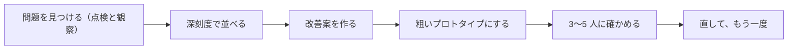

# 第 8 章　実践: 1 画面を改善して確かめる

- 講座: エンジニアのための UI・UX デザイン（uiux-engineers）
- 章 ID: `uiux-08`　動画 ID: `D08`
- 動画: 08:19（70 台詞）
- 要約: 自分のサービスの 1 画面で、経験則での点検と観察で問題を見つけて深刻度で並べ、改善案を紙か HTML の粗いプロトタイプにし、同じ利用者層の 3〜5 人にタスクを渡して確かめる。「5 人で約 85%」の前提と限界を押さえ、直して繰り返す。講座全体の振り返りと次の一歩も。

> このファイルは `bun scripts/build_materials.ts` が `content/` の台本から作ります。直すときは台本（`content/uiux-engineers/` の TS）を直してください。

## 学習目標

- 10 の経験則（ユーザビリティ・ヒューリスティクス）での点検と、使う様子の観察で、1 画面の問題を見つけて書き出せる
- 問題に深刻度（頻度・影響・繰り返しで 0〜4）を付け、直す順番を決められる
- 改善案を、試したいことに合わせて、紙か HTML の粗いプロトタイプにできる
- 同じ利用者層の 3〜5 人で誘導しないテストを計画して実施し、少人数の結果の限界を踏まえて次の手を決められる

## 前提知識

- 第 1〜7 章（特に第 1 章の「主要なタスクの 1 文」と、10 の経験則）
- 自分のサービスの画面（作りかけでもよい）があり、テストに協力してくれる人を 3 人ほど探せる

根拠の種類の札: **研究・学術**（査読のある研究・メタ分析・学術書の定義）／**公式・法令・規格**（法律・官公庁・標準化団体・公式ガイドライン）／**実務の指針**（実務家や専門機関の一般的な指針。条件によって外れる）／**説明用の仮の例**（架空のサンプルで、実在のデータではない）

## 1. 教材本文

### [uiux-08-s01] 困りごと: 直したけれど、良くなったか分からない

根拠: 説明用の仮の例　動画の場面: 3

サンプル予約で、第 1 章の改善案（日時を最初に選ぶ・3 つのステップを見せる・ラベルを欄の外に出す・ボタンに次の動作を書く）を、そのまま本番に出したとします。予約の画面を開いた 100 人のうち、予約を送った人は、改善の前の週が 29 人、後の週が 31 人でした（**仮の数字で、実在のデータではありません**）。

2 人増えましたが、この人数では、改善の効果なのか、週ごとの偶然の揺れなのかを区別できません。しかも本番の数字は、「どこで・なぜ迷ったか」を教えてくれません。直したつもりの画面に、別の問題が生まれていることもあります。

この章では、本番に出す前に、少ない人数に使ってもらい、迷う所を見て確かめる方法を学びます。講座の最後の章なので、これまでの道具（目的と流れ・見た目・フォームとエラー・アクセシビリティ）を、1 画面の改善にまとめて使います。

### [uiux-08-s02] 一巡の流れ: 見つける → 直す → 作る → 確かめる

根拠: 実務の指針　動画の場面: 4　出典: [Jakob Nielsen（Nielsen Norman Group） 2000](https://www.nngroup.com/articles/why-you-only-need-to-test-with-5-users/)

1 画面の改善は、次の 4 つの段階を一巡し、結果で直して、もう一度回します（図 uiux-08-f01）。

1. **問題を見つける**: 10 の経験則で点検し、使う様子を観察する（uiux-08-s03）
2. **改善案を作る**: 深刻度の高い問題から直し方を考え、「なぜ分かりやすくなるか」を経験則の言葉で 1 文書く（第 1 章）
3. **プロトタイプにする**: 紙か HTML で、試したいことが試せる、いちばん粗いものを作る（uiux-08-s04）
4. **利用者に確かめる**: 同じ利用者層の 3〜5 人に、目的だけのタスクを渡し、声に出してもらいながら黙って見る（uiux-08-s05・s06）

大事なのは、1 回で終わらせないことです。Jakob Nielsen は、同じ人数を使うなら、1 回の大きなテストより、少人数のテストを直しながら何度も回すほうがよいと勧めています。直した案が本当に良くなったか、直したことで新しい問題が生まれていないかは、次の回で分かるからです。

### [uiux-08-s03] 問題を見つけて、深刻度で並べる

根拠: 実務の指針・説明用の仮の例　動画の場面: 5, 6　出典: [Jakob Nielsen（Nielsen Norman Group） 1994（2020 年改訂・2024 年見直し）](https://www.nngroup.com/articles/ten-usability-heuristics/)、[Kate Moran, Kelley Gordon（Nielsen Norman Group） 2023](https://www.nngroup.com/articles/how-to-conduct-a-heuristic-evaluation/)、[Jakob Nielsen（Nielsen Norman Group） 1994](https://www.nngroup.com/articles/how-to-rate-the-severity-of-usability-problems/)

**経験則で点検する（ヒューリスティック評価）**: 第 1 章で見た Nielsen の 10 の経験則（システムの状態を見せる・現実の世界に合わせる・利用者が取り消せる・一貫性・エラーを防ぐ・記憶より見て分かる など）に照らして、画面を 1 つずつ見ます。NN/g の Moran と Gordon（2023）は、腕のある人でも見落としがあるので、3〜5 人がそれぞれ別々に点検し、終わってから持ち寄る進め方を勧めています。1 人で点検するなら、見落としがある前提で、観察とテストで補います。

**使う様子を見る（観察）**: 実際に使ってもらい、迷った所・止まった所・戻った所・口にした言葉を書き留めます。問い合わせやレビューの言葉も手がかりになります。

経験則の点検は、利用者のテストの代わりにはなりません（Moran と Gordon も、点検は利用者のリサーチに代わるものではないと書いています）。点検で見つけたものは「たぶん問題」の候補で、テストで確かめる所の目印です。

**深刻度で並べる**: Nielsen（1994）は、問題の深刻さを、**頻度**（どれだけの人が出会うか）・**影響**（出会ったとき、どれだけ乗り越えにくいか）・**繰り返し**（一度で慣れるか、毎回困るか）で考え、0〜4 の点で表す方法を示しています。

- **0**: 問題ではない
- **1**: 見た目だけの問題。時間に余裕があれば直す
- **2**: 小さな問題。後回しにしてよい
- **3**: 大きな問題。早く直す
- **4**: 致命的。出す前に必ず直す

点は点検の最中ではなく、終わってから付けます。1 人で付けた点はぶれやすいので、できれば数人が別々に付けて平均します（Nielsen は、3 人の平均で多くの場合は足りるとしています）。サンプル予約の連絡先の入力で並べた例が、図 uiux-08-f02 です（仮の例）。

### [uiux-08-s04] 改善案とプロトタイプ: 紙と HTML の使い分け

根拠: 実務の指針・説明用の仮の例　動画の場面: 7　出典: [Jakob Nielsen（Nielsen Norman Group） 2003](https://www.nngroup.com/articles/paper-prototyping/)、[Kara Pernice（Nielsen Norman Group） 2016](https://www.nngroup.com/articles/ux-prototype-hi-lo-fidelity/)

改善案は、深刻度の高い問題から作ります。サンプル予約なら、電話番号はハイフンがあってもなくても受け付ける（エラーを防ぐ）、エラーは欄のそばに直し方まで書く（エラーに気づき、直せる）、確認の画面に日時を直す入口を置く（利用者が戻れる）、の 3 つです。

プロトタイプは、作り込まなくてかまいません。Nielsen（2003）は、紙のプロトタイプを、利用者のデータを得る最も速く安い方法の 1 つとし、作る前の早い段階で見つけるほど、直すのが安く済むとしています。

**どれだけ作り込むか**は、操作（押すと動くか）・見た目（配置や文字が本物に近いか）・中身（本物の文章や画像か）の 3 つの軸で考えます（Pernice, 2016）。粗いプロトタイプでは、人が「コンピューターの役」をして、押された所に合わせて次の紙を出します。

- **紙が向くとき**: 画面の流れ・並び・言葉を試したい。数分で描け、テストの合間やその場でも描き直せる
- **HTML が向くとき**: 入力そのもの（電話番号の形式・キーボードの出方）や、スマホでの操作、スクリーンリーダーでの読み上げを試したい。保存も送信もしない 1 枚のページで足りることが多い（図 uiux-08-f04）
- **作り込んだ試作が要るとき**: 動きのある部品の細かいふるまい、文字や画像の読みやすさ、反応の速さまで確かめたい

Pernice は、粗い試作のほうが、参加者が「試されているのは自分ではなく画面だ」と感じて遠慮なく意見を言いやすく、作り手も案を手放しやすいと書いています。作り込むほど、直したくない気持ちが出てくることに気をつけます。

### [uiux-08-s05] 何人に確かめるか: 5 人の目安と、その限界

根拠: 実務の指針・研究・学術　動画の場面: 8, 9　出典: [Jakob Nielsen（Nielsen Norman Group） 2000](https://www.nngroup.com/articles/why-you-only-need-to-test-with-5-users/)、[Laura Faulkner（Behavior Research Methods, Instruments, & Computers 35） 2003](https://doi.org/10.3758/BF03195514)

よく使われる目安が「5 人で十分」です。Nielsen（2000）は、1 人のテストで見つかる問題を平均で約 31% と置くモデル（Nielsen と Landauer が 1993 年に示したもの）で計算し、5 人で約 85% の問題が見つかるとしました。人数を増やすほど、同じ問題を何度も見ることになり、新しく分かることは減っていきます。一方で、0 人なら、分かることも 0 です。

ただし、この目安には前提があります。

- **同じ利用者層であること**: 使い方のはっきり違う層（例: 初めての人と、毎週予約する常連）がいるなら、層ごとにテストする（2 層なら各 3〜4 人、3 層以上なら各 3 人。どの層も 3 人を下回らない）
- **問題を見つけるテストであること**: 完了率や時間を数字で比べて差を言うテストには、もっと多くの人数が要る
- **直しながら繰り返すこと**: 15 人に 1 回より、5 人ずつ 3 回、直しながら確かめるほうがよい

**限界**: Faulkner（2003）は 60 人をテストし、その中から 5 人の組を無作為に作って比べました。見つかった問題の割合（60 人全員で見つかった問題に対して）は、組によって 55% から 99% までばらつきました。最も少ない組でも、10 人の組では 80%、20 人の組では 95% でした。5 人の 1 回のテストが、たまたま多くを見落とすこともある、ということです。

だから、少人数の結果は「これで全部の問題」ではなく、次の手を決めるための仮説として扱います。予約や支払いのように、失敗したときの影響が大きい画面ほど、回数か人数を増やします。また、1 人だけのテストは、その人のたまたまの行動に引きずられやすいので（Nielsen も 1 人だけのテストを勧めていません）、少なくとも 3 人は見ます。

記録は、第 1 章の効果・効率・満足でそろえます。**効果** = タスクを最後までできた人の数（例: 5 人中 4 人）、**効率** = かかった時間や戻った回数、**満足** = 終わった後の一言や点数。5 人の完了率は、割合にすると偶然の揺れがとても大きいので、「何人ができて、どこで、なぜ迷ったか」を言葉で残すほうが、次の手につながります。

### [uiux-08-s06] 良い例・悪い例: テストの進め方（タスク・思考発話・誘導しない質問）

根拠: 実務の指針・説明用の仮の例　動画の場面: 10, 11　出典: [Marieke McCloskey（Nielsen Norman Group） 2014](https://www.nngroup.com/articles/task-scenarios-usability-testing/)、[Jakob Nielsen（Nielsen Norman Group） 2012](https://www.nngroup.com/articles/thinking-aloud-the-1-usability-tool/)、[Amy Schade（Nielsen Norman Group） 2017](https://www.nngroup.com/articles/leading-questions/)、[Jeff Sauro（MeasuringU） 2017](https://measuringu.com/usability-assistance/)

テストで見たいのは、利用者がひとりで使うときに、どこで、なぜ迷うかです。進め方しだいで、それは簡単に見えなくなります（図 uiux-08-f03）。

**タスクは、目的だけを渡す**: McCloskey（2014）は、テストのタスクを、現実にありそうで、実際に操作してもらう形にし、手順のヒントや画面の言葉（ボタンの名前など）を入れないよう勧めています。「上の［予約する］を押して、日時を選んでください」では、自分で見つけられるかどうかが分かりません。「来週の土曜の午後に、お店を予約してみてください」のように、目的と、やり切るのに必要な情報（日にちなど）だけを渡します。

**声に出してもらう（思考発話）**: 使いながら、考えていることを声に出し続けてもらう方法です。Nielsen（2012）は、代表的な利用者を集め、現実的なタスクを渡し、あとは黙って話してもらう、という 3 つで始められるとし、安く・崩れにくく・どの段階の試作にも使える一番の道具と位置づけています。一方で、声に出し続けるのは不自然なこと、話す前に考えをまとめてしまう人がいること、進行役の口出しで行動が変わること、細かい統計には向かないことも挙げています。

**黙って見る。助けるのは、本当に進めないときだけ**: 迷った所で正しい操作を教えると、直すべき問題が見えなくなります。Sauro（2017）は、助けに入るのは、同じ所で行き詰まって本当に先へ進めない・時間が足りない・データが消えるなどの事故が起きそうなとき、としています。助けたら、そのことと程度を記録し、「助けなしでできた人数」と分けて数えます。

**質問は、答えを含めない**: Schade（2017）は、答えを含む・ほのめかす質問（誘導する質問）では、参加者が質問の言葉や意見に合わせてしまい、確かめるのではなく、思い込みを裏付けるだけになるとしています。「分かりやすいですよね？」「メニューが分かりにくかったのはなぜですか？」のように答えや原因を決めつけず、「この予約で、やりやすかった所や、やりにくかった所はありましたか？」のように、両方を同じ重さで、開いた形で聞きます。画面の部品の名前も、こちらからは出しません。

テストの前には、試しているのは画面で、あなたではないこと、いつでもやめてよいことを伝えます。録画や録音をするなら、何のために、どう使うかを先に伝えて同意をもらい、記録は必要な範囲にとどめます。電話番号などは本物を入れてもらわず、テスト用の値を渡します。

### [uiux-08-s07] 実践手順: 1 画面の改善レポートを作る

根拠: 実務の指針　動画の場面: 12, 13

1. **画面とタスクを 1 つ決める**: 第 1 章の「主要なタスクの 1 文」から始める（例: 初めての人が、仕事帰りにスマホで、希望の日時で予約したい）
2. **問題を書き出し、深刻度で並べる**: 経験則の点検と、2〜3 人の観察（または問い合わせの言葉）から問題を書き、頻度・影響・繰り返しで 0〜4 の点を付ける
3. **上位 1〜3 個の改善案を、粗く作る**: 直す理由を経験則の言葉で 1 文書き、試したいことに合わせて紙か HTML を選ぶ
4. **テストの計画を書く**: 誰に（同じ利用者層の 3〜5 人）、どのタスクを渡し、何を記録するか（できた人の数・時間・迷った所と言葉・助けた回数）
5. **テストして、結果をまとめる**: 黙って見て、終わってから中立に聞く。同じ問題に何人が出会ったかを数える
6. **次の手を決める**: 直してもう一度確かめる、または本番に出して数字を見る。本番の数字は人数が少ないうちは揺れるので、観察の結果と合わせて読む

成果物は「1 画面の改善レポート」です（実践課題 uiux-08-ex）。最初から完璧な手順はいりません。1 回目は小さく回し、2 回目で直します。

### [uiux-08-s08] 振り返りの問いと、講座の次の一歩

根拠: 実務の指針　動画の場面: 14, 15, 16

- 最近直した画面は、本番に出す前に、誰かに使ってもらいましたか？ そのとき、手順や答えを教えていませんでしたか？
- 見つけた問題を深刻度の順に並べると、一番上は何ですか？ 今、それから直していますか？
- 次のテストでは、誰に（どの利用者層の何人に）、どんなタスクを渡しますか？

**講座の振り返り**: 第 1 章で、画面を「目的 → 流れ → 見た目」の 3 層で見ることと、改善を効果・効率・満足で比べることを学びました。第 2〜3 章で目的と情報設計・操作の流れ、第 4〜5 章で優先順位・余白・文字・色、第 6〜7 章でフォームとエラー表示・アクセシビリティを扱い、この章で、それらを 1 画面の改善と、その確かめ方にまとめました。

**次の一歩**: 毎月 1 つの画面を選び、3 人に使ってもらうことを習慣にします。1 回は小さくてかまいません。直して、また確かめる。その繰り返しが、作り手の思い込みを、利用者の事実に置き換えていきます。

## 2. ナレーション台本

話者: 講師 = VOICEVOX:No.7、呼び込み = VOICEVOX:青山龍星。時刻は合成した音声の実測。

### 場面 1　オープニング

- `00:02` （呼び込み）第8章。実践: 1 画面を改善して確かめる。
- `00:07` いよいよ、最後の章です。これまでの道具を使って、一つの画面を直し、本当に良くなったかを確かめます。

### 場面 2　この章のゴール

- `00:16` この章のゴールは、三つです。
- `00:18` 一つ目。経験則と観察で問題を見つけ、深刻さの順に並べられること。
- `00:24` 二つ目。改善案を、紙か HTML の、粗いプロトタイプにできること。
- `00:30` 三つ目。少ない人数のテストで確かめ、その限界も踏まえて、次の手を決められることです。

### 場面 3　困りごと: 直したけれど、良くなった？

- `00:38` サンプル予約で、第一章の改善案を、そのまま本番に出したとします。
- `00:43` 改善の前の週は、予約の画面を開いた百人のうち、予約を送ったのが、二十九人。
- `00:50` 改善の後の週は、三十一人でした。
- `00:53` 増えました。でも、二人の差は、たまたまかもしれません。この人数では、区別できません。
- `01:00` しかも数字は、どこで、なぜ迷ったのかを教えてくれません。だから、本番に出す前に、少ない人数で確かめます。

### 場面 4　1 画面で、一巡する

- `01:10` この章でやることは、四つの段階の一巡です。
- `01:13` まず、問題を見つける。経験則で点検し、実際に使う様子を見ます。
- `01:19` 次に、深刻な問題から、改善案を作ります。
- `01:23` それを、紙か HTML で、粗いプロトタイプにします。
- `01:28` そして、利用者に使ってもらい、確かめます。
- `01:32` 一回で終わりではありません。結果で直して、もう一度回します。

### 場面 5　問題の見つけ方と、並べ方

- `01:38` 問題の見つけ方は、二つあります。
- `01:41` 一つは、第一章で見た、ニールセンの十の経験則で、画面を点検すること。一人では見落とすので、できれば三人から五人が、別々に見て持ち寄ります。
- `01:52` もう一つは、使う様子を見ること。迷った所、止まった所、口にした言葉を、書き留めます。
- `01:59` 見つけた問題は、深刻度で並べます。どれだけの人が出会うか、どれだけ困るか、毎回困るかで、ゼロから四の点を付けます。
- `02:09` ただし、経験則の点検は、利用者のテストの代わりにはなりません。見つけた問題は、まだ候補です。

### 場面 6　問題を、深刻度の順に並べる

- `02:17` サンプル予約の、連絡先を入れる画面で、並べてみます。三人に使ってもらった様子と、点検から集めた、仮の例です。
- `02:27` 一番深刻なのは、電話番号にハイフンを入れると、エラーになること。三人中二人が引っかかり、一人は、ここで予約をやめました。点は四です。
- `02:38` エラーが画面の上だけに出て、どの欄の問題か分からない。点は三です。
- `02:43` 確認の画面で、日時を直す方法がない。点は二です。
- `02:48` 補足の文字が薄く、読みにくい。点は一です。直す順番は、上からです。

### 場面 7　プロトタイプは、試したいことに合わせて粗く

- `02:56` プロトタイプは、作り込まなくて大丈夫です。試したいことに合わせて選びます。
- `03:01` 紙のプロトタイプは、数分で描けて、その場で描き直せます。
- `03:06` 人がコンピューターの役をして、押された所に合わせて、次の紙を出します。画面の流れや、言葉を試すのに向いています。
- `03:15` HTML のプロトタイプは、実際に入力できて、スマホでも試せます。電話番号のように、入力そのものを試すなら、こちらです。
- `03:25` 保存も送信もしない、一枚のページで足ります。
- `03:28` 粗いほうが、作り手は手放しやすく、使う人も、遠慮なく意見を言いやすい、とされています。

### 場面 8　何人に確かめるか

- `03:36` 何人に確かめればいいのでしょうか。よく使われる目安があります。
- `03:40` ニールセンは、一人のテストで見つかる問題を、平均で三十一パーセントと置きました。
- `03:46` この前提で計算すると、五人で、およそ八十五パーセントが見つかります。
- `03:52` ただし、条件があります。同じ利用者層であること。数字を比べるのではなく、問題を見つけるテストであること。そして、直しながら繰り返すことです。
- `04:03` 十五人に一回より、五人ずつ三回、直しながら確かめるほうがいい、と勧めています。

### 場面 9　5 人の結果は、ばらつく

- `04:10` ただ、五人で八十五パーセントは、平均の話です。
- `04:15` 六十人をテストした研究で、五人の組を無作為に作ってみると、見つかった問題が、五十五パーセントだけの組がありました。
- `04:23` 一方で、九十九パーセントの組もありました。
- `04:27` 十人の組なら、最も少ない組でも、八十パーセントでした。
- `04:32` だから、五人の結果が、全部ではありません。大事な画面ほど、回数か人数を増やし、結果は、次を決めるための仮説として扱います。

### 場面 10　悪い例・良い例: テストの進め方

- `04:43` では、テストの進め方を、悪い例と良い例で比べます。
- `04:47` 悪い例の台本は、まず、手順と、ボタンの名前を教えています。これでは、自分で見つけられるかどうかが、分かりません。
- `04:56` 迷ったら、すぐに正しい操作を教える。直すべき問題は、迷った所にあるのに、それが見えなくなります。
- `05:04` 最後に、分かりやすいですよね、と聞く。答えを含んだ質問には、相手は合わせてしまいがちです。
- `05:11` 良い例は、目的だけを渡します。来週の土曜の午後に、お店を予約してみてください。画面の言葉は使いません。
- `05:20` 進めながら、考えていることを、声に出してもらいます。思考発話と呼ばれる方法で、迷った理由が聞こえます。
- `05:28` 口を出さずに、黙って見る。終わってから、やりやすかった所と、やりにくかった所を、同じ重さで聞きます。

### 場面 11　クイズ

- `05:37` ここでクイズです。テスト中に利用者が迷ったら、すぐに正しい操作を教えたほうがいい。マルでしょうか、バツでしょうか。
- `05:48` 答えは、バツ。迷った所こそ、直すべき問題の手がかりです。
- `05:54` まずは黙って見て、終わってから、どこで、なぜ迷ったかを聞きます。本当に先へ進めないときだけ助けて、助けたことを記録します。

### 場面 12　実践: 1 画面を一巡する

- `06:04` 実践の手順です。
- `06:06` まず、画面とタスクを、一つ決めます。第一章で書いた、タスクの一文が出発点です。
- `06:13` 次に、点検と観察で問題を書き出し、深刻度で並べます。
- `06:18` 上位の問題の改善案を、紙か HTML で、粗く作ります。
- `06:23` 最後に、同じ利用者層の、三人から五人に確かめます。できた人の数、かかった時間、使った後の一言を記録します。第一章の、効果、効率、満足です。

### 場面 13　演習

- `06:37` では、演習です。動画を止めて、五分だけ、取り組んでみてください。
- `06:43` 自分のサービスの、一つの画面で、問題を三つ挙げ、ゼロから四の深刻度を付けます。一番上の問題を、紙と HTML の、どちらで試すかも決めましょう。
- `06:56` テストまでの手順と回答例、評価の基準は、講座サイトの実践課題にあります。
- （2.5 秒の間。考える時間）

### 場面 14　振り返り

- `07:05` 振り返りです。問題は、経験則の点検と、使う様子の観察で見つけ、深刻度で並べます。
- `07:12` プロトタイプは、試したいことに合わせて、粗く、速く作ります。
- `07:17` 確かめるのは、同じ利用者層の、三人から五人。直して繰り返し、少人数の結果は、仮説として扱います。

### 場面 15　この講座で学んだこと

- `07:27` 最後に、講座の全体を振り返ります。
- `07:30` 第一章から第三章で、画面を、目的、流れ、見た目の順に見て、言葉と流れを、利用者に合わせることを学びました。
- `07:40` 第四章と第五章は、見た目の基本。優先順位、余白、文字、そして色です。
- `07:47` 第六章と第七章で、間違いを防ぎ、すぐ直せるフォームと、誰でも使える画面を学びました。
- `07:54` そしてこの章で、見つけて、直して、作って、確かめる、を一巡しました。次の一歩は、毎月一つの画面を、三人に使ってもらうことです。

### 場面 16　エンディング

- `08:06` 以上で、エンジニアのための、UI・UX デザイン講座はおしまいです。最後まで、ありがとうございました。

## 3. 絵コンテ

| # | 開始 | 秒数 | 図解の種類 | 根拠 | 表示内容（画面の文字） | 読み上げ（字幕と同じ） |
| --- | --- | --- | --- | --- | --- | --- |
| 1 | 00:00 | 16 秒 | タイトル |  | SECTION 5　実践／タイトル「実践: 1 画面を改善して確かめる」／見つけて、直して、作って、確かめる | 第8章。実践: 1 画面を改善して確かめる。 いよいよ、最後の章です。これまでの道具を使って、一つの画面を直し、本当に良くなったかを確かめます。 |
| 2 | 00:15 | 22 秒 | ゴールの一覧 |  | 【この章のゴール】1. 経験則と観察で問題を見つけ、深刻度で並べられる 2. 改善案を、紙か HTML の粗いプロトタイプにできる 3. 3〜5 人のテストで確かめ、限界も踏まえて次を決められる | この章のゴールは、三つです。 一つ目。経験則と観察で問題を見つけ、深刻さの順に並べられること。 二つ目。改善案を、紙か HTML の、粗いプロトタイプにできること。 三つ目。少ない人数のテストで確かめ、その限界も踏まえて、次の手を決められることです。 |
| 3 | 00:38 | 32 秒 | 数字 | 説明用の仮の例 | 【困りごと: 直したけれど、良くなった？】改善の前の週に、予約を送った 29 人 改善の後の週に、予約を送った 31 人／どちらも、予約の画面を開いた 100 人のうち。サンプル予約の仮の数字 | サンプル予約で、第一章の改善案を、そのまま本番に出したとします。 改善の前の週は、予約の画面を開いた百人のうち、予約を送ったのが、二十九人。 改善の後の週は、三十一人でした。 増えました。でも、二人の差は、たまたまかもしれません。この人数では、区別できません。 しかも数字は、どこで、なぜ迷ったのかを教えてくれません。だから、本番に出す前に、少ない人数で確かめます。 |
| 4 | 01:09 | 28 秒 | 流れの図 | 実務の指針 | 【1 画面で、一巡する】1. 問題を見つける・2. 改善案を作る・3. プロトタイプにする・4. 利用者に確かめる。直して、もう一度 | この章でやることは、四つの段階の一巡です。 まず、問題を見つける。経験則で点検し、実際に使う様子を見ます。 次に、深刻な問題から、改善案を作ります。 それを、紙か HTML で、粗いプロトタイプにします。 そして、利用者に使ってもらい、確かめます。 一回で終わりではありません。結果で直して、もう一度回します。 |
| 5 | 01:37 | 40 秒 | 用語のカード | 実務の指針 | 【問題の見つけ方と、並べ方】経験則で点検する（Heuristic Evaluation）: 10 の経験則で画面を見る。できれば 3〜5 人が別々に／使う様子を見る（Observation）: 迷った所・止まった所・口にした言葉を書く／深刻度で並べる（Severity）: 頻度・影響・繰り返しで 0〜4 を付け、上から直す | 問題の見つけ方は、二つあります。 一つは、第一章で見た、ニールセンの十の経験則で、画面を点検すること。一人では見落とすので、できれば三人から五人が、別々に見て持ち寄ります。 もう一つは、使う様子を見ること。迷った所、止まった所、口にした言葉を、書き留めます。 見つけた問題は、深刻度で並べます。どれだけの人が出会うか、どれだけ困るか、毎回困るかで、ゼロから四の点を付けます。 ただし、経験則の点検は、利用者のテストの代わりにはなりません。見つけた問題は、まだ候補です。 |
| 6 | 02:17 | 39 秒 | 表 | 説明用の仮の例 | 【問題を、深刻度の順に並べる】見つけた問題（連絡先の入力）｜見つけ方｜深刻度: 電話番号にハイフンを入れると、エラーになる・観察: 3 人中 2 人・4／エラーが画面の上だけに出て、どの欄か分からない・経験則: エラーに気づき、直せる・3／確認の画面で、日時を直す方法がない・経験則: 利用者が戻れる・2／補足の文字が薄く、読みにくい・点検: 文字のコントラスト・1 | サンプル予約の、連絡先を入れる画面で、並べてみます。三人に使ってもらった様子と、点検から集めた、仮の例です。 一番深刻なのは、電話番号にハイフンを入れると、エラーになること。三人中二人が引っかかり、一人は、ここで予約をやめました。点は四です。 エラーが画面の上だけに出て、どの欄の問題か分からない。点は三です。 確認の画面で、日時を直す方法がない。点は二です。 補足の文字が薄く、読みにくい。点は一です。直す順番は、上からです。 |
| 7 | 02:56 | 40 秒 | 左右の比較 | 実務の指針 | 【プロトタイプは、試したいことに合わせて粗く】左「紙のプロトタイプ」数分で描けて、その場で描き直せる・人が紙を差し替えて、操作に応える／右「HTML のプロトタイプ」実際に入力でき、スマホで試せる・保存も送信もしない、1 枚のページで足りる／結論: いちばん粗く、速く作れるもので試す | プロトタイプは、作り込まなくて大丈夫です。試したいことに合わせて選びます。 紙のプロトタイプは、数分で描けて、その場で描き直せます。 人がコンピューターの役をして、押された所に合わせて、次の紙を出します。画面の流れや、言葉を試すのに向いています。 HTML のプロトタイプは、実際に入力できて、スマホでも試せます。電話番号のように、入力そのものを試すなら、こちらです。 保存も送信もしない、一枚のページで足ります。 粗いほうが、作り手は手放しやすく、使う人も、遠慮なく意見を言いやすい、とされています。 |
| 8 | 03:36 | 34 秒 | 数字 | 実務の指針 | 【何人に確かめるか】1 人のテストで見つかる問題（平均と置く） 31% 5 人のテストで見つかる問題（計算） 85%／同じ利用者層で、問題を見つけるテストを、直しながら繰り返す前提の目安 | 何人に確かめればいいのでしょうか。よく使われる目安があります。 ニールセンは、一人のテストで見つかる問題を、平均で三十一パーセントと置きました。 この前提で計算すると、五人で、およそ八十五パーセントが見つかります。 ただし、条件があります。同じ利用者層であること。数字を比べるのではなく、問題を見つけるテストであること。そして、直しながら繰り返すことです。 十五人に一回より、五人ずつ三回、直しながら確かめるほうがいい、と勧めています。 |
| 9 | 04:10 | 32 秒 | 数字 | 研究・学術 | 【5 人の結果は、ばらつく】5 人組: 最も少なかった組 55% 5 人組: 最も多かった組 99% 10 人組: 最も少なかった組 80%／60 人をテストし、組を無作為に作って比べた。割合は 60 人全員で見つかった問題に対して | ただ、五人で八十五パーセントは、平均の話です。 六十人をテストした研究で、五人の組を無作為に作ってみると、見つかった問題が、五十五パーセントだけの組がありました。 一方で、九十九パーセントの組もありました。 十人の組なら、最も少ない組でも、八十パーセントでした。 だから、五人の結果が、全部ではありません。大事な画面ほど、回数か人数を増やし、結果は、次を決めるための仮説として扱います。 |
| 10 | 04:42 | 54 秒 | 画面の比較（改善前・改善後） | 説明用の仮の例 | 【悪い例・良い例: テストの進め方】悪い例「サンプル予約　テストの台本」: 1. 手順と画面の言葉を教えている 2. 迷った所が見えなくなる 3. 答えを含む質問（誘導）／良い例「サンプル予約　テストの台本」: 1. 目的だけを渡す（画面の言葉を使わない） 2. 声に出してもらい、迷う理由を聞く 3. 黙って見て、答えを含めずに聞く | では、テストの進め方を、悪い例と良い例で比べます。 悪い例の台本は、まず、手順と、ボタンの名前を教えています。これでは、自分で見つけられるかどうかが、分かりません。 迷ったら、すぐに正しい操作を教える。直すべき問題は、迷った所にあるのに、それが見えなくなります。 最後に、分かりやすいですよね、と聞く。答えを含んだ質問には、相手は合わせてしまいがちです。 良い例は、目的だけを渡します。来週の土曜の午後に、お店を予約してみてください。画面の言葉は使いません。 進めながら、考えていることを、声に出してもらいます。思考発話と呼ばれる方法で、迷った理由が聞こえます。 口を出さずに、黙って見る。終わってから、やりやすかった所と、やりにくかった所を、同じ重さで聞きます。 |
| 11 | 05:36 | 27 秒 | ○×クイズ |  | 【クイズ】Q1. テスト中に利用者が迷ったら、すぐに正しい操作を教えたほうがいい？ → 答え ×: 迷った所が、直すべき問題の手がかり。黙って見て、終わってから聞く | ここでクイズです。テスト中に利用者が迷ったら、すぐに正しい操作を教えたほうがいい。マルでしょうか、バツでしょうか。 答えは、バツ。迷った所こそ、直すべき問題の手がかりです。 まずは黙って見て、終わってから、どこで、なぜ迷ったかを聞きます。本当に先へ進めないときだけ助けて、助けたことを記録します。 |
| 12 | 06:04 | 33 秒 | 要点のカード | 実務の指針 | 【実践: 1 画面を一巡する】1. 画面とタスクを 1 つ決める（第 1 章で書いたタスクの 1 文から）／2. 問題を書き、深刻度で並べる（経験則の点検と、使う様子の観察）／3. 上位の問題を、粗く作る（紙か HTML。試したいことで選ぶ）／4. 3〜5 人に確かめ、直して回す（タスクを渡し、声に出してもらい、黙って見る） | 実践の手順です。 まず、画面とタスクを、一つ決めます。第一章で書いた、タスクの一文が出発点です。 次に、点検と観察で問題を書き出し、深刻度で並べます。 上位の問題の改善案を、紙か HTML で、粗く作ります。 最後に、同じ利用者層の、三人から五人に確かめます。できた人の数、かかった時間、使った後の一言を記録します。第一章の、効果、効率、満足です。 |
| 13 | 06:37 | 27 秒 | 大きな一文 |  | 【演習】動画を止めて、5 分／自分の 1 画面で、問題を 3 つ 挙げる／0〜4 の深刻度を付け、一番上の問題を、紙と HTML のどちらで試すか決める | では、演習です。動画を止めて、五分だけ、取り組んでみてください。 自分のサービスの、一つの画面で、問題を三つ挙げ、ゼロから四の深刻度を付けます。一番上の問題を、紙と HTML の、どちらで試すかも決めましょう。 テストまでの手順と回答例、評価の基準は、講座サイトの実践課題にあります。（2.5 秒の間） |
| 14 | 07:04 | 22 秒 | まとめ |  | 【振り返り】1. 問題は、経験則の点検と観察で見つけ、深刻度で並べる 2. プロトタイプは、試したいことに合わせて、粗く速く 3. 同じ利用者層の 3〜5 人で確かめ、直して繰り返す | 振り返りです。問題は、経験則の点検と、使う様子の観察で見つけ、深刻度で並べます。 プロトタイプは、試したいことに合わせて、粗く、速く作ります。 確かめるのは、同じ利用者層の、三人から五人。直して繰り返し、少人数の結果は、仮説として扱います。 |
| 15 | 07:27 | 39 秒 | 時間の流れ |  | 【この講座で学んだこと】第 1〜3 章　目的と流れ（3 章） → 第 4〜5 章　見た目の基本（2 章） → 第 6〜7 章　フォームと誰でも使える画面（2 章） → 第 8 章　確かめる（1 章） | 最後に、講座の全体を振り返ります。 第一章から第三章で、画面を、目的、流れ、見た目の順に見て、言葉と流れを、利用者に合わせることを学びました。 第四章と第五章は、見た目の基本。優先順位、余白、文字、そして色です。 第六章と第七章で、間違いを防ぎ、すぐ直せるフォームと、誰でも使える画面を学びました。 そしてこの章で、見つけて、直して、作って、確かめる、を一巡しました。次の一歩は、毎月一つの画面を、三人に使ってもらうことです。 |
| 16 | 08:06 | 13 秒 | 次の章の予告 |  | 次の一歩は、1 画面を 3 人に使ってもらうところから | 以上で、エンジニアのための、UI・UX デザイン講座はおしまいです。最後まで、ありがとうございました。 |

字幕: 全部の台詞を日本語字幕にする（講座サイトは動画の下の帯、`out/captioned/` の動画は焼き込み）。画面の文字は要点だけにし、説明はナレーションと教材本文で補う。

## 4. 図解・比較例

### [uiux-08-f01] 1 画面の改善の一巡

4 つの段階を一巡し、結果で直してもう一度回す（実務の指針）



流れ: 問題を見つける（点検と観察） → 深刻度で並べる → 改善案を作る → 粗いプロトタイプにする → 3〜5 人に確かめる → 直して、もう一度

### [uiux-08-f02] 問題の一覧と深刻度（サンプル予約の連絡先の入力）

動画の場面 6 の表に、直し方の案を足したもの。中身は仮の例（説明用の仮の例）

| 見つけた問題 | 見つけ方 | 深刻度 | 直し方の案（理由） |
| --- | --- | --- | --- |
| 電話番号にハイフンを入れると、エラーになる | 観察（3 人中 2 人。1 人はやめた） | 4 | ハイフン・空白・全角の数字も受け付ける（エラーを防ぐ） |
| エラーが画面の上だけに出て、どの欄か分からない | 経験則の点検 | 3 | 欄のそばに、何が違って、どう直すかを書く（エラーに気づき、直せる） |
| 確認の画面で、日時を直す方法がない | 経験則の点検 | 2 | 日時の横に「変更する」を置く（利用者が戻れる） |
| 補足の文字が薄く、読みにくい | コントラストの点検 | 1 | 本文と同じ濃さにする（第 5 章） |

### [uiux-08-f03] テストの台本: 悪い例と良い例

動画の場面 10 の要点。手順を教えず、誘導せずに見る（実務の指針）

| 場面 | 悪い例 | 良い例 |
| --- | --- | --- |
| タスクの渡し方 | 「上の［予約する］を押して、日時を選んでください」（手順と画面の言葉を教える） | 「来週の土曜の午後に、お店を予約してみてください」（目的と必要な情報だけ） |
| 考えを知る | 終わってから「どうでしたか？」とだけ聞く | 進めながら、考えを声に出してもらう（思考発話） |
| 迷ったとき | すぐに正しい操作を教える | 黙って見る。本当に進めないときだけ助け、記録する |
| 終わった後の質問 | 「分かりやすいですよね？」 | 「やりやすかった所や、やりにくかった所はありましたか？」 |

### [uiux-08-f04] HTML のプロトタイプの例（電話番号の欄）

改善案を試すためだけの 1 枚のページ。保存も送信もしない。スマホで開いて入力してもらう（説明用の仮の例）

```html
<!-- 改善案を試すだけの 1 枚の HTML（保存も送信もしない） -->
<label for="tel">電話番号</label>
<p id="tel-hint">ハイフンはあってもなくても大丈夫です</p>
<input id="tel" type="tel" autocomplete="tel" aria-describedby="tel-hint">
<p id="tel-error" hidden>電話番号は、10 桁か 11 桁の数字で入れてください</p>
<button type="button" id="next">確認へ進む</button>
<script>
  document.getElementById('next').addEventListener('click', () => {
    const input = document.getElementById('tel');
    // 全角の数字は半角にし、ハイフンや空白は除いて桁を数える
    const digits = input.value.normalize('NFKC').replace(/\D/g, '');
    const ok = digits.length === 10 || digits.length === 11;
    document.getElementById('tel-error').hidden = ok;
    input.setAttribute('aria-invalid', String(!ok));
    input.setAttribute('aria-describedby', ok ? 'tel-hint' : 'tel-hint tel-error');
  });
</script>
```

## 5. 理解確認問題

### 問 1. 「5 人の利用者テストで、問題の約 85% が見つかる」という目安の前提は？

1. どんな利用者でも、5 人なら必ず 85% 見つかる
2. 同じ利用者層で、問題を見つけるテストを、直しながら繰り返す
3. 5 人の満足度の平均が 85 点以上になる
4. 完了率を数字で比べる、大きなテストで使う

<details><summary>答えと解説</summary>

**答え: 2. 同じ利用者層で、問題を見つけるテストを、直しながら繰り返す**

Nielsen（2000）の計算は、1 人が平均約 31% の問題を見つけると置いたモデル。利用者層が違えば層ごとに 3〜4 人、数字で比べるならもっと人数が要る。60 人から選んだ 5 人組では、見つかった問題が 55%〜99% とばらついた研究もある（Faulkner, 2003）。

</details>

### 問 2. テストの後の質問として、いちばん誘導が少ないのは？

1. 「この新しい画面、分かりやすいですよね？」
2. 「上の［予約する］ボタンは、すぐ見つかりましたか？」
3. 「この予約で、やりやすかった所や、やりにくかった所はありましたか？」
4. 「メニューが分かりにくかったのは、なぜですか？」

<details><summary>答えと解説</summary>

**答え: 3. 「この予約で、やりやすかった所や、やりにくかった所はありましたか？」**

答え（分かりやすい）や原因（メニュー）を質問に含めず、画面の部品の名前も出さない。やりやすさとやりにくさを同じ重さで、相手が自分の言葉で答えられる形で聞く（NN/g の Schade, 2017 の指針）。

</details>

### 問 3. 電話番号の入力形式（ハイフンなど）でつまずくかを確かめたい。どのプロトタイプが向く？

1. 紙のプロトタイプ
2. 入力できる、簡単な HTML のプロトタイプ
3. 本番の画面を作り込んでから
4. プロトタイプは作らず、アンケートで聞く

<details><summary>答えと解説</summary>

**答え: 2. 入力できる、簡単な HTML のプロトタイプ**

紙は流れや言葉を速く試すのに向くが、実際の入力やキーボードの出方は試しにくい。試したいことが試せる、いちばん粗いものを選ぶ。保存も送信もしない 1 枚の HTML で足りることが多い。

</details>

## 6. 実践課題 [uiux-08-ex] 1 画面の改善レポートを作る

- ねらい: 自分のサービスの 1 画面について、問題の一覧（深刻度つき）・改善案・簡単なプロトタイプ・3〜5 人のテストの結果と次の手を、1 つのレポートにまとめられる
- 目安の時間: 準備 2〜3 時間 ＋ テスト 3〜5 人（1 人 30 分ほど）
- 出すもの: 1 画面の改善レポート（タスクの 1 文、問題の一覧と深刻度、改善案とその理由、プロトタイプの写真か URL、テストの計画と結果、次の手）

### 手順

1. 第 1 章で書いた主要なタスクの 1 文を見直し、そのタスクで使う画面を 1 つ選んで、スクリーンショットを撮る
2. 10 の経験則で画面を点検し、2〜3 人に使ってもらう様子（または問い合わせ・レビューの言葉）から、問題を書き出す
3. 問題ごとに、頻度・影響・繰り返しから 0〜4 の深刻度を付け、上位 1〜3 個を選ぶ
4. 上位の問題の改善案を書き（理由を経験則の言葉で 1 文）、試したいことに合わせて、紙か HTML のプロトタイプを作る
5. 同じ利用者層の 3〜5 人に、目的だけのタスクを渡し、声に出しながら進めてもらう。黙って見て、終わってから中立に聞き、できた人数・時間・迷った所と言葉・助けた回数を記録する
6. 結果をまとめ、次の手（直してもう一度確かめる・本番に出して数字を見る・別の問題に移る）を決める

### 回答例: サンプル予約の連絡先の入力（仮の例）

**タスク**: 初めての人が、仕事帰りにスマホで、希望の日時で予約したい（連絡先の入力まで）。

**問題の一覧**: ①電話番号にハイフンを入れるとエラーになる（観察で 3 人中 2 人、1 人はやめた。深刻度 4）②エラーが画面の上だけに出る（点検。3）③確認の画面で日時を直せない（点検。2）④補足の文字が薄い（点検。1）。

**改善案**: ①ハイフン・空白・全角の数字も受け付ける（エラーを防ぐ）②エラーは欄のそばに「電話番号は、10 桁か 11 桁の数字で入れてください」と直し方まで書く（エラーに気づき、直せる）③確認の画面の日時の横に「変更する」を置く（利用者が戻れる）。

**プロトタイプ**: 入力そのものを試したいので、電話番号の欄と確認の画面だけの HTML を 1 枚作り（保存も送信もしない）、スマホで開ける URL にした。

**テスト**: 初めて予約する人（同じ利用者層）5 人。タスクは「来週の土曜の午後に、お店を予約してみてください。電話番号は、この紙のテスト用の番号を使ってください」。声に出しながら進めてもらい、黙って見た。

**結果**: 5 人とも電話番号の欄を一度で通れた（前は 3 人中 2 人が引っかかった）。1 人が確認の画面で「変更する」に気づかず、ブラウザの戻るボタンを探した。助けた回数は 0。「迷わなかった」と答えたのは 5 人中 4 人。

**次の手**: 「変更する」を日時のすぐ下のボタンにして、次の回に 3 人で確かめる。5 人の結果なので、見落とした問題が残っている前提で、本番に出したあとも問い合わせの言葉を見る。

### 評価基準

| 観点 | できている | もう一歩 | やり直し |
| --- | --- | --- | --- |
| 問題の見つけ方と並べ方 | 経験則の点検と観察の両方から問題を集め、頻度・影響・繰り返しで深刻度を付けて並べている | 問題はあるが、点検か観察の片方だけ、または深刻度がない | 好み（「ダサい」など）の一覧になっている |
| 改善案とプロトタイプ | 上位の問題に絞り、理由を経験則の言葉で書き、試したいことに合ったプロトタイプ（紙か HTML）がある | 改善案はあるが、理由かプロトタイプのどちらかがない | プロトタイプを作らず、本番の画面をいきなり作り直している |
| テストの進め方 | 同じ利用者層の 3〜5 人に目的だけのタスクを渡し、黙って見て、誘導しない質問で聞いている | 人数か利用者層が足りない、または質問の一部が誘導になっている | 手順を教える・答えを含む質問をするなど、確かめになっていない |
| 結果の読み方と次の手 | できた人数・迷った所と言葉・助けた回数を記録し、少人数の限界を踏まえて次の手を決めている | 結果はあるが、次の手が曖昧、または「全部直った」と言い切っている | 結果を記録していない |

## 7. 要点まとめと参考資料

### 要点

- 1 画面の改善は「問題を見つける → 改善案を作る → 粗いプロトタイプにする → 利用者に確かめる」を一巡し、結果で直してもう一度回す
- 問題は、経験則の点検（できれば 3〜5 人が別々に）と使う様子の観察で見つけ、頻度・影響・繰り返しの深刻度（0〜4）で並べる。点検はテストの代わりにならない
- プロトタイプは、試したいことが試せる、いちばん粗く速く作れるもので。流れと言葉なら紙、入力や操作なら HTML
- 「5 人で約 85%」は、同じ利用者層で、問題を見つけるテストを直しながら繰り返す前提の目安。5 人組の結果は 55%〜99% とばらつくので、少人数の結果は仮説として扱う
- テストは、目的だけのタスクを渡し、声に出してもらい、黙って見る。質問は答えを含めず、やりやすさとやりにくさを中立に聞く

### 参考資料

- Jakob Nielsen（Nielsen Norman Group）（1994（2020 年改訂・2024 年見直し））「10 Usability Heuristics for User Interface Design」 https://www.nngroup.com/articles/ten-usability-heuristics/ （実務の指針・2026-10-30 確認）
  - 10 のユーザビリティ・ヒューリスティクス（システムの状態を見せる・現実の世界に合わせる・記憶より見て分かる・エラーを防ぐ など）。具体的なガイドラインではなく大まかな経験則と明記
- Kate Moran, Kelley Gordon（Nielsen Norman Group）（2023）「How to Conduct a Heuristic Evaluation」 https://www.nngroup.com/articles/how-to-conduct-a-heuristic-evaluation/ （実務の指針・2026-10-30 確認）
  - 経験則（ヒューリスティクス）で画面を点検する進め方。腕のある人でも見落とすので、3〜5 人がそれぞれ別々に点検し、終わってから持ち寄る。点検は利用者のリサーチの代わりにはならず、テストで確かめる所の目印になる（2023-06-25 公開）
- Jakob Nielsen（Nielsen Norman Group）（1994）「Severity Ratings for Usability Problems」 https://www.nngroup.com/articles/how-to-rate-the-severity-of-usability-problems/ （実務の指針・2026-10-30 確認）
  - 問題の深刻度は、頻度・影響（乗り越えにくさ）・繰り返し（一度で慣れるか、毎回困るか）に市場への影響を加えて決め、0（問題ではない）〜4（出す前に必ず直す）で表す。点検の最中ではなく後で付ける。1 人の点はぶれるので、3 人の平均で多くの場合は足りるとする
- Jakob Nielsen（Nielsen Norman Group）（2003）「Paper Prototyping: Getting User Data Before You Code」 https://www.nngroup.com/articles/paper-prototyping/ （実務の指針・2026-10-30 確認）
  - 紙の試作で、作る前に利用者のテストをする方法。最も速く安い手法の 1 つで、粗い試作でも役に立つ。早い段階で見つけるほど直すのが安い（2003-04-13 公開）
- Kara Pernice（Nielsen Norman Group）（2016）「UX Prototypes: Low Fidelity vs. High Fidelity」 https://www.nngroup.com/articles/ux-prototype-hi-lo-fidelity/ （実務の指針・2026-10-30 確認）
  - 試作の作り込みは、操作・見た目・中身の 3 つの軸で決まる。粗い試作では人が「コンピューターの役」をし、直しやすく、参加者が遠慮なく意見を言いやすく、作り手も手放しやすい。流れの細部・動く部品・読みやすさ・反応の速さを確かめるなら作り込んだ試作が向く（2016-12-18 公開）
- Jakob Nielsen（Nielsen Norman Group）（2000）「Why You Only Need to Test with 5 Users」 https://www.nngroup.com/articles/why-you-only-need-to-test-with-5-users/ （実務の指針・2026-10-30 確認）
  - 1 人が見つける問題の割合を約 31% と置くモデルでは 5 人で約 85%。利用者層が同じ・問題を見つける定性テスト・繰り返すことが前提
- Laura Faulkner（Behavior Research Methods, Instruments, & Computers 35）（2003）「Beyond the five-user assumption: Benefits of increased sample sizes in usability testing」 https://doi.org/10.3758/BF03195514 （研究・学術・2026-10-30 確認）
  - 60 人のデータから 5 人組を選ぶと、見つかる問題の割合は 55〜99% とばらついた。最も少ない組でも 10 人なら 80%、20 人なら 95%。5 人で必ず 85% とは言えない根拠。Springer はログインに飛ばされ、PubMed の抄録（PMID 14587545）で確認
- Jakob Nielsen（Nielsen Norman Group）（2012）「Thinking Aloud: The #1 Usability Tool」 https://www.nngroup.com/articles/thinking-aloud-the-1-usability-tool/ （実務の指針・2026-10-30 確認）
  - 利用者に考えを声に出してもらいながら使ってもらう思考発話法の説明。Nielsen はユーザビリティの一番の道具と位置づけ、万能ではない・統計的な比較には向かないとも書く
- Marieke McCloskey（Nielsen Norman Group）（2014）「Turn User Goals into Task Scenarios for Usability Testing」 https://www.nngroup.com/articles/task-scenarios-usability-testing/ （実務の指針・2026-10-30 確認）
  - テストのタスクは、現実にありそうで、実際に操作してもらう形にし、手順のヒントや画面の言葉（ボタンの名前など）を入れない。名前や日付など、やり切るのに必要な情報は入れる（2014-01-12 公開）
- Amy Schade（Nielsen Norman Group）（2017）「Avoid Leading Questions to Get Better Insights from Participants」 https://www.nngroup.com/articles/leading-questions/ （実務の指針・2026-10-30 確認）
  - 答えを含む・ほのめかす質問（誘導する質問）では、参加者が言葉や意見を合わせ、確かめるのではなく思い込みを裏付けるだけになる。原因や気持ちを決めつけず、画面の部品の名前を出さず、やりやすさ・やりにくさを中立に、開いた質問で聞く（2017-12-17 公開）
- Jeff Sauro（MeasuringU）（2017）「When to Provide Assistance in a Usability Test」 https://measuringu.com/usability-assistance/ （実務の指針・2026-10-30 確認）
  - 助けに入るのは、同じ所で行き詰まって本当に先へ進めない・時間が足りない・データが消えるなどの事故が起きそうなとき。助けたら回数・理由・程度を記録し、完了の数は助けありと助けなしを分けて出せる。助けは少ないほどよい（2017-08-30 公開）

## 8. 学習画面の右側の AI チャットに聞ける質問例

（チャットはまだ作っていません。質問ごとに、答えの根拠にする節 ID を付けています）

1. テストに協力してくれる人が 2 人しか見つかりません。それでもテストする意味はありますか？　→ 参照: `uiux-08-s05`、`uiux-08-s07`
2. 紙のプロトタイプと HTML のプロトタイプ、どちらで作ればいいか迷います。何で決めればいいですか？　→ 参照: `uiux-08-s04`
3. テスト中に「これはどう使うんですか？」と聞かれたら、どう答えればいいですか？　→ 参照: `uiux-08-s06`
